05c · SMA001 profiles
================
Nikki Biskis
Rendered 26 Oct 2026 17:08

- [Water](#water)
  - [Tooth](#tooth)
  - [Vert](#vert)
  - [Figure (fig 6)](#figure-fig-6)
- [Bleach](#bleach)
  - [Tooth](#tooth-1)
  - [Vert](#vert-1)
  - [Figure (fig 6)](#figure-fig-6-1)

- **Paper:** The potential of elemental analysis in determining origin
  of sawfish rostra
- **DOI:** tbd
- **Written:** 16 Jul 2024
- **Content:** vert and teeth pics for aquarium samples, sma001.

R markdown version of `05c_fig_sma001.R`. Rendering it also saves
`figures/fig6/SMA001VTH.png` and `figures/fig6/SMA001VTB.png`.

``` r
source('helpers/microHelp.R')
set_theme(mytheme)
source('helpers/functions/fxn_mavs.R')
source('helpers/functions/fxn_profile.R')
transsplit <- readRDS('data/output/transsplit.RDS')
names(transsplit)[54:60] # and I can easily check this bc I was smart earlier and named things
```

    #> [1] "SMA001BT-TR" "SMA001HT"    "SMA001BV"    "SMA001HV"    "SMA002BT-TR"
    #> [6] "SMA002HT"    "SMA002BV"

``` r
# want 54-57 for SMA001
```

## Water

### Tooth

``` r
SMA001T <- transsplit[[55]] %>%
  filter(true_dist >= 165, true_dist <= 55798) %>% na.omit()
# 165 um from tip (start) and 169 from end off the sample

# lets remove In spikes
h1 <- plot_holes(SMA001T, trigger =  2.5, release = 1,
                 elements = c("Sr_Ca", "Ba_Ca", "Li_Ca", "Mg_Ca"))
```

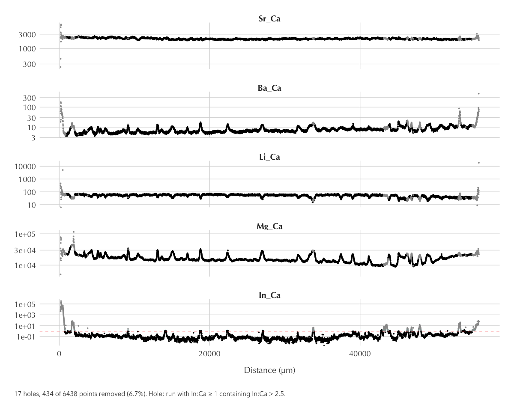<!-- -->

``` r
SMA001T <- h1$data[!h1$data$.hole, ]

# sanity check:
get_spikes(id = SMA001T) %>%
  round(digits = 2)
```

    #>    start_dist end_dist n_points max_In_Ca
    #> 1      769.00   803.56        4      0.77
    #> 2      967.73   985.01        3      0.59
    #> 3     1131.90  1373.83       29      0.94
    #> 4     1391.11  2056.43       27      1.26
    #> 5     9072.47  9115.67        6      0.64
    #> 6    14023.45 14222.18       24      1.32
    #> 7    18663.37 18896.66       28      1.13
    #> 8    22249.16 22447.89       24      1.29
    #> 9    27010.04 27122.37       14      1.31
    #> 10   31684.53 31710.45        4      0.61
    #> 11   33671.85 33879.21        8      0.95
    #> 12   39046.20 39141.24       12      0.91
    #> 13   39322.68 39400.44       10      0.86
    #> 14   39797.91 39815.19        3      0.63
    #> 15   41111.25 41163.09        7      0.70
    #> 16   42752.94 42934.41       22      1.68
    #> 17   43124.49 43781.16       11      0.97
    #> 18   43815.72 43841.64        4      0.66
    #> 19   43893.48 44023.11       16      1.23
    #> 20   45034.02 45172.26       17      1.02
    #> 21   46200.48 46425.15        8      1.00
    #> 22   46727.55 46934.91        5      0.81
    #> 23   47729.85 48135.93       10      0.97
    #> 24   49302.39 49319.70        3      0.55
    #> 25   53017.80 53976.90       68      1.62
    #> 26   53994.18 54020.10        4      0.59
    #> 27   54037.38 54210.18       20      0.85
    #> 28   54227.46 54262.02        5      0.57
    #> 29   54287.94 54305.22        3      0.69
    #> 30   54322.50 54382.98        8      0.68
    #> 31   54555.81 54901.41       41      0.96

#### Holes and smoothing

Removing the In spikes leaves holes. Smoothing runs on each piece
between holes on its own (`smooth_gaps()` in
`helpers/functions/fxn_gaps.R`), here and in the DTW scripts. Red is one
loess across everything (no sep chunks); blue is each piece on its own
between holes.

``` r
find_gaps(SMA001T$true_dist) # holes > 50 um (normal spacing ~8.6 um)
```

    #>       start       end
    #> 1  1589.841  2039.145
    #> 2 33715.020 33870.570
    #> 3 43124.490 43357.770
    #> 4 43375.050 43729.320
    #> 5 46226.400 46399.200
    #> 6 46736.190 46917.630
    #> 7 47773.050 48110.010
    #> 8 53035.080 53423.910

``` r
plot_smoothing(SMA001T, c("Sr_Ca", "Ba_Ca", "Li_Ca", "Mg_Ca"), span = 0.01, gap_um = 100) # no benefit - looks the same
```

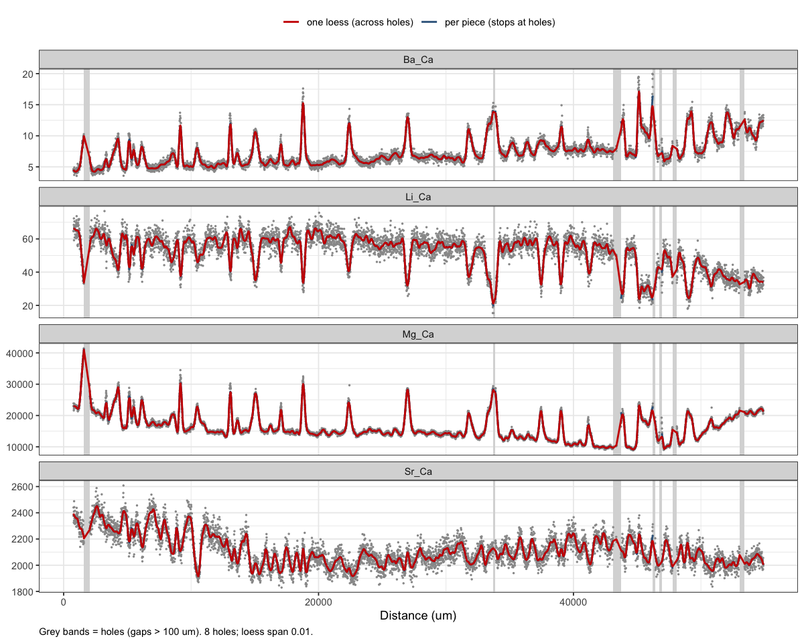<!-- -->

``` r
# remind myself... what is a window size of 21 (10 pts each side) in um:
samp_intt <- mean(diff(sort(SMA001T$true_dist)), na.rm = TRUE)
samp_intt*5 # ws(11) = 43 um
```

    #> [1] 45.0878

``` r
samp_intt*10 # ws(21) = 86 um
```

    #> [1] 90.1756

``` r
samp_intt*12 # ws(25) = 104 um
```

    #> [1] 108.2107

``` r
SMA001T_out <- profs(SMA001T, el_all, "tooth", # alt_denom = "Ba", # data types incl.
                      span = 0.02, window_size = 21, gap_um = 250, # smoothing
                      # img_path = "data/imgs/SMA001/SMA001HT/SMA001-H-sm.jpg", # cool visual
                      show_In = TRUE, In_style = "rect", rect_threshold = 0.75) # contamination check
```

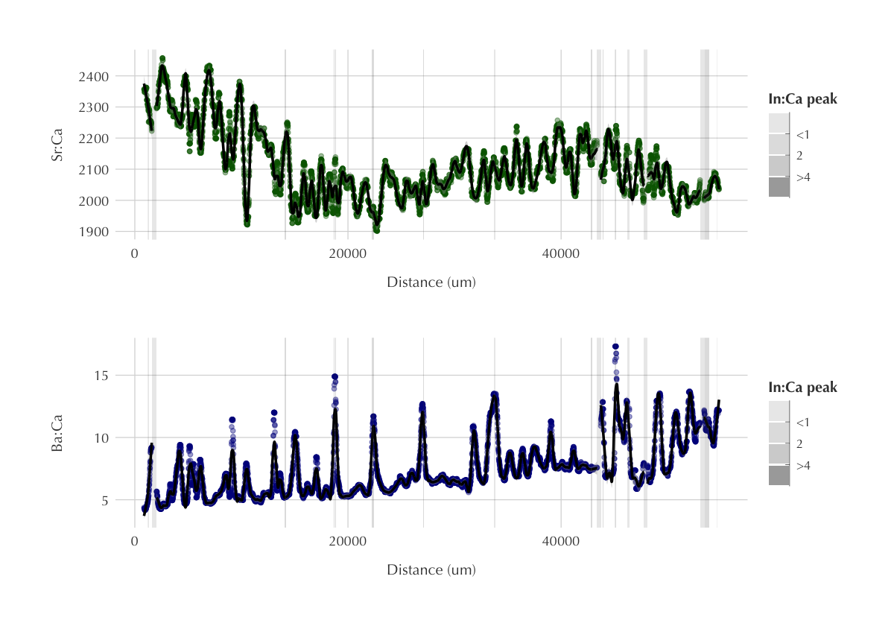<!-- -->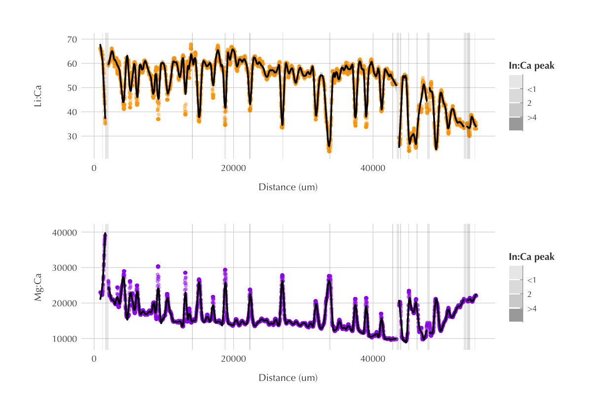<!-- -->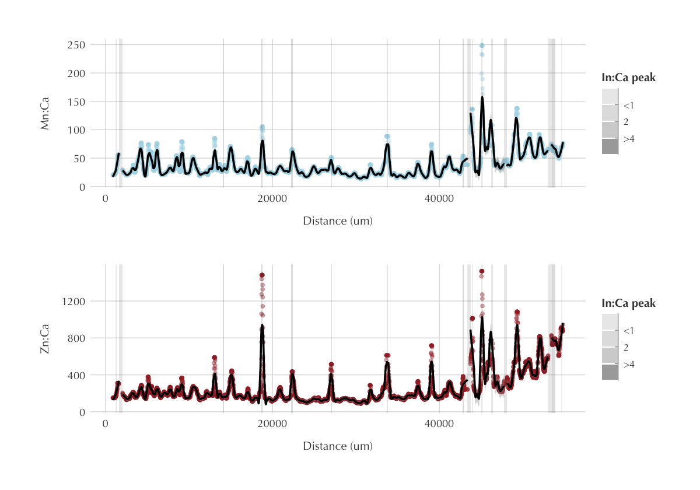<!-- -->

``` r
SMA001T_out$plots$Ca
```

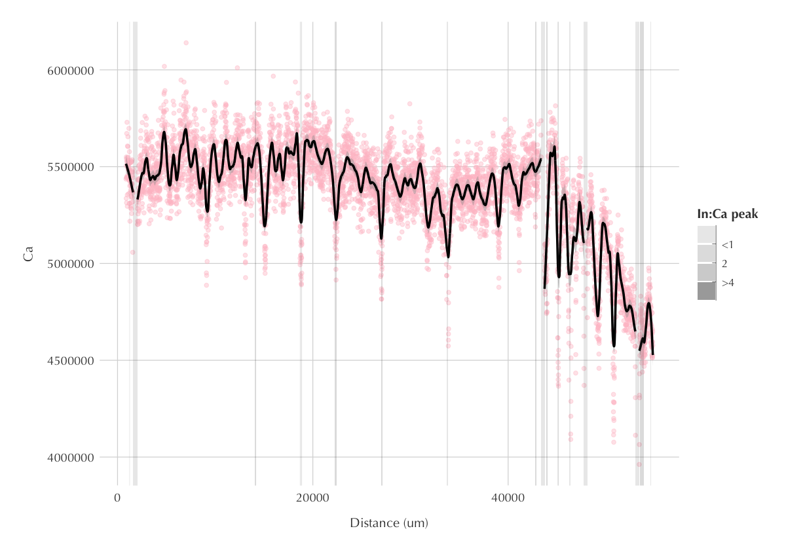<!-- -->

``` r
sma01a <- SMA001T_out$plots$Sr + theme(axis.title.x = element_blank(), axis.title.y = element_blank(), 
                                        legend.position = "none")
sma01b <- SMA001T_out$plots$Ba + theme(axis.title.x = element_blank(), axis.title.y = element_blank(), 
                                        legend.position = "none")
sma01c <- SMA001T_out$plots$Li + theme(axis.title.x = element_blank(), axis.title.y = element_blank(), 
                                        legend.position = "none")
sma01d <- SMA001T_out$plots$Mg + theme(axis.title.y = element_blank(), legend.position = "none")
sma01e <- SMA001T_out$plots$Mn 
```

### Vert

``` r
SMA001V <- transsplit[[57]] %>%
  filter(# true_dist >= 707,
    true_dist <= 10659.44) %>% na.omit()

get_spikes(id = SMA001V) %>%
  # filter(max_In_Ca >= 4) %>%
  round(digits = 2) # no holes, just In at start
```

    #>    start_dist end_dist n_points max_In_Ca
    #> 1       23.04  5639.33     1951    140.88
    #> 2     5650.85  5685.42       13      0.76
    #> 3     5800.62  5820.78        8      0.61
    #> 4     5829.42  5875.51       17      0.64
    #> 5     5881.27  5887.03        3      0.61
    #> 6     5892.79  5910.07        7      0.64
    #> 7     7785.04  7799.45        6      0.74
    #> 8     7923.29  7934.81        5      0.62
    #> 9     8735.49  8744.14        4      0.64
    #> 10   10584.55 10590.31        3      0.59
    #> 11   10630.63 10636.39        3      0.58

``` r
SMA001V_out <- profs(SMA001V, el_all, "vert", # alt_denom = "Ba",
                      # img_path = "data/imgs/SMA001/SMA001HV/SMA001-H-bw-crop.jpg",
                      span = 0.025, window_size = 31, # thin = 2,
                      show_In = FALSE)
```

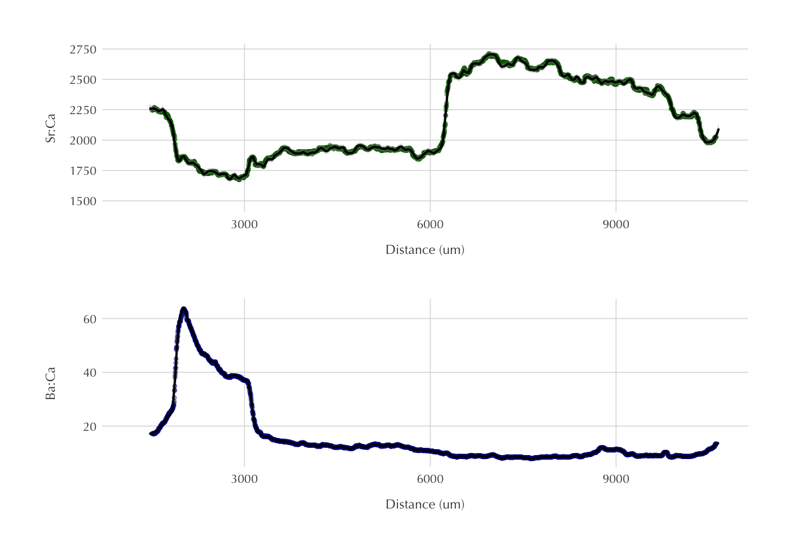<!-- -->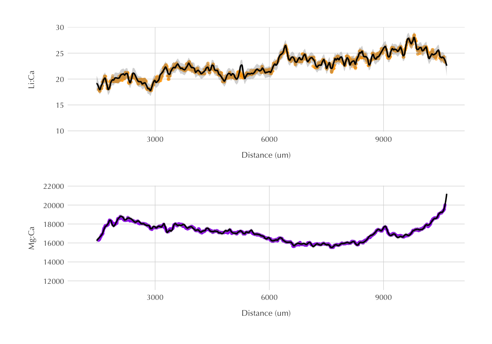<!-- -->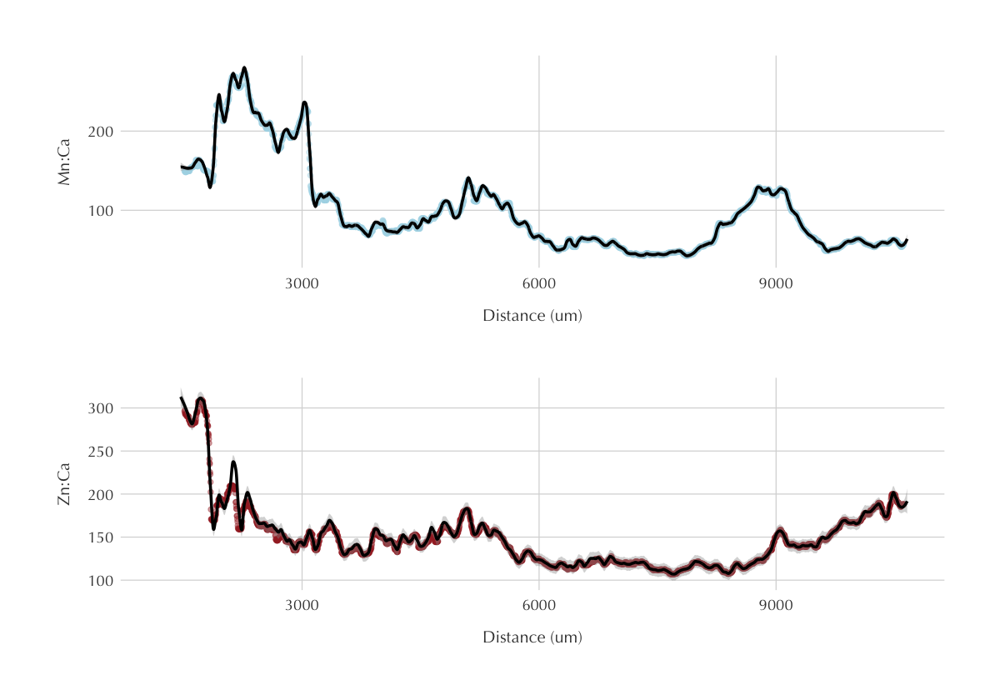<!-- -->

``` r
samp_intv <- mean(diff(sort(SMA001V$true_dist)), na.rm = TRUE)
samp_intv*10 # ws(21) = 29 um! much less, noisier
```

    #> [1] 28.80151

``` r
samp_intv*15 # ws(31) = 43, matching teeth
```

    #> [1] 43.20227

``` r
samp_intv*20 # ws(21) = 60 um
```

    #> [1] 57.60302

``` r
samp_intv*35 # ws(71) = 101 um
```

    #> [1] 100.8053

``` r
SMA001V_out$plots$Ca
```

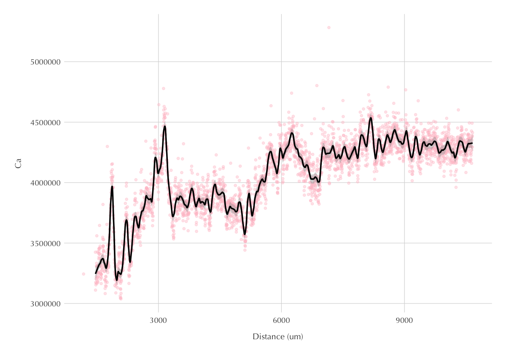<!-- -->

``` r
sma01va <- SMA001V_out$plots$Sr + theme(axis.title.x = element_blank(), axis.title.y = element_blank(), 
                                        legend.position = "none")
sma01vb <- SMA001V_out$plots$Ba + theme(axis.title.x = element_blank(), axis.title.y = element_blank(), 
                                        legend.position = "none")
sma01vc <- SMA001V_out$plots$Li + theme(axis.title.x = element_blank(), axis.title.y = element_blank(), 
                                        legend.position = "none")
sma01vd <- SMA001V_out$plots$Mg + theme(axis.title.y = element_blank(), legend.position = "none")
sma01ve <- SMA001V_out$plots$Mn 
```

### Figure (fig 6)

``` r
recta <- ggplot2::annotate("rect", xmin = 6100, xmax = 10800,
                          ymin = 1650, ymax = 2750,
                              fill = "lightgrey", alpha = 0.3)
sma01va$layers <- c(recta, sma01va$layers)

rectb <- ggplot2::annotate("rect", xmin = 6100, xmax = 10800,
                           ymin = 5, ymax = 42,
                           fill = "lightgrey", alpha = 0.3)
sma01vb$layers <- c(rectb, sma01vb$layers)

rectc <- ggplot2::annotate("rect", xmin = 6100, xmax = 10800,
                              ymin = 15, ymax = 29,
                              fill = "lightgrey", alpha = 0.3)
sma01vc$layers <- c(rectc, sma01vc$layers)

rectd <- ggplot2::annotate("rect", xmin = 6100, xmax = 10800,
                              ymin = 15450, ymax = 21000,
                   fill = "lightgrey", alpha = 0.3)
sma01vd$layers <- c(rectd, sma01vd$layers)

sma001a <- (sma01a + sma01va) / (sma01b + sma01vb) / (sma01c + sma01vc) / (sma01d + sma01vd) +
  plot_layout(widths = c(1, 1)) & theme(plot.margin = margin(5, 5, 5, 5))

ggsave(
  "SMA001VTH.png",
  plot = sma001a,
  device = NULL,
  path = 'figures/fig6',
  scale = 1,
  width = 8,
  height = 8,
  units = c("in", "cm", "mm", "px"),
  dpi = 300,
  limitsize = TRUE,
  bg = NULL,
)

sma001a
```

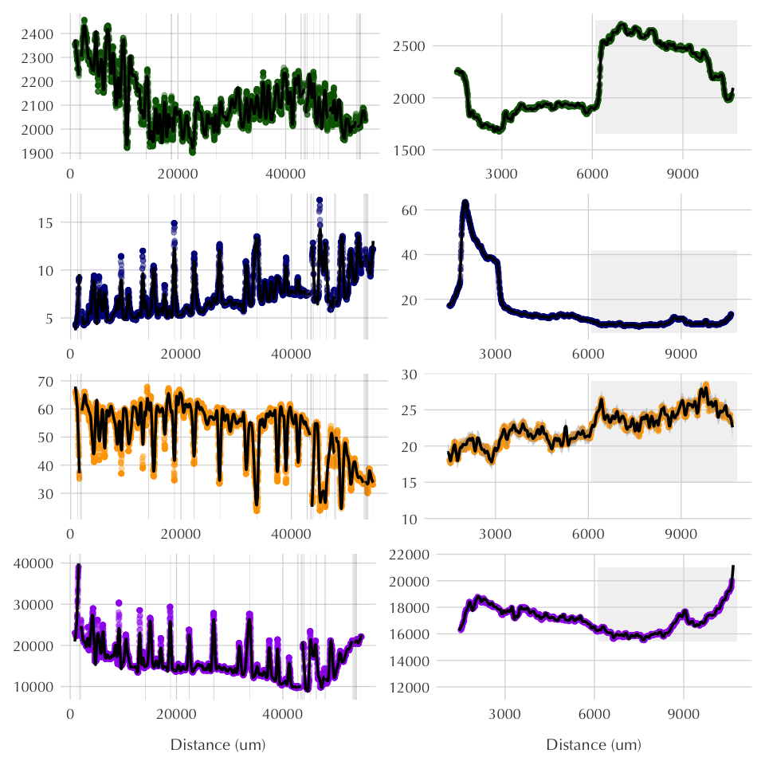<!-- -->

## Bleach

### Tooth

``` r
SMA001TB <- transsplit[[54]]  %>%
  filter(true_dist >= 164,
         true_dist <= 55369)

b1 <- plot_holes(SMA001TB, trigger =  2.5, release = 1,
                 elements = c("Sr_Ca", "Ba_Ca", "Li_Ca", "Mg_Ca"))
```

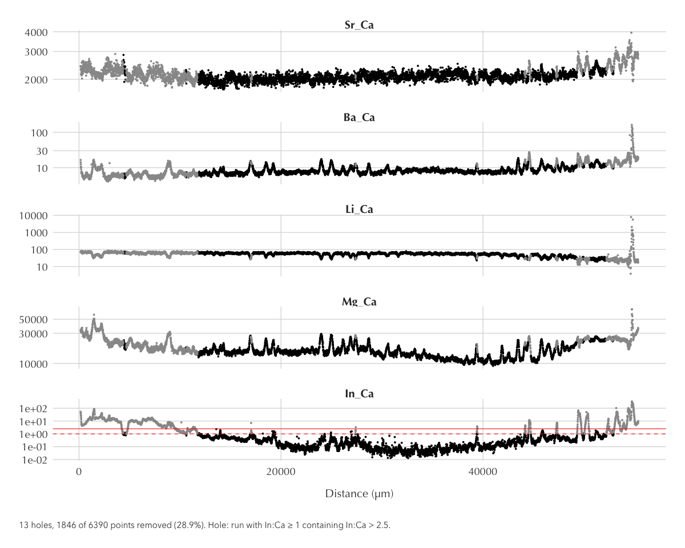<!-- -->

``` r
SMA001TB <- b1$data[!b1$data$.hole, ]

get_spikes(SMA001TB)
```

    #>    start_dist end_dist n_points max_In_Ca
    #> 1     4389.36 12252.15      108 1.2187209
    #> 2    12269.43 12424.98       19 0.7176039
    #> 3    12442.26 12943.38       59 0.9508362
    #> 4    13470.48 13487.73        3 0.5530212
    #> 5    13530.96 13651.92       15 2.3408535
    #> 6    13677.84 13695.12        3 0.5679654
    #> 7    13729.68 13781.52        7 0.5949925
    #> 8    13824.72 13876.56        7 0.7291294
    #> 9    13893.84 14187.63       35 1.8788336
    #> 10   14222.19 14256.75        5 0.6751430
    #> 11   14274.03 14291.31        3 0.5986350
    #> 12   14308.59 14559.15       30 0.8848732
    #> 13   14576.43 14602.38        4 0.5676711
    #> 14   14697.42 14714.70        3 0.6089223
    #> 15   15086.22 15112.14        4 0.5829259
    #> 16   15163.98 15181.26        3 0.5683995
    #> 17   15198.57 15215.85        3 0.5585647
    #> 18   15259.05 15276.33        3 0.5538204
    #> 19   15388.65 15423.21        5 0.6002195
    #> 20   16874.79 17159.94       20 1.0656685
    #> 21   17237.70 17393.22       19 0.8337319
    #> 22   17410.50 17453.70        6 0.6899780
    #> 23   19138.59 19354.62       26 1.6193397
    #> 24   19371.90 19441.02        9 1.3200877
    #> 25   24253.74 24357.42       13 0.9815175
    #> 26   24919.05 24970.89        7 1.2886211
    #> 27   26975.49 27018.69        6 1.5704291
    #> 28   27347.03 27364.31        3 0.9865388
    #> 29   27554.40 27658.08       13 0.9423156
    #> 30   39357.25 39469.58        5 1.0449221
    #> 31   43375.06 43435.54        8 0.6292077
    #> 32   43556.51 43582.43        4 0.5266190
    #> 33   44083.58 44247.75        7 1.0327281
    #> 34   44472.40 44774.81        7 0.8667575
    #> 35   45699.34 46114.08       49 1.8736106
    #> 36   46165.93 46183.21        3 0.6717285
    #> 37   46839.88 47021.33       22 0.8119020
    #> 38   47133.66 47150.94        3 0.5599818
    #> 39   47168.22 47427.43       10 0.8973112
    #> 40   47479.28 47582.96       13 0.7270143
    #> 41   47824.89 47859.46        5 0.5774367
    #> 42   47928.58 48101.39       21 0.6684259
    #> 43   48308.76 48351.96        6 0.6122704
    #> 44   49293.77 49898.60       14 0.8914588
    #> 45   49976.36 49993.64        3 1.1108405
    #> 46   50010.93 50563.91        8 1.5908099
    #> 47   51090.98 51626.69       63 1.8030129
    #> 48   51652.61 51687.17        5 0.6333128
    #> 49   51739.02 51790.86        7 0.5902178
    #> 50   51885.90 52922.76       55 1.7866350

#### Holes and smoothing

``` r
find_gaps(SMA001TB$true_dist) # holes > 50 um (normal spacing ~8.6 um)
```

    #>       start      end
    #> 1   4674.48 10549.98
    #> 2  10653.69 11733.75
    #> 3  16995.78 17125.38
    #> 4  27364.31 27416.15
    #> 5  39383.17 39469.58
    #> 6  44118.14 44239.11
    #> 7  44489.68 44748.89
    #> 8  47211.42 47401.51
    #> 9  49311.05 49812.19
    #> 10 50036.85 50537.99
    #> 11 52214.24 52793.15

``` r
plot_smoothing(SMA001TB, c("Sr_Ca", "Ba_Ca", "Li_Ca", "Mg_Ca"), span = 0.01)
```

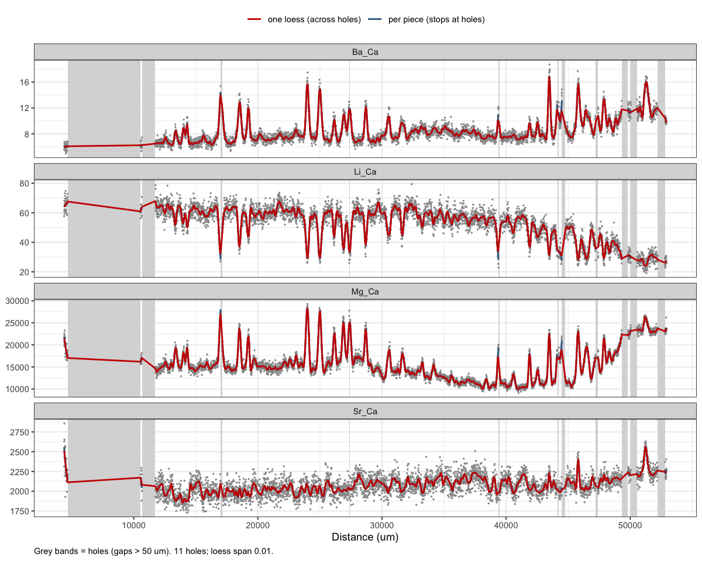<!-- -->

``` r
SMA001TB_out <- profs(SMA001TB, el_all, "tooth",
                       # alt_denom = "Ba",
                      span = 0.02, window_size = 21, gap_um = 250, # smoothing
                      show_In = TRUE, In_style = "rect")
```

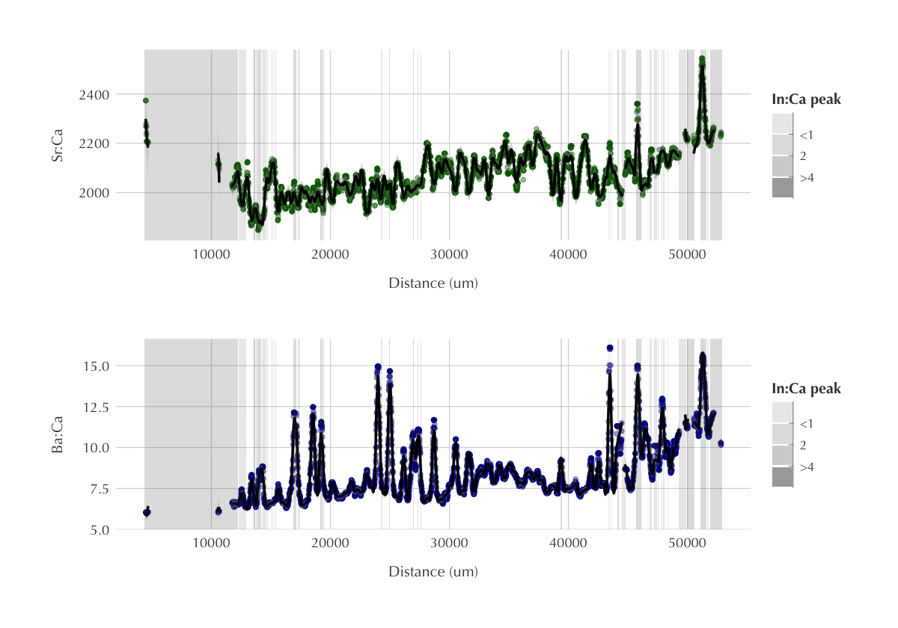<!-- -->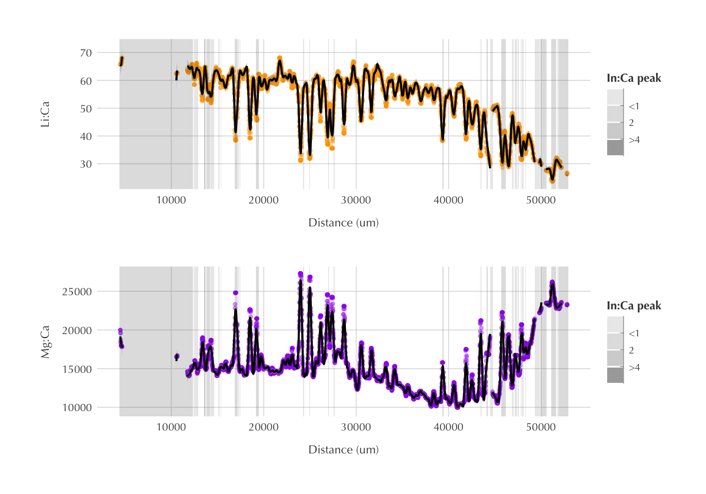<!-- -->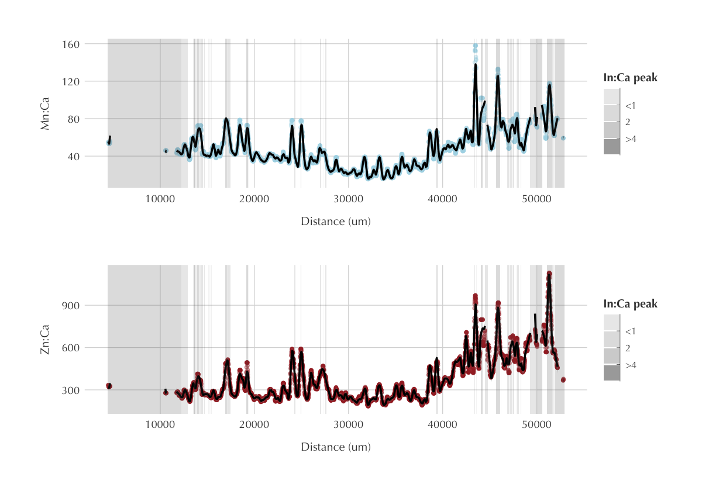<!-- -->

``` r
SMA001TB_out$plots$Ca
```

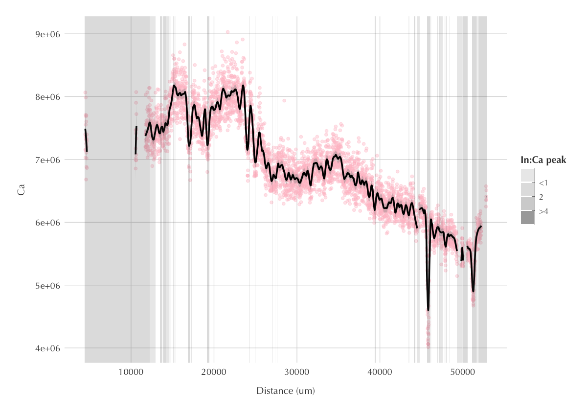<!-- -->

``` r
sma01a2 <- SMA001TB_out$plots$Sr + theme(axis.title.x = element_blank(), axis.title.y = element_blank(), 
                                        legend.position = "none")
sma01b2 <- SMA001TB_out$plots$Ba + theme(axis.title.x = element_blank(), axis.title.y = element_blank(), 
                                        legend.position = "none")
sma01c2 <- SMA001TB_out$plots$Li + theme(axis.title.x = element_blank(), axis.title.y = element_blank(), 
                                        legend.position = "none")
sma01d2 <- SMA001TB_out$plots$Mg + theme(axis.title.y = element_blank(), legend.position = "none")
sma01e2 <- SMA001TB_out$plots$Mn 
```

### Vert

``` r
SMA001VB <- transsplit[[56]] %>%
  filter(true_dist> 745, true_dist <= 9968.2)

get_spikes(id = SMA001VB) %>%
  # filter(max_In_Ca >= 2) %>%
  round(digits = 2)
```

    #>    start_dist end_dist n_points max_In_Ca
    #> 1      745.96  5529.89     1662     57.42
    #> 2     5541.41  5555.81        6      0.60
    #> 3     5624.93  5633.57        4      0.61
    #> 4     5645.10  5650.85        3      0.57
    #> 5     5656.62  5668.14        5      0.56
    #> 6     5685.42  5691.18        3      0.54
    #> 7     5771.82  5777.58        3      0.53
    #> 8     6028.15  6033.91        3      0.58
    #> 9     6074.24  6080.00        3      0.59
    #> 10    6097.28  6537.94      154      1.00
    #> 11    6543.70  6618.59       27      0.67
    #> 12    7453.83  7482.63       11      0.65
    #> 13    8571.33  8738.38       59      2.98
    #> 14    9354.73  9360.49        3      0.53
    #> 15    9406.57  9435.37       11      0.65

``` r
SMA001VB_out <- profs(SMA001VB, el_all, "vert", # alt_denom = "Ba",
                       span = 0.025, window_size = 31,
                       show_In = FALSE) # wow that is cool
```

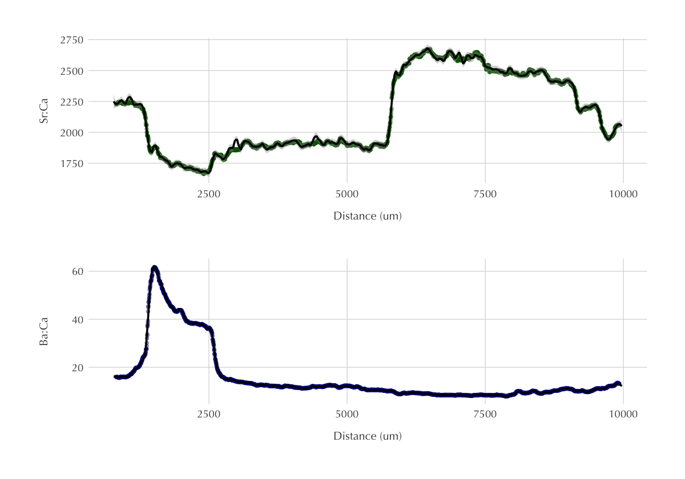<!-- -->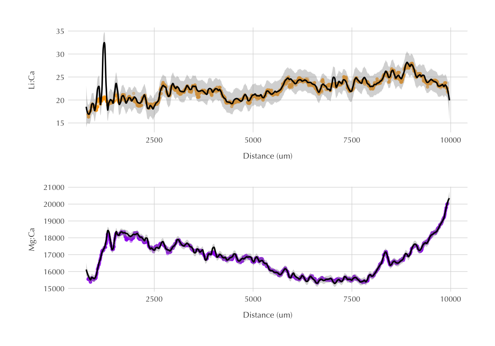<!-- -->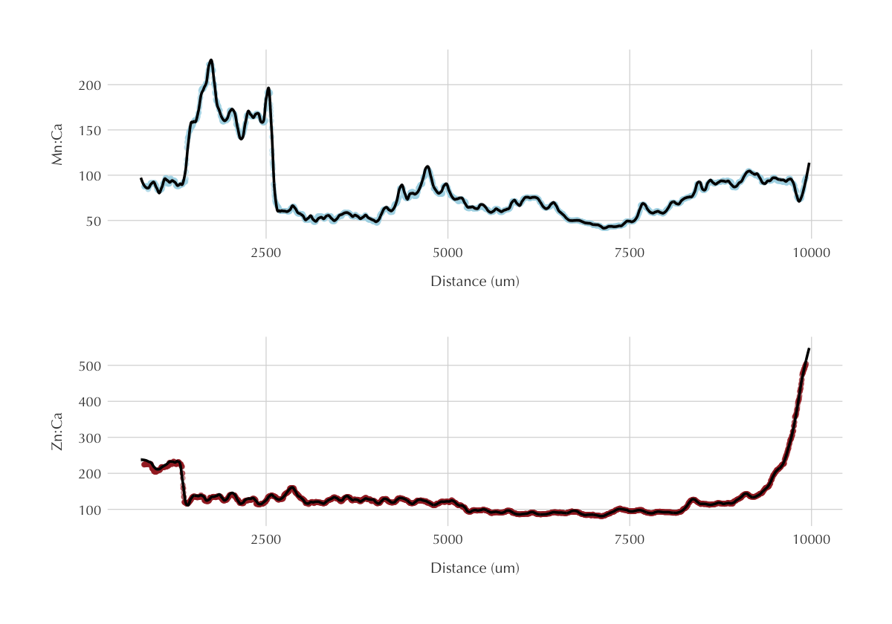<!-- -->

``` r
SMA001VB_out$plots$Ca
```

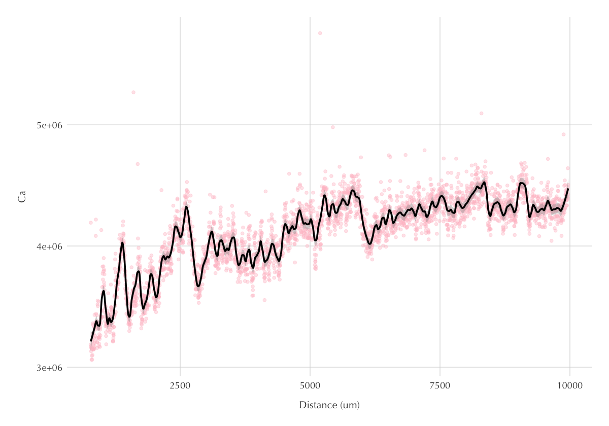<!-- -->

``` r
sma01va2 <- SMA001VB_out$plots$Sr + theme(axis.title.x = element_blank(), axis.title.y = element_blank(), 
                                        legend.position = "none")
sma01vb2 <- SMA001VB_out$plots$Ba + theme(axis.title.x = element_blank(), axis.title.y = element_blank(), 
                                        legend.position = "none")
sma01vc2 <- SMA001VB_out$plots$Li + theme(axis.title.x = element_blank(), axis.title.y = element_blank(), 
                                        legend.position = "none")
sma01vd2 <- SMA001VB_out$plots$Mg + theme(axis.title.y = element_blank(), legend.position = "none")
sma01ve2 <- SMA001VB_out$plots$Mn
```

### Figure (fig 6)

``` r
recta <- ggplot2::annotate("rect", xmin = 6100, xmax = 10000,
                           ymin = 1650, ymax = 2650,
                           fill = "lightgrey", alpha = 0.3)
sma01va2$layers <- c(recta, sma01va2$layers)

rectb <- ggplot2::annotate("rect", xmin = 6100, xmax = 10000,
                           ymin = 5, ymax = 62,
                           fill = "lightgrey", alpha = 0.3)
sma01vb2$layers <- c(rectb, sma01vb2$layers)

rectc <- ggplot2::annotate("rect", xmin = 6100, xmax = 10000,
                           ymin = 15, ymax = 28,
                           fill = "lightgrey", alpha = 0.3)
sma01vc2$layers <- c(rectc, sma01vc2$layers)

rectd <- ggplot2::annotate("rect", xmin = 6100, xmax = 10000,
                           ymin = 15450, ymax = 20200,
                           fill = "lightgrey", alpha = 0.3)
sma01vd2$layers <- c(rectd, sma01vd2$layers)

sma001b <- (sma01a2 + sma01va2) / (sma01b2 + sma01vb2) / (sma01c2 + sma01vc2) / (sma01d2 + sma01vd2) &
  theme(plot.margin = margin(5, 5, 5, 5)) #thats ... identical

ggsave(
  "SMA001VTB.png",
  plot = sma001b,
  device = NULL,
  path = 'figures/fig6',
  scale = 1,
  width = 8,
  height = 8,
  units = c("in", "cm", "mm", "px"),
  dpi = 300,
  limitsize = TRUE,
  bg = NULL,
)

sma001b
```

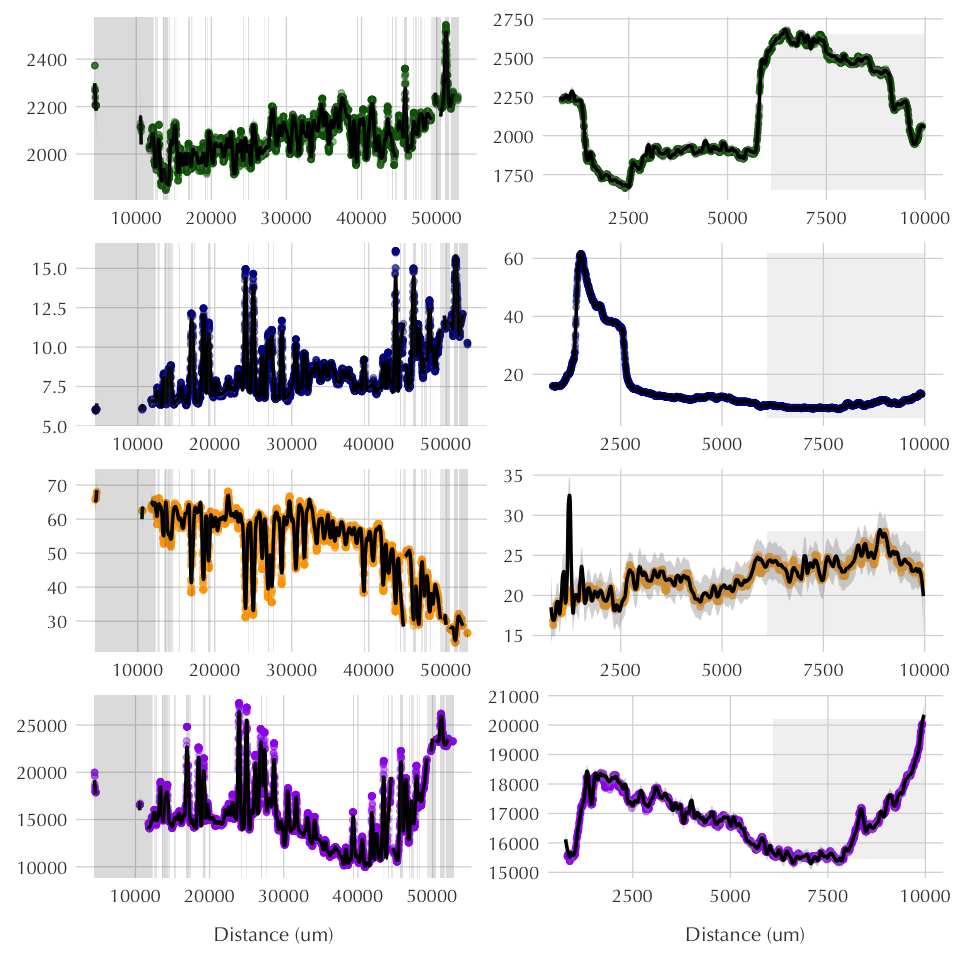<!-- -->
