06a · DTW prep
================
Nikki Biskis
Rendered 27 Oct 2026 21:46

- [Check other ratios](#check-other-ratios)
- [Apply mavs](#apply-mavs)
- [Filters](#filters)
  - [SMA001 tooth (water)](#sma001-tooth-water)
  - [SMA001 tooth (bleach)](#sma001-tooth-bleach)
  - [SMA001 vert (water)](#sma001-vert-water)
  - [SMA001 vert (bleach)](#sma001-vert-bleach)
  - [SMA002 tooth (bleach)](#sma002-tooth-bleach)
  - [SMA002 tooth (water)](#sma002-tooth-water)
  - [SMA002 vert (bleach)](#sma002-vert-bleach)
- [Mav column names](#mav-column-names)
- [Replicate check](#replicate-check)
  - [Tooth](#tooth)
  - [Vertebra](#vertebra)
- [Save for 06b–06e](#save-for-06b06e)

- **Paper:** The potential of elemental analysis in determining origin
  of sawfish rostra
- **DOI:** tbd
- **Written:** 8 Jul 2026
- **Content:** dynamic time warping strategy

R markdown version of `06a_dtw_prep.R`. The objects made here are saved
to `data/output/dtw_cache/06a.RData` at the end, and 06b–06e load that
file.

``` r
source('helpers/functions/fxn_dtw.R')
source('helpers/functions/fxn_profile.R')
source('helpers/functions/fxn_mavs.R')
source('helpers/microHelp.R')
transsplit <- readRDS('data/output/transsplit.RDS')
names(transsplit)
```

    #>  [1] "055HTsctBase"  "055HTsctMid"   "055HTsctTip"   "3149"         
    #>  [5] "3150TrsctBase" "3150TrsctMid"  "3150TrsctTip"  "3151"         
    #>  [9] "3158TrscBase"  "3158TrscMid"   "3158TrscTip"   "4224Transect" 
    #> [13] "4228TsctBase"  "4228TsctMid"   "4228TsctTip"   "437TsctBase"  
    #> [17] "437TsctMid"    "437TsctTip"    "4462Transect"  "4468"         
    #> [21] "4469HBase"     "4469CrossT2"   "4469FullT2"    "4469HMid"     
    #> [25] "4469HTip"      "448HTsctBase"  "448HTsctMid"   "448HTsctTip"  
    #> [29] "480BTT"        "480HTT"        "480BVT"        "480HVT"       
    #> [33] "482BTT"        "482BVT"        "482HVT"        "483BTT"       
    #> [37] "483HTT"        "483BVT"        "483HVT"        "484BTT"       
    #> [41] "484HTT"        "484BVT"        "484HVT"        "485BTT"       
    #> [45] "485HTT"        "485BVT"        "485HVT"        "486BTT"       
    #> [49] "486HTT"        "486BVT"        "486HVT"        "NB028B"       
    #> [53] "NB028Transect" "SMA001BT-TR"   "SMA001HT"      "SMA001BV"     
    #> [57] "SMA001HV"      "SMA002BT-TR"   "SMA002HT"      "SMA002BV"

``` r
plot_els <- c('Sr_Ca', 'Ba_Ca', 'Mg_Ca', 'Li_Ca')
elsg <- els[!els %in% c("Cu_Ca", "Pb_Ca", 'Ni_Ca')]
SMA001TB <- get_spikes(transsplit[[54]], threshold = 2.5, release = 1.25, min_points = 1, drop = TRUE)
SMA001T <- get_spikes(transsplit[[55]], threshold = 2.5, release = 1.25, min_points = 1, drop = TRUE)
SMA001VB <- transsplit[[56]]
SMA001V <- transsplit[[57]]
SMA002TB <- get_spikes(transsplit[[58]], threshold = 2.5, release = 1.25, min_points = 1, drop = TRUE)
SMA002T <- get_spikes(transsplit[[59]], threshold = 2.5, release = 1.25, min_points = 1, drop = TRUE)
SMA002V <- transsplit[[60]]
```

## Check other ratios

``` r
plot_els_ba <- c('Sr_Ba', 'Mg_Ba', 'Li_Ba', 'Mn_Ba', 'Zn_Ba')
plot_els_mg <- c('Sr_Mg', 'Ba_Mg', 'Li_Mg', 'Mn_Mg', 'Zn_Mg')
denoms   <- c('Ba', 'Mg')
plot_els_xc <- c('Sr', 'Ba', 'Mg', 'Li', 'Mn', 'Zn') # feels inefficient w/e

dfs <- list(SMA001TB = SMA001TB, SMA001T = SMA001T, SMA001VB = SMA001VB, SMA001V = SMA001V,
            SMA002TB = SMA002TB, SMA002T = SMA002T, SMA002V = SMA002V)
dfs <- lapply(dfs, add_alt, elements = plot_els_xc, denoms = denoms)
list2env(dfs, envir = .GlobalEnv)
```

    #> <environment: R_GlobalEnv>

## Apply mavs

``` r
allmavs <- Reduce(union, list(elsg, plot_els_ba, plot_els_mg, 'In_Ca'))

SMA001TB <- add_mavs(SMA001TB, ratio_columns = allmavs, window_size = 21, gap_um = 350) # 21 pts x 8.6 um = 181 um (~3.6 spots); verts 61 x 2.9 = 176 um (~3.5 spots)
SMA001T <- add_mavs(SMA001T, ratio_columns = allmavs, window_size = 21, gap_um = 350)
SMA001VB <- add_mavs(SMA001VB, ratio_columns = allmavs, window_size = 61)
SMA001V <- add_mavs(SMA001V, ratio_columns = allmavs, window_size = 61)

SMA002TB <- add_mavs(SMA002TB, ratio_columns = allmavs, window_size = 21, gap_um = 350)
SMA002T <- add_mavs(SMA002T, ratio_columns = allmavs, window_size = 21, gap_um = 350)
SMA002V <- add_mavs(SMA002V, ratio_columns = allmavs, window_size = 61)

names(SMA001TB)
```

    #>  [1] "SpecID"        "Species"       "Type"          "Loc"          
    #>  [5] "Bath"          "ID"            "ElapsedTime_s" "speed"        
    #>  [9] "distance"      "Ca43_CPS"      "IntStdWv"      "Li_Ca"        
    #> [13] "B_Ca"          "Na_Ca"         "Mg_Ca"         "Mn_Ca"        
    #> [17] "Ni_Ca"         "Cu_Ca"         "Zn_Ca"         "Sr_Ca"        
    #> [21] "In_Ca"         "Ba_Ca"         "Pb_Ca"         "Speed"        
    #> [25] "true_dist"     "Sr_Ba"         "Mg_Ba"         "Li_Ba"        
    #> [29] "Mn_Ba"         "Zn_Ba"         "Sr_Mg"         "Ba_Mg"        
    #> [33] "Li_Mg"         "Mn_Mg"         "Zn_Mg"         "Li_Ca_mav"    
    #> [37] "B_Ca_mav"      "Mg_Ca_mav"     "Mn_Ca_mav"     "Zn_Ca_mav"    
    #> [41] "Sr_Ca_mav"     "Ba_Ca_mav"     "Sr_Ba_mav"     "Mg_Ba_mav"    
    #> [45] "Li_Ba_mav"     "Mn_Ba_mav"     "Zn_Ba_mav"     "Sr_Mg_mav"    
    #> [49] "Ba_Mg_mav"     "Li_Mg_mav"     "Mn_Mg_mav"     "Zn_Mg_mav"    
    #> [53] "In_Ca_mav"

## Filters

### SMA001 tooth (water)

``` r
SMA001T_filt <- SMA001T %>% filter(true_dist >= 650, true_dist <= 55583) %>% na.omit()
make_plot(SMA001T_filt, 'Sr_Ca', color = "brown", 'Sr_Ca', span = 0.01, show_In = TRUE)
```

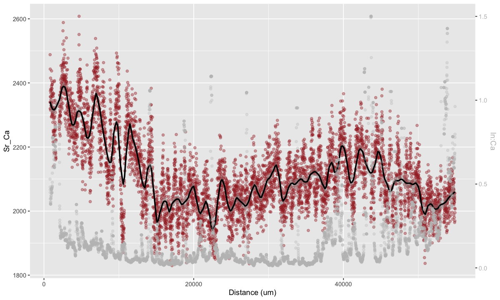<!-- -->

### SMA001 tooth (bleach)

``` r
SMA001TB_filt <- SMA001TB %>% filter(true_dist >= 12000, # remove na (overcautious but to be safe)
                                     true_dist <= 55402) %>% na.omit()
make_plot(SMA001TB_filt, 'Sr_Ca', color = "brown", 'Sr_Ca', span = 0.01, show_In = TRUE)
```

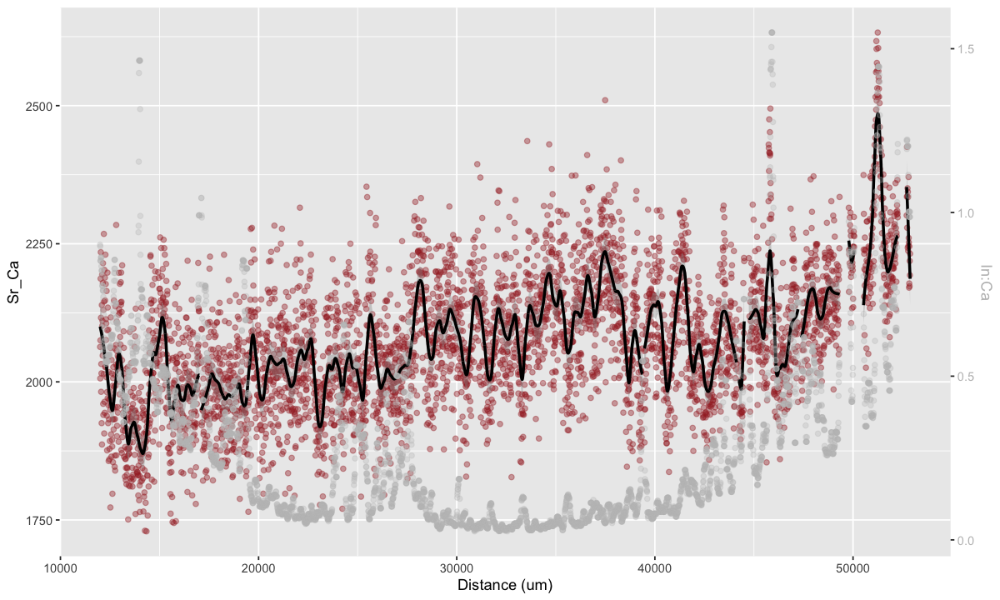<!-- -->

### SMA001 vert (water)

``` r
SMA001V_filt <- SMA001V %>% filter(true_dist >= 710, true_dist <= 10659) %>% na.omit()
make_plot(SMA001V_filt, 'Sr_Ca', color = "brown", 'Sr_Ca', span = 0.02, show_In = FALSE)
```

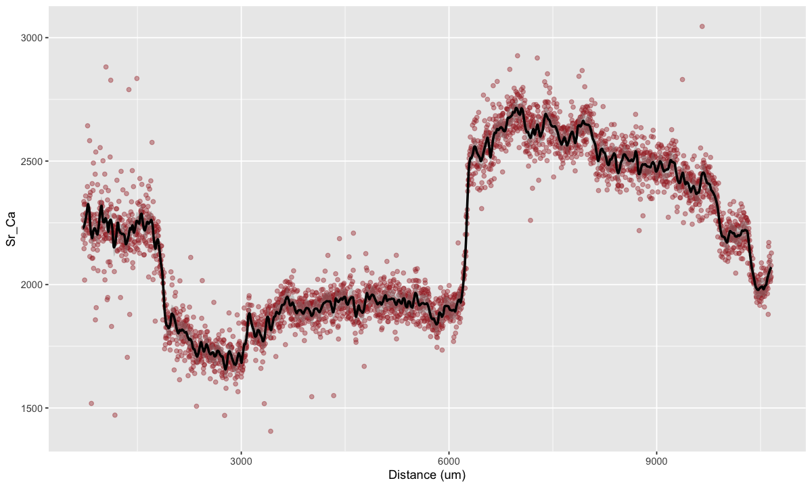<!-- -->

### SMA001 vert (bleach)

``` r
SMA001VB_filt <- SMA001VB %>% filter(true_dist >= 745, true_dist <= 9968) %>% na.omit() # from measurements
make_plot(SMA001VB_filt, 'Sr_Ca', color = "brown", 'Sr_Ca', span = 0.02, show_In = FALSE)
```

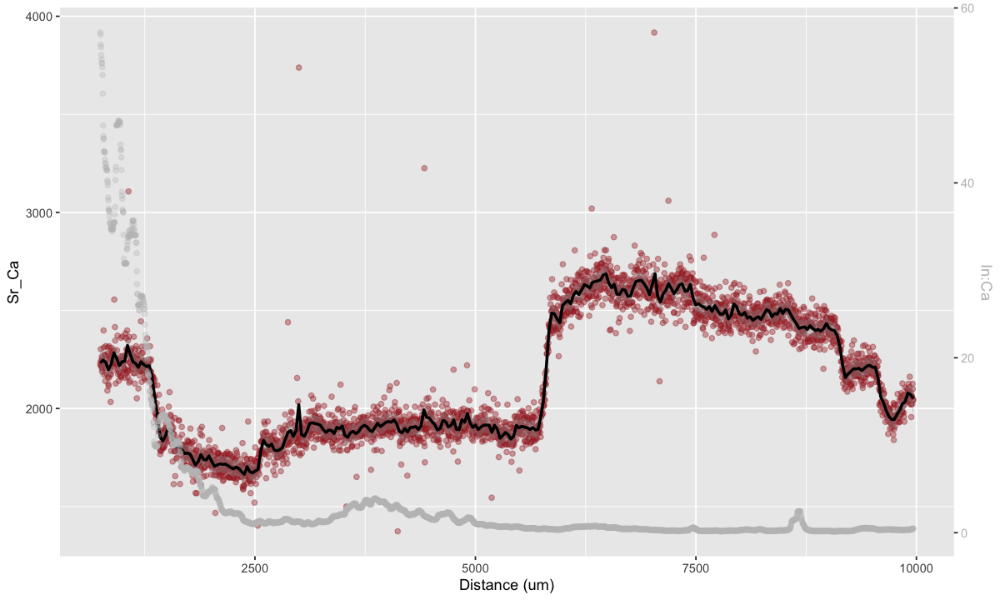<!-- -->

### SMA002 tooth (bleach)

``` r
SMA002TB_filt <- SMA002TB %>% filter(true_dist <= 49907) %>% na.omit() # yuck - toss
make_plot(SMA002TB_filt, 'Sr_Ca', color = "brown", 'Sr_Ca', span = 0.01, show_In = TRUE, In_style = "points")
```

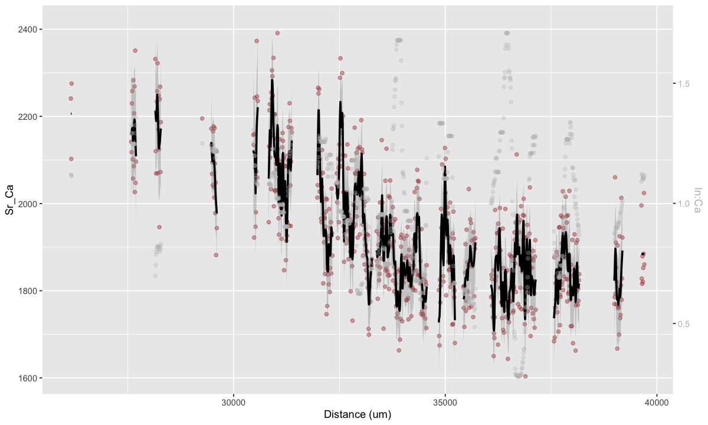<!-- -->

### SMA002 tooth (water)

``` r
SMA002T_filt <- SMA002T %>% na.omit() # he's great tho!
make_plot(SMA002T_filt, 'Sr_Ca', color = "brown", 'Sr_Ca', span = 0.01, show_In = TRUE, In_style = "points")
```

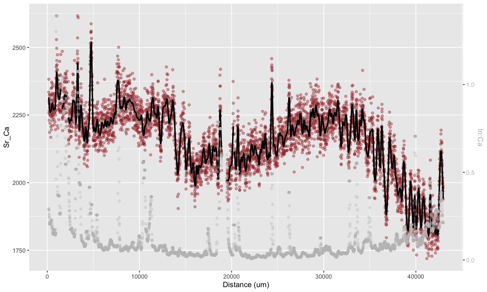<!-- -->

### SMA002 vert (bleach)

``` r
SMA002V_filt <- SMA002V %>% filter(true_dist >= 334, true_dist <= 7952) %>% na.omit() # from measurements
make_plot(SMA002V_filt, 'Sr_Ca', color = "brown", 'Sr_Ca', span = 0.02, show_In = FALSE)
```

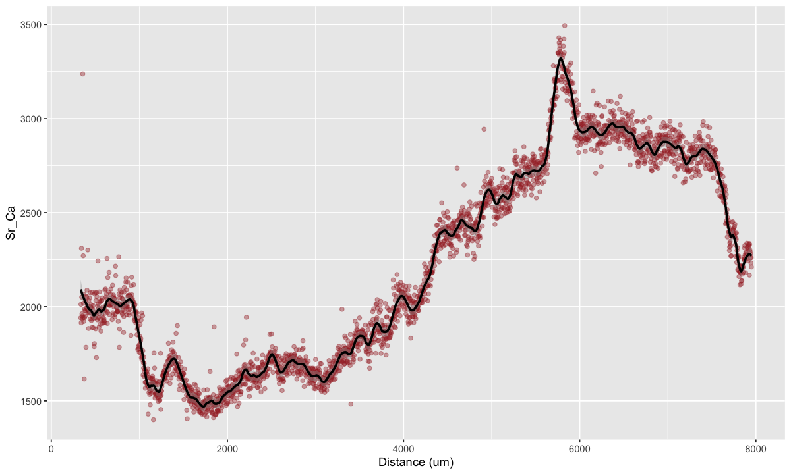<!-- -->

## Mav column names

``` r
# get the name for mavs cols!
names(SMA001TB_filt) # they arent nearly as good - lose too much detail with smoothing
```

    #>  [1] "SpecID"        "Species"       "Type"          "Loc"          
    #>  [5] "Bath"          "ID"            "ElapsedTime_s" "speed"        
    #>  [9] "distance"      "Ca43_CPS"      "IntStdWv"      "Li_Ca"        
    #> [13] "B_Ca"          "Na_Ca"         "Mg_Ca"         "Mn_Ca"        
    #> [17] "Ni_Ca"         "Cu_Ca"         "Zn_Ca"         "Sr_Ca"        
    #> [21] "In_Ca"         "Ba_Ca"         "Pb_Ca"         "Speed"        
    #> [25] "true_dist"     "Sr_Ba"         "Mg_Ba"         "Li_Ba"        
    #> [29] "Mn_Ba"         "Zn_Ba"         "Sr_Mg"         "Ba_Mg"        
    #> [33] "Li_Mg"         "Mn_Mg"         "Zn_Mg"         "Li_Ca_mav"    
    #> [37] "B_Ca_mav"      "Mg_Ca_mav"     "Mn_Ca_mav"     "Zn_Ca_mav"    
    #> [41] "Sr_Ca_mav"     "Ba_Ca_mav"     "Sr_Ba_mav"     "Mg_Ba_mav"    
    #> [45] "Li_Ba_mav"     "Mn_Ba_mav"     "Zn_Ba_mav"     "Sr_Mg_mav"    
    #> [49] "Ba_Mg_mav"     "Li_Mg_mav"     "Mn_Mg_mav"     "Zn_Mg_mav"    
    #> [53] "In_Ca_mav"

``` r
mavs1 <- c('Sr_Ca_mav', 'Ba_Ca_mav', 'Li_Ca_mav', 'Mg_Ca_mav')
mavs2 <- c('Sr_Ca_mav', 'Ba_Ca_mav', 'Li_Ca_mav', 'Mg_Ca_mav', 'Mn_Ca_mav', 'Zn_Ca_mav')
mavsb <- names(SMA001VB_filt)[43:47]
mavsm <- names(SMA001VB_filt)[48:51]
```

## Replicate check

The rolling medians above are the only smoothing in the DTW (06b–06f);
there is no loess. Their width is tested in 06a2: breakpoints stop
moving from about one spot width (50 µm), and 21 tooth points (181 µm)
and 61 vertebra points (176 µm), about 3.5 spots each, are used.

As a check that this is enough, each pair of replicate transects of the
same structure (SMA001’s tooth sectioned for water and bleach; likewise
its vertebra) is aligned. They record the same growth, so the warping
path should be close to a straight line: **warp_r2** is how straight it
is (R² of a straight line through the path, 1 = straight) and
**warp_slope** its slope (1 = the same length); **norm_dist** is the DTW
fit (lower = closer). In `align_els()`’s figures, “tooth” is the first
replicate and “vertebra” the second.

### Tooth

``` r
rep_fit <- function(a, b) {
  g <- align_grid(a, b, mavs2, spans = 0, ns = 2000)   # spans = 0: medians only
  g$element <- sub("_mav$", "", g$element)
  g[c("element", "norm_dist", "warp_slope", "warp_r2", "startA", "endA", "startB", "endB")]
}
knitr::kable(rep_fit(SMA001TB_filt, SMA001T_filt), digits = 2)
```

| element | norm_dist | warp_slope | warp_r2 |   startA |     endA |   startB |     endB |
|:--------|----------:|-----------:|--------:|---------:|---------:|---------:|---------:|
| Sr_Ca   |      0.25 |       0.65 |    0.98 | 12001.59 | 52836.35 | 14481.39 | 45163.62 |
| Ba_Ca   |      0.24 |       0.72 |    0.99 | 12001.59 | 52836.35 |  4562.16 | 39158.52 |
| Li_Ca   |      0.18 |       0.75 |    0.97 | 12001.59 | 52836.35 |  1131.90 | 33948.33 |
| Mg_Ca   |      0.27 |       0.72 |    0.97 | 12001.59 | 52836.35 | 12900.19 | 45111.78 |
| Mn_Ca   |      0.22 |       0.82 |    0.99 | 12001.59 | 52836.35 | 12459.53 | 53605.35 |
| Zn_Ca   |      0.21 |       0.73 |    0.98 | 12001.59 | 52836.35 | 15751.54 | 52577.13 |

``` r
tooth_els <- align_els(SMA001TB_filt, SMA001T_filt, elements = mavs2, n = 2000)
```

    #> Sr_Ca_mav 
    #>  Tooth: 12001.59 to 52836.35 
    #>  Vert:  14481.39 to 45163.62 
    #>  Normalized distance: 0.2518227

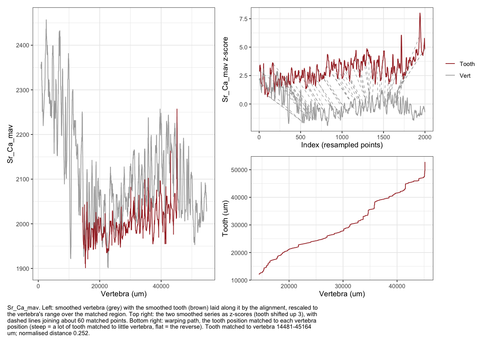<!-- -->

    #> Ba_Ca_mav 
    #>  Tooth: 12001.59 to 52836.35 
    #>  Vert:  4562.157 to 39158.52 
    #>  Normalized distance: 0.2411154

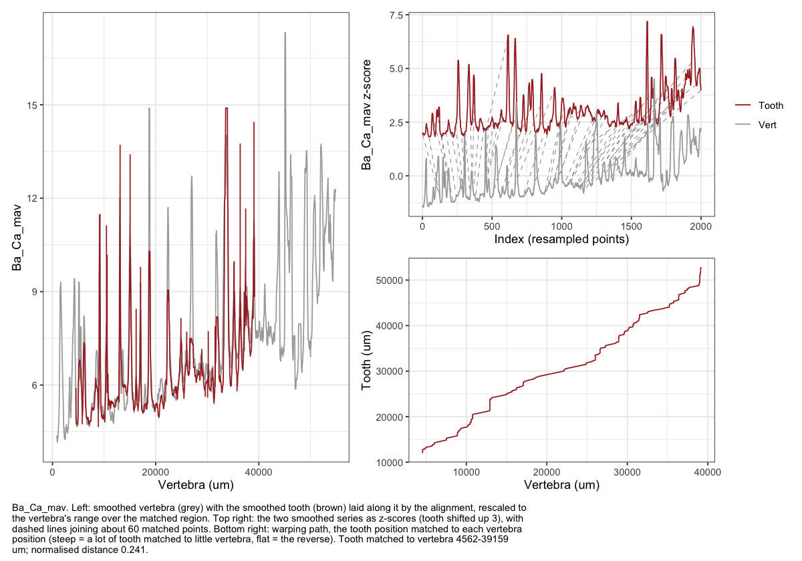<!-- -->

    #> Li_Ca_mav 
    #>  Tooth: 12001.59 to 52836.35 
    #>  Vert:  1131.9 to 33948.33 
    #>  Normalized distance: 0.1843885

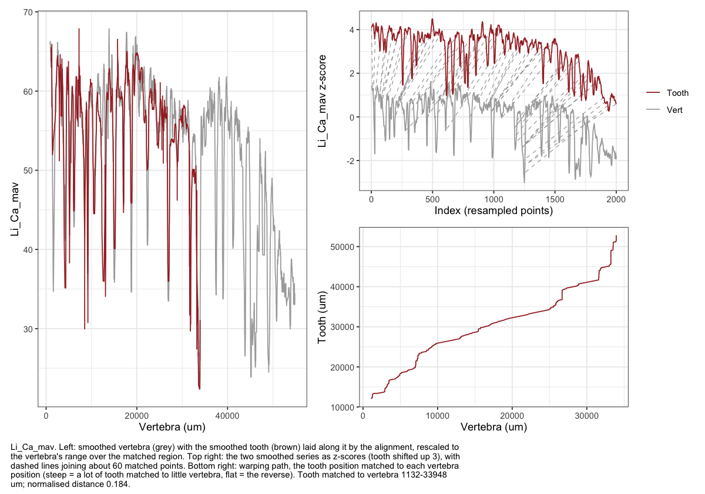<!-- -->

    #> Mg_Ca_mav 
    #>  Tooth: 12001.59 to 52836.35 
    #>  Vert:  12900.19 to 45111.78 
    #>  Normalized distance: 0.2663445

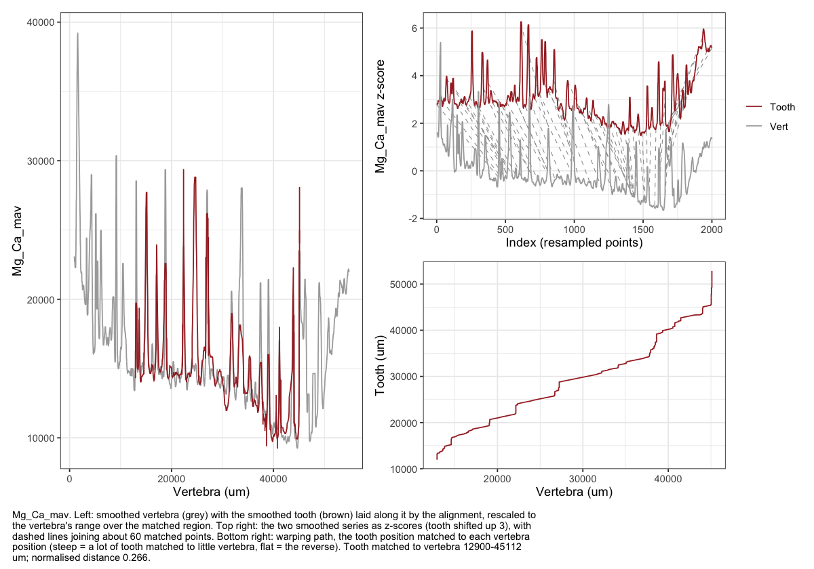<!-- -->

    #> Mn_Ca_mav 
    #>  Tooth: 12001.59 to 52836.35 
    #>  Vert:  12459.53 to 53605.35 
    #>  Normalized distance: 0.2193095

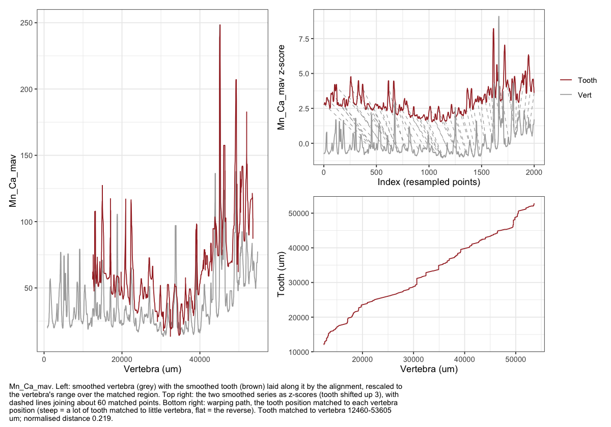<!-- -->

    #> Zn_Ca_mav 
    #>  Tooth: 12001.59 to 52836.35 
    #>  Vert:  15751.54 to 52577.13 
    #>  Normalized distance: 0.2107211

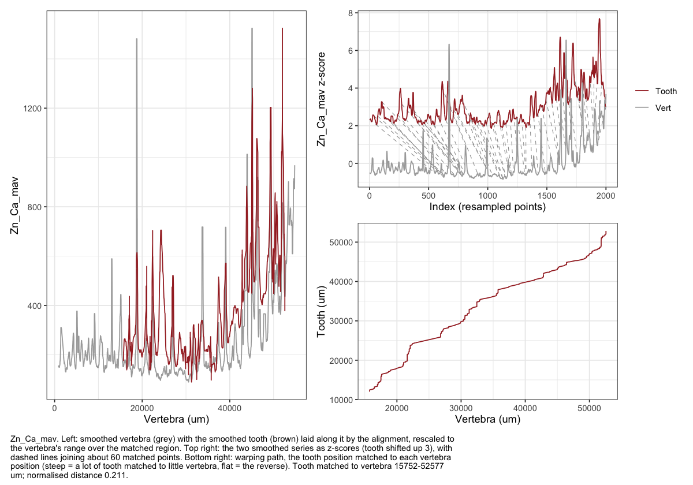<!-- -->

``` r
finalt <- align_multi(SMA001TB_filt |> filter(true_dist <= 50000), SMA001T_filt, elements = mavs1,
                      open_begin = TRUE, open_end = TRUE, n = 2000)
```

    #> Tooth: 12001.59 to 49993.64 
    #>  Vert:  15829.3 to 48948.15 
    #>  Normalized distance: 0.4883055

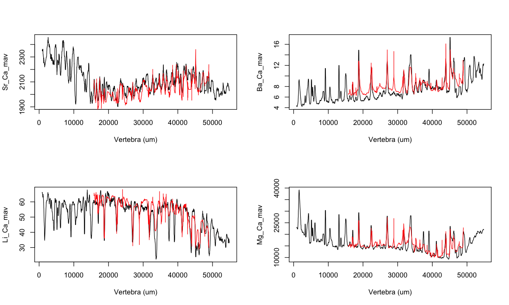<!-- -->

``` r
range(SMA001T_filt$true_dist)
```

    #> [1]   864.045 54832.290

``` r
range(SMA001TB_filt$true_dist)
```

    #> [1] 12001.59 52836.35

### Vertebra

``` r
knitr::kable(rep_fit(SMA001VB_filt, SMA001V_filt), digits = 2)
```

| element | norm_dist | warp_slope | warp_r2 | startA |    endA |  startB |     endB |
|:--------|----------:|-----------:|--------:|-------:|--------:|--------:|---------:|
| Sr_Ca   |      0.02 |       0.94 |    1.00 | 745.96 | 9965.32 | 1612.88 | 10656.56 |
| Ba_Ca   |      0.01 |       0.82 |    0.99 | 745.96 | 9965.32 | 1503.44 |  8816.14 |
| Li_Ca   |      0.10 |       0.98 |    1.00 | 745.96 | 9965.32 | 1123.26 | 10656.56 |
| Mg_Ca   |      0.06 |       0.95 |    1.00 | 745.96 | 9965.32 | 1463.12 | 10630.63 |
| Mn_Ca   |      0.14 |       0.83 |    0.98 | 745.96 | 9965.32 | 1811.62 |  9173.28 |
| Zn_Ca   |      0.22 |       0.92 |    0.99 | 745.96 | 9965.32 | 1820.26 | 10656.56 |

``` r
vert_els <- align_els(SMA001VB_filt, SMA001V_filt, elements = mavs2, n = 2000)
```

    #> Sr_Ca_mav 
    #>  Tooth: 745.959 to 9965.319 
    #>  Vert:  1612.884 to 10656.56 
    #>  Normalized distance: 0.0210083

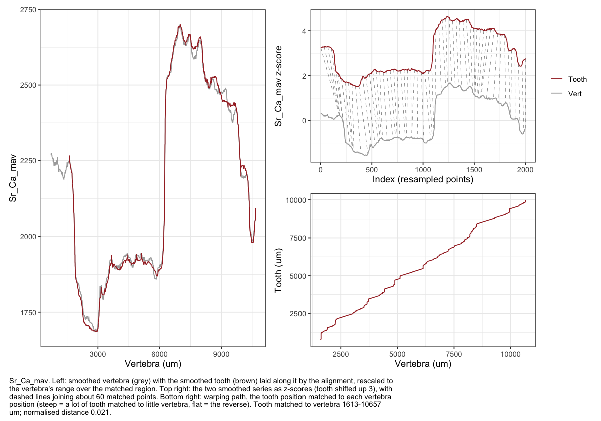<!-- -->

    #> Ba_Ca_mav 
    #>  Tooth: 745.959 to 9965.319 
    #>  Vert:  1503.439 to 8816.14 
    #>  Normalized distance: 0.01439421

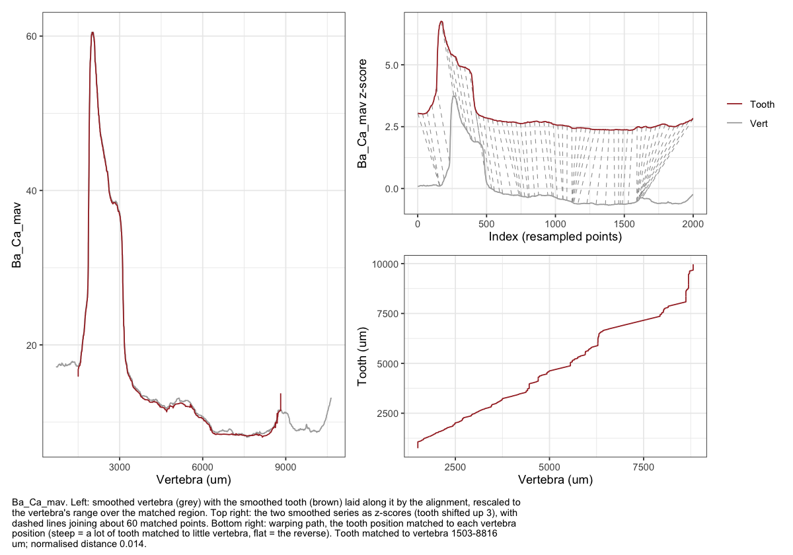<!-- -->

    #> Li_Ca_mav 
    #>  Tooth: 745.959 to 9965.319 
    #>  Vert:  1123.259 to 10656.56 
    #>  Normalized distance: 0.1037762

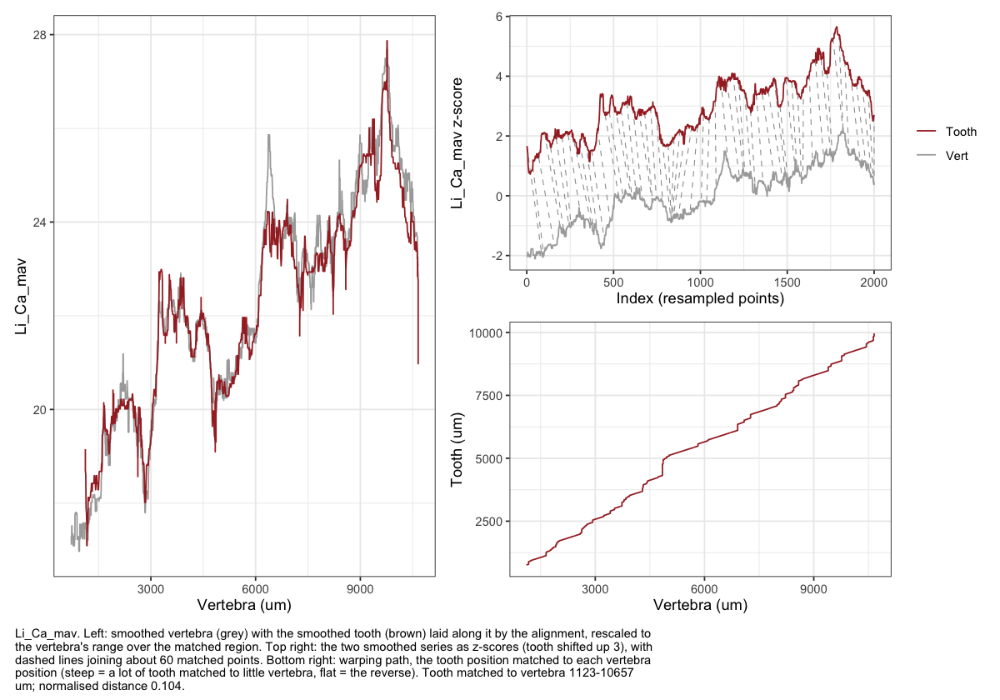<!-- -->

    #> Mg_Ca_mav 
    #>  Tooth: 745.959 to 9965.319 
    #>  Vert:  1463.117 to 10630.63 
    #>  Normalized distance: 0.05942035

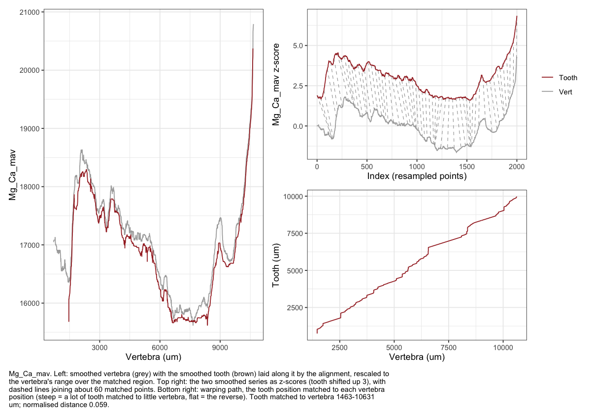<!-- -->

    #> Mn_Ca_mav 
    #>  Tooth: 745.959 to 9965.319 
    #>  Vert:  1811.615 to 9173.278 
    #>  Normalized distance: 0.1421497

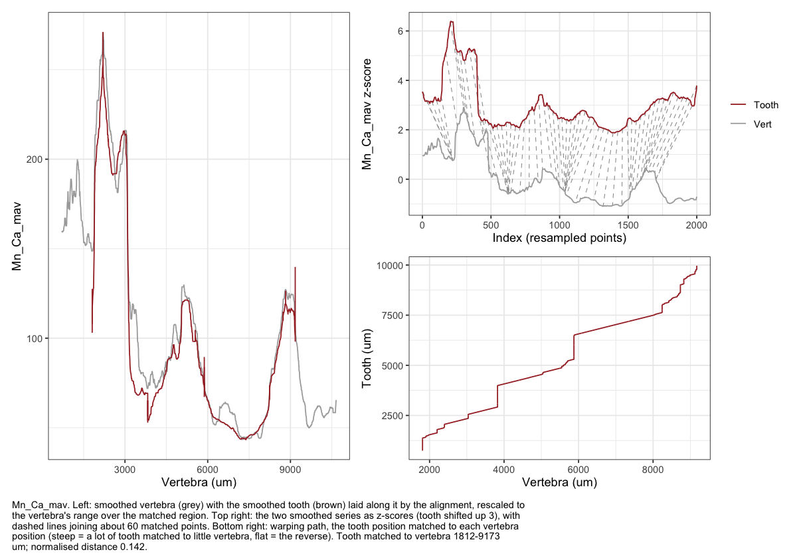<!-- -->

    #> Zn_Ca_mav 
    #>  Tooth: 745.959 to 9965.319 
    #>  Vert:  1820.255 to 10656.56 
    #>  Normalized distance: 0.2150013

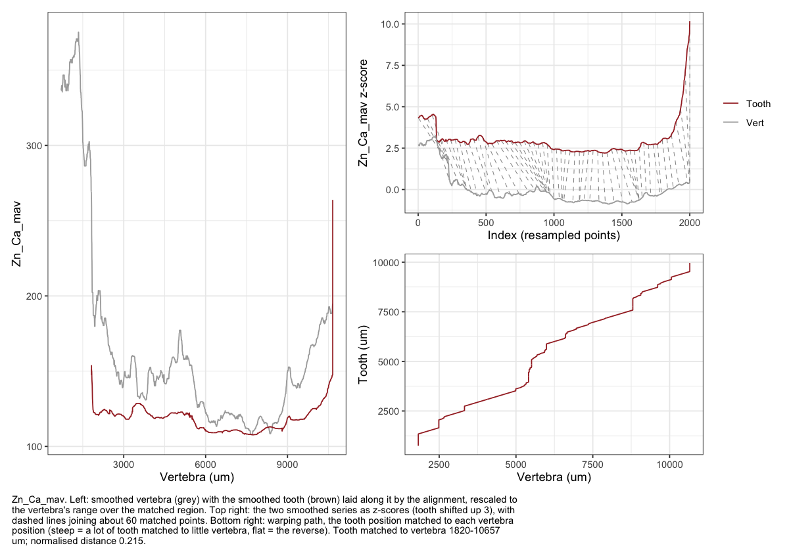<!-- -->

``` r
finalv <- align_multi(SMA001VB_filt, SMA001V_filt, elements = mavs1,
                      open_begin = TRUE, open_end = TRUE, n = 2000)
```

    #> Tooth: 745.959 to 9965.319 
    #>  Vert:  1422.795 to 10647.92 
    #>  Normalized distance: 0.1266406

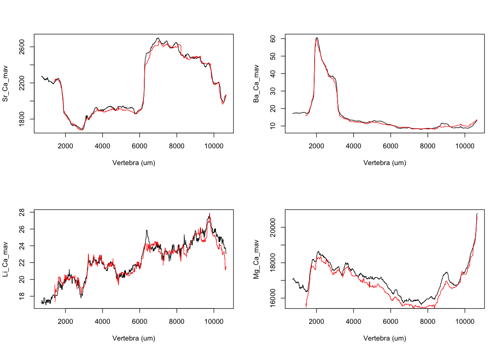<!-- -->

``` r
range(SMA001VB_filt$true_dist)
```

    #> [1]  745.959 9965.319

``` r
range(SMA001V_filt$true_dist)
```

    #> [1]   711.397 10656.560

## Save for 06b–06e

``` r
dir.create('data/output/dtw_cache', showWarnings = FALSE)
save(list = Filter(function(x) !is.function(get(x)), ls()),
     file = 'data/output/dtw_cache/06a.RData')
```
