06b · DTW run
================
Nikki Biskis
Rendered 27 Oct 2026 21:47

- [SMA001](#sma001)
  - [Multi: bleach](#multi-bleach)
  - [Multi: water](#multi-water)
- [SMA002](#sma002)
  - [Multi](#multi)
- [Save for 06f](#save-for-06f)

- **Paper:** The potential of elemental analysis in determining origin
  of sawfish rostra

- **DOI:** tbd

- **Written:** 28 Aug 2026

- **Content:** dynamic time warping II

- application of functions developed previously

- setting the models built with parameters developed in dtw1

R markdown version of `06b_dtw_run.R`. It starts from the objects 06a
saved (`data/output/dtw_cache/06a.RData`), and saves its own objects to
`data/output/dtw_cache/06b.RData` for 06f.

``` r
source('helpers/functions/fxn_dtw.R')
source('helpers/functions/fxn_profile.R')
source('helpers/functions/fxn_mavs.R')
source('helpers/microHelp.R')
load('data/output/dtw_cache/06a.RData') # objects from 06a
```

## SMA001

``` r
# rebuilt as in 05c_fig_sma001.R 
SMA001TH_out <- profs(SMA001T_filt, el_all, "tooth", span = 0.01, window_size = 11,
                      show_In = TRUE, In_style = "rect")
```

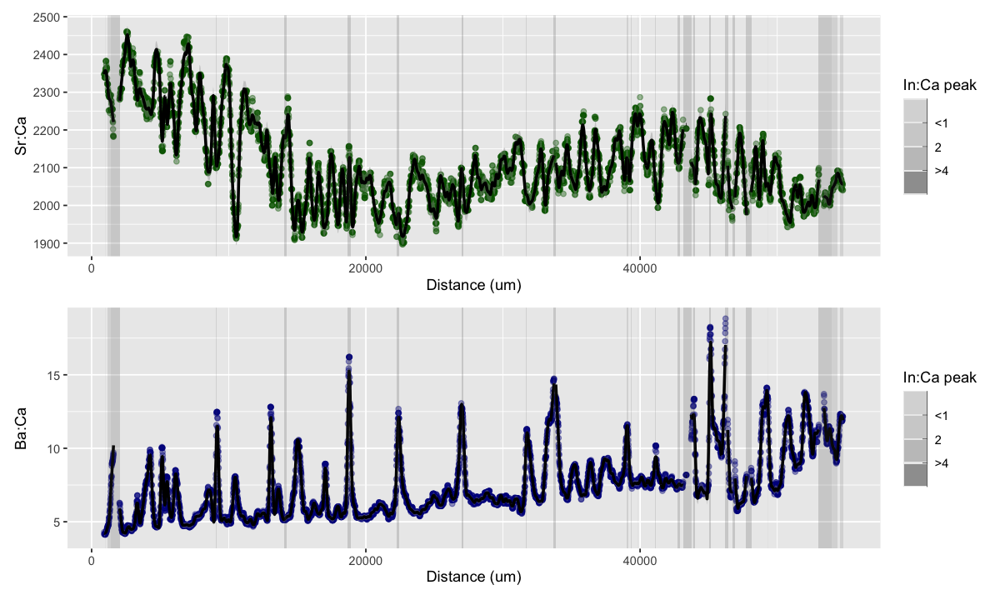<!-- -->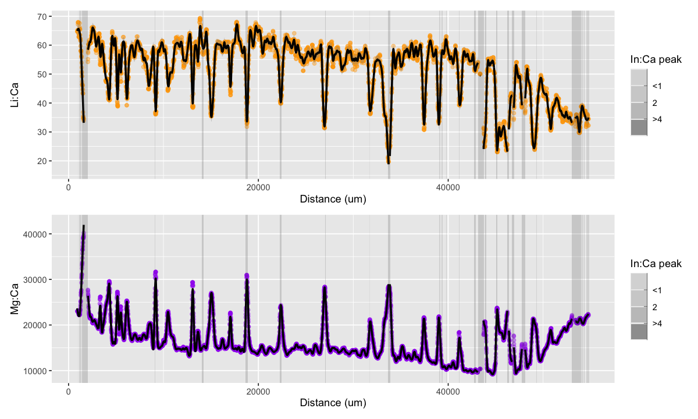<!-- -->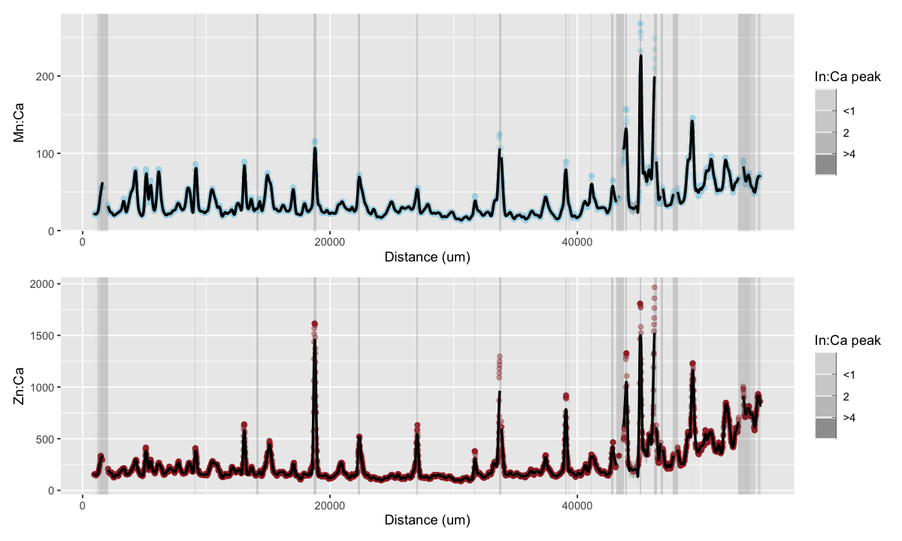<!-- -->

``` r
SMA001TH_out$plots$Ca #(never gets to the base, tooth incomplete)
```

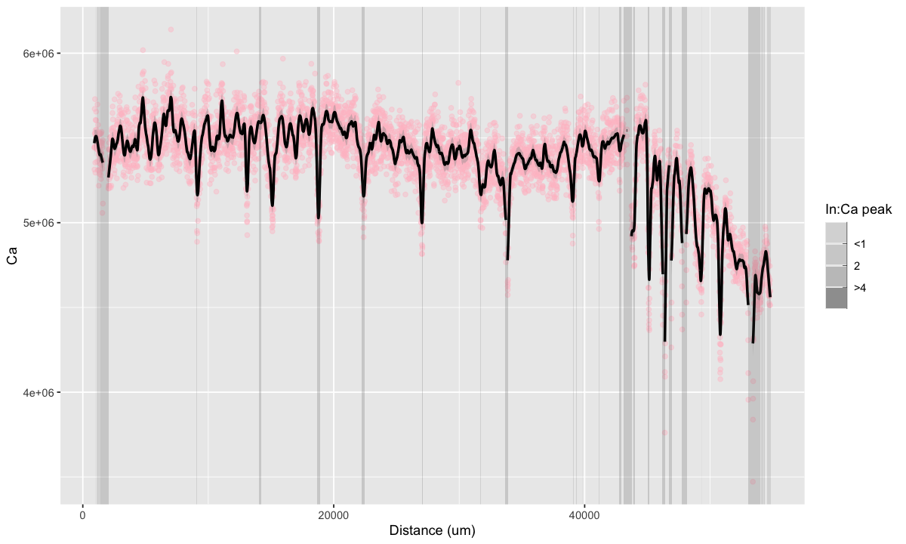<!-- -->

``` r
SMA001TB_out <- profs(SMA001TB_filt, el_all, "tooth", span = 0.01, window_size = 11,
                      show_In = TRUE, In_style = "rect")
```

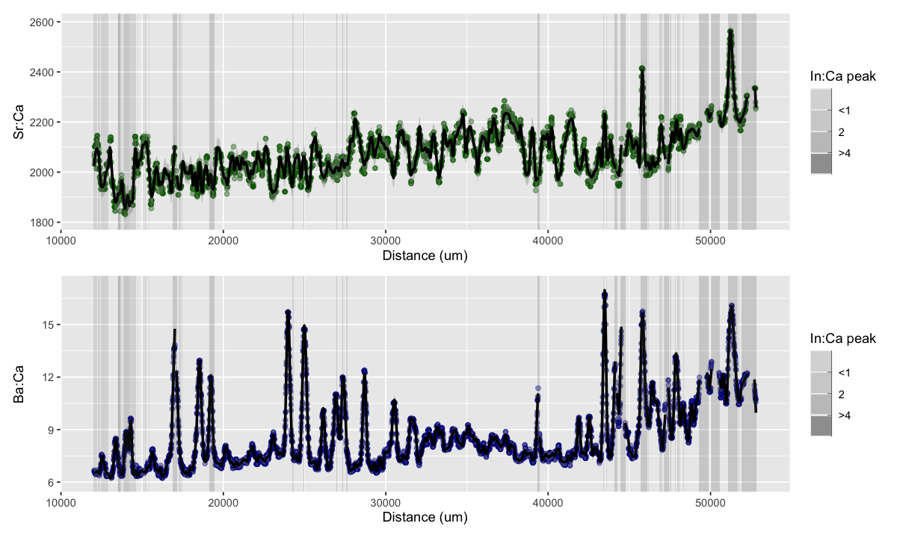<!-- -->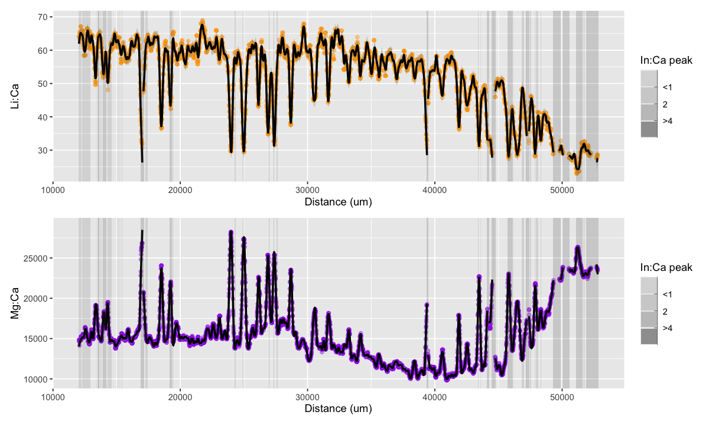<!-- -->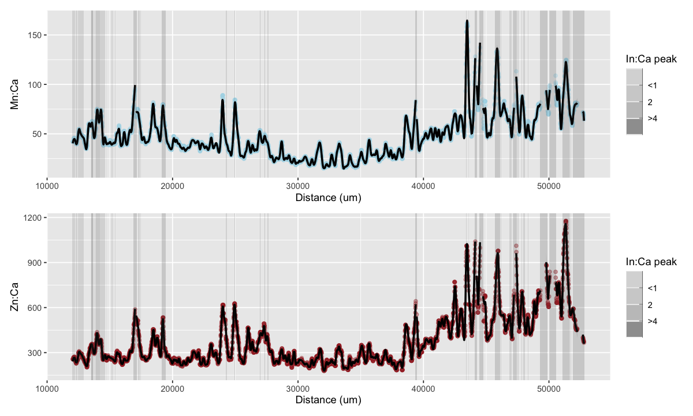<!-- -->

``` r
SMA001TB_out$plots$Ca #(never gets to the base, tooth incomplete)
```

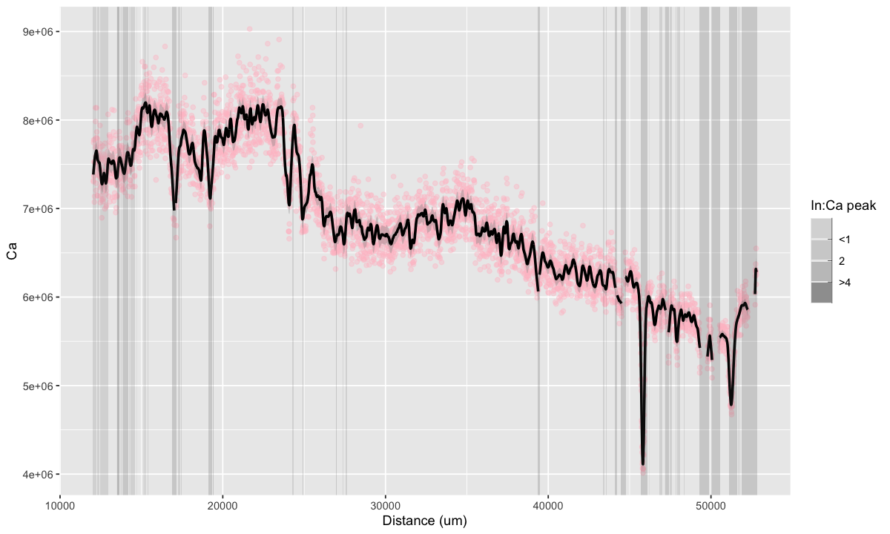<!-- -->

``` r
# rep1
align_els(SMA001T_filt,
          SMA001V_filt, # Ba gets confused
          elements = mavs2,
          n = 2000)
```

    #> Sr_Ca_mav 
    #>  Tooth: 864.045 to 54832.29 
    #>  Vert:  6915.241 to 10656.56 
    #>  Normalized distance: 0.4927315

<!-- -->

    #> Ba_Ca_mav 
    #>  Tooth: 864.045 to 54832.29 
    #>  Vert:  7194.615 to 10647.92 
    #>  Normalized distance: 0.6464673

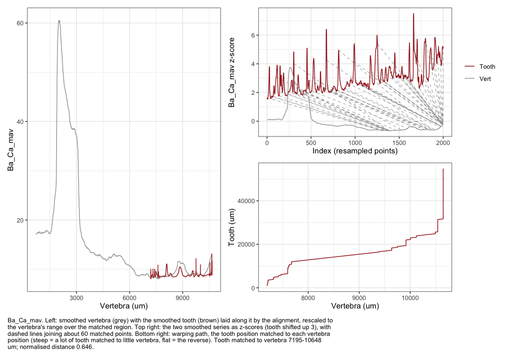<!-- -->

    #> Li_Ca_mav 
    #>  Tooth: 864.045 to 54832.29 
    #>  Vert:  3528.184 to 4844.413 
    #>  Normalized distance: 0.5758643

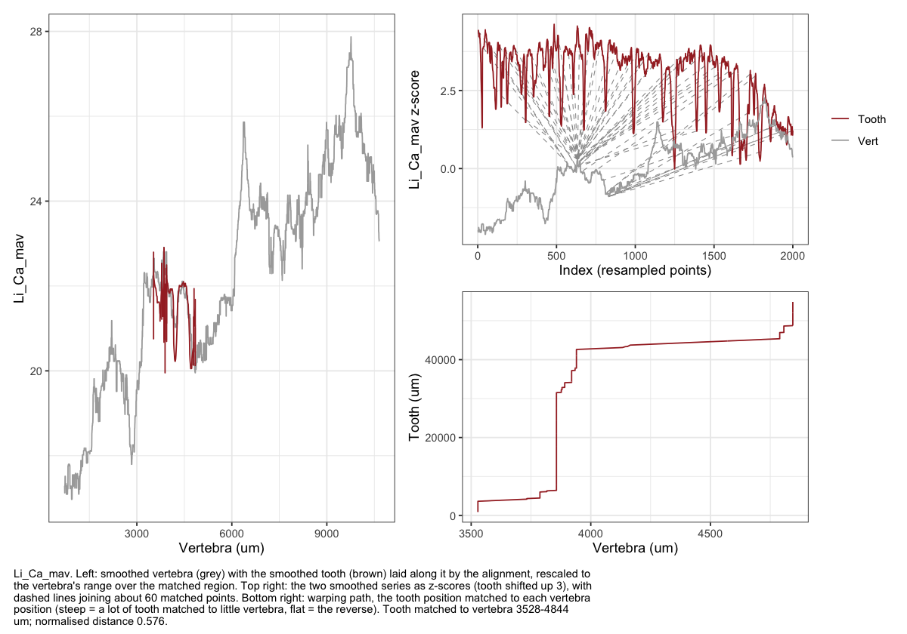<!-- -->

    #> Mg_Ca_mav 
    #>  Tooth: 864.045 to 54832.29 
    #>  Vert:  2237.877 to 10264.86 
    #>  Normalized distance: 0.4157967

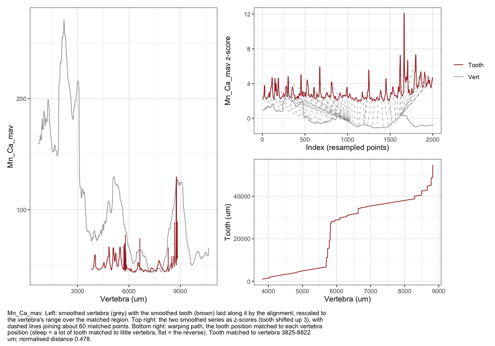<!-- -->

    #> Mn_Ca_mav 
    #>  Tooth: 864.045 to 54832.29 
    #>  Vert:  3824.839 to 8821.9 
    #>  Normalized distance: 0.4780615

<!-- -->

    #> Zn_Ca_mav 
    #>  Tooth: 864.045 to 54832.29 
    #>  Vert:  3582.907 to 10656.56 
    #>  Normalized distance: 0.3904342

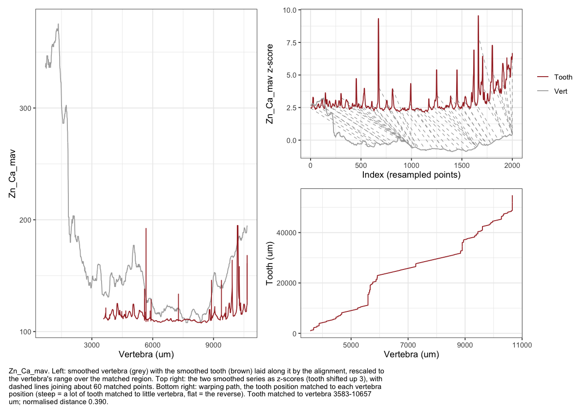<!-- -->

    #> $Sr_Ca_mav
    #> DTW alignment object
    #>  Alignment size (query x reference): 2000 x 2000
    #>  Call: dtw(x = tSmooth, y = vSmooth, step.pattern = pattern, keep.internals = TRUE, 
    #>  Call:     open.end = TRUE, open.begin = TRUE)
    #> 
    #> $Ba_Ca_mav
    #> DTW alignment object
    #>  Alignment size (query x reference): 2000 x 2000
    #>  Call: dtw(x = tSmooth, y = vSmooth, step.pattern = pattern, keep.internals = TRUE, 
    #>  Call:     open.end = TRUE, open.begin = TRUE)
    #> 
    #> $Li_Ca_mav
    #> DTW alignment object
    #>  Alignment size (query x reference): 2000 x 2000
    #>  Call: dtw(x = tSmooth, y = vSmooth, step.pattern = pattern, keep.internals = TRUE, 
    #>  Call:     open.end = TRUE, open.begin = TRUE)
    #> 
    #> $Mg_Ca_mav
    #> DTW alignment object
    #>  Alignment size (query x reference): 2000 x 2000
    #>  Call: dtw(x = tSmooth, y = vSmooth, step.pattern = pattern, keep.internals = TRUE, 
    #>  Call:     open.end = TRUE, open.begin = TRUE)
    #> 
    #> $Mn_Ca_mav
    #> DTW alignment object
    #>  Alignment size (query x reference): 2000 x 2000
    #>  Call: dtw(x = tSmooth, y = vSmooth, step.pattern = pattern, keep.internals = TRUE, 
    #>  Call:     open.end = TRUE, open.begin = TRUE)
    #> 
    #> $Zn_Ca_mav
    #> DTW alignment object
    #>  Alignment size (query x reference): 2000 x 2000
    #>  Call: dtw(x = tSmooth, y = vSmooth, step.pattern = pattern, keep.internals = TRUE, 
    #>  Call:     open.end = TRUE, open.begin = TRUE)

``` r
# rep2
align_els(SMA001TB_filt,
          SMA001VB_filt,
          elements = mavs2,
          n = 2000)
```

    #> Sr_Ca_mav 
    #>  Tooth: 12001.59 to 52836.35 
    #>  Vert:  1336.39 to 6512.02 
    #>  Normalized distance: 0.4826424

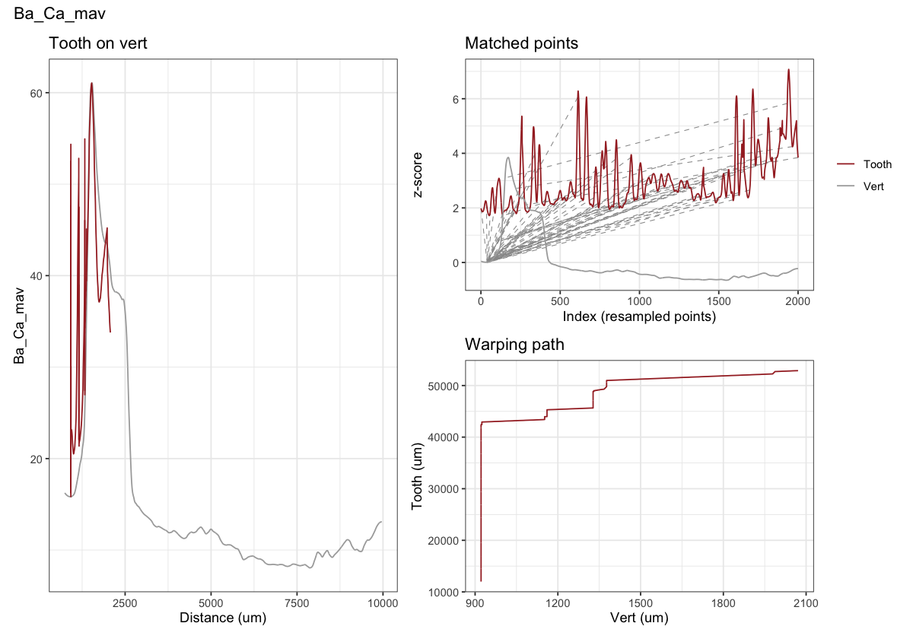<!-- -->

    #> Ba_Ca_mav 
    #>  Tooth: 12001.59 to 52836.35 
    #>  Vert:  7839.769 to 9956.679 
    #>  Normalized distance: 0.6214233

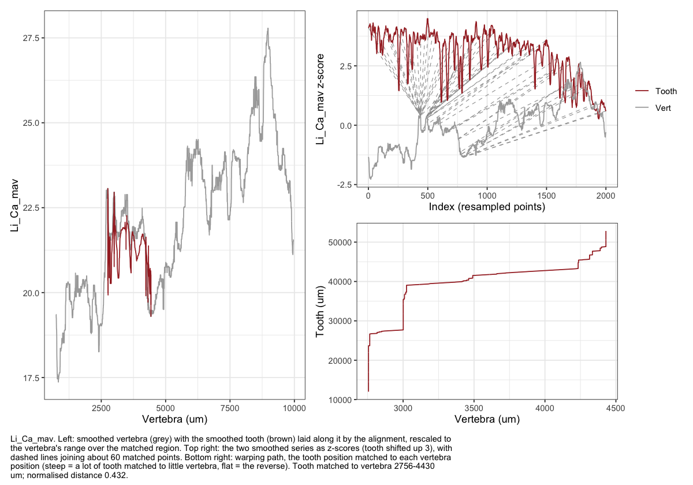<!-- -->

    #> Li_Ca_mav 
    #>  Tooth: 12001.59 to 52836.35 
    #>  Vert:  2756.304 to 4429.671 
    #>  Normalized distance: 0.4318772

<!-- -->

    #> Mg_Ca_mav 
    #>  Tooth: 12001.59 to 52836.35 
    #>  Vert:  3862.281 to 9798.271 
    #>  Normalized distance: 0.3306297

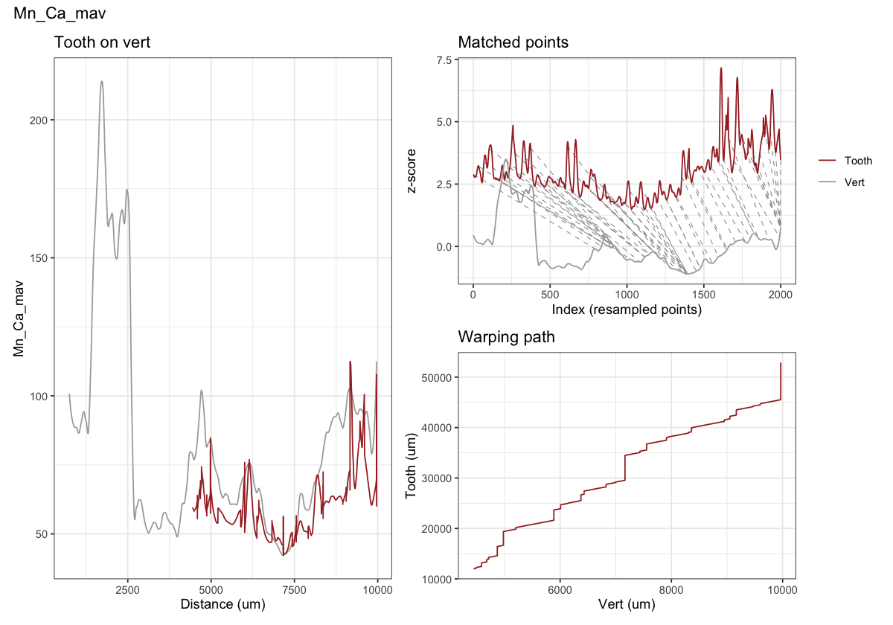<!-- -->

    #> Mn_Ca_mav 
    #>  Tooth: 12001.59 to 52836.35 
    #>  Vert:  4395.109 to 9965.319 
    #>  Normalized distance: 0.3705884

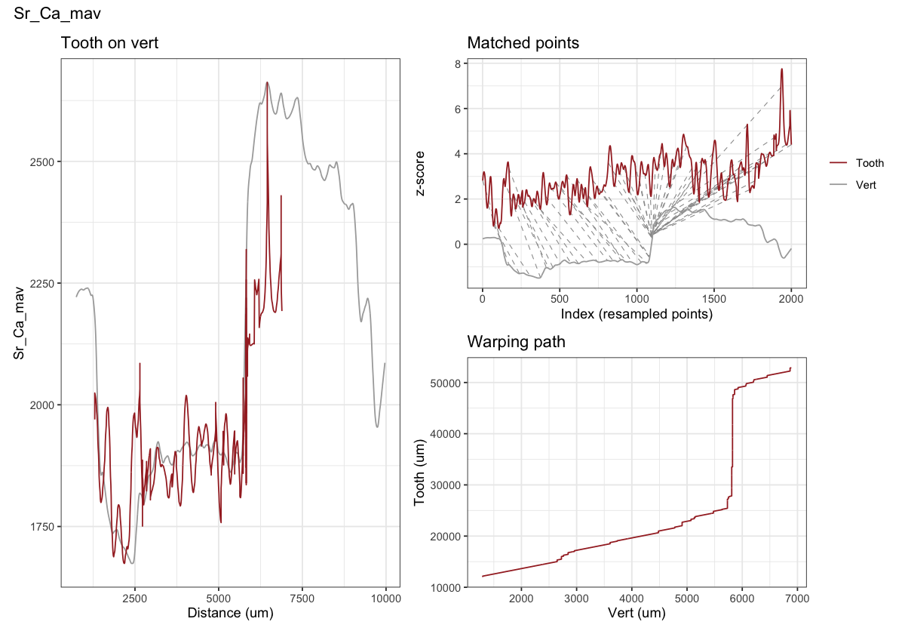<!-- -->

    #> Zn_Ca_mav 
    #>  Tooth: 12001.59 to 52836.35 
    #>  Vert:  5227.472 to 9636.982 
    #>  Normalized distance: 0.3591171

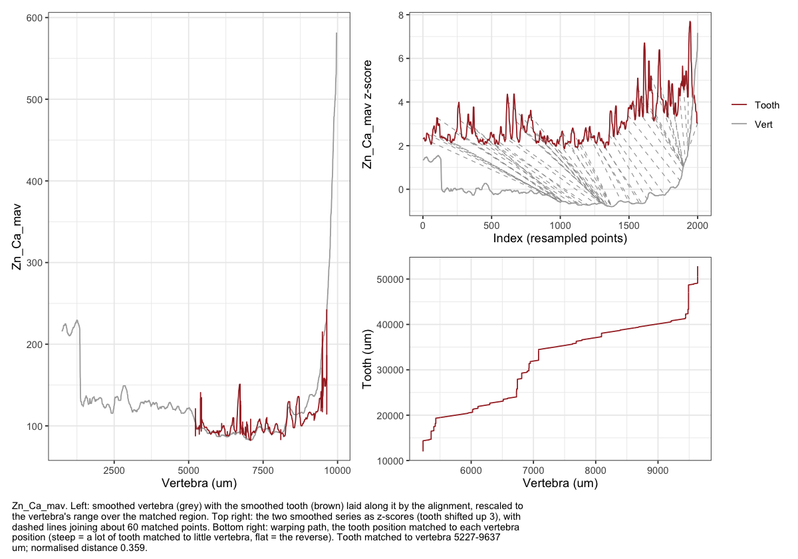<!-- -->

    #> $Sr_Ca_mav
    #> DTW alignment object
    #>  Alignment size (query x reference): 2000 x 2000
    #>  Call: dtw(x = tSmooth, y = vSmooth, step.pattern = pattern, keep.internals = TRUE, 
    #>  Call:     open.end = TRUE, open.begin = TRUE)
    #> 
    #> $Ba_Ca_mav
    #> DTW alignment object
    #>  Alignment size (query x reference): 2000 x 2000
    #>  Call: dtw(x = tSmooth, y = vSmooth, step.pattern = pattern, keep.internals = TRUE, 
    #>  Call:     open.end = TRUE, open.begin = TRUE)
    #> 
    #> $Li_Ca_mav
    #> DTW alignment object
    #>  Alignment size (query x reference): 2000 x 2000
    #>  Call: dtw(x = tSmooth, y = vSmooth, step.pattern = pattern, keep.internals = TRUE, 
    #>  Call:     open.end = TRUE, open.begin = TRUE)
    #> 
    #> $Mg_Ca_mav
    #> DTW alignment object
    #>  Alignment size (query x reference): 2000 x 2000
    #>  Call: dtw(x = tSmooth, y = vSmooth, step.pattern = pattern, keep.internals = TRUE, 
    #>  Call:     open.end = TRUE, open.begin = TRUE)
    #> 
    #> $Mn_Ca_mav
    #> DTW alignment object
    #>  Alignment size (query x reference): 2000 x 2000
    #>  Call: dtw(x = tSmooth, y = vSmooth, step.pattern = pattern, keep.internals = TRUE, 
    #>  Call:     open.end = TRUE, open.begin = TRUE)
    #> 
    #> $Zn_Ca_mav
    #> DTW alignment object
    #>  Alignment size (query x reference): 2000 x 2000
    #>  Call: dtw(x = tSmooth, y = vSmooth, step.pattern = pattern, keep.internals = TRUE, 
    #>  Call:     open.end = TRUE, open.begin = TRUE)

``` r
# similar...
```

### Multi: bleach

``` r
mult1b2 <- align_multi(SMA001TB_filt, SMA001VB_filt,
                      elements = c('Mg_Ca_mav', 'Sr_Ca_mav'),
                      n = 6000, open_end = TRUE, open_begin = TRUE)
```

    #> Tooth: 12001.59 to 52836.35 
    #>  Vert:  4109.975 to 9089.754 
    #>  Normalized distance: 0.6431826

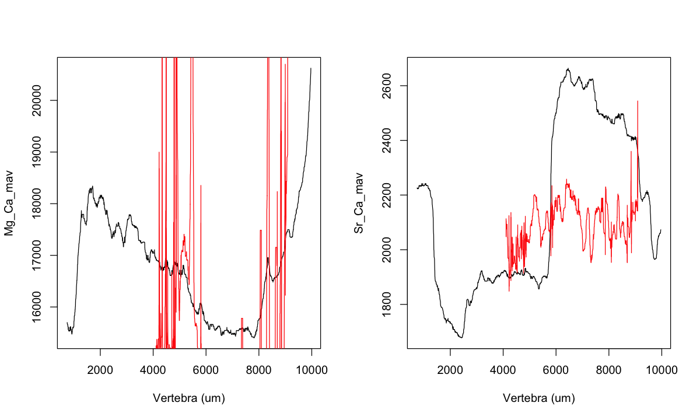<!-- -->

``` r
mult1b2.1 <- align_multi(SMA001TB_filt, SMA001VB_filt,
                        elements = c('Mg_Ca_mav', 'Ba_Ca_mav'),
                        n = 6000, open_end = TRUE, open_begin = TRUE)
```

    #> Tooth: 12001.59 to 52836.35 
    #>  Vert:  3865.162 to 9832.833 
    #>  Normalized distance: 0.594338

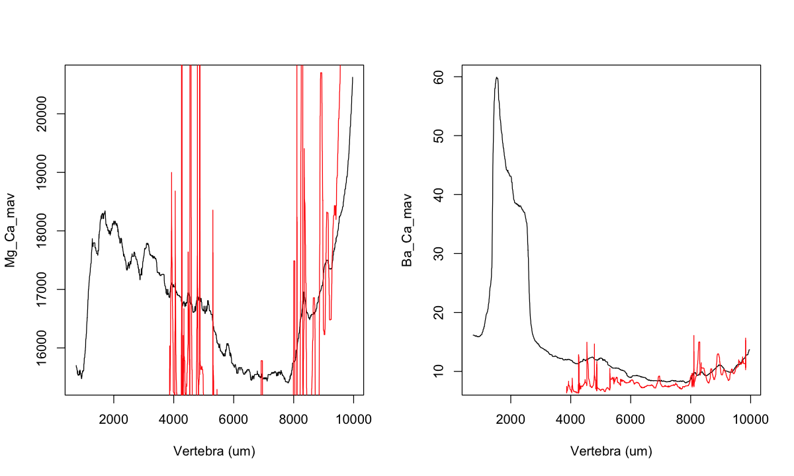<!-- -->

``` r
mult1b3 <- align_multi(SMA001TB_filt, SMA001VB_filt,
                       elements = c('Mg_Ca_mav', 'Zn_Ca_mav', "Mn_Ca_mav"),
                       n = 6000, open_end = TRUE, open_begin = TRUE)
```

    #> Tooth: 12001.59 to 52836.35 
    #>  Vert:  4553.517 to 9654.263 
    #>  Normalized distance: 0.5902783

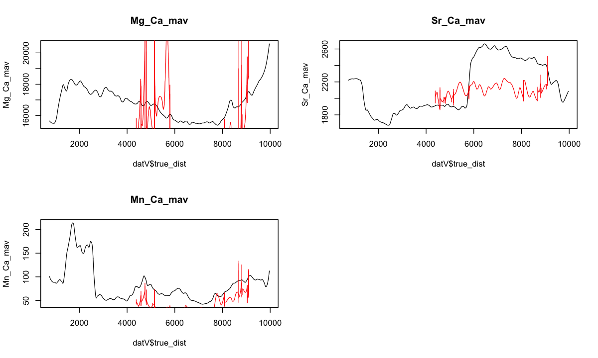<!-- -->

``` r
mult1b3.1 <- align_multi(SMA001TB_filt, SMA001VB_filt,
                       elements = c('Mg_Ca_mav', 'Ba_Ca_mav', "Sr_Ca_mav"),
                       n = 6000, open_end = TRUE, open_begin = TRUE)
```

    #> Tooth: 12001.59 to 52836.35 
    #>  Vert:  4109.975 to 9026.39 
    #>  Normalized distance: 0.7182992

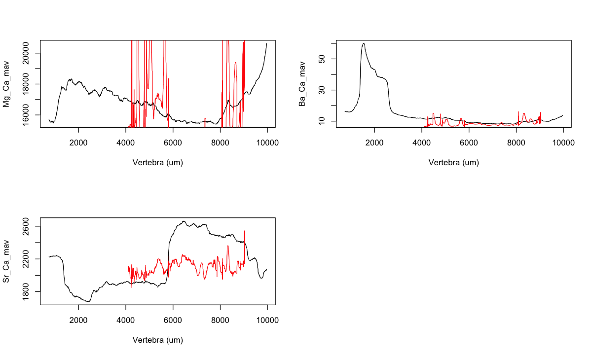<!-- -->

``` r
mult1b4 <- align_multi(SMA001TB_filt, SMA001VB_filt,
                       elements = mavs1,
                       n = 6000, open_end = TRUE, open_begin = TRUE)
```

    #> Tooth: 12001.59 to 52836.35 
    #>  Vert:  3516.664 to 9927.877 
    #>  Normalized distance: 0.8269997

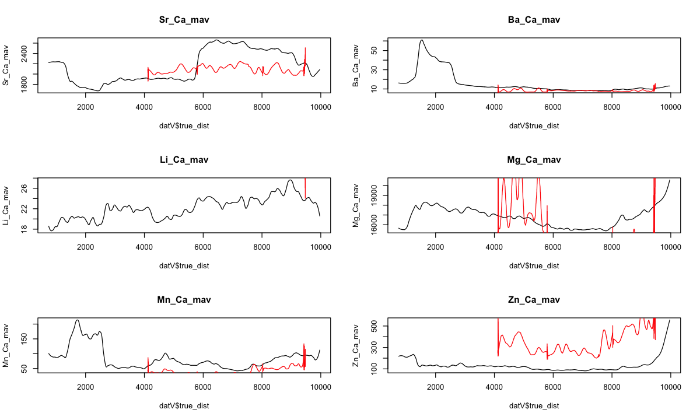<!-- -->

``` r
mult1b6 <- align_multi(SMA001TB_filt, SMA001VB_filt,
                       elements = mavs2,
                       n = 6000, open_end = TRUE, open_begin = TRUE)
```

    #> Tooth: 12001.59 to 52836.35 
    #>  Vert:  4089.813 to 9516.016 
    #>  Normalized distance: 0.8253933

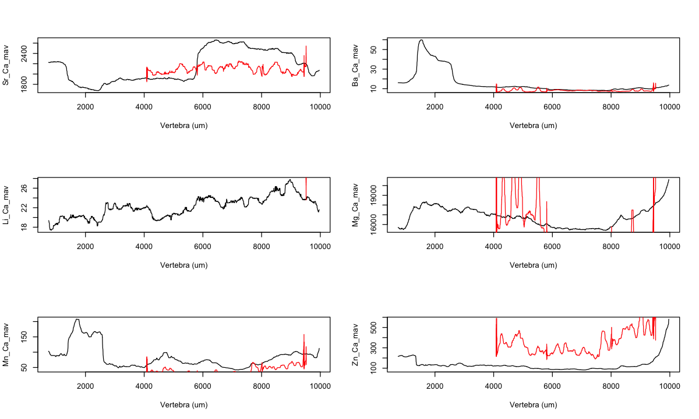<!-- -->

``` r
# ahhh that's interesting!
```

### Multi: water

``` r
mult1h2 <- align_multi(SMA001T_filt, SMA001V_filt,
                      elements = c('Mg_Ca_mav', 'Sr_Ca_mav'),
                      n = 6000, open_begin = TRUE, # lockV_start = 3266.09,
                      open_end = TRUE) # same result for both verts
```

    #> Tooth: 864.045 to 54832.29 
    #>  Vert:  740.199 to 1898.019 
    #>  Normalized distance: 0.7552389

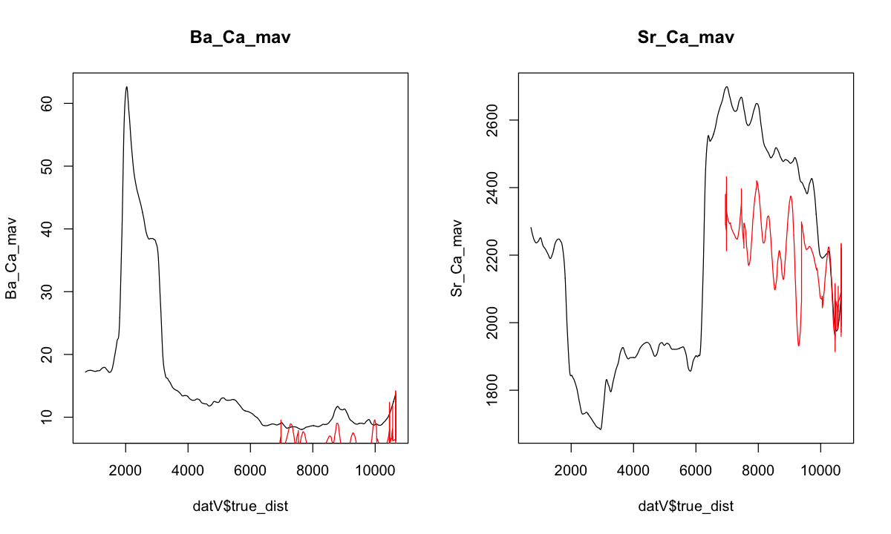<!-- -->

``` r
mult1h2.1 <- align_multi(SMA001T_filt, SMA001V_filt,
                         elements = c('Mg_Ca_mav', 'Ba_Ca_mav'),
                         n = 6000, open_end = TRUE, open_begin = TRUE)
```

    #> Tooth: 864.045 to 54832.29 
    #>  Vert:  3577.147 to 9006.23 
    #>  Normalized distance: 0.6983228

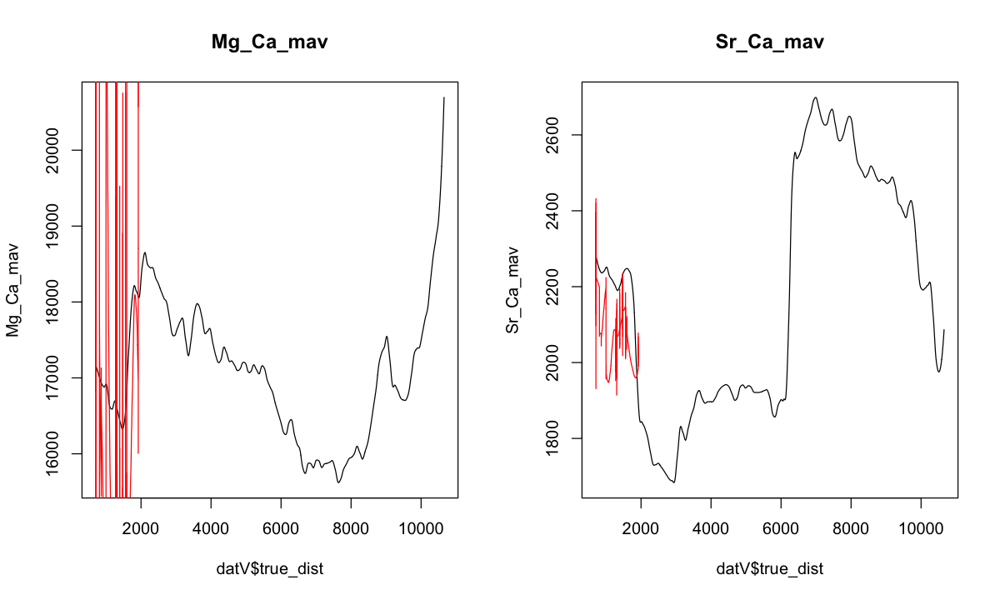<!-- -->

``` r
mult1h2.2 <- align_multi(SMA001T_filt, SMA001V_filt,
                         elements = c('Sr_Ca_mav', 'Zn_Ca_mav'),
                         n = 6000, open_end = TRUE, open_begin = TRUE)
```

    #> Tooth: 864.045 to 54832.29 
    #>  Vert:  6961.323 to 10656.56 
    #>  Normalized distance: 0.6879814

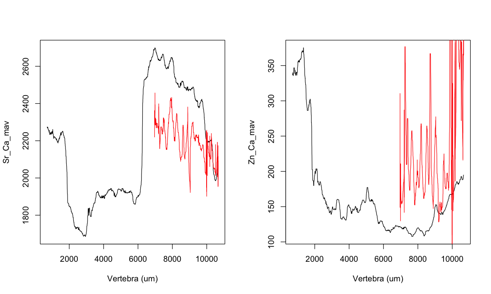<!-- -->

``` r
mult1h3 <- align_multi(SMA001T_filt, SMA001V_filt,
                       elements = c('Mg_Ca_mav', 'Mn_Ca_mav', "Zn_Ca_mav"),
                       n = 6000, open_end = TRUE, open_begin = TRUE)
```

    #> Tooth: 864.045 to 54832.29 
    #>  Vert:  3577.147 to 9089.753 
    #>  Normalized distance: 0.5990763

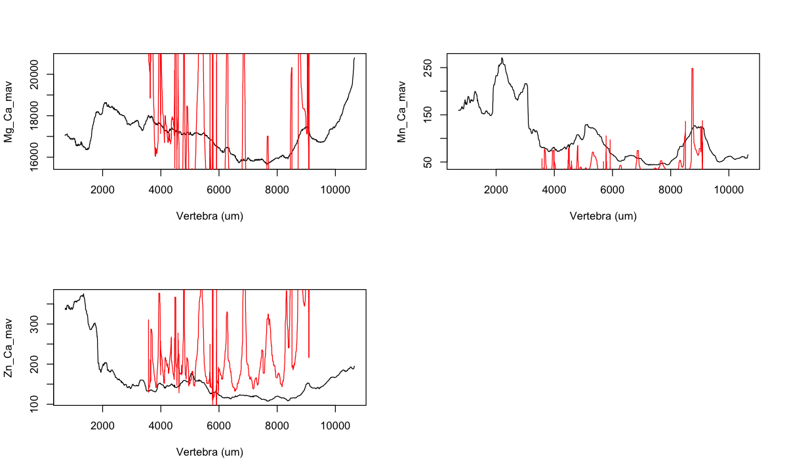<!-- -->

``` r
mult1h3.1 <- align_multi(SMA001T_filt, SMA001V_filt,
                       elements = c('Mg_Ca_mav', 'Sr_Ca_mav', "Ba_Ca_mav"),
                       n = 6000, open_end = TRUE, open_begin = TRUE)
```

    #> Tooth: 864.045 to 54832.29 
    #>  Vert:  734.439 to 1886.499 
    #>  Normalized distance: 0.7937674

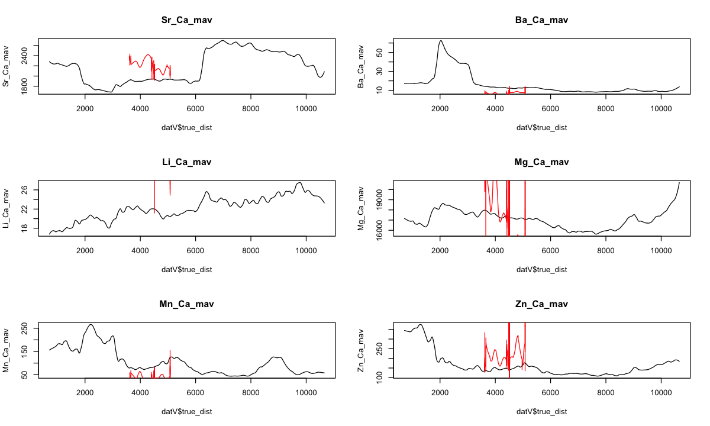<!-- -->

``` r
mult1h4 <- align_multi(SMA001T_filt, SMA001V_filt,
                      elements = mavs1,
                      n = 6000, open_begin = TRUE,
                      open_end = TRUE) # but this one suggests longer
```

    #> Tooth: 864.045 to 54832.29 
    #>  Vert:  3660.671 to 5146.828 
    #>  Normalized distance: 0.9322837

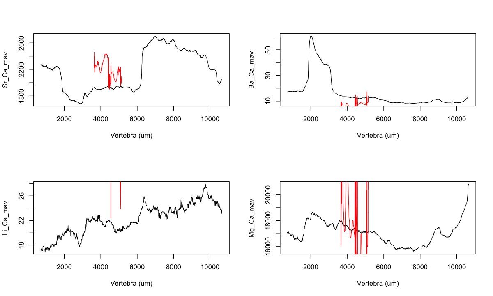<!-- -->

``` r
mult1h6 <- align_multi(SMA001T_filt, SMA001V_filt,
                      elements = mavs2,
                      n = 6000, open_begin = TRUE, # lockV_start = 3266.09,
                      open_end = TRUE)
```

    #> Tooth: 864.045 to 54832.29 
    #>  Vert:  3660.671 to 5086.346 
    #>  Normalized distance: 0.8600364

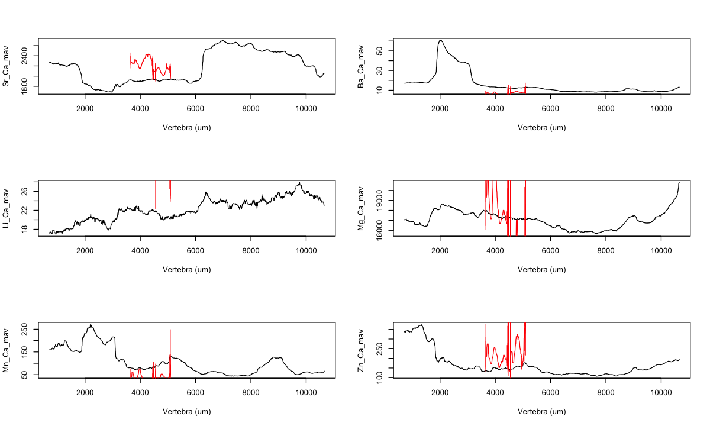<!-- -->

## SMA002

``` r
align_els(SMA002T_filt, SMA002V_filt, elements = mavs2,
          n = 4000)
```

    #> Sr_Ca_mav 
    #>  Tooth: 155.529 to 42968.97 
    #>  Vert:  7131.251 to 7946.334 
    #>  Normalized distance: 0.6140934

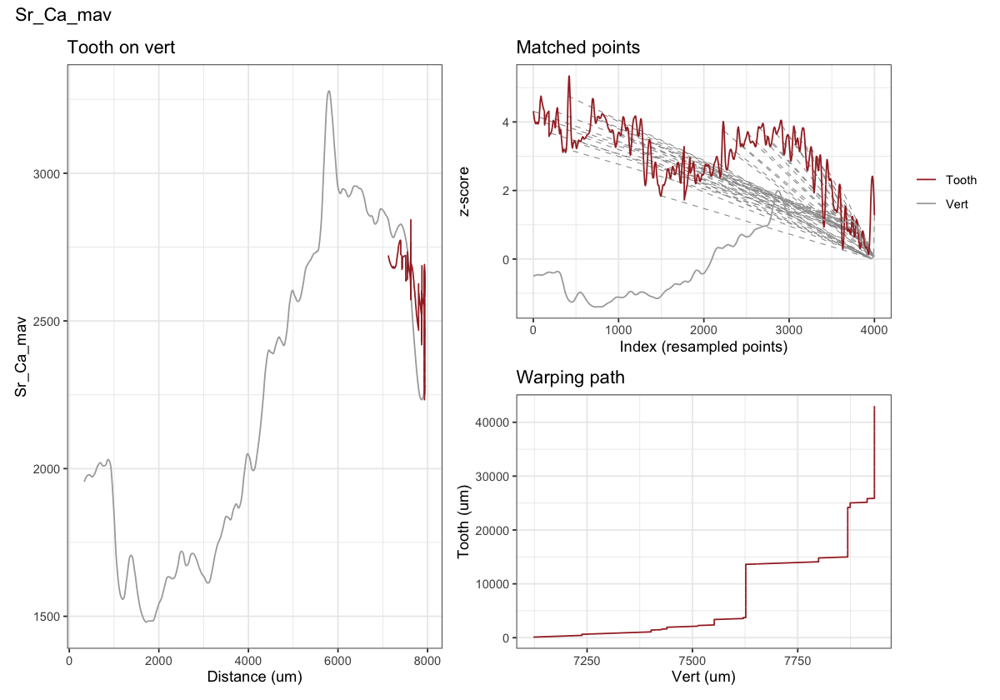<!-- -->

    #> Ba_Ca_mav 
    #>  Tooth: 155.529 to 42968.97 
    #>  Vert:  1932.581 to 5771.821 
    #>  Normalized distance: 0.2652901

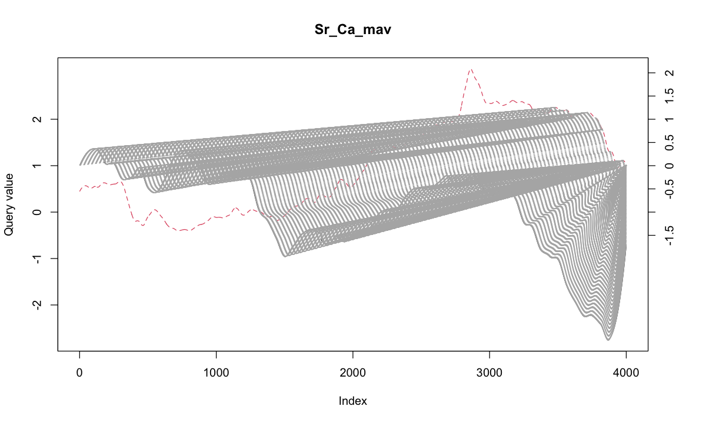<!-- -->

    #> Li_Ca_mav 
    #>  Tooth: 155.529 to 42968.97 
    #>  Vert:  5578.851 to 7943.454 
    #>  Normalized distance: 0.3907613

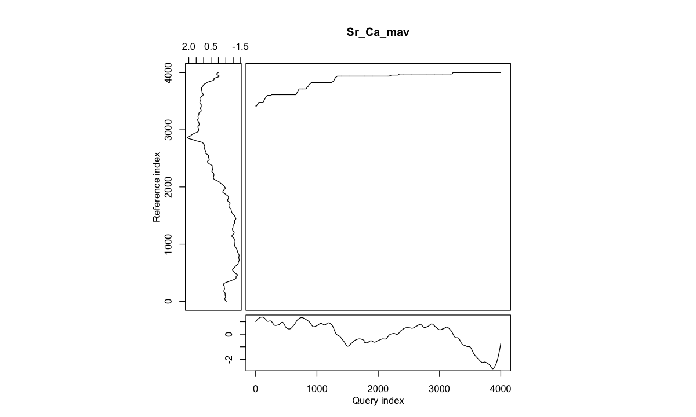<!-- -->

    #> Mg_Ca_mav 
    #>  Tooth: 155.529 to 42968.97 
    #>  Vert:  3640.51 to 5884.147 
    #>  Normalized distance: 0.3687739

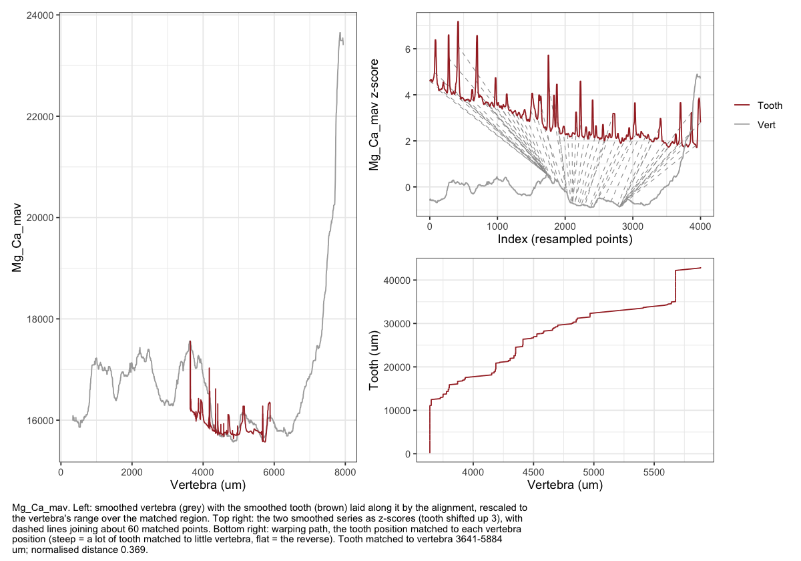<!-- -->

    #> Mn_Ca_mav 
    #>  Tooth: 155.529 to 42968.97 
    #>  Vert:  360.019 to 1883.618 
    #>  Normalized distance: 0.3438469

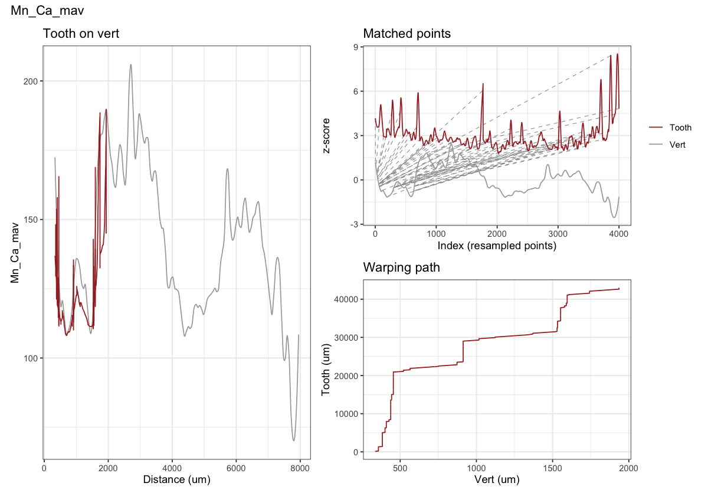<!-- -->

    #> Zn_Ca_mav 
    #>  Tooth: 155.529 to 42968.97 
    #>  Vert:  843.884 to 7329.982 
    #>  Normalized distance: 0.3075538

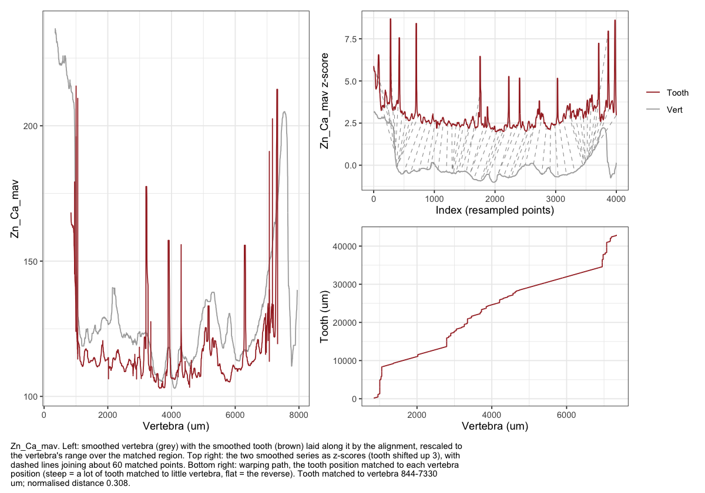<!-- -->

    #> $Sr_Ca_mav
    #> DTW alignment object
    #>  Alignment size (query x reference): 4000 x 4000
    #>  Call: dtw(x = tSmooth, y = vSmooth, step.pattern = pattern, keep.internals = TRUE, 
    #>  Call:     open.end = TRUE, open.begin = TRUE)
    #> 
    #> $Ba_Ca_mav
    #> DTW alignment object
    #>  Alignment size (query x reference): 4000 x 4000
    #>  Call: dtw(x = tSmooth, y = vSmooth, step.pattern = pattern, keep.internals = TRUE, 
    #>  Call:     open.end = TRUE, open.begin = TRUE)
    #> 
    #> $Li_Ca_mav
    #> DTW alignment object
    #>  Alignment size (query x reference): 4000 x 4000
    #>  Call: dtw(x = tSmooth, y = vSmooth, step.pattern = pattern, keep.internals = TRUE, 
    #>  Call:     open.end = TRUE, open.begin = TRUE)
    #> 
    #> $Mg_Ca_mav
    #> DTW alignment object
    #>  Alignment size (query x reference): 4000 x 4000
    #>  Call: dtw(x = tSmooth, y = vSmooth, step.pattern = pattern, keep.internals = TRUE, 
    #>  Call:     open.end = TRUE, open.begin = TRUE)
    #> 
    #> $Mn_Ca_mav
    #> DTW alignment object
    #>  Alignment size (query x reference): 4000 x 4000
    #>  Call: dtw(x = tSmooth, y = vSmooth, step.pattern = pattern, keep.internals = TRUE, 
    #>  Call:     open.end = TRUE, open.begin = TRUE)
    #> 
    #> $Zn_Ca_mav
    #> DTW alignment object
    #>  Alignment size (query x reference): 4000 x 4000
    #>  Call: dtw(x = tSmooth, y = vSmooth, step.pattern = pattern, keep.internals = TRUE, 
    #>  Call:     open.end = TRUE, open.begin = TRUE)

### Multi

``` r
mult2 <- align_multi(SMA002T_filt, SMA002V_filt,
                       elements = c('Mg_Ca_mav', 'Ba_Ca_mav'),
                       n = 6000, open_begin = TRUE, # lockV_start = 3266.09,
                       open_end = TRUE) #hmm!
```

    #> Tooth: 155.529 to 42968.97 
    #>  Vert:  3617.468 to 5846.705 
    #>  Normalized distance: 0.4604932

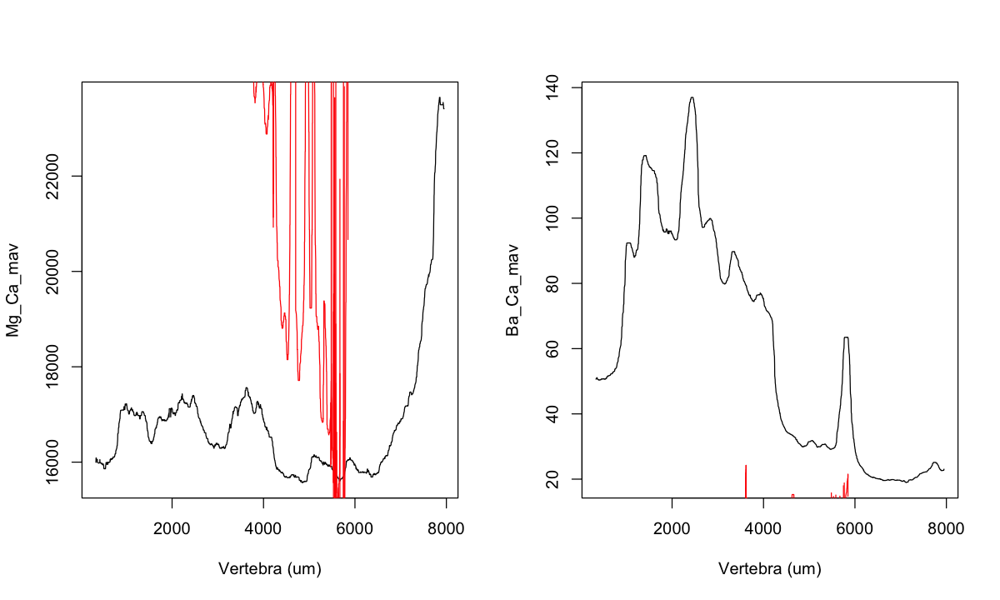<!-- -->

``` r
# oh! it's calling it right before (note tooth incomplete)

mult2.1 <- align_multi(SMA002T_filt, SMA002V_filt,
                       elements = c('Mg_Ca_mav', 'Sr_Ca_mav'),
                       n = 6000, open_begin = TRUE, # lockV_start = 3266.09,
                       open_end = TRUE)
```

    #> Tooth: 155.529 to 42968.97 
    #>  Vert:  3934.285 to 4349.027 
    #>  Normalized distance: 0.7483158

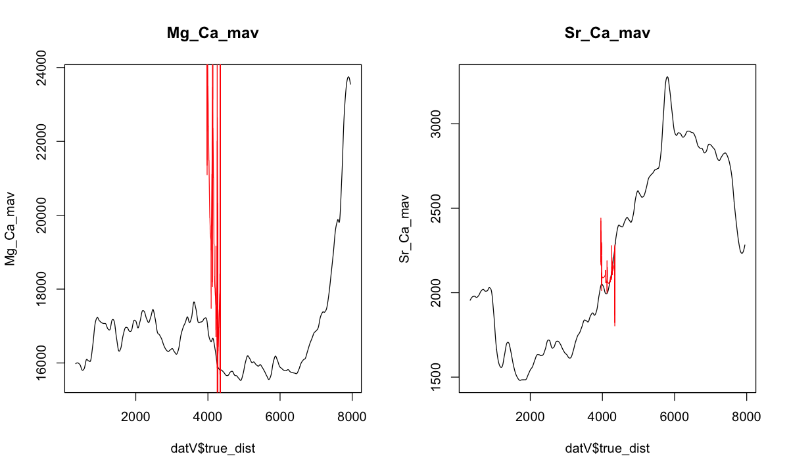<!-- -->

``` r
mult3 <- align_multi(SMA002T_filt, SMA002V_filt,
                       elements = c('Mg_Ca_mav', 'Zn_Ca_mav', 'Mn_Ca_mav'),
                       n = 6000, open_begin = TRUE, # lockV_start = 3266.09,
                       open_end = TRUE)
```

    #> Tooth: 155.529 to 42968.97 
    #>  Vert:  2220.596 to 5771.821 
    #>  Normalized distance: 0.5589661

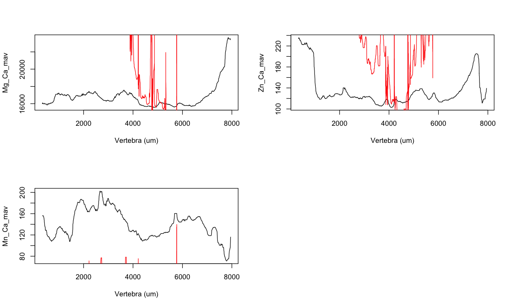<!-- -->

``` r
mult3.1 <- align_multi(SMA002T_filt, SMA002V_filt,
                       elements = c('Mg_Ca_mav', 'Ba_Ca_mav', 'Sr_Ca_mav'),
                       n = 6000, open_begin = TRUE, # lockV_start = 3266.09,
                       open_end = TRUE)
```

    #> Tooth: 155.529 to 42968.97 
    #>  Vert:  3934.285 to 4389.349 
    #>  Normalized distance: 0.7531597

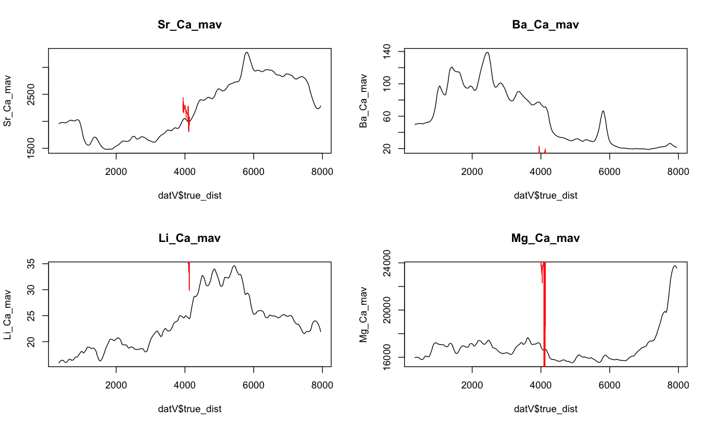<!-- -->

``` r
mult4 <- align_multi(SMA002T_filt, SMA002V_filt,
                    elements =  mavs1,
                    n = 6000, open_begin = TRUE, open_end = TRUE)
```

    #> Tooth: 155.529 to 42968.97 
    #>  Vert:  3931.405 to 4256.862 
    #>  Normalized distance: 0.9261502

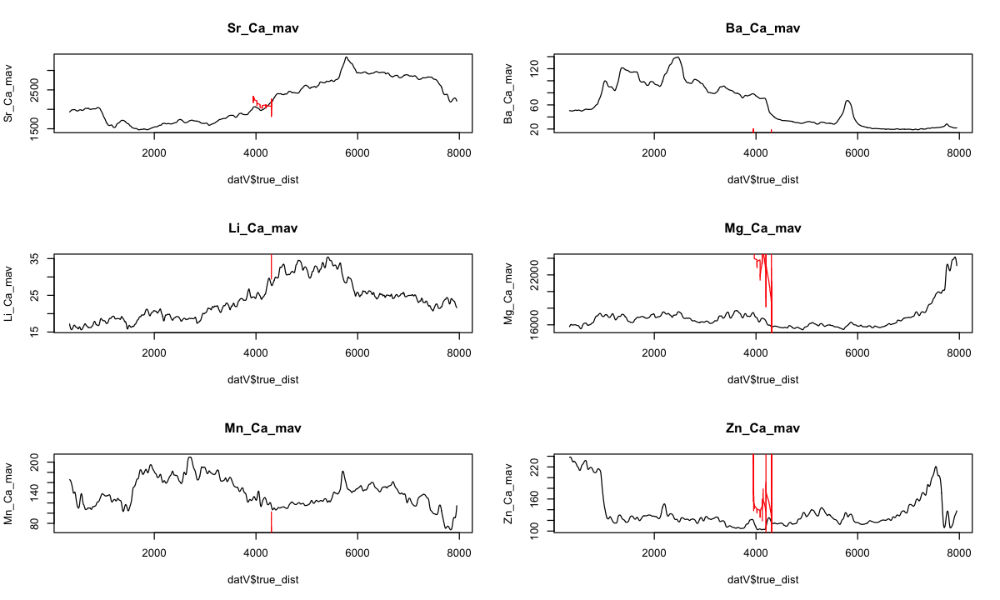<!-- -->

``` r
mult6 <- align_multi(SMA002T_filt, SMA002V_filt,
                       elements =  mavs2,
                       n = 6000,  open_begin = TRUE,
                       open_end = TRUE)
```

    #> Tooth: 155.529 to 42968.97 
    #>  Vert:  3931.405 to 4256.862 
    #>  Normalized distance: 0.8945084

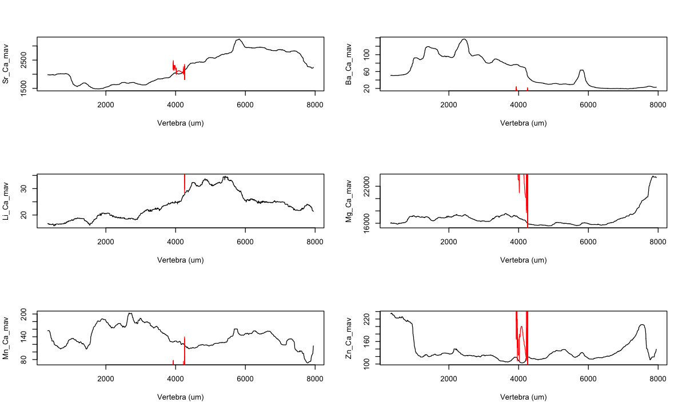<!-- -->

``` r
# oh woah these all look like they match - not long though and they are def scrunched.
```

## Save for 06f

Only what 06f uses is saved: each `mult*` alignment carries two n × n
cost matrices (`keep = TRUE`), so saving all of them comes to ~8 GB.

``` r
save(mult1h6, SMA001T_filt, SMA001V_filt, mavs2,
     file = 'data/output/dtw_cache/06b.RData')
```
