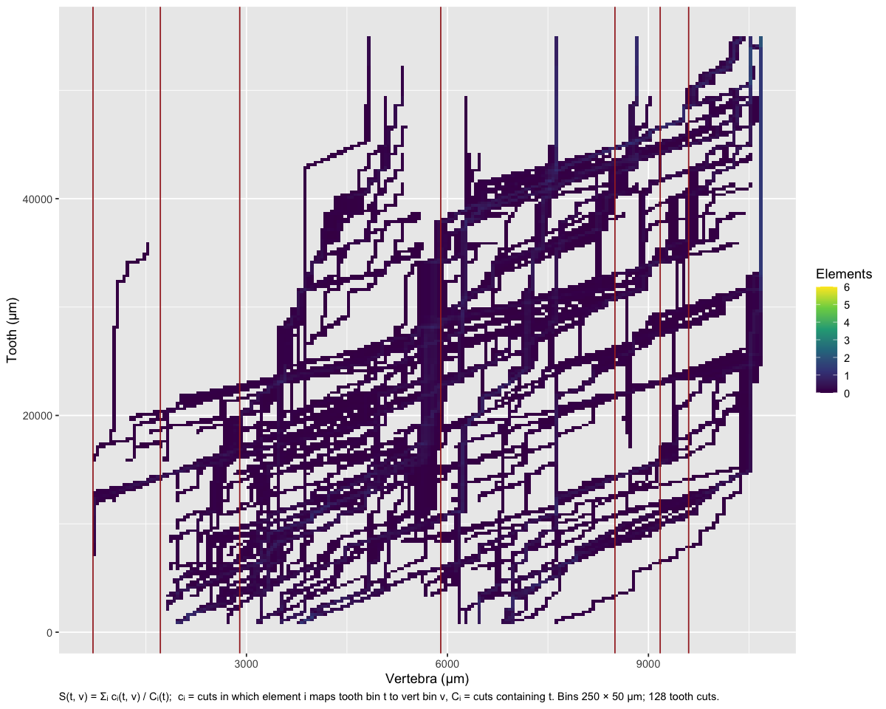
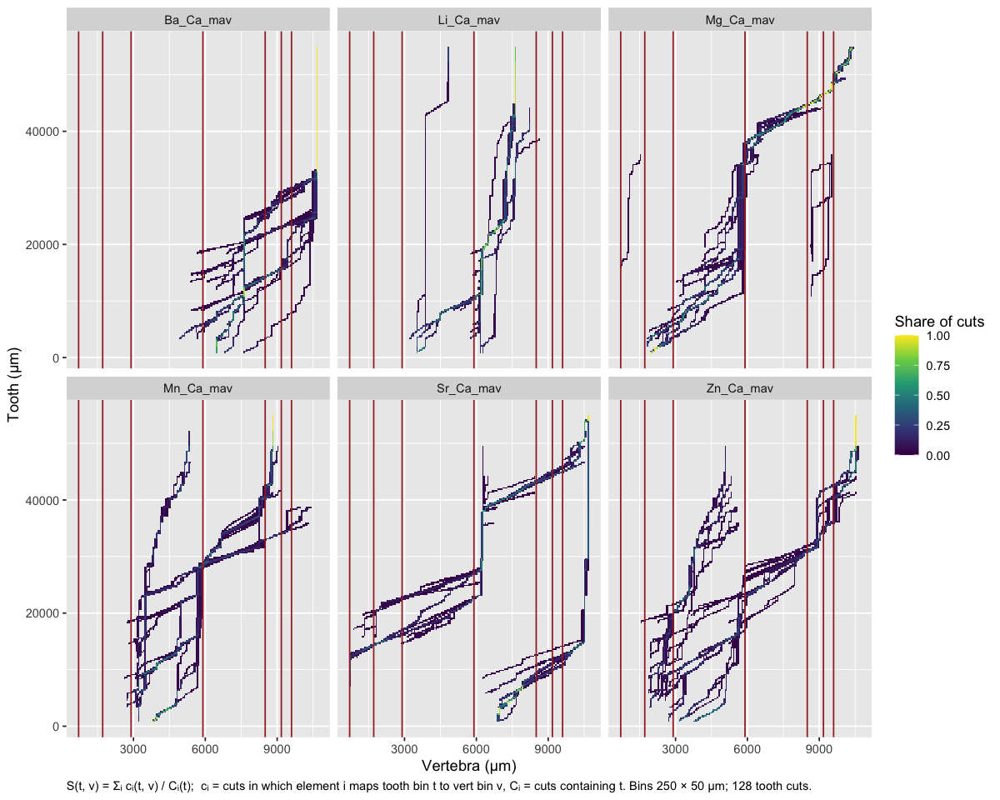
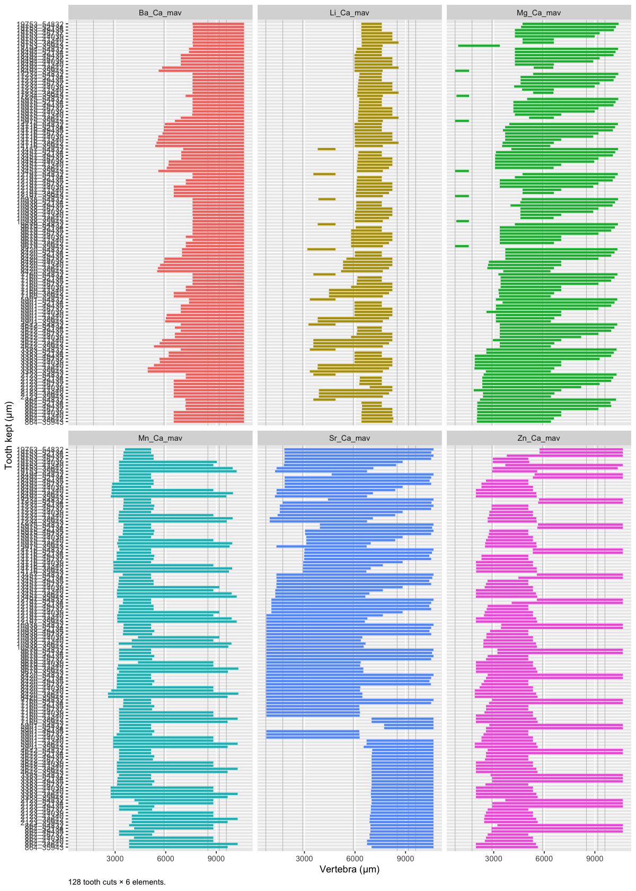
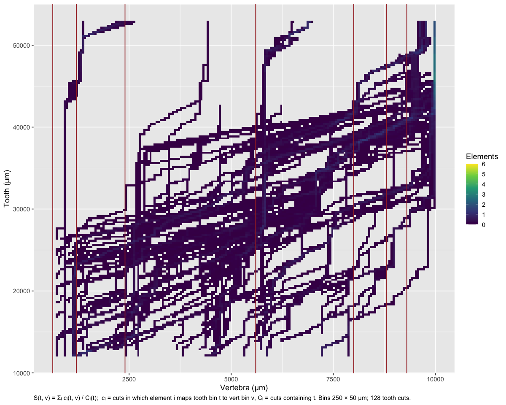
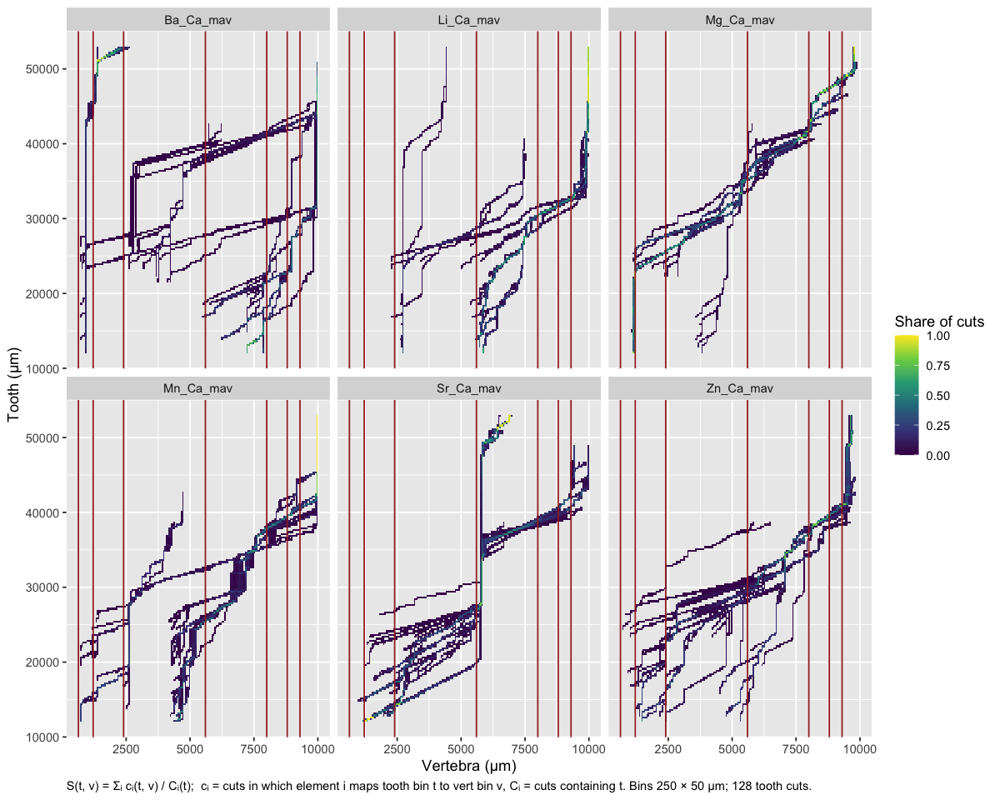
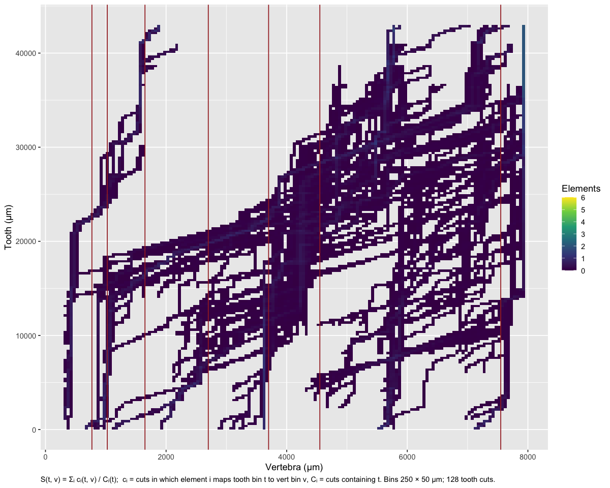
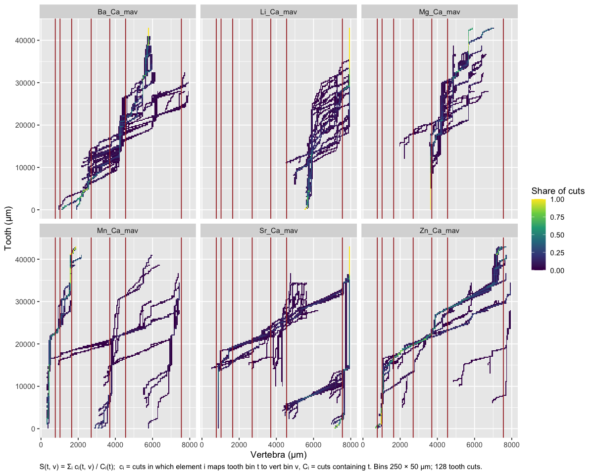
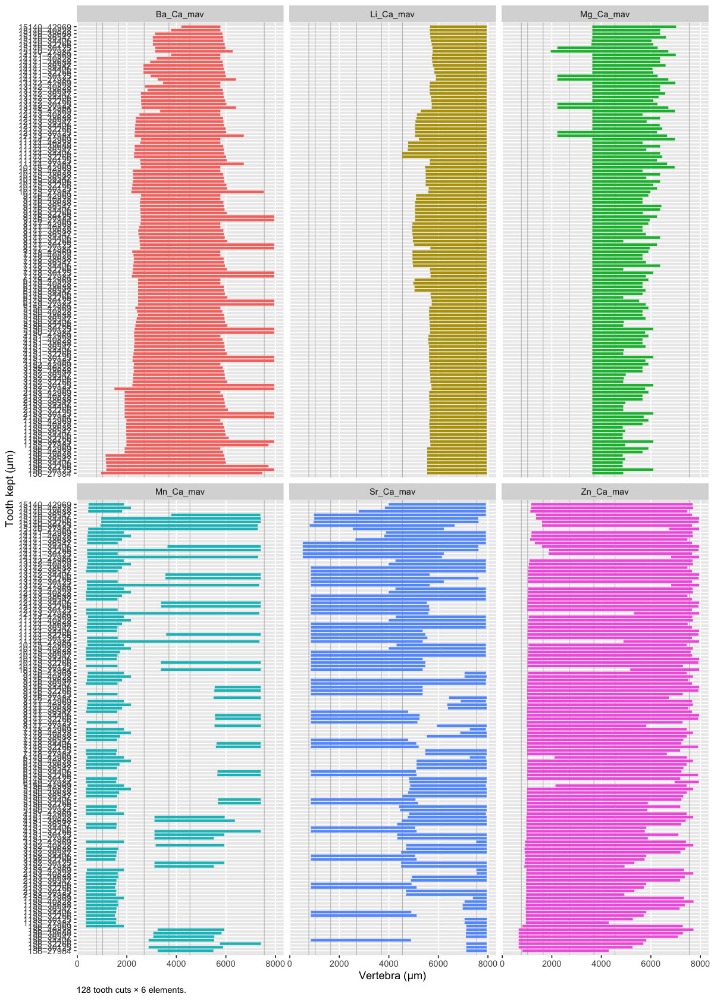

06c · DTW warp down
================
Nikki Biskis
Rendered 27 Oct 2026 12:56

- [SMA001 (water)](#sma001-water)
- [SMA001 (bleach)](#sma001-bleach)
- [SMA002](#sma002)

- **Paper:** The potential of elemental analysis in determining origin
  of sawfish rostra
- **DOI:** tbd
- **Written:** 14 Aug 2026
- **Content:** dynamic time warping IV

R markdown version of `original/06d_dtw_warpdown.R`. It starts from the
objects 06a saved (`data/output/dtw_cache/06a.RData`).

``` r
source('helpers/microHelp.R')
source('helpers/functions/fxn_mavs.R')
source('helpers/functions/fxn_dtw.R')
source('helpers/functions/fxn_stack.R')
load('data/output/dtw_cache/06a.RData') # objects from 06a
```

Instead of building up sections, trialing cutting down the tooth

- and seeing which elements are aligned in a section
- and importantly, whether cutting it makes the tooth end to an earlier
  part of the vert

5 gives a general idea - quick 10 fits the end much better

## SMA001 (water)

``` r
s <- stack_alignments(SMA001T_filt, SMA001V_filt, # 1
                      elements = mavs2, # or mavs1 for just the main 4
                      spanT = 0.02, spanV = 0.04, # adjust res again, path ~ same
                      n = 1000, n_steps = c(16, 8), # how high res the map is
                      tol_um = 600, ref_step = 1000, # how (detailed) the table prints
                      plot = "heat", # for continuous scale
                      bands = c(710, # a visual of how path relates to banding
                                1715, 2900, 5900, 
                                8500, 9175, 9600))
```

<!-- -->

    #>  tooth_ref n_agree n_elements     members n_cuts vert_median vert_lo vert_hi
    #>       1000       3          6    Li+Mn+Zn      8        3832  2722.3    6256
    #>       2000       3          6    Li+Mn+Zn      8        3987  2762.2    6256
    #>       3000       2          6       Ba+Sr     16        6993  6485.4    8326
    #>       4000       2          6       Ba+Sr     24        7179  5112.6    8795
    #>       5000       3          6    Mg+Mn+Zn     32        3145  2005.4    5062
    #>       6000       3          6    Mg+Mn+Zn     40        3180  1876.1    5333
    #>       7000       3          6    Mg+Mn+Zn     40        3325  1955.8    5669
    #>       8000       3          6    Mg+Mn+Zn     48        3409  1955.8    5669
    #>       9000       2          6       Mn+Zn     56        3350  1987.4    5669
    #>      10000       2          6       Mg+Mn     64        3837  3150.4    5689
    #>      11000       2          6       Mg+Mn     72        3993  3190.2    8695
    #>      12000       2          6       Mg+Mn     72        4365  3210.1    8695
    #>      13000       2          6       Mg+Mn     80        4789  3160.4    8735
    #>      14000       3          6    Mg+Mn+Zn     88        4757  1955.8    8735
    #>      15000       3          6    Mg+Mn+Zn     96        4932  2085.2    9024
    #>      16000       3          6    Mg+Mn+Zn    104        5140   711.4    9213
    #>      17000       2          6       Mg+Zn    104        5460   781.1    9253
    #>      18000       2          6       Mg+Zn    112        5619   950.3    9352
    #>      19000       2          6       Sr+Zn    120        4647  1328.6   10507
    #>      20000       2          6       Mn+Zn    128        4166  2632.7    6437
    #>      21000       2          6       Mg+Sr    128        5634  1049.9   10507
    #>      22000       2          6       Mg+Sr    128        5744  1049.9   10507
    #>      23000       4          6 Mg+Mn+Sr+Zn    128        5659  1049.9   10507
    #>      24000       4          6 Mg+Mn+Sr+Zn    128        5699  1049.9   10627
    #>      25000       4          6 Mg+Mn+Sr+Zn    128        5699  1049.9   10627
    #>      26000       4          6 Mg+Mn+Sr+Zn    128        5699  1049.9   10627
    #>      27000       4          6 Mg+Mn+Sr+Zn    128        5769  1049.9   10627
    #>      28000       2          6       Mg+Mn    128        5679  1049.9    9392
    #>      29000       3          6    Mg+Mn+Sr    128        6025  1069.8   10657
    #>      30000       3          6    Mg+Mn+Sr    128        6122  1079.7   10657
    #>      31000       3          6    Mg+Mn+Sr    128        6256  1079.7   10657
    #>      32000       2          6       Mn+Sr    128        6655  3867.2   10657
    #>      33000       2          6       Mn+Sr    128        6655  3867.2   10657
    #>      34000       2          6       Li+Mn    128        7252  3897.0    9150
    #>      35000       2          6       Li+Mn    128        7334  3897.0    9786
    #>      36000       2          6       Li+Mn    112        7601  3897.0    9815
    #>      37000       2          6       Mg+Sr    112        6236  5818.4   10657
    #>      38000       2          6       Mg+Sr    112        6277  5933.9   10657
    #>      39000       2          6       Mg+Sr     96        6456  6266.4   10657
    #>      40000       2          6       Mg+Sr     96        6831  6266.4   10657
    #>      41000       3          6    Li+Mg+Sr     96        7510  3897.0   10657
    #>      42000       3          6    Li+Mg+Sr     80        7585  3897.0   10657
    #>      43000       2          6       Li+Mg     80        7620  3936.9    8315
    #>      44000       2          6       Li+Mg     80        8090  4292.8    9059
    #>      45000       2          6       Ba+Zn     64       10589  5061.8   10657
    #>      46000       2          6       Mg+Mn     64        8899  5141.4    9024
    #>      47000       3          6    Ba+Sr+Zn     48       10537  5061.8   10657
    #>      48000       3          6    Ba+Sr+Zn     48       10537  5061.8   10657
    #>      49000       3          6    Ba+Sr+Zn     48       10537  5061.8   10657
    #>      50000       3          6    Ba+Sr+Zn     32       10537 10248.4   10657
    #>      51000       3          6    Ba+Sr+Zn     32       10537 10507.2   10657
    #>      52000       4          6 Ba+Mg+Sr+Zn     32       10537 10016.6   10657
    #>      53000       4          6 Ba+Mg+Sr+Zn     16       10537 10218.5   10657
    #>      54000       4          6 Ba+Mg+Sr+Zn     16       10559 10228.5   10657
    #>  uncert_um
    #>     3534.1
    #>     3494.2
    #>     1841.0
    #>     3682.3
    #>     3056.4
    #>     3457.1
    #>     3713.3
    #>     3713.3
    #>     3681.6
    #>     2538.6
    #>     5505.2
    #>     5485.3
    #>     5574.9
    #>     6779.4
    #>     6938.7
    #>     8501.2
    #>     8471.8
    #>     8402.1
    #>     9178.6
    #>     3803.9
    #>     9457.4
    #>     9457.4
    #>     9457.4
    #>     9576.8
    #>     9576.8
    #>     9576.8
    #>     9576.8
    #>     8342.4
    #>     9586.8
    #>     9576.8
    #>     9576.8
    #>     6789.4
    #>     6789.4
    #>     5252.6
    #>     5888.9
    #>     5918.2
    #>     4838.2
    #>     4722.6
    #>     4390.2
    #>     4390.2
    #>     6759.5
    #>     6759.5
    #>     4377.8
    #>     4766.0
    #>     5594.8
    #>     3882.5
    #>     5594.8
    #>     5594.8
    #>     5594.8
    #>      408.2
    #>      149.3
    #>      640.0
    #>      438.0
    #>      428.1

``` r
s$heat(by_element = TRUE)
```

<!-- -->

``` r
s$plot(by_element = TRUE)
```

<!-- -->

a couple options here looks like: - seeing overlap between Mg, Sr, and
to lesser extent Mn and Zn from 14k - 50k - and Li, Ba at the earlier
part (4k - 35k). VERY promising

## SMA001 (bleach)

``` r
t <- stack_alignments(SMA001TB_filt, SMA001VB_filt, # removing end due to inc holes
                      elements = mavs2, # or mavs1 for just the main 4
                      spanT = 0.02, spanV = 0.04, # adjust res again, path ~ same
                      n = 1000, n_steps = c(16, 8), # how high res the map is
                      tol_um = 600, ref_step = 1000, # how (detailed) the table prints
                      plot = "heat", # for continuous scale
                      bands = c(630, # birth
                                1210, 2400, 5600, 
                                8000, 8800, 9300))
```

<!-- -->

    #>  tooth_ref n_agree n_elements     members n_cuts vert_median vert_lo vert_hi
    #>      13000       2          6       Sr+Zn     16        1852  1364.3    5333
    #>      14000       2          6       Sr+Zn     24        2398  1286.8    5443
    #>      15000       2          6       Sr+Zn     32        2647  1050.0    5665
    #>      16000       2          6       Sr+Zn     40        2453  1465.8    5665
    #>      17000       2          6       Sr+Zn     48        2573  1165.8    5831
    #>      18000       2          6       Sr+Zn     56        2684  1345.8    5831
    #>      19000       2          6       Sr+Zn     64        2859  1013.9    5831
    #>      20000       2          6       Sr+Zn     72        3127  1419.6    6292
    #>      21000       2          6       Sr+Zn     80        3192  1419.6    6292
    #>      22000       0          6        none     NA          NA      NA      NA
    #>      23000       2          6       Mn+Sr     96        4484  1179.7    5875
    #>      24000       2          6       Mn+Sr    104        4714  1675.1    5997
    #>      25000       2          6       Mn+Sr    112        5012  1699.7    6142
    #>      26000       2          6       Mn+Sr    120        5552  1401.2    6375
    #>      27000       2          6       Mn+Sr    128        5637  1764.9    6431
    #>      28000       0          6        none     NA          NA      NA      NA
    #>      29000       2          6       Sr+Zn    128        5803  1702.8    7757
    #>      30000       2          6       Sr+Zn    128        5822  2407.1    7806
    #>      31000       2          6       Ba+Li    128        8333   921.3    9956
    #>      32000       2          6       Ba+Li    128        8892   921.3    9956
    #>      33000       2          6       Ba+Li    128        9421   921.3    9956
    #>      34000       2          6       Mg+Sr    128        5789  4745.1    5888
    #>      35000       2          6       Mg+Sr    128        5803  5314.4    6455
    #>      36000       2          6       Mg+Sr    128        5891  5443.3    6698
    #>      37000       2          6       Mn+Zn    128        7943  4151.3    9181
    #>      38000       2          6       Mn+Zn    128        8129  4271.3    9938
    #>      39000       3          6    Mn+Sr+Zn    112        8519  4695.8    9965
    #>      40000       3          6    Ba+Mn+Zn    112        8970   921.3    9965
    #>      41000       4          6 Ba+Li+Mn+Zn     96        9479   921.3    9965
    #>      42000       3          6    Ba+Sr+Zn     96        9458   921.3    9965
    #>      43000       3          6    Ba+Sr+Zn     80        9495   921.3    9965
    #>      44000       3          6    Ba+Li+Mn     80        9965  1004.4    9965
    #>      45000       4          6 Ba+Li+Mn+Zn     64        9947  1004.4    9965
    #>      46000       4          6 Ba+Li+Mn+Zn     64        9965  1262.8    9965
    #>      47000       4          6 Ba+Li+Mn+Zn     48        9956  1262.8    9965
    #>      48000       3          6    Ba+Li+Mn     48        9965  1290.4    9965
    #>      49000       4          6 Li+Mg+Mn+Zn     32        9626  4446.6    9965
    #>      50000       4          6 Li+Mg+Mn+Zn     32        9837  4446.6    9965
    #>      51000       4          6 Li+Mg+Mn+Zn     16        9785  4446.6    9965
    #>      52000       4          6 Li+Mg+Mn+Zn     16        9785  4446.6    9965
    #>  uncert_um
    #>       3968
    #>       4157
    #>       4615
    #>       4199
    #>       4665
    #>       4485
    #>       4817
    #>       4873
    #>       4873
    #>         NA
    #>       4695
    #>       4322
    #>       4442
    #>       4974
    #>       4666
    #>         NA
    #>       6054
    #>       5399
    #>       9035
    #>       9035
    #>       9035
    #>       1143
    #>       1141
    #>       1255
    #>       5030
    #>       5666
    #>       5270
    #>       9044
    #>       9044
    #>       9044
    #>       9044
    #>       8961
    #>       8961
    #>       8703
    #>       8703
    #>       8675
    #>       5519
    #>       5519
    #>       5519
    #>       5519

``` r
t$heat(by_element = TRUE)
```

<!-- -->

``` r
t$plot(by_element = TRUE)
```

<!-- -->

Ooh and all of them 22k - 50k?

## SMA002

``` r
u <- stack_alignments(SMA002T_filt, SMA002V_filt, # sawfish 1 - bleach
                      elements = mavs2, # or mavs1 for just the main 4
                      spanT = 0.02, spanV = 0.04, # adjust res again, path ~ same
                      n = 1000, n_steps = c(16, 8), # how high res the map is
                      tol_um = 600, ref_step = 1000, # how (detailed) the table prints
                      plot = "heat", # for continuous scale
                      bands = c(770, 1025, # birth and/or 1yr
                                1650, 2700, 3700,
                                4550, 7550))
```

<!-- -->

    #>  tooth_ref n_agree n_elements  members n_cuts vert_median vert_lo vert_hi
    #>       1000       2          6    Ba+Zn      8        1001   867.5    1419
    #>       2000       0          6     none     NA          NA      NA      NA
    #>       3000       0          6     none     NA          NA      NA      NA
    #>       4000       0          6     none     NA          NA      NA      NA
    #>       5000       0          6     none     NA          NA      NA      NA
    #>       6000       0          6     none     NA          NA      NA      NA
    #>       7000       2          6    Li+Sr     56        5708   867.7    7652
    #>       8000       2          6    Li+Sr     64        5761   867.7    7652
    #>       9000       2          6    Ba+Mg     72        3612  2552.3    3931
    #>      10000       2          6    Ba+Mg     80        3612  2300.8    4127
    #>      11000       2          6    Ba+Mg     88        3612  2514.2    4161
    #>      12000       2          6    Ba+Mg     96        3612  2201.7    4191
    #>      13000       2          6    Ba+Mg    104        3677  2201.7    4245
    #>      14000       3          6 Ba+Mg+Sr    112        3749   768.0    7836
    #>      15000       3          6 Ba+Mg+Sr    120        3978   728.6    7865
    #>      16000       3          6 Ba+Mg+Sr    128        3897   989.7    7865
    #>      17000       3          6 Ba+Mg+Sr    128        4092   989.7    7865
    #>      18000       3          6 Ba+Mg+Sr    128        4237   989.7    7865
    #>      19000       3          6 Ba+Mg+Sr    128        4237  1424.9    7865
    #>      20000       3          6 Ba+Mg+Sr    128        4252  2075.0    7865
    #>      21000       3          6 Ba+Mg+Sr    128        4321  2661.9    7865
    #>      22000       3          6 Ba+Mg+Sr    128        4665  3148.7    7865
    #>      23000       2          6    Mg+Sr    128        4336  3249.4    7865
    #>      24000       2          6    Mg+Sr    128        4367  3596.6    7865
    #>      25000       3          6 Mg+Sr+Zn    128        4374  3840.6    7919
    #>      26000       3          6 Ba+Mg+Sr    128        5098  4191.2    7949
    #>      27000       3          6 Ba+Mg+Sr    128        5210  4229.3    7949
    #>      28000       2          6    Ba+Sr    112        5273  4351.3    7949
    #>      29000       3          6 Ba+Mg+Zn    112        5266  4229.3    7591
    #>      30000       3          6 Ba+Mg+Zn    112        5418  4259.8    7926
    #>      31000       2          6    Ba+Zn     96        5632  5502.3    7794
    #>      32000       2          6    Ba+Zn     96        5896  5563.3    7926
    #>      33000       2          6    Ba+Mg     80        5624  4900.1    5982
    #>      34000       2          6    Ba+Mg     80        5624  4900.1    6448
    #>      35000       2          6    Ba+Mg     64        5650  4907.7    6286
    #>      36000       2          6    Ba+Mg     64        5685  4907.7    6493
    #>      37000       2          6    Ba+Mg     48        5685  4907.7    5885
    #>      38000       2          6    Ba+Mg     48        5685  4907.7    5937
    #>      39000       2          6    Ba+Mg     32        5742  5685.3    5807
    #>      40000       3          6 Li+Sr+Zn     32        7528  7057.4    7949
    #>      41000       2          6    Ba+Mg     16        5765  5685.3    6448
    #>      42000       2          6    Ba+Mg     16        5807  5685.3    6600
    #>      43000       3          6 Li+Sr+Zn     16        7643  7461.4    7949
    #>  uncert_um
    #>      551.7
    #>         NA
    #>         NA
    #>         NA
    #>         NA
    #>         NA
    #>     6784.2
    #>     6784.2
    #>     1378.7
    #>     1825.8
    #>     1646.5
    #>     1989.5
    #>     2042.9
    #>     7068.0
    #>     7136.7
    #>     6875.7
    #>     6875.7
    #>     6875.7
    #>     6440.4
    #>     5790.3
    #>     5203.5
    #>     4716.7
    #>     4615.9
    #>     4268.7
    #>     4078.2
    #>     3758.0
    #>     3719.9
    #>     3597.9
    #>     3361.6
    #>     3666.5
    #>     2292.0
    #>     2363.0
    #>     1081.7
    #>     1547.4
    #>     1378.3
    #>     1585.5
    #>      977.4
    #>     1029.1
    #>      122.0
    #>      891.9
    #>      762.3
    #>      914.7
    #>      487.9

``` r
u$heat(by_element = TRUE) 
```

<!-- --> Ba/Mg
10k-30k or Sr/Zn 19k-28k

``` r
u$plot(by_element = TRUE)
```

<!-- -->

``` r
# for 06c2 (anchors): each fish's records, and its stack_alignments() run (paths, runs, spans)
gap_um <- 350   # tooth holes wider than this (um), as in 06a's add_mavs()
fish <- list(
  SMA001W = list(tooth = SMA001T_filt,  vert = SMA001V_filt,  bands = c(710, 1715, 2900, 5900, 8500, 9175, 9600)),
  SMA001B = list(tooth = SMA001TB_filt, vert = SMA001VB_filt, bands = c(630, 1210, 2400, 5600, 8000, 8800, 9300)),
  SMA002W = list(tooth = SMA002T_filt,  vert = SMA002V_filt,  bands = c(770, 1025, 1650, 2700, 3700, 4550, 7550)))
stacks <- lapply(list(SMA001W = s, SMA001B = t, SMA002W = u), `[`, c("paths", "runs", "spanT", "spanV"))
save(fish, stacks, gap_um, file = 'data/output/dtw_cache/06c.RData')
```
