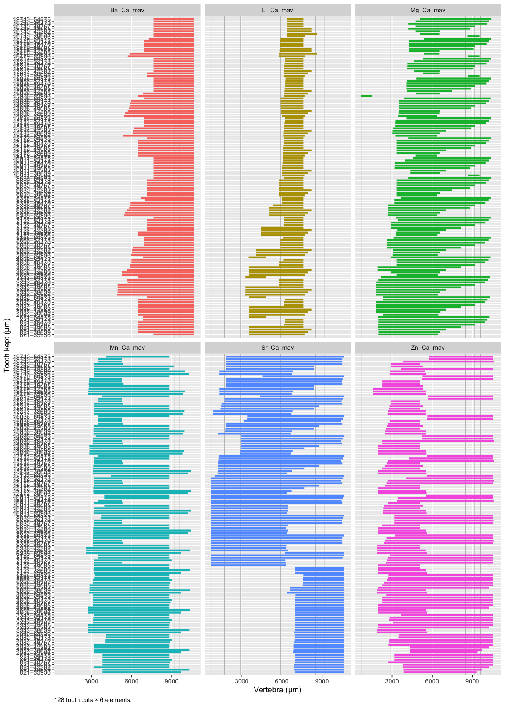
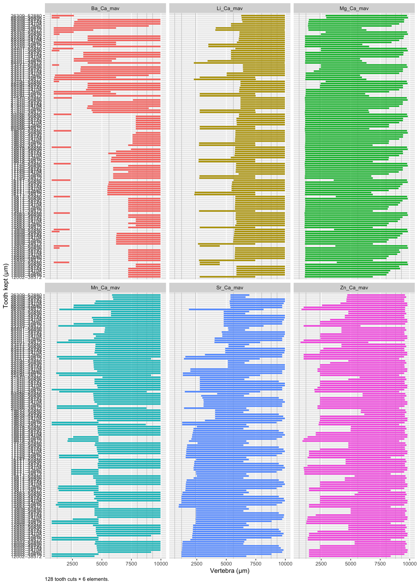
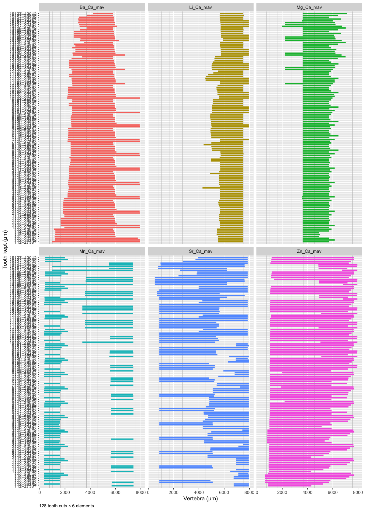
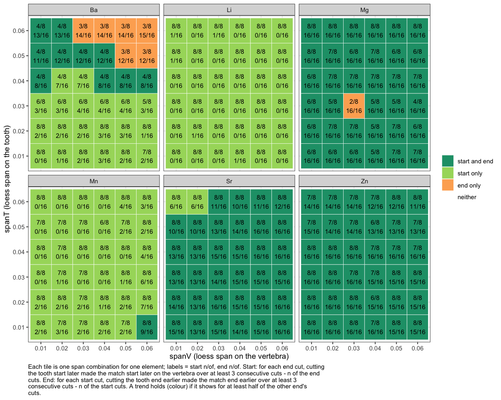

06c · DTW warp down
================
Nikki Biskis
Rendered 26 Oct 2026 20:20

- [SMA001 (water)](#sma001-water)
- [SMA001 (bleach)](#sma001-bleach)
- [SMA002](#sma002)
- [Sweeps: all three sets](#sweeps-all-three-sets)
  - [SMA001 (water)](#sma001-water-1)
  - [SMA001 (bleach)](#sma001-bleach-1)
  - [SMA002](#sma002-1)
- [Warp-down result per set](#warp-down-result-per-set)

- **Paper:** The potential of elemental analysis in determining origin
  of sawfish rostra
- **DOI:** tbd
- **Written:** 14 Aug 2026
- **Content:** dynamic time warping IV

R markdown version of `original/06d_dtw_warpdown.R`. It starts from the
objects 06a saved (`data/output/dtw_cache/06a.RData`).

``` r
source('helpers/microHelp.R')
source('helpers/functions/fxn_mavs.R')
source('helpers/functions/fxn_dtw.R')
source('helpers/functions/fxn_stack.R')
load('data/output/dtw_cache/06a.RData') # objects from 06a
```

Instead of building up sections, trialing cutting down the tooth

- and seeing which elements are aligned in a section
- and importantly, whether cutting it makes the tooth end to an earlier
  part of the vert

5 gives a general idea - quick 10 fits the end much better

## SMA001 (water)

``` r
s <- stack_alignments(SMA001T_filt, SMA001V_filt, # 1
                      elements = mavs2, # or mavs1 for just the main 4
                      spanT = 0.02, spanV = 0.04, # adjust res again, path ~ same
                      n = 1000, n_steps = c(12, 6), # how high res the map is
                      tol_um = 400, ref_step = 1000, # how (detailed) the table prints
                      plot = "heat", # for continuous scale
                      bands = c(710, # a visual of how path relates to banding
                                1715, 2900, 5900, 
                                8500, 9175, 9600))
```

<!-- -->

    #>  tooth_ref n_agree n_elements     members n_cuts vert_median vert_lo vert_hi
    #>       1000       3          6    Li+Mn+Zn      6        3817  2722.3    6266
    #>       2000       3          6    Li+Mn+Zn      6        3977  2772.1    6266
    #>       3000       3          6    Li+Mn+Zn     12        3646  1786.5    6515
    #>       4000       3          6    Li+Mn+Zn     12        3911  1933.8    6754
    #>       5000       3          6    Mg+Mn+Zn     18        3064  2006.9    5062
    #>       6000       2          6       Mg+Mn     24        3133  2549.6    5328
    #>       7000       2          6       Mg+Mn     24        3305  2881.6    5669
    #>       8000       2          6       Mg+Mn     30        3394  2951.3    5669
    #>       9000       2          6       Mg+Mn     30        3509  3140.4    5669
    #>      10000       2          6       Mg+Mn     36        3836  3200.2    5689
    #>      11000       2          6       Mg+Mn     36        3993  3200.2    5719
    #>      12000       2          6       Mg+Mn     42        4371  3210.1    8695
    #>      13000       2          6       Mg+Zn     48        4367  1673.3    8735
    #>      14000       3          6    Mg+Mn+Zn     48        4773  1955.8    8735
    #>      15000       3          6    Mg+Mn+Zn     54        4932  2085.2    9024
    #>      16000       2          6       Mg+Mn     54        5143  3210.1    9208
    #>      17000       2          6       Mg+Zn     60        5460   781.1    9253
    #>      18000       2          6       Mg+Zn     60        5629   950.3    9352
    #>      19000       2          6       Mg+Zn     66        5619  1000.1    9352
    #>      20000       3          6    Mn+Sr+Zn     72        4903  1454.3   10507
    #>      21000       3          6    Mg+Sr+Zn     72        5629  1049.9   10507
    #>      22000       3          6    Mg+Sr+Zn     72        5744  1049.9   10507
    #>      23000       3          6    Mg+Mn+Zn     72        5629  1049.9    9382
    #>      24000       3          6    Mg+Mn+Zn     72        5689  1049.9    9382
    #>      25000       3          6    Mg+Mn+Zn     72        5689  1049.9    9382
    #>      26000       3          6    Mg+Mn+Zn     72        5689  1049.9    9382
    #>      27000       2          6       Mg+Mn     72        5679  1049.9    9382
    #>      28000       2          6       Mg+Mn     72        5701  1049.9    9382
    #>      29000       2          6       Li+Zn     72        7217  3668.1    8018
    #>      30000       2          6       Li+Zn     72        7252  3797.5    8334
    #>      31000       2          6       Mn+Sr     72        6321  3817.4   10657
    #>      32000       2          6       Mn+Sr     72        6655  3867.2   10657
    #>      33000       2          6       Mn+Sr     72        6655  3867.2   10657
    #>      34000       2          6       Li+Mn     72        7252  3897.0    9142
    #>      35000       2          6       Li+Mn     72        7351  3897.0    9786
    #>      36000       2          6       Li+Mn     60        7648  3897.0    9799
    #>      37000       2          6       Mg+Sr     60        6236  5818.4   10657
    #>      38000       2          6       Mg+Sr     60        6276  5934.8   10657
    #>      39000       2          6       Mg+Sr     60        6456  6266.4   10657
    #>      40000       2          6       Mg+Sr     48        6818  6276.3   10657
    #>      41000       3          6    Li+Mg+Sr     48        7491  3897.0   10657
    #>      42000       2          6       Li+Mg     48        7531  3897.0    8228
    #>      43000       2          6       Li+Mg     48        7620  3942.6    8228
    #>      44000       2          6       Mn+Sr     36        8800  5031.9   10657
    #>      45000       2          6       Mg+Mn     36        8688  5099.4    9024
    #>      46000       2          6       Mg+Mn     36        8994  5141.4    9024
    #>      47000       3          6    Ba+Sr+Zn     36       10617  5061.8   10657
    #>      48000       3          6    Ba+Sr+Zn     24       10537  9900.0   10657
    #>      49000       3          6    Ba+Sr+Zn     24       10537  9900.0   10657
    #>      50000       3          6    Ba+Sr+Zn     24       10537 10248.4   10657
    #>      51000       3          6    Ba+Sr+Zn     24       10537 10507.2   10657
    #>      52000       3          6    Ba+Sr+Zn     12       10537 10507.2   10657
    #>      53000       4          6 Ba+Mg+Sr+Zn     12       10537 10218.5   10657
    #>      54000       4          6 Ba+Mg+Sr+Zn     12       10562 10228.5   10657
    #>  uncert_um
    #>     3544.0
    #>     3494.2
    #>     4728.7
    #>     4820.3
    #>     3054.9
    #>     2778.7
    #>     2787.4
    #>     2717.7
    #>     2528.6
    #>     2488.8
    #>     2518.6
    #>     5485.3
    #>     7061.9
    #>     6779.4
    #>     6938.7
    #>     5997.7
    #>     8471.8
    #>     8402.1
    #>     8352.3
    #>     9052.9
    #>     9457.4
    #>     9457.4
    #>     8332.4
    #>     8332.4
    #>     8332.4
    #>     8332.4
    #>     8332.4
    #>     8332.4
    #>     4350.4
    #>     4536.9
    #>     6839.2
    #>     6789.4
    #>     6789.4
    #>     5244.9
    #>     5888.9
    #>     5902.0
    #>     4838.2
    #>     4721.8
    #>     4390.2
    #>     4380.3
    #>     6759.5
    #>     4330.5
    #>     4284.9
    #>     5624.6
    #>     3924.5
    #>     3882.5
    #>     5594.8
    #>      756.6
    #>      756.6
    #>      408.2
    #>      149.3
    #>      149.3
    #>      438.0
    #>      428.1

``` r
head(s$groups, 20)  # stats per tooth cut: first 20 rows
```

    #>    cut t_start    t_end n_elements members  v_start     v_end spread_start
    #> 1    1 820.842 35956.36          1      Sr 6993.077 10656.560      0.00000
    #> 2    1 820.842 35956.36          1      Ba 7630.204 10656.560      0.00000
    #> 3    1 820.842 35956.36          1      Li 3548.606  7699.890      0.00000
    #> 4    1 820.842 35956.36          1      Mg 1985.652  6425.635      0.00000
    #> 5    1 820.842 35956.36          2   Mn+Zn 3837.304  9506.744     39.82047
    #> 6    2 820.842 39740.19          2   Ba+Sr 6684.468 10656.560    398.20472
    #> 7    2 820.842 39740.19          1      Li 3548.606  8048.319      0.00000
    #> 8    2 820.842 39740.19          1      Mg 2005.562  6754.154      0.00000
    #> 9    2 820.842 39740.19          1      Mn 3817.394 10636.650      0.00000
    #> 10   2 820.842 39740.19          1      Zn 3847.259 10039.343      0.00000
    #> 11   3 820.842 43524.01          1      Sr 6913.436 10656.560      0.00000
    #> 12   3 820.842 43524.01          1      Ba 6485.366 10656.560      0.00000
    #> 13   3 820.842 43524.01          1      Li 3548.606  7620.249      0.00000
    #> 14   3 820.842 43524.01          1      Mg 1975.697  6734.243      0.00000
    #> 15   3 820.842 43524.01          1      Mn 3210.132  9223.023      0.00000
    #> 16   3 820.842 43524.01          1      Zn 3797.484 10268.310      0.00000
    #> 17   4 820.842 47307.84          1      Sr 6993.077 10656.560      0.00000
    #> 18   4 820.842 47307.84          1      Ba 6485.366 10656.560      0.00000
    #> 19   4 820.842 47307.84          1      Li 6166.802  7620.249      0.00000
    #> 20   4 820.842 47307.84          1      Mg 1975.697  9511.721      0.00000
    #>    spread_end
    #> 1      0.0000
    #> 2      0.0000
    #> 3      0.0000
    #> 4      0.0000
    #> 5    368.3394
    #> 6      0.0000
    #> 7      0.0000
    #> 8      0.0000
    #> 9      0.0000
    #> 10     0.0000
    #> 11     0.0000
    #> 12     0.0000
    #> 13     0.0000
    #> 14     0.0000
    #> 15     0.0000
    #> 16     0.0000
    #> 17     0.0000
    #> 18     0.0000
    #> 19     0.0000
    #> 20     0.0000

``` r
s$plot()
```

<!-- -->

``` r
s$plot(by_element = TRUE)
```

<!-- -->

``` r
s$heat(by_element = TRUE)
```

<!-- -->

## SMA001 (bleach)

``` r
t <- stack_alignments(SMA001TB_filt, SMA001VB_filt, # removing end due to inc holes
                      elements = mavs2, # or mavs1 for just the main 4
                      spanT = 0.01, spanV = 0.02, # adjust res again, path ~ same
                      n = 1000, n_steps = c(12, 6), # how high res the map is
                      tol_um = 400, ref_step = 1000, # how (detailed) the table prints
                      plot = "heat", # for continuous scale
                      bands = c(630, # birth
                                1210, 2400, 5600, 
                                8000, 8800, 9300))
```

<!-- -->

    #>  tooth_ref n_agree n_elements        members n_cuts vert_median vert_lo vert_hi
    #>      13000       2          6          Sr+Zn      6        1702  1419.6    5416
    #>      14000       2          6          Sr+Zn     12        2304  1355.0    5489
    #>      15000       2          6          Li+Sr     18        2739  1216.6    3120
    #>      16000       3          6       Li+Sr+Zn     24        2739  1419.6    5780
    #>      17000       3          6       Li+Sr+Zn     24        2739  1520.7    5840
    #>      18000       2          6          Li+Sr     30        2739  2175.8    5868
    #>      19000       2          6          Li+Sr     36        2799  2261.4    5988
    #>      20000       2          6          Li+Sr     42        3007  2684.0    6006
    #>      21000       2          6          Li+Zn     42        2739  1419.6    6099
    #>      22000       0          6           none     NA          NA      NA      NA
    #>      23000       2          6          Li+Sr     54        3598  1664.6    6394
    #>      24000       0          6           none     NA          NA      NA      NA
    #>      25000       2          6          Mn+Sr     60        4845  2536.3    6138
    #>      26000       0          6           none     NA          NA      NA      NA
    #>      27000       0          6           none     NA          NA      NA      NA
    #>      28000       0          6           none     NA          NA      NA      NA
    #>      29000       2          6          Li+Sr     72        5812  2720.9    8120
    #>      30000       2          6          Li+Mn     72        6698  2739.3    8184
    #>      31000       2          6          Li+Mn     72        6763  2739.3    8458
    #>      32000       2          6          Li+Mn     72        7023  2739.3    8947
    #>      33000       2          6          Mn+Zn     72        6989  2692.8    7590
    #>      34000       3          6       Li+Mn+Zn     72        7117  2767.0    9897
    #>      35000       3          6       Li+Mn+Zn     72        7409  2785.5    9910
    #>      36000       3          6       Li+Mn+Zn     72        7621  2951.6    9910
    #>      37000       2          6          Li+Mn     72        7686  3163.1    9919
    #>      38000       2          6          Li+Sr     72        7408  3330.0    9919
    #>      39000       2          6          Mn+Zn     60        8506  4686.6    9965
    #>      40000       3          6       Ba+Mn+Zn     60        8987   865.9    9965
    #>      41000       3          6       Ba+Mn+Zn     60        9347   865.9    9965
    #>      42000       2          6          Ba+Zn     48        9467   865.9    9965
    #>      43000       2          6          Ba+Zn     48        9568   865.9    9965
    #>      44000       3          6       Ba+Li+Mn     48        9947   905.8    9965
    #>      45000       3          6       Ba+Li+Mn     36        9938   976.7    9965
    #>      46000       3          6       Ba+Li+Mn     36        9965  1281.2    9965
    #>      47000       3          6       Ba+Li+Mn     36        9965  1281.2    9965
    #>      48000       3          6       Ba+Li+Mn     24        9965  1281.2    9965
    #>      49000       3          6       Ba+Li+Mn     24        9965  1299.7    9965
    #>      50000       5          6 Ba+Li+Mg+Mn+Zn     24        9901  1373.5    9965
    #>      51000       5          6 Ba+Li+Mg+Mn+Zn     12        9901  1373.5    9965
    #>      52000       5          6 Ba+Li+Mg+Mn+Zn     12        9901  2009.7    9965
    #>  uncert_um
    #>       3996
    #>       4134
    #>       1903
    #>       4361
    #>       4319
    #>       3692
    #>       3726
    #>       3322
    #>       4679
    #>         NA
    #>       4729
    #>         NA
    #>       3602
    #>         NA
    #>         NA
    #>         NA
    #>       5399
    #>       5445
    #>       5718
    #>       6208
    #>       4897
    #>       7130
    #>       7124
    #>       6958
    #>       6756
    #>       6589
    #>       5279
    #>       9099
    #>       9099
    #>       9099
    #>       9099
    #>       9060
    #>       8989
    #>       8684
    #>       8684
    #>       8684
    #>       8666
    #>       8592
    #>       8592
    #>       7956

``` r
head(t$groups, 20) 
```

    #>    cut  t_start    t_end n_elements members  v_start    v_end spread_start
    #> 1    1 12001.59 38572.27          2   Mg+Sr 1152.017 6795.299     73.82871
    #> 2    1 12001.59 38572.27          1      Ba 7242.885 9965.319      0.00000
    #> 3    1 12001.59 38572.27          1      Li 2730.106 7464.371      0.00000
    #> 4    1 12001.59 38572.27          1      Mn  745.959 4363.566      0.00000
    #> 5    1 12001.59 38572.27          1      Zn 1419.646 8378.002      0.00000
    #> 6    2 12001.59 41433.73          1      Sr 1198.160 8977.860      0.00000
    #> 7    2 12001.59 41433.73          1      Ba 7242.885 9965.319      0.00000
    #> 8    2 12001.59 41433.73          1      Li 2739.334 6716.856      0.00000
    #> 9    2 12001.59 41433.73          1      Mg 1124.331 7759.686      0.00000
    #> 10   2 12001.59 41433.73          1      Mn  745.959 4778.852      0.00000
    #> 11   2 12001.59 41433.73          1      Zn 1419.646 9706.919      0.00000
    #> 12   3 12001.59 44295.18          2   Sr+Zn 1308.903 9886.876    221.48613
    #> 13   3 12001.59 44295.18          1      Ba 7242.885 9965.319      0.00000
    #> 14   3 12001.59 44295.18          1      Li 2739.334 4908.052      0.00000
    #> 15   3 12001.59 44295.18          1      Mg 1133.560 8350.316      0.00000
    #> 16   3 12001.59 44295.18          1      Mn 4603.509 9965.319      0.00000
    #> 17   4 12001.59 47156.64          1      Sr 1262.760 9596.175      0.00000
    #> 18   4 12001.59 47156.64          1      Ba 7242.885 9965.319      0.00000
    #> 19   4 12001.59 47156.64          1      Li 2739.334 4917.281      0.00000
    #> 20   4 12001.59 47156.64          1      Mg 1133.560 8562.574      0.00000
    #>    spread_end
    #> 1    119.9717
    #> 2      0.0000
    #> 3      0.0000
    #> 4      0.0000
    #> 5      0.0000
    #> 6      0.0000
    #> 7      0.0000
    #> 8      0.0000
    #> 9      0.0000
    #> 10     0.0000
    #> 11     0.0000
    #> 12   156.8860
    #> 13     0.0000
    #> 14     0.0000
    #> 15     0.0000
    #> 16     0.0000
    #> 17     0.0000
    #> 18     0.0000
    #> 19     0.0000
    #> 20     0.0000

``` r
t$plot()
```

<!-- -->

``` r
t$plot(by_element = TRUE)
```

<!-- -->

``` r
t$heat(by_element = TRUE)
```

<!-- -->

## SMA002

``` r
u <- stack_alignments(SMA002T_filt, SMA002V_filt, # sawfish 1 - bleach
                      elements = mavs2, # or mavs1 for just the main 4
                      spanT = 0.01, spanV = 0.02, # adjust res again, path ~ same
                      n = 1000, n_steps = c(12, 6), # how high res the map is
                      tol_um = 400, ref_step = 1000, # how (detailed) the table prints
                      plot = "heat", # for continuous scale
                      bands = c(770, 1025, # birth and/or 1yr
                                1650, 2700, 3700,
                                4550, 7550))
```

<!-- -->

    #>  tooth_ref n_agree n_elements  members n_cuts vert_median vert_lo vert_hi
    #>       1000       0          6     none     NA          NA      NA      NA
    #>       2000       0          6     none     NA          NA      NA      NA
    #>       3000       0          6     none     NA          NA      NA      NA
    #>       4000       0          6     none     NA          NA      NA      NA
    #>       5000       2          6    Li+Sr     24        5750   890.6    7660
    #>       6000       0          6     none     NA          NA      NA      NA
    #>       7000       2          6    Ba+Mn     36        2641   341.7    6524
    #>       8000       2          6    Ba+Mn     36        2929   402.7    6824
    #>       9000       2          6    Ba+Mn     42        3025   402.7    6928
    #>      10000       0          6     none     NA          NA      NA      NA
    #>      11000       2          6    Ba+Mg     48        3612  2559.9    4176
    #>      12000       2          6    Ba+Mg     54        3612  2559.9    4206
    #>      13000       2          6    Ba+Mg     60        3680  2186.4    4237
    #>      14000       2          6    Ba+Sr     66        4222   471.3    7835
    #>      15000       2          6    Ba+Sr     66        4237   905.8    7835
    #>      16000       2          6    Ba+Sr     72        4237   989.7    7835
    #>      17000       2          6    Ba+Sr     72        4245   989.7    7835
    #>      18000       3          6 Ba+Mg+Sr     72        4233   989.7    7835
    #>      19000       3          6 Ba+Mg+Sr     72        4245  1442.4    7835
    #>      20000       3          6 Ba+Mg+Sr     72        4260  2063.7    7835
    #>      21000       3          6 Ba+Mg+Sr     72        4330  2620.9    7835
    #>      22000       2          6    Mg+Sr     72        4300  3168.1    7835
    #>      23000       2          6    Mg+Sr     72        4557  3224.8    7835
    #>      24000       2          6    Mg+Sr     72        4626  3604.3    7850
    #>      25000       2          6    Mg+Sr     72        4710  3873.3    7896
    #>      26000       2          6    Mg+Sr     72        4881  4198.8    7903
    #>      27000       3          6 Ba+Mg+Sr     72        5213  4221.7    7919
    #>      28000       2          6    Ba+Sr     60        5226  4374.1    7903
    #>      29000       3          6 Ba+Mg+Zn     60        5206  2120.3    7576
    #>      30000       2          6    Ba+Zn     60        5426  2186.4    7820
    #>      31000       2          6    Ba+Zn     48        5597  4412.9    7789
    #>      32000       2          6    Li+Sr     48        7606  4671.4    7949
    #>      33000       2          6    Li+Sr     48        7708  4671.4    7949
    #>      34000       2          6    Ba+Mg     48        5624  4900.1    6432
    #>      35000       2          6    Ba+Mg     36        5644  4900.1    6273
    #>      36000       2          6    Ba+Mg     36        5682  4900.1    6464
    #>      37000       2          6    Ba+Mg     24        5685  5519.0    5754
    #>      38000       2          6    Ba+Mg     24        5693  5666.7    5776
    #>      39000       2          6    Ba+Mg     24        5742  5692.9    5800
    #>      40000       2          6    Ba+Mg     24        5800  5692.9    5939
    #>      41000       2          6    Ba+Mg     12        5752  5692.9    6303
    #>      42000       2          6    Ba+Mg     12        5800  5692.9    6500
    #>      43000       2          6    Ba+Mg     12        5834  5799.6    7035
    #>  uncert_um
    #>         NA
    #>         NA
    #>         NA
    #>         NA
    #>     6769.0
    #>         NA
    #>     6182.4
    #>     6421.7
    #>     6525.1
    #>         NA
    #>     1616.0
    #>     1646.5
    #>     2050.5
    #>     7363.6
    #>     6929.1
    #>     6845.2
    #>     6845.2
    #>     6845.2
    #>     6392.4
    #>     5771.2
    #>     5214.0
    #>     4666.8
    #>     4610.1
    #>     4245.9
    #>     4022.5
    #>     3704.7
    #>     3697.0
    #>     3529.3
    #>     5455.9
    #>     5633.2
    #>     3376.2
    #>     3277.8
    #>     3277.8
    #>     1532.2
    #>     1373.2
    #>     1563.8
    #>      234.9
    #>      109.6
    #>      106.7
    #>      245.7
    #>      609.8
    #>      806.9
    #>     1235.9

``` r
head(u$groups, 20)  
```

    #>    cut t_start    t_end n_elements members   v_start    v_end spread_start
    #> 1    1 112.326 27997.22          1      Sr 6760.0668 7933.969      0.00000
    #> 2    1 112.326 27997.22          1      Ba  951.5398 7491.850      0.00000
    #> 3    1 112.326 27997.22          1      Li 5593.7877 7949.214      0.00000
    #> 4    1 112.326 27997.22          1      Mg 3611.8757 4945.855      0.00000
    #> 5    1 112.326 27997.22          1      Mn 5677.6379 7415.622      0.00000
    #> 6    1 112.326 27997.22          1      Zn  905.8034 4290.299      0.00000
    #> 7    2 112.326 31000.21          1      Sr 6760.0668 7903.478      0.00000
    #> 8    2 112.326 31000.21          1      Ba 1180.2220 7918.723      0.00000
    #> 9    2 112.326 31000.21          1      Li 5593.7877 7949.214      0.00000
    #> 10   2 112.326 31000.21          1      Mg 3611.8757 4900.119      0.00000
    #> 11   2 112.326 31000.21          1      Mn 5685.2606 7415.622      0.00000
    #> 12   2 112.326 31000.21          1      Zn  898.1807 5609.033      0.00000
    #> 13   3 112.326 34003.20          1      Sr 7118.3355 7949.214      0.00000
    #> 14   3 112.326 34003.20          2   Ba+Zn 1035.3900 5879.640    274.41859
    #> 15   3 112.326 34003.20          2   Li+Mn 5647.1469 7446.113     76.22739
    #> 16   3 112.326 34003.20          1      Mg 3611.8757 4938.232      0.00000
    #> 17   4 112.326 37006.19          1      Sr 7118.3355 7949.214      0.00000
    #> 18   4 112.326 37006.19          1      Ba 1157.3538 5891.075      0.00000
    #> 19   4 112.326 37006.19          1      Li 5609.0332 7476.604      0.00000
    #> 20   4 112.326 37006.19          1      Mg 3611.8757 5189.783      0.00000
    #>    spread_end
    #> 1     0.00000
    #> 2     0.00000
    #> 3     0.00000
    #> 4     0.00000
    #> 5     0.00000
    #> 6     0.00000
    #> 7     0.00000
    #> 8     0.00000
    #> 9     0.00000
    #> 10    0.00000
    #> 11    0.00000
    #> 12    0.00000
    #> 13    0.00000
    #> 14  190.56847
    #> 15   60.98191
    #> 16    0.00000
    #> 17    0.00000
    #> 18    0.00000
    #> 19    0.00000
    #> 20    0.00000

``` r
u$plot()
```

<!-- -->

``` r
u$plot(by_element = TRUE)
```

<!-- -->

``` r
u$heat(by_element = TRUE) 
```

<!-- -->

``` r
#oh Ba is useful for this one - makes sense - it lived longer in the wild.
```

## Sweeps: all three sets

The same analysis under every smoothing setting (loess span on the tooth
`spanT` x on the vertebra `spanV`), everything else held constant. For
each set, three figures: where each element responds to cutting and the
anchor points; agreement per smoothing setting; and each element’s
response to cutting. The results are saved to
`data/output/dtw_cache/06c.RData` for 06d, which builds the final
mapping from them.

``` r
gap_um <- 350   # tooth holes wider than this (um), as in 06a's add_mavs()
sets <- list(
  SMA001W = list(tooth = SMA001T_filt,  vert = SMA001V_filt,  bands = c(710, 1715, 2900, 5900, 8500, 9175, 9600)),
  SMA001B = list(tooth = SMA001TB_filt, vert = SMA001VB_filt, bands = c(630, 1210, 2400, 5600, 8000, 8800, 9300)),
  SMA002W = list(tooth = SMA002T_filt,  vert = SMA002V_filt,  bands = c(770, 1025, 1650, 2700, 3700, 4550, 7550)))

# held constant across smoothing settings and sets
sweep_settings <- list(elements = mavs2,
                       spansT = c(0.01, 0.02, 0.03, 0.04, 0.05, 0.06), spansV = c(0.01, 0.02, 0.03, 0.04, 0.05, 0.06),
                       n = 1000, n_steps = c(12, 6), tol_um = 400, ref_step = 1000, min_agree = 2)
run_sweep <- function(set) with(sweep_settings, sweep_stack(
  set$tooth, set$vert, elements, spansT, spansV, n = n, n_steps = n_steps, tol_um = tol_um,
  ref_step = ref_step, min_agree = min_agree, gap_um = gap_um, bands = set$bands,
  workers = future::availableCores() - 1))
sweeps <- list()
```

### SMA001 (water)

``` r
sweeps$SMA001W <- run_sweep(sets$SMA001W)
```

<!-- --><!-- --><!-- -->

    #>  element  usable start_ok  end_ok R_start_med R_end_med
    #>       Ba  0 / 36  33 / 36  0 / 36        15.6        NA
    #>       Li  0 / 36  36 / 36  0 / 36         6.7        NA
    #>       Mg 35 / 36  35 / 36 36 / 36         9.6       3.8
    #>       Mn  0 / 36   0 / 36  0 / 36          NA        NA
    #>       Sr  0 / 36   0 / 36 36 / 36          NA       6.8
    #>       Zn 36 / 36  36 / 36 36 / 36        13.2       5.4
    #>  spanT spanV n_usable usable agree_pct cut_iqr_um anchored anchor_tooth
    #>   0.01  0.01        2  Mg+Zn        15        966        0             
    #>   0.02  0.01        2  Mg+Zn        13        992        2    5981-7701
    #>   0.03  0.01        2  Mg+Zn        17        972        0             
    #>   0.04  0.01        2  Mg+Zn        19        914        0             
    #>   0.05  0.01        2  Mg+Zn        19        568        2  51092-54875
    #>   0.06  0.01        2  Mg+Zn        23        560        2  51092-54875
    #>   0.01  0.02        2  Mg+Zn         4        230        0             
    #>   0.02  0.02        2  Mg+Zn        11        767        3    4261-7701
    #>   0.03  0.02        2  Mg+Zn        17        707        0             
    #>   0.04  0.02        2  Mg+Zn        15        761        1    7701-7701
    #>   0.05  0.02        2  Mg+Zn        36        976        0             
    #>   0.06  0.02        1     Zn         0         NA        0             
    #>   0.01  0.03        2  Mg+Zn         8        316        2    7701-9420
    #>   0.02  0.03        2  Mg+Zn        28       1788        0             
    #>   0.03  0.03        2  Mg+Zn        19        521        4    4261-9420
    #>   0.04  0.03        2  Mg+Zn        17        711        1    7701-7701
    #>   0.05  0.03        2  Mg+Zn        28       1185        0             
    #>   0.06  0.03        2  Mg+Zn        38       1059        0             
    #>   0.01  0.04        2  Mg+Zn         6        269        0             
    #>   0.02  0.04        2  Mg+Zn        34        991        0             
    #>   0.03  0.04        2  Mg+Zn        36        945        4   5981-11140
    #>   0.04  0.04        2  Mg+Zn        28        885        2    7701-9420
    #>   0.05  0.04        2  Mg+Zn        30        952        2    4261-9420
    #>   0.06  0.04        2  Mg+Zn        21        685        1    5981-5981
    #>   0.01  0.05        2  Mg+Zn         8        400        2    5981-7701
    #>   0.02  0.05        2  Mg+Zn        26        983        2    7701-9420
    #>   0.03  0.05        2  Mg+Zn        34        853        3   7701-11140
    #>   0.04  0.05        2  Mg+Zn        25       1135        2    7701-9420
    #>   0.05  0.05        2  Mg+Zn        13        363        1    4261-4261
    #>   0.06  0.05        2  Mg+Zn        21        684        1    5981-5981
    #>   0.01  0.06        2  Mg+Zn        17        739        2  35956-39740
    #>   0.02  0.06        2  Mg+Zn        28       1075        5   7701-43524
    #>   0.03  0.06        2  Mg+Zn        34        949        3  35956-43524
    #>   0.04  0.06        2  Mg+Zn        30        781        3   7701-11140
    #>   0.05  0.06        2  Mg+Zn        19        815        0             
    #>   0.06  0.06        2  Mg+Zn        19        434        0             
    #>  anchor_vert
    #>             
    #>    2384-3130
    #>             
    #>             
    #>  10296-10552
    #>  10313-10559
    #>             
    #>    2613-3133
    #>             
    #>    2974-2974
    #>             
    #>             
    #>    3130-3424
    #>             
    #>    2085-3529
    #>    3018-3018
    #>             
    #>             
    #>             
    #>             
    #>    2941-3959
    #>    2994-3282
    #>    2765-3265
    #>    2262-2262
    #>    2941-3267
    #>    3160-3521
    #>    3168-4096
    #>    3009-3392
    #>    3228-3228
    #>    2262-2262
    #>    6600-6841
    #>    3180-7334
    #>    6617-7421
    #>    3130-3969
    #>             
    #>             
    #>   side tooth settings of  vert span_range_um elem_spread_um members
    #>  start  4261        4 36  2920          1180            361   Li+Mn
    #>  start  5981        7 36  2941           724            164   Mg+Mn
    #>  start  7701       14 36  3132           294             60   Mg+Mn
    #>  start  9420       10 36  3396           764            137   Mg+Mn
    #>  start 11140        3 36  3969           137            353   Mg+Mn
    #>    end 35956        3 36  6600            20            309   Mg+Sr
    #>    end 39740        3 36  6841            17            304   Mg+Sr
    #>    end 43524        2 36  7378            87            147   Mg+Sr
    #>    end 51092        2 36 10304            17            366   Mg+Sr
    #>    end 54875        2 36 10556             7            202   Mg+Sr

### SMA001 (bleach)

``` r
sweeps$SMA001B <- run_sweep(sets$SMA001B)
```

<!-- --><!-- --><!-- -->

    #>  element usable start_ok  end_ok R_start_med R_end_med
    #>       Ba 0 / 36   0 / 36  0 / 36          NA        NA
    #>       Li 9 / 36  14 / 36 20 / 36         9.6       8.1
    #>       Mg 2 / 36   2 / 36 36 / 36        20.8       4.0
    #>       Mn 3 / 36   3 / 36 36 / 36        19.4       3.7
    #>       Sr 0 / 36  36 / 36  0 / 36         4.0        NA
    #>       Zn 2 / 36   8 / 36 15 / 36        15.7      15.7
    #>  spanT spanV n_usable usable agree_pct cut_iqr_um anchored anchor_tooth
    #>   0.01  0.01        1     Mn         0         NA        0             
    #>   0.02  0.01        0                0         NA        0             
    #>   0.03  0.01        0                0         NA        0             
    #>   0.04  0.01        1     Zn         0         NA        0             
    #>   0.05  0.01        1     Zn         0         NA        0             
    #>   0.06  0.01        0                0         NA        0             
    #>   0.01  0.02        2  Li+Mn        45        711        0             
    #>   0.02  0.02        1     Li         0         NA        0             
    #>   0.03  0.02        1     Li         0         NA        0             
    #>   0.04  0.02        0                0         NA        0             
    #>   0.05  0.02        0                0         NA        0             
    #>   0.06  0.02        0                0         NA        0             
    #>   0.01  0.03        2  Li+Mn        30          0        0             
    #>   0.02  0.03        1     Li         0         NA        0             
    #>   0.03  0.03        1     Li         0         NA        2  23708-25008
    #>   0.04  0.03        1     Li         0         NA        0             
    #>   0.05  0.03        1     Li         0         NA        0             
    #>   0.06  0.03        1     Li         0         NA        0             
    #>   0.01  0.04        0                0         NA        0             
    #>   0.02  0.04        0                0         NA        0             
    #>   0.03  0.04        0                0         NA        0             
    #>   0.04  0.04        0                0         NA        0             
    #>   0.05  0.04        0                0         NA        0             
    #>   0.06  0.04        0                0         NA        3  17204-19806
    #>   0.01  0.05        0                0         NA        0             
    #>   0.02  0.05        0                0         NA        0             
    #>   0.03  0.05        1     Mg         0         NA        0             
    #>   0.04  0.05        0                0         NA        1  21106-21106
    #>   0.05  0.05        0                0         NA        1  21106-21106
    #>   0.06  0.05        0                0         NA        3  17204-19806
    #>   0.01  0.06        0                0         NA        0             
    #>   0.02  0.06        0                0         NA        0             
    #>   0.03  0.06        1     Mg         0         NA        0             
    #>   0.04  0.06        0                0         NA        0             
    #>   0.05  0.06        0                0         NA        0             
    #>   0.06  0.06        0                0         NA        0             
    #>  anchor_vert
    #>             
    #>             
    #>             
    #>             
    #>             
    #>             
    #>             
    #>             
    #>             
    #>             
    #>             
    #>             
    #>             
    #>             
    #>    4421-4687
    #>             
    #>             
    #>             
    #>             
    #>             
    #>             
    #>             
    #>             
    #>    1888-2527
    #>             
    #>             
    #>             
    #>    4264-4264
    #>    4334-4334
    #>    1828-2546
    #>             
    #>             
    #>             
    #>             
    #>             
    #>             
    #>   side tooth settings of vert span_range_um elem_spread_um members
    #>  start 17204        2 36 1858            60            268   Sr+Zn
    #>  start 18505        2 36 2144             0             18   Sr+Zn
    #>  start 19806        2 36 2536            18            268   Sr+Zn
    #>  start 21106        2 36 4299            69            217   Mn+Sr
    #>  start 23708        1 36 4421             0             32   Mn+Sr
    #>  start 25008        1 36 4687             0            129   Mn+Sr

### SMA002

``` r
sweeps$SMA002W <- run_sweep(sets$SMA002W)
```

<!-- --><!-- --><!-- -->

    #>  element  usable start_ok  end_ok R_start_med R_end_med
    #>       Ba  0 / 36  36 / 36  0 / 36        10.3        NA
    #>       Li  0 / 36  10 / 36  0 / 36        20.7        NA
    #>       Mg  0 / 36   0 / 36  3 / 36          NA      22.4
    #>       Mn  0 / 36   0 / 36  0 / 36          NA        NA
    #>       Sr  0 / 36   0 / 36 36 / 36          NA       8.7
    #>       Zn 36 / 36  36 / 36 36 / 36        10.8      13.7
    #>  spanT spanV n_usable usable agree_pct cut_iqr_um anchored anchor_tooth
    #>   0.01  0.01        1     Zn         0         NA        0             
    #>   0.02  0.01        1     Zn         0         NA        0             
    #>   0.03  0.01        1     Zn         0         NA        0             
    #>   0.04  0.01        1     Zn         0         NA        0             
    #>   0.05  0.01        1     Zn         0         NA        1    5572-5572
    #>   0.06  0.01        1     Zn         0         NA        0             
    #>   0.01  0.02        1     Zn         0         NA        0             
    #>   0.02  0.02        1     Zn         0         NA        0             
    #>   0.03  0.02        1     Zn         0         NA        0             
    #>   0.04  0.02        1     Zn         0         NA        0             
    #>   0.05  0.02        1     Zn         0         NA        0             
    #>   0.06  0.02        1     Zn         0         NA        0             
    #>   0.01  0.03        1     Zn         0         NA        0             
    #>   0.02  0.03        1     Zn         0         NA        1  27997-27997
    #>   0.03  0.03        1     Zn         0         NA        0             
    #>   0.04  0.03        1     Zn         0         NA        0             
    #>   0.05  0.03        1     Zn         0         NA        0             
    #>   0.06  0.03        1     Zn         0         NA        0             
    #>   0.01  0.04        1     Zn         0         NA        0             
    #>   0.02  0.04        1     Zn         0         NA        1  27997-27997
    #>   0.03  0.04        1     Zn         0         NA        0             
    #>   0.04  0.04        1     Zn         0         NA        0             
    #>   0.05  0.04        1     Zn         0         NA        1    5572-5572
    #>   0.06  0.04        1     Zn         0         NA        1    5572-5572
    #>   0.01  0.05        1     Zn         0         NA        0             
    #>   0.02  0.05        1     Zn         0         NA        0             
    #>   0.03  0.05        1     Zn         0         NA        0             
    #>   0.04  0.05        1     Zn         0         NA        0             
    #>   0.05  0.05        1     Zn         0         NA        1    5572-5572
    #>   0.06  0.05        1     Zn         0         NA        2    4207-5572
    #>   0.01  0.06        1     Zn         0         NA        0             
    #>   0.02  0.06        1     Zn         0         NA        0             
    #>   0.03  0.06        1     Zn         0         NA        0             
    #>   0.04  0.06        1     Zn         0         NA        1    5572-5572
    #>   0.05  0.06        1     Zn         0         NA        1    5572-5572
    #>   0.06  0.06        1     Zn         0         NA        2    4207-5572
    #>  anchor_vert
    #>             
    #>             
    #>             
    #>             
    #>    4689-4689
    #>             
    #>             
    #>             
    #>             
    #>             
    #>             
    #>             
    #>             
    #>    5851-5851
    #>             
    #>             
    #>             
    #>             
    #>             
    #>    5845-5845
    #>             
    #>             
    #>    2638-2638
    #>    2638-2638
    #>             
    #>             
    #>             
    #>             
    #>    2627-2627
    #>    2440-2627
    #>             
    #>             
    #>             
    #>    2526-2526
    #>    2529-2529
    #>    2440-2562
    #>   side tooth settings of vert span_range_um elem_spread_um members
    #>  start  4207        2 36 2440             0            248   Ba+Sr
    #>  start  5572        8 36 2627          2163            332   Ba+Sr
    #>    end 27997        2 36 5848             6            116   Mg+Zn

## Warp-down result per set

- **Mix**: the elements whose match responds to cutting at both ends
  (cutting the tooth start later moves the vertebra start later; cutting
  the tooth end earlier moves the vertebra end earlier) in at least half
  the smoothing settings. If fewer than two, the two that do so most
  often.
- **Mg best match**: in the `stack_alignments()` runs above (s, t, u),
  the stretch where cutting the tooth moves Mg’s match the way it should
  (its responding runs from `response_ranges()`, start run to end run).

``` r
# spans of the stack_alignments() calls above (s, t, u), kept with their runs
down <- list(SMA001W = list(runs = s$runs, spanT = 0.02, spanV = 0.04),
             SMA001B = list(runs = t$runs, spanT = 0.01, spanV = 0.02),
             SMA002W = list(runs = u$runs, spanT = 0.01, spanV = 0.02))

down_mix <- lapply(sweeps, function(sw){
  score <- with(sw$response, tapply(usable + (start_ok + end_ok) / 10, element, mean))  # usable first
  mix <- names(score)[tapply(sw$response$usable, sw$response$element, mean) >= 0.5]
  if(length(mix) < 2) mix <- names(sort(score, decreasing = TRUE))[1:2]
  mix
})

down_best <- do.call(rbind, lapply(names(down), function(name){
  r <- response_ranges(down[[name]]$runs[down[[name]]$runs$element == "Mg_Ca_mav", ])
  if(is.null(r)) return(data.frame(set = name, tooth_from = NA, tooth_to = NA, vert_from = NA, vert_to = NA, sides = "none"))
  data.frame(set = name, tooth_from = round(min(r$tooth)), tooth_to = round(max(r$tooth)),
             vert_from = round(min(r$vert)), vert_to = round(max(r$vert)),
             sides = paste(unique(r$side), collapse = " + "))
}))

data.frame(set = names(down_mix), mix = sapply(down_mix, function(m) paste(sub("_Ca.*$", "", m), collapse = "+")),
           row.names = NULL)
```

    #>       set   mix
    #> 1 SMA001W Mg+Zn
    #> 2 SMA001B Li+Mn
    #> 3 SMA002W Zn+Ba

``` r
knitr::kable(down_best, row.names = FALSE)
```

| set     | tooth_from | tooth_to | vert_from | vert_to | sides       |
|:--------|-----------:|---------:|----------:|--------:|:------------|
| SMA001W |      12860 |    43524 |      3101 |    7033 | start + end |
| SMA001B |      44295 |    50018 |      8563 |    9827 | end         |
| SMA002W |         NA |       NA |        NA |      NA | none        |

- **tooth_from, tooth_to, vert_from, vert_to**: Mg’s best match on the
  tooth and vertebra (µm).
- **sides**: which ends of the tooth responded to cutting (start, end,
  or both).

``` r
save(sets, sweeps, sweep_settings, gap_um, down, down_mix, down_best,
     file = 'data/output/dtw_cache/06c.RData')
```
