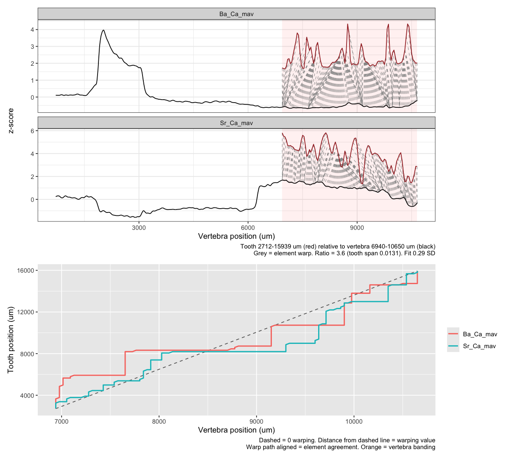
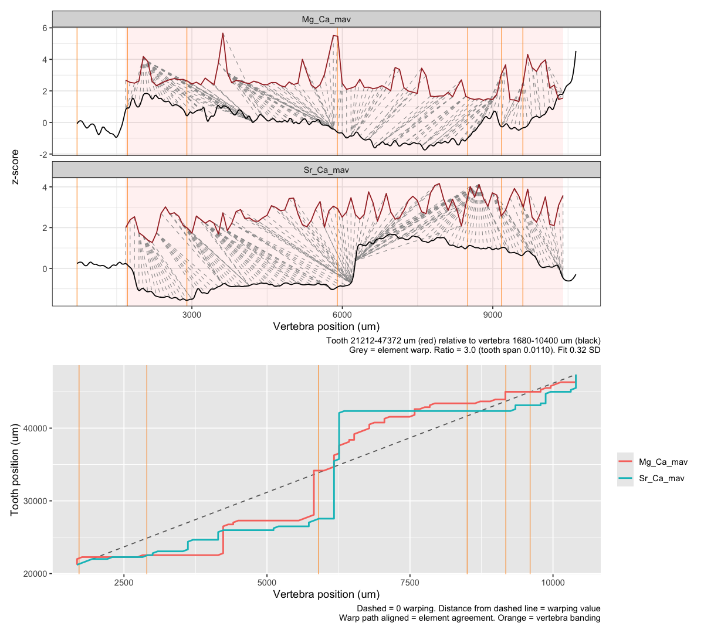
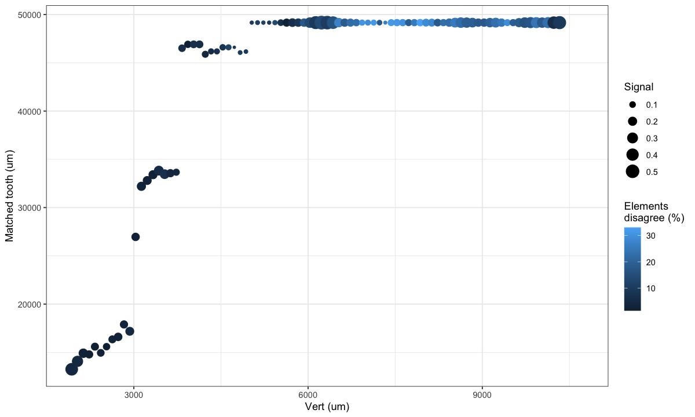
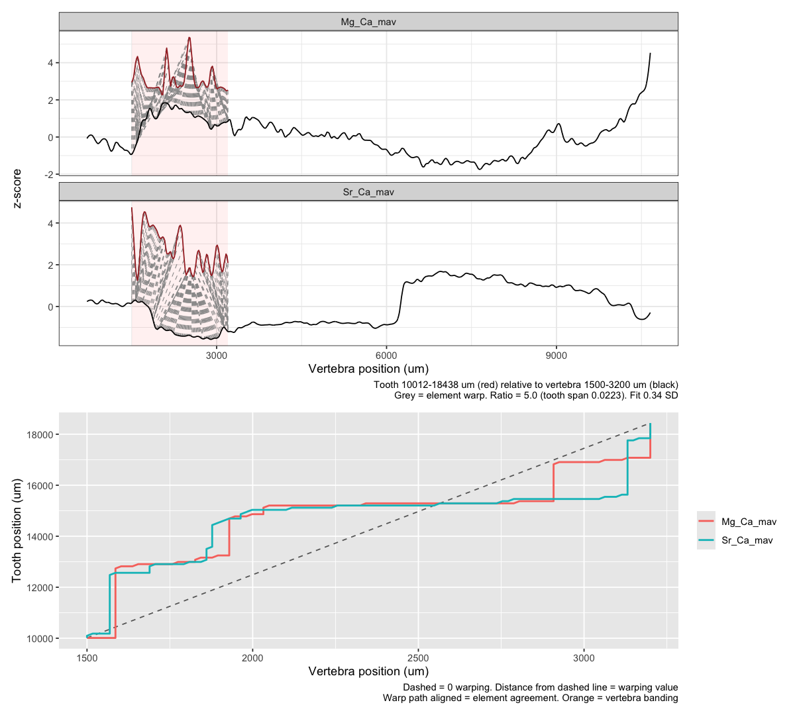
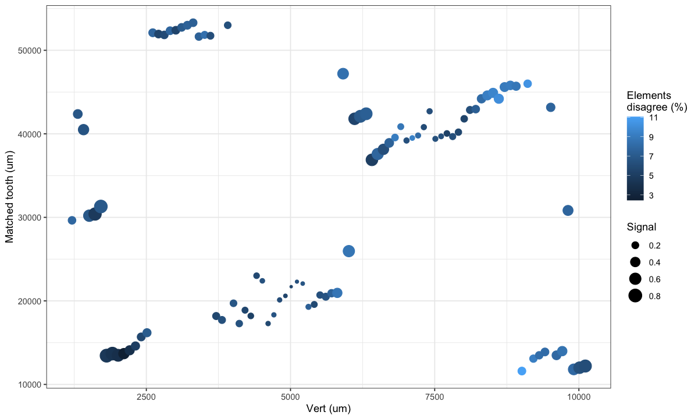
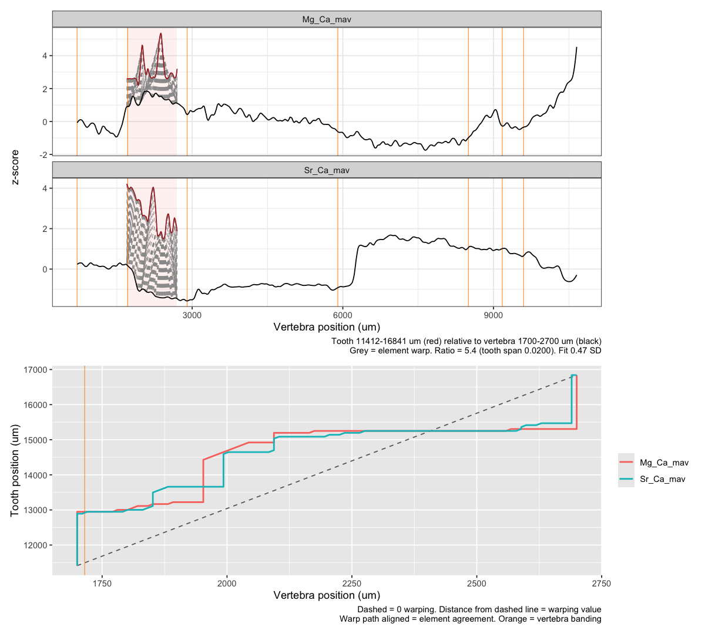
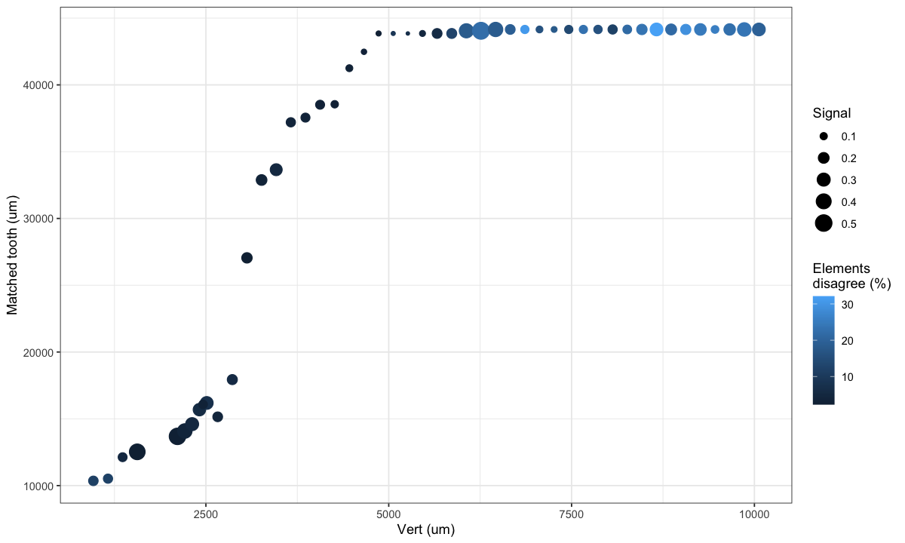
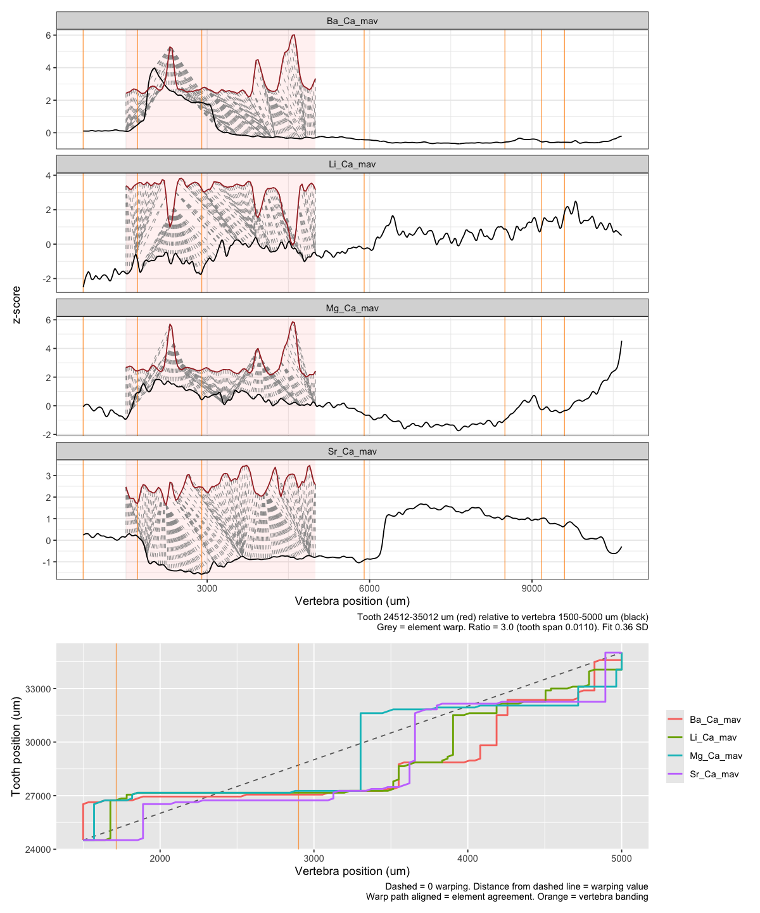

06c · DTW warp up
================
Nikki Biskis
Rendered 24 Oct 2026 19:00

- [First visual](#first-visual)
- [Let’s go hunting! Start with
  SMA001](#lets-go-hunting-start-with-sma001)
  - [First: an ordered loop](#first-an-ordered-loop)
  - [Now check random order](#now-check-random-order)
- [We’ve found our anchor](#weve-found-our-anchor)
  - [Moment of truth](#moment-of-truth)
  - [Final plot!](#final-plot)
- [Repeat for SMA002](#repeat-for-sma002)

- **Paper:** The potential of elemental analysis in determining origin
  of sawfish rostra

- **DOI:** tbd

- **Written:** 28 Aug 2026

- **Content:** dynamic time warping III

- testing whether a loop can calculate the best location in a sequence,
  rather than guess and check

- building on span determined in dtw1 and prelim results in dtw2

R markdown version of `06c_dtw_warpup.R`. It starts from the objects 06a
saved (`data/output/dtw_cache/06a.RData`).

``` r
source('helpers/functions/fxn_dtw.R')
source('helpers/functions/fxn_mavs.R')
source('helpers/functions/fxn_warps.R')
source('helpers/microHelp.R')
load('data/output/dtw_cache/06a.RData') # objects from 06a

library(patchwork)
library(furrr)
library(progressr)
```

## First visual

Forced align chose ~6k or ~3k depending on \# elements.

``` r
match_window(SMA001T_filt, SMA001V_filt, # option 1
             elements = c("Ba_Ca_mav", "Sr_Ca_mav"),
             v_from = 6940, win = 3710, ratio_range = c(3, 16),
             n_ratios = 24, spanV = 0.02, plot = TRUE) # based on 6b runs
```

<!-- -->

    #>     v_from  v_to tooth_start tooth_end    ratio      spanT disagree_pct
    #> 450   6940 10650    2712.202  15939.16 3.565217 0.01311044        7.835
    #>     disagree_um     cost    signal cost_Ba_Ca_mav cost_Sr_Ca_mav warp_Ba_Ca_mav
    #> 450    1036.332 0.287447 0.3540983      0.2747184      0.3001755          8.625
    #>     warp_Sr_Ca_mav
    #> 450           7.42

``` r
match_window(SMA001T_filt, SMA001V_filt, # option 1
             elements = c("Mg_Ca_mav", "Sr_Ca_mav"),
             v_from = 1680, win = 8720, ratio_range = c(3, 16),
             n_ratios = 24, spanV = 0.02, plot = TRUE,
             bands = c(710, 1715, 2900, 5900, 8500, 9175, 9600)) # based on 6b runs
```

<!-- -->

    #>     v_from  v_to tooth_start tooth_end ratio      spanT disagree_pct
    #> 205   1680 10400     21212.2   47372.2     3 0.01103196        5.305
    #>     disagree_um      cost  signal cost_Mg_Ca_mav cost_Sr_Ca_mav warp_Mg_Ca_mav
    #> 205    1387.788 0.3237203 1.00702      0.3676984      0.2797423          9.405
    #>     warp_Sr_Ca_mav
    #> 205           11.6

``` r
# warped heavily near the band! but the line graph looks excellent
```

## Let’s go hunting! Start with SMA001

### First: an ordered loop

``` r
range(SMA001T_filt$true_dist)
```

    #> [1]   812.202 54901.410

``` r
range(SMA001V_filt$true_dist)
```

    #> [1]   711.397 10656.560

``` r
starts  <- seq(1680, 10500, by = 100)
# start after residency in aquarium, can always search forward once we find the anchor
# thought process is - we know its had these teeth already at least, better than getting stuck early on
results <- list()
search  <- c(-Inf, Inf)
for(v in starts){
  r <- match_window(SMA001T_filt, SMA001V_filt, elements = c("Mg_Ca_mav", "Sr_Ca_mav"),
                    v_from = v, win = 500, spanV = 0.025,
                    ratio_range = c(3, 12),
                    tooth_max = 50000, tooth_search = search)
  results[[length(results) + 1]] <- r
  if(!is.na(r$tooth_start)) search <- c(r$tooth_start, Inf)
}
results <- do.call(rbind, results)
```

#### Let’s check the output

``` r
ggplot(results, aes((v_from + v_to) / 2, (tooth_start + tooth_end) / 2, colour = disagree_pct,
                    size = signal)) + geom_point() + theme_bw() +
  labs(x = "Vert (um)", y = "Matched tooth (um)",
       colour = "Elements\ndisagree (%)", size = "Signal") # ooh! that is pretty
```

<!-- -->

``` r
# weak from 4k to 5.5k but lets...
# similar with and without Mg
```

#### What does that warp look like there

``` r
match_window(SMA001T_filt, SMA001V_filt,
             elements = c("Mg_Ca_mav", "Sr_Ca_mav"),
             v_from = 1500, win = 1700,
             ratio_range = c(3, 12), n_ratios = 24,
             spanV = 0.02, tooth_max = 45000, plot = TRUE) #checks out its just the start
```

<!-- -->

    #>      v_from v_to tooth_start tooth_end    ratio      spanT disagree_pct
    #> 1983   1500 3200     10012.2  18438.29 4.956522 0.02231115         4.03
    #>      disagree_um      cost    signal cost_Mg_Ca_mav cost_Sr_Ca_mav
    #> 1983    339.5713 0.3391748 0.6138511      0.4016335      0.2767161
    #>      warp_Mg_Ca_mav warp_Sr_Ca_mav
    #> 1983          13.82          15.78

### Now check random order

``` r
plan(multisession, workers = availableCores() - 1) # leave one core free bc idk thats what Dave says so it's law

handlers(handler_progress(format = ":spin :current/:total [:bar] :percent  elapsed :elapsed  ETA :eta"))
results <- list()
starts <- seq(min(SMA001V_filt$true_dist), max(SMA001V_filt$true_dist) - 1000, by = 100)
with_progress({
  p <- progressor(along = starts)
  results <- future_map_dfr(starts, function(v){
    r <- match_window(SMA001T_filt, SMA001V_filt, keep_best = 0.1,
                      elements = c("Mg_Ca_mav", "Sr_Ca_mav"),
                      v_from = v, win = 1000, spanV = 0.02, # best span from 6a
                      ratio_range = c(3, 12),
                      tooth_search = c(10000, 55000)) # keeps finding high element agreement at early tooth (even though signal is weak)
    p()        # tick the bar
    r
  }, .options = furrr_options(packages = c("dtw", "ggplot2")))
})

plan(sequential)  # back to normal when done
# omg its!
```

#### Sticky beak

``` r
ggplot(results, aes((v_from + v_to) / 2, (tooth_start + tooth_end) / 2, colour = disagree_pct,
                    size = signal)) + geom_point() + theme_bw() +
  labs(x = "Vert (um)", y = "Matched tooth (um)",
       colour = "Elements\ndisagree (%)", size = "Signal")
```

<!-- -->

``` r
# that's looking like we've got a signal in the middle!
# go with an anchor (5.9-6.5k) and build **
# can redo from opposite end @ 3k and go out too and see if we get the same
```

``` r
# check our anchor
match_window(SMA001T_filt, SMA001V_filt,
             elements = c("Mg_Ca_mav", "Sr_Ca_mav"),
             v_from = 1700, win = 1000, ratio_range = c(3, 20),
             spanV = 0.02,
             bands = c(710, 1715, 2900, 5900, 8500, 9175, 9600),
             plot = TRUE)
```

<!-- -->

    #>     v_from v_to tooth_start tooth_end    ratio      spanT disagree_pct
    #> 618   1700 2700     11412.2  16840.77 5.428571 0.01996259         2.72
    #>     disagree_um      cost    signal cost_Mg_Ca_mav cost_Sr_Ca_mav
    #> 618    147.6571 0.4685643 0.3866592       0.620329      0.3167995
    #>     warp_Mg_Ca_mav warp_Sr_Ca_mav
    #> 618         17.375         16.185

## We’ve found our anchor

``` r
anchor <- subset(results, v_from >= 1600 & v_from <= 2100) # ah should have done this actually
anchor$v_mid <- (anchor$v_from + anchor$v_to) / 2
anchor$t_mid <- (anchor$tooth_start + anchor$tooth_end) / 2
coef(lm(t_mid ~ v_mid, data = anchor))[2]   # observed slope (tooth um per vert um)
```

    #> v_mid 
    #>   6.6

``` r
anchor$ratio                                # ratios the windows chose
```

    #> [1] 5.571429 5.571429 3.000000 5.571429 5.571429

And build it out from a part I KNOW aligns.

``` r
a1 <- anchor[1, ]; aN <- anchor[nrow(anchor), ]
args <- list(datT = SMA001T_filt, datV = SMA001V_filt,
             elements = c("Mg_Ca_mav", "Sr_Ca_mav"), win = 500,
             spanV = 0.02, ratio_range = c(3, 16), tooth_max = 45000
             ) # from the graph

## forward: later vert must match later tooth
fwd <- list(); search <- c(aN$tooth_start, Inf)
for(v in seq(aN$v_from + 200, 10000, by = 200)){
  r <- do.call(match_window, c(args, list(v_from = v, tooth_search = search)))
  fwd[[length(fwd) + 1]] <- r
  if(!is.na(r$tooth_start)) search <- c(r$tooth_start, Inf)
}

## backward: earlier vert must match earlier tooth
bwd <- list(); search <- c(-Inf, a1$tooth_end)
for(v in rev(seq(min(SMA001V_filt$true_dist), a1$v_from - 200, by = 200))){
  r <- do.call(match_window, c(args, list(v_from = v, tooth_search = search)))
  bwd[[length(bwd) + 1]] <- r
  if(!is.na(r$tooth_end)) search <- c(-Inf, r$tooth_end)
}

built <- rbind(do.call(rbind, bwd), anchor[names(results)], do.call(rbind, fwd))
```

### Moment of truth

``` r
ggplot(built, aes((v_from + v_to) / 2, (tooth_start + tooth_end) / 2, colour = disagree_pct,
                    size = signal)) + geom_point() + theme_bw() +
  labs(x = "Vert (um)", y = "Matched tooth (um)",
       colour = "Elements\ndisagree (%)", size = "Signal")
```

<!-- -->

``` r
# not always a strong signal but elements are aligned
```

### Final plot!

``` r
match_window(SMA001T_filt, SMA001V_filt,
             elements = c("Sr_Ca_mav", "Li_Ca_mav", "Mg_Ca_mav", "Ba_Ca_mav"),
             v_from = 1500, win = 3500, ratio_range = c(3, 24), n_ratios = 24,
             spanV = 0.02, plot = TRUE,
             bands = c(710, # birth
                       1715, 2900, 5900, # spread out for most; there are faint ones not included
                       8500, 9175, 9600))
```

<!-- -->

    #>     v_from v_to tooth_start tooth_end ratio      spanT disagree_pct disagree_um
    #> 238   1500 5000     24512.2   35012.2     3 0.01103196       14.225    1493.625
    #>          cost    signal cost_Sr_Ca_mav cost_Li_Ca_mav cost_Mg_Ca_mav
    #> 238 0.3628823 0.7167172      0.2704488      0.4033567      0.3962252
    #>     cost_Ba_Ca_mav warp_Sr_Ca_mav warp_Li_Ca_mav warp_Mg_Ca_mav warp_Ba_Ca_mav
    #> 238      0.3814982         10.935         11.645          10.06          14.42

## Repeat for SMA002

To do.
