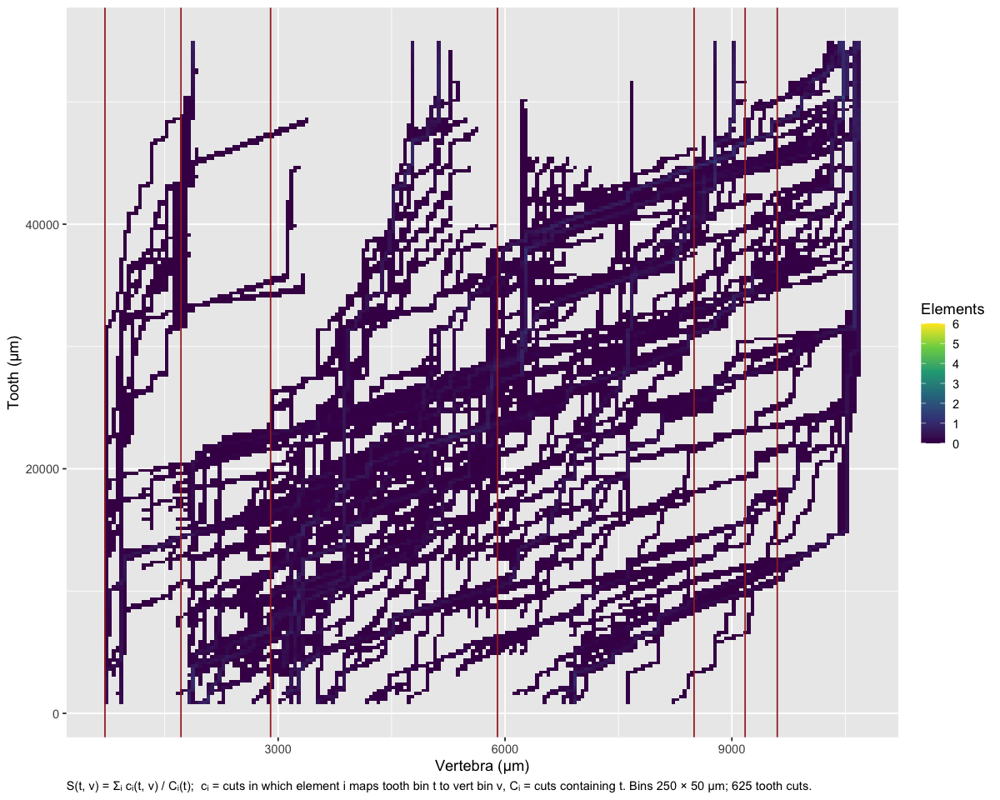
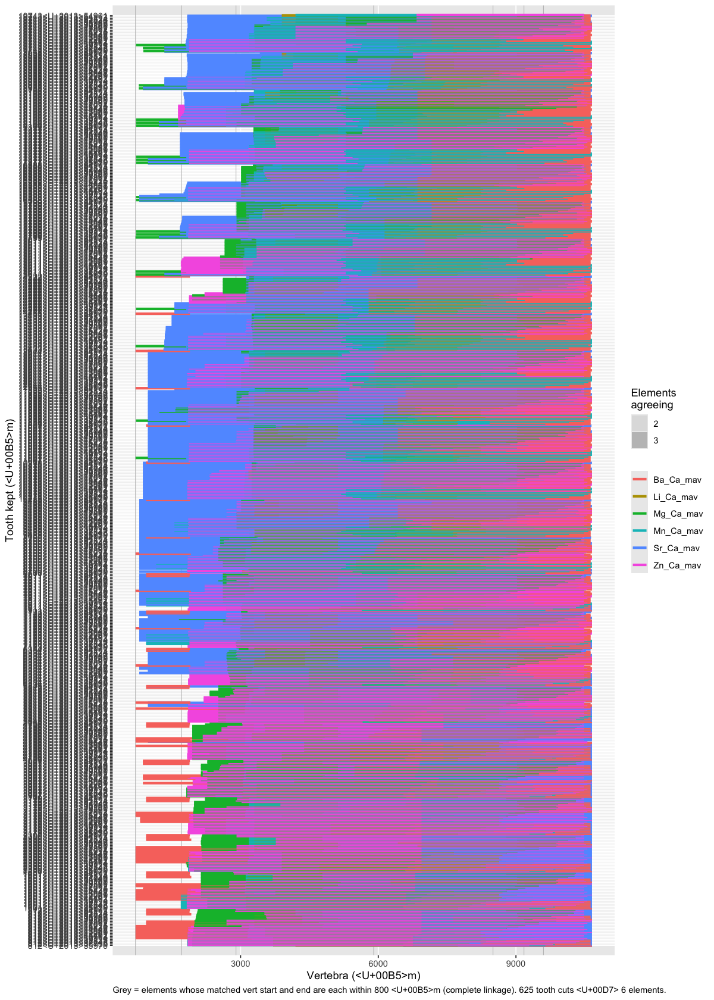
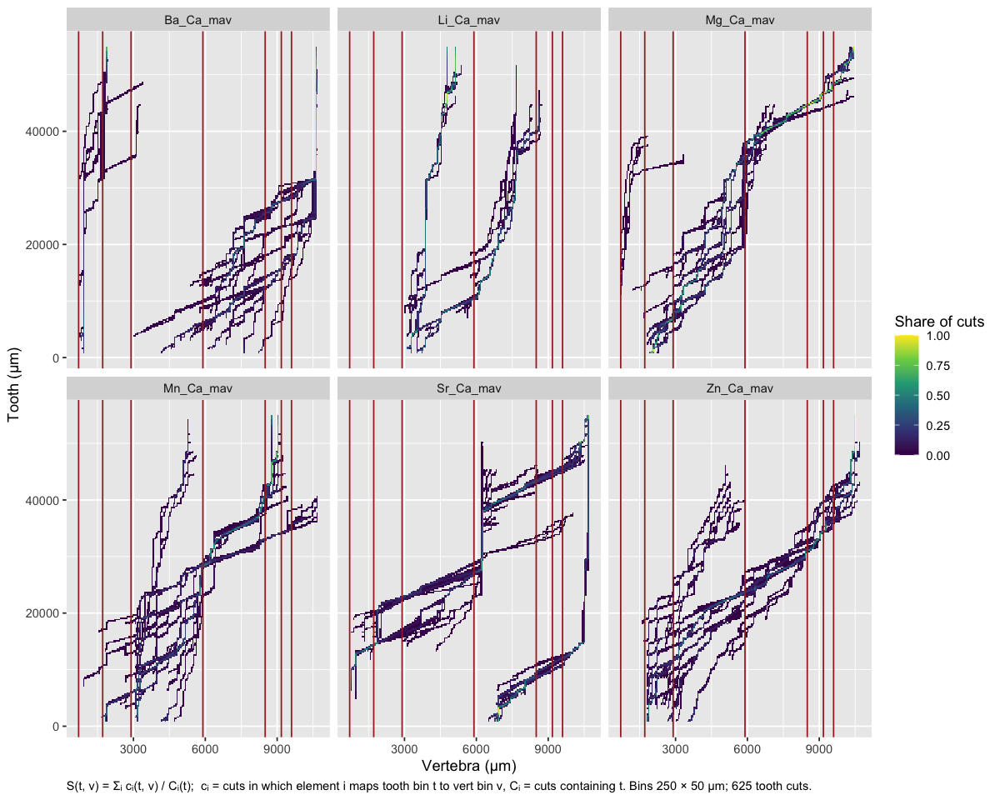
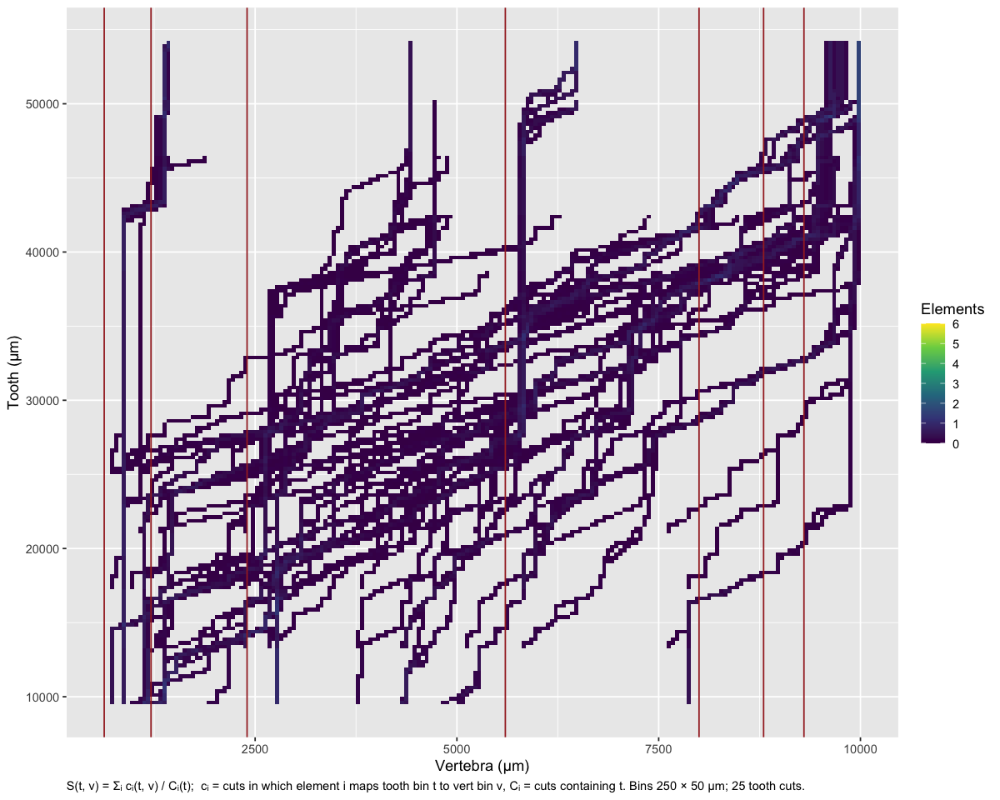
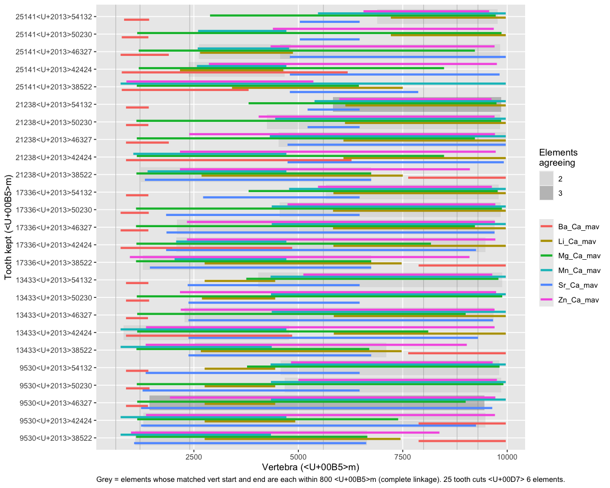
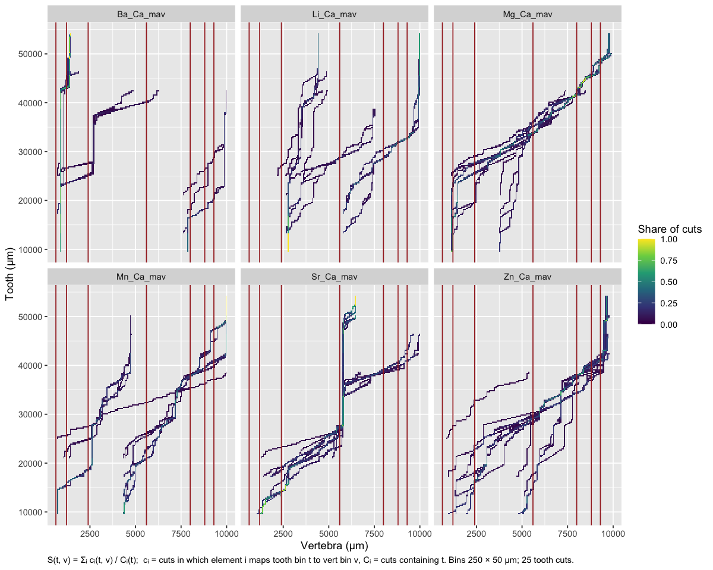
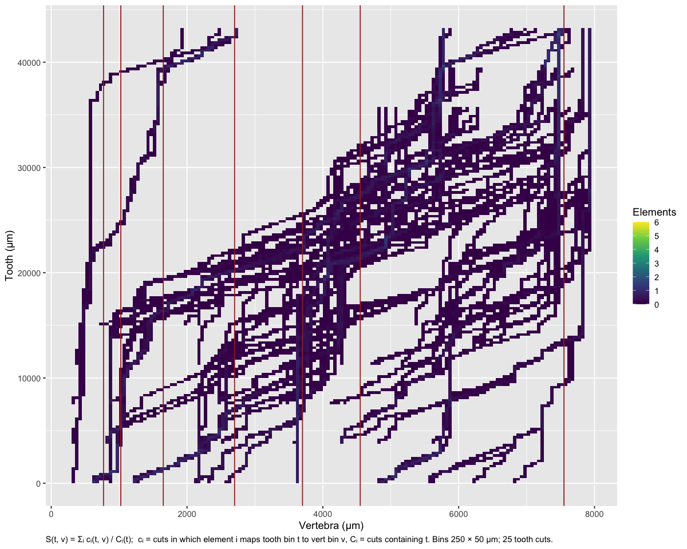
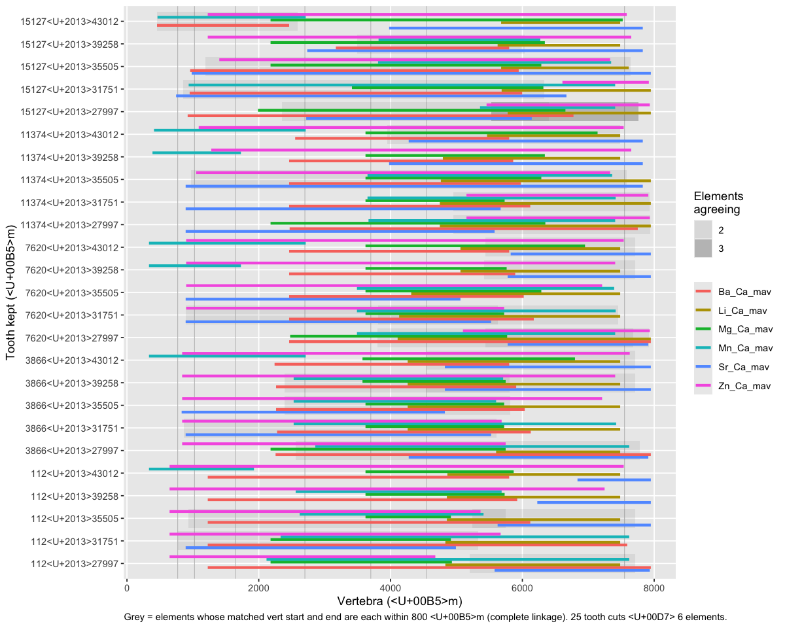
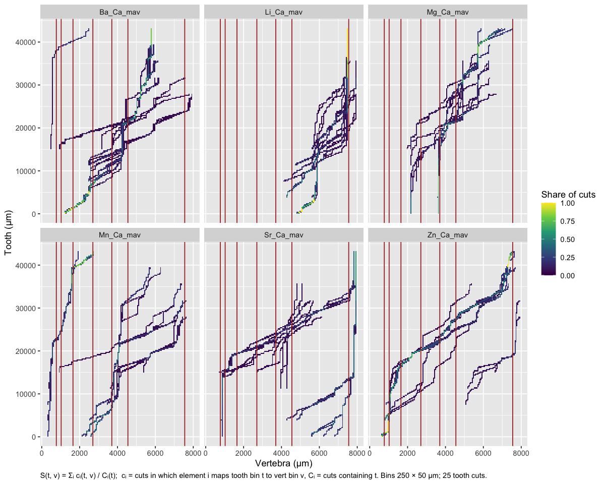

06d · DTW warp down
================
Nikki Biskis
Rendered 24 Oct 2026 19:08

- [Try again](#try-again)
- [Sawfish 1 (water)](#sawfish-1-water)
- [Sawfish 1 (bleach)](#sawfish-1-bleach)
- [Sawfish 2](#sawfish-2)

- **Paper:** The potential of elemental analysis in determining origin
  of sawfish rostra
- **DOI:** tbd
- **Written:** 14 Aug 2026
- **Content:** dynamic time warping IV

R markdown version of `06d_dtw_warpdown.R`. It starts from the objects
06a saved (`data/output/dtw_cache/06a.RData`).

``` r
source('helpers/functions/fxn_dtw.R')
source('helpers/functions/fxn_mavs.R')
source('helpers/microHelp.R')
load('data/output/dtw_cache/06a.RData') # objects from 06a
```

Instead of building up sections, trialling cutting down the tooth

- until the same elements are aligned in a section
- and then growing it

## Try again

<details>
<summary>
Show the function
</summary>

``` r
stack_alignments <- function(tooth, vert, elements,
                             spanT = 0.04, spanV = 0.01, n = 500,
                             n_steps = 5,            # cut positions tried at each end
                             max_trim = 0.35,        # trim up to this share of the tooth from each end
                             t_starts = NULL, t_ends = NULL,   # or give cut positions directly
                             tol_um = 300,           # elements agree if within this (vert um)
                             ref_step = 2500,        # tooth reference points every ref_step um
                             bands = NULL,           # optional vert band positions (um)
                             plot = c("segments", "heat", "both"),
                             ...){                   # passed to the heat map: tooth_bin, vert_bin, by_element, flip
  
  tooth <- tooth[order(tooth$true_dist), ]
  vert  <- vert[order(vert$true_dist), ]
  if(is.null(tooth$.hole)) tooth$.hole <- FALSE
  
  # loess on kept points -> grid -> NA at holes -> z-score
  sm_grid <- function(dat, el, span, grid, hole){
    d  <- dat[!dat$.hole & is.finite(dat[[el]]), ]
    y  <- approx(d$true_dist, predict(loess(d[[el]] ~ d$true_dist, span = span)),
                 xout = grid, ties = mean, rule = 2)$y
    y[hole] <- NA
    (y - mean(y, na.rm = TRUE)) / sd(y, na.rm = TRUE)
  }
  
  # vert: smoothed once
  vert$.hole <- FALSE
  vg <- seq(min(vert$true_dist), max(vert$true_dist), length.out = n)
  Vz <- sapply(elements, function(el) sm_grid(vert, el, spanV, vg, rep(FALSE, n)))
  
  # tooth cuts
  tr <- range(tooth$true_dist); L <- diff(tr)
  if(is.null(t_starts)) t_starts <- seq(tr[1], tr[1] + max_trim * L, length.out = n_steps)
  if(is.null(t_ends))   t_ends   <- seq(tr[2] - max_trim * L, tr[2], length.out = n_steps)
  cuts <- expand.grid(t_start = t_starts, t_end = t_ends)
  cuts <- cuts[cuts$t_end > cuts$t_start, ]
  cuts <- cuts[order(cuts$t_start, cuts$t_end), ]
  cuts$cut <- seq_len(nrow(cuts))
  
  runs <- list(); refs <- list(); paths <- list()
  for(k in seq_len(nrow(cuts))){
    message("Cut ", k, " of ", nrow(cuts))
    tc <- tooth[tooth$true_dist >= cuts$t_start[k] & tooth$true_dist <= cuts$t_end[k], ]
    if(nrow(tc) < 30) next
    tg <- seq(min(tc$true_dist), max(tc$true_dist), length.out = n)
    hg <- approx(tc$true_dist, as.numeric(tc$.hole), xout = tg, method = "constant",
                 rule = 2, ties = max)$y > 0
    rp <- seq(ceiling(min(tg) / ref_step) * ref_step, max(tg), by = ref_step)
    
    for(el in elements){
      res <- tryCatch({
        Tz <- sm_grid(tc, el, spanT, tg, hg)
        C  <- abs(outer(Tz, Vz[, el], "-")); C[is.na(Tz), ] <- 0
        a  <- dtw(C, step.pattern = asymmetric, open.begin = TRUE, open.end = TRUE)
        list(a = a, C = C, gap = is.na(Tz))
      }, error = function(e) NULL)
      if(is.null(res)) next
      a <- res$a
      v <- tapply(vg[a$index2], a$index1, mean)          # vert position per tooth point
      ti <- tg[as.integer(names(v))]
      paths[[length(paths) + 1]] <- data.frame(cut = k, element = el, tooth = ti, vert = as.numeric(v))
      kept <- !res$gap[a$index1]
      runs[[length(runs) + 1]] <- data.frame(
        cut = k, t_start = cuts$t_start[k], t_end = cuts$t_end[k], element = el,
        v_start = min(v), v_end = max(v),
        fit = mean(res$C[cbind(a$index1, a$index2)][kept]))   # mean |dz| over kept tooth points
      if(length(rp) > 0)
        refs[[length(refs) + 1]] <- data.frame(cut = k, element = el, tooth_ref = rp,
                                               vert = approx(ti, as.numeric(v), xout = rp)$y)
    }
  }
  runs <- do.call(rbind, runs)
  refs <- do.call(rbind, refs)
  paths <- do.call(rbind, paths)
  
  # --- groups within each cut ---
  runs$group <- NA_integer_
  groups <- do.call(rbind, lapply(split(runs, runs$cut), function(d){
    if(nrow(d) == 1) g <- 1L else {
      D <- outer(seq_len(nrow(d)), seq_len(nrow(d)), Vectorize(function(i, j)
        max(abs(d$v_start[i] - d$v_start[j]), abs(d$v_end[i] - d$v_end[j]))))
      g <- cutree(hclust(as.dist(D), "complete"), h = tol_um)
    }
    runs$group[runs$cut == d$cut[1]] <<- g
    do.call(rbind, lapply(split(seq_len(nrow(d)), g), function(i) data.frame(
      cut = d$cut[1], t_start = d$t_start[1], t_end = d$t_end[1],
      n_elements = length(i),
      members = paste(sort(sub("_Ca.*$", "", d$element[i])), collapse = "+"),
      v_start = mean(d$v_start[i]), v_end = mean(d$v_end[i]),
      spread_start = diff(range(d$v_start[i])), spread_end = diff(range(d$v_end[i])))))
  }))
  rownames(groups) <- NULL
  
  # --- uncertainty at tooth reference points ---
  ref_tab <- NULL
  if(!is.null(refs) && nrow(refs) > 0){
    ref_tab <- do.call(rbind, lapply(split(refs, refs$tooth_ref), function(d){
      d <- d[!is.na(d$vert), ]
      if(nrow(d) == 0) return(NULL)
      med <- tapply(d$vert, d$element, median)
      if(length(med) > 1){
        D <- abs(outer(as.numeric(med), as.numeric(med), "-")); g <- cutree(hclust(as.dist(D), "complete"), h = tol_um)
        best <- names(which.max(table(g)))
        mem <- names(med)[g == as.integer(best)]
        if(length(mem) < 2) return(data.frame(tooth_ref = d$tooth_ref[1], n_agree = 0,
                                              n_elements = length(med), members = "none", n_cuts = NA,
                                              vert_median = NA, vert_lo = NA, vert_hi = NA, uncert_um = NA))
      } else mem <- names(med)
      v <- d$vert[d$element %in% mem]
      data.frame(tooth_ref = d$tooth_ref[1], n_agree = length(mem), n_elements = length(med),
                 members = paste(sort(sub("_Ca.*$", "", mem)), collapse = "+"),
                 n_cuts = length(unique(d$cut[d$element %in% mem])),
                 vert_median = median(v), vert_lo = min(v), vert_hi = max(v),
                 uncert_um = max(v) - min(v))
    }))
    rownames(ref_tab) <- NULL
  }
  
  # --- plot: elements stacked within row ---
  ne  <- length(elements)
  off <- setNames(seq(-0.3, 0.3, length.out = ne), elements)
  runs$y <- runs$cut + off[runs$element]
  boxes <- groups[groups$n_elements >= 2, ]
  labs_y <- sprintf("%.0f–%.0f", cuts$t_start, cuts$t_end)
  
  p_seg <- ggplot() +
    { if(!is.null(bands)) geom_vline(xintercept = bands, colour = "grey75", linewidth = 0.3) } +
    { if(nrow(boxes) > 0) geom_rect(data = boxes,
                                    aes(xmin = v_start, xmax = v_end, ymin = cut - 0.42, ymax = cut + 0.42,
                                        alpha = n_elements), fill = "grey40") } +
    geom_segment(data = runs, aes(x = v_start, xend = v_end, y = y, yend = y, colour = element),
                 linewidth = 1.2) +
    scale_alpha_continuous(range = c(0.1, 0.35), breaks = seq(2, ne), name = "Elements\nagreeing") +
    scale_y_continuous(breaks = cuts$cut, labels = labs_y, expand = c(0.01, 0.01)) +
    theme(panel.grid.minor = element_blank(), plot.caption = element_text(hjust = 0)) +
    labs(x = "Vertebra (µm)", y = "Tooth kept (µm)", colour = NULL,
         caption = sprintf(paste0("Grey = elements whose matched vert start and end are each within %d µm ",
                                  "(complete linkage). %d tooth cuts × %d elements."),
                           tol_um, nrow(cuts), ne))
  
  # --- plot option: heat map----
  p_heat <- function(s, tooth_bin = 250, vert_bin = 50, bands = NULL, by_element = FALSE, flip = FALSE){
    d <- s$paths
    d$tb <- (floor(d$tooth / tooth_bin) + 0.5) * tooth_bin
    d$vb <- (floor(d$vert  / vert_bin)  + 0.5) * vert_bin
    hit   <- unique(d[, c("element", "cut", "tb", "vb")])
    cover <- aggregate(cut ~ element + tb, data = unique(d[, c("element", "cut", "tb")]), FUN = length)
    names(cover)[3] <- "n_cover"                                  # cuts containing this tooth bin
    agg <- aggregate(cut ~ element + tb + vb, data = hit, FUN = length)
    agg <- merge(agg, cover)
    agg$share <- agg$cut / agg$n_cover                            # share of those cuts mapping here
    ne <- length(unique(d$element))
    
    if(by_element){
      df <- agg; lim <- c(0, 1); lab <- "Share of cuts"
    } else {
      df <- aggregate(share ~ tb + vb, data = agg, FUN = sum); lim <- c(0, ne); lab <- "Elements"
    }
    ggplot(df, aes(vb, tb, fill = share)) +
      geom_tile(height = tooth_bin, width = vert_bin) +
      { if(!is.null(bands)) geom_vline(xintercept = bands, colour = "brown", linewidth = 0.5) } +
      { if(by_element) facet_wrap(~ element) } +
      scale_fill_viridis_c(limits = lim, name = lab) +
      { if(flip) coord_flip() } +
      theme(plot.caption = element_text(hjust = 0)) +
      labs(x = "Vertebra (\u00b5m)", y = "Tooth (\u00b5m)",
           caption = sprintf(paste0("S(t, v) = \u03a3\u1d62 c\u1d62(t, v) / C\u1d62(t);  c\u1d62 = cuts in which element i maps tooth bin t ",
                                    "to vert bin v, C\u1d62 = cuts containing t. Bins %d \u00d7 %d \u00b5m; %d tooth cuts."),
                             tooth_bin, vert_bin, nrow(s$cuts)))
  }
  
  out <- list(runs = runs, groups = groups, ref_points = ref_tab, ref_raw = refs,
              paths = paths, cuts = cuts, plot = p_seg)
  out$heat <- function(...) p_heat(out, bands = bands, ...)
  plot <- match.arg(plot)
  if(plot %in% c("segments", "both")) print(p_seg)
  if(plot %in% c("heat", "both"))     print(p_heat(out, bands = bands, ...))
  if(!is.null(ref_tab)) print(ref_tab, digits = 4, row.names = FALSE)
  invisible(out)
}
```

</details>

## Sawfish 1 (water)

25 × 25 tooth cuts, so this is the slow one.

``` r
s <- stack_alignments(SMA001T_filt, SMA001V_filt, # sawfish 1
                      elements = mavs2, # or mavs1 for just the main 4
                      spanT = 0.05, spanV = 0.01, # adjust res again, path ~ same
                      n = 1000, n_steps = 25, # how high res the map is
                      tol_um = 800, ref_step = 1000, # how (detailed) the table prints
                      plot = "heat", # for continuous scale
                      bands = c(710, # a visual of how path relates to banding
                                1715, 2900, 5900, 
                                8500, 9175, 9600))
```

<!-- -->

    #>  tooth_ref n_agree n_elements     members n_cuts vert_median vert_lo vert_hi
    #>       1000       2          6       Li+Mn     25        3414  1836.3    4703
    #>       2000       2          6       Li+Mn     50        3244  1834.8    4952
    #>       3000       2          6       Li+Mn     75        3300  1856.2    4952
    #>       4000       2          6       Li+Mn    125        3330  1913.0    5082
    #>       5000       3          6    Ba+Li+Mn    150        3479   711.4    8775
    #>       6000       2          6       Mg+Zn    175        2553  1846.3    4048
    #>       7000       2          6       Mg+Mn    200        3180  2612.8    5191
    #>       8000       2          6       Mg+Mn    250        3180   940.4    5191
    #>       9000       2          6       Mg+Mn    275        3240  1235.8    5291
    #>      10000       3          6    Li+Mg+Mn    300        3529  1557.6    5798
    #>      11000       2          6       Li+Mn    325        3876  1856.2    6097
    #>      12000       2          6       Ba+Li    375        6156   711.4    9342
    #>      13000       2          6       Mg+Zn    400        3516   771.1    5440
    #>      14000       2          6       Ba+Li    425        6376   711.4    9625
    #>      15000       2          6       Mg+Zn    450        3937   781.1    5868
    #>      16000       2          6       Mg+Mn    500        4200   711.4    5749
    #>      17000       2          6       Mg+Mn    525        4355   781.1    5749
    #>      18000       2          6       Ba+Li    550        6744   711.4   10059
    #>      19000       4          6 Mg+Mn+Sr+Zn    600        4146   781.1   10527
    #>      20000       3          6    Mg+Mn+Zn    625        4424   721.4    6834
    #>      21000       3          6    Mg+Mn+Zn    625        4809   721.4    6894
    #>      22000       4          6 Mg+Mn+Sr+Zn    625        4962   721.4   10527
    #>      23000       2          6       Mg+Sr    625        4711   840.8   10527
    #>      24000       2          6       Mg+Sr    625        4921   840.8   10597
    #>      25000       2          6       Mg+Sr    625        5341   860.7   10597
    #>      26000       3          6    Mg+Mn+Sr    625        5341   860.7   10597
    #>      27000       3          6    Mg+Mn+Sr    625        5716   860.7   10597
    #>      28000       2          6       Li+Zn    625        7481  3518.7    8261
    #>      29000       2          6       Li+Zn    625        7600  3518.7    8307
    #>      30000       2          6       Li+Zn    625        7610  3518.7    8417
    #>      31000       2          6       Mn+Sr    625        6256  3837.3   10657
    #>      32000       2          6       Mn+Sr    625        6386  3837.3   10657
    #>      33000       2          6       Mn+Sr    625        6504  3837.3   10657
    #>      34000       2          6       Mn+Sr    625        6785  3996.6   10657
    #>      35000       2          6       Li+Mn    625        7338  4106.1    9791
    #>      36000       2          6       Li+Mn    600        7740  4106.1   10399
    #>      37000       2          6       Li+Mn    575        7971  4106.1   10657
    #>      38000       2          6       Mg+Sr    550        6277  1487.9   10657
    #>      39000       2          6       Mg+Sr    525        6545  1740.6   10657
    #>      40000       2          6       Mg+Sr    475        6742  6246.4   10657
    #>      41000       2          6       Ba+Zn    450       10300  1119.6   10627
    #>      42000       2          6       Ba+Zn    425       10388  1169.3   10627
    #>      43000       2          6       Ba+Zn    400       10487  1169.3   10657
    #>      44000       3          6    Mg+Mn+Sr    350        8758  5081.7   10657
    #>      45000       2          6       Ba+Zn    325       10487  1308.7   10627
    #>      46000       3          6    Ba+Sr+Zn    300       10487  1308.7   10657
    #>      47000       3          6    Ba+Sr+Zn    275       10487  1481.5   10657
    #>      48000       3          6    Ba+Sr+Zn    225       10408  1537.7   10657
    #>      49000       4          6 Ba+Mg+Sr+Zn    200       10487  1756.7   10657
    #>      50000       4          6 Ba+Mg+Sr+Zn    175       10487  1756.7   10657
    #>      51000       4          6 Ba+Mg+Sr+Zn    125       10487  1856.2   10657
    #>      52000       4          6 Ba+Mg+Sr+Zn    100       10487  1876.1   10657
    #>      53000       4          6 Ba+Mg+Sr+Zn     75       10487  1876.1   10657
    #>      54000       3          6    Mg+Sr+Zn     50       10487 10258.4   10657
    #>  uncert_um
    #>     2867.1
    #>     3117.5
    #>     3096.0
    #>     3168.7
    #>     8063.6
    #>     2201.3
    #>     2578.4
    #>     4250.8
    #>     4055.0
    #>     4240.9
    #>     4240.9
    #>     8631.1
    #>     4669.0
    #>     8913.5
    #>     5087.1
    #>     5037.3
    #>     4967.6
    #>     9347.9
    #>     9746.1
    #>     6112.4
    #>     6172.2
    #>     9805.8
    #>     9686.3
    #>     9756.0
    #>     9736.1
    #>     9736.1
    #>     9736.1
    #>     4742.3
    #>     4788.4
    #>     4897.9
    #>     6819.3
    #>     6819.3
    #>     6819.3
    #>     6660.0
    #>     5685.0
    #>     6293.1
    #>     6550.5
    #>     9168.7
    #>     8916.0
    #>     4410.1
    #>     9507.1
    #>     9457.4
    #>     9487.2
    #>     5574.9
    #>     9318.0
    #>     9347.9
    #>     9175.0
    #>     9118.9
    #>     8899.9
    #>     8899.9
    #>     8800.3
    #>     8780.4
    #>     8780.4
    #>      398.2

``` r
head(s$groups, 20)       # stats per tooth cut: which elements & where (first 20 rows; full table is s$groups)
```

    #>    cut t_start    t_end n_elements members  v_start     v_end spread_start
    #> 1    1 812.202 35970.19          1      Sr 6545.096 10656.560     0.000000
    #> 2    1 812.202 35970.19          1      Ba 4195.688 10656.560     0.000000
    #> 3    1 812.202 35970.19          1      Li 3707.888  7729.755     0.000000
    #> 4    1 812.202 35970.19          1      Mg 1945.832  6594.872     0.000000
    #> 5    1 812.202 35970.19          2   Mn+Zn 1841.303  9466.923     9.955118
    #> 6    2 812.202 36758.99          1      Sr 6754.154 10656.560     0.000000
    #> 7    2 812.202 36758.99          1      Ba 4195.688 10626.695     0.000000
    #> 8    2 812.202 36758.99          1      Li 3707.888  7739.710     0.000000
    #> 9    2 812.202 36758.99          1      Mg 1945.832  6545.096     0.000000
    #> 10   2 812.202 36758.99          2   Mn+Zn 1841.303  9830.285     9.955118
    #> 11   3 812.202 37547.79          1      Sr 6754.154 10656.560     0.000000
    #> 12   3 812.202 37547.79          1      Ba 8227.511 10626.695     0.000000
    #> 13   3 812.202 37547.79          1      Li 3707.888  7988.588     0.000000
    #> 14   3 812.202 37547.79          1      Mg 1945.832  6545.096     0.000000
    #> 15   3 812.202 37547.79          1      Mn 1836.325  8287.242     0.000000
    #> 16   3 812.202 37547.79          1      Zn 1846.280 10308.131     0.000000
    #> 17   4 812.202 38336.59          1      Sr 6754.154 10656.560     0.000000
    #> 18   4 812.202 38336.59          1      Ba 8227.511 10626.695     0.000000
    #> 19   4 812.202 38336.59          1      Li 3707.888  8346.973     0.000000
    #> 20   4 812.202 38336.59          1      Mg 1945.832  6644.647     0.000000
    #>    spread_end
    #> 1     0.00000
    #> 2     0.00000
    #> 3     0.00000
    #> 4     0.00000
    #> 5   348.42913
    #> 6     0.00000
    #> 7     0.00000
    #> 8     0.00000
    #> 9     0.00000
    #> 10   39.82047
    #> 11    0.00000
    #> 12    0.00000
    #> 13    0.00000
    #> 14    0.00000
    #> 15    0.00000
    #> 16    0.00000
    #> 17    0.00000
    #> 18    0.00000
    #> 19    0.00000
    #> 20    0.00000

``` r
s$plot
```

<!-- -->

``` r
s$heat(by_element = TRUE)
```

<!-- -->

## Sawfish 1 (bleach)

``` r
t <- stack_alignments(SMA001TB_filt, SMA001VB_filt, # sawfish 1 - bleach
                      elements = mavs2, # or mavs1 for just the main 4
                      spanT = 0.05, spanV = 0.01, # adjust res again, path ~ same
                      n = 1000, n_steps = 5, # how high res the map is
                      tol_um = 800, ref_step = 1000, # how (detailed) the table prints
                      plot = "heat", # for continuous scale
                      bands = c(630, # birth
                                1210, 2400, 5600, 
                                8000, 8800, 9300))
```

<!-- -->

    #>  tooth_ref n_agree n_elements     members n_cuts vert_median vert_lo vert_hi
    #>      10000       3          6    Ba+Mg+Sr      5        1189   875.2    7880
    #>      11000       3          6    Ba+Mg+Sr      5        1348   875.2    7880
    #>      12000       3          6    Ba+Mg+Sr      5        1364   875.2    7880
    #>      13000       2          6       Ba+Mg      5        1152   875.2    7880
    #>      14000       3          6    Li+Sr+Zn     10        2370  1345.8    5969
    #>      15000       3          6    Li+Sr+Zn     10        2610  1392.0    6154
    #>      16000       3          6    Li+Sr+Zn     10        2758  1392.0    6490
    #>      17000       3          6    Li+Sr+Zn     10        2772  1622.7    6661
    #>      18000       3          6    Li+Sr+Zn     15        2758   995.1    6754
    #>      19000       3          6    Li+Sr+Zn     15        2878  1345.8    6837
    #>      20000       3          6    Li+Sr+Zn     15        3330  1392.0    7058
    #>      21000       3          6    Li+Sr+Zn     15        3642  1392.0    7252
    #>      22000       3          6    Li+Mn+Sr     20        4407  1115.1    7326
    #>      23000       3          6    Li+Mn+Sr     20        4635  1336.6    7372
    #>      24000       3          6    Li+Mn+Sr     20        4908  1593.6    7446
    #>      25000       3          6    Li+Mn+Sr     20        5280  2409.2    7446
    #>      26000       2          6       Li+Zn     25        4430  1032.0    7483
    #>      27000       2          6       Li+Zn     25        4793  1198.2    7483
    #>      28000       2          6       Li+Zn     25        5331  1376.6    7698
    #>      29000       3          6    Li+Sr+Zn     25        5794  1927.2    8173
    #>      30000       2          6       Li+Mn     25        6571  2757.8    8424
    #>      31000       2          6       Li+Mn     25        6795  2951.6    8513
    #>      32000       2          6       Li+Mn     25        7092  2951.6    8923
    #>      33000       2          6       Li+Mn     25        7224  3032.7    9449
    #>      34000       3          6    Li+Mn+Zn     25        7114  3062.3    9725
    #>      35000       3          6    Li+Mn+Zn     25        7330  3330.0    9910
    #>      36000       3          6    Li+Mn+Zn     25        7474  3330.0    9910
    #>      37000       3          6    Li+Mn+Zn     25        7649  3330.0    9919
    #>      38000       3          6    Li+Mn+Zn     25        8057  3330.0    9928
    #>      39000       2          6       Mg+Sr     20        7197  5775.5    8607
    #>      40000       2          6       Mg+Sr     20        7432  5775.5    9116
    #>      41000       2          6       Li+Zn     20        9332  3496.1    9938
    #>      42000       2          6       Li+Zn     20        9472  3579.1    9965
    #>      43000       3          6    Li+Mn+Zn     15        9511  3579.1    9965
    #>      44000       3          6    Li+Mn+Zn     15        9624  3606.8    9965
    #>      45000       3          6    Li+Mn+Zn     15        9624  4037.3    9965
    #>      46000       3          6    Li+Mn+Zn     15        9624  4354.3    9965
    #>      47000       3          6    Li+Mn+Zn     10        9536  4400.5    9965
    #>      48000       4          6 Li+Mg+Mn+Zn     10        9536  4409.7    9965
    #>      49000       4          6 Li+Mg+Mn+Zn     10        9566  4419.0    9965
    #>      50000       4          6 Li+Mg+Mn+Zn     10        9804  4446.6    9965
    #>      51000       4          6 Li+Mg+Mn+Zn      5        9776  4446.6    9965
    #>      52000       4          6 Li+Mg+Mn+Zn      5        9776  4446.6    9965
    #>      53000       4          6 Li+Mg+Mn+Zn      5        9781  4446.6    9965
    #>      54000       4          6 Li+Mg+Mn+Zn      5        9781  4446.6    9965
    #>  uncert_um
    #>       7004
    #>       7004
    #>       7004
    #>       7004
    #>       4624
    #>       4762
    #>       5098
    #>       5039
    #>       5759
    #>       5491
    #>       5666
    #>       5860
    #>       6211
    #>       6035
    #>       5852
    #>       5037
    #>       6451
    #>       6285
    #>       6321
    #>       6246
    #>       5666
    #>       5561
    #>       5971
    #>       6416
    #>       6663
    #>       6580
    #>       6580
    #>       6589
    #>       6598
    #>       2832
    #>       3341
    #>       6442
    #>       6386
    #>       6386
    #>       6358
    #>       5928
    #>       5611
    #>       5565
    #>       5556
    #>       5546
    #>       5519
    #>       5519
    #>       5519
    #>       5519
    #>       5519

``` r
t$plot
```

<!-- -->

``` r
t$heat(by_element = TRUE)
```

<!-- -->

## Sawfish 2

``` r
u <- stack_alignments(SMA002T_filt, SMA002V_filt, # sawfish 1 - bleach
                      elements = mavs2, # or mavs1 for just the main 4
                      spanT = 0.05, spanV = 0.01, # adjust res again, path ~ same
                      n = 1000, n_steps = 5, # how high res the map is
                      tol_um = 800, ref_step = 1000, # how (detailed) the table prints
                      plot = "heat", # for continuous scale
                      bands = c(770, 1025, # birth and/or 1yr
                                1650, 2700, 3700,
                                4550, 7550))
```

<!-- -->

    #>  tooth_ref n_agree n_elements     members n_cuts vert_median vert_lo vert_hi
    #>       1000       2          6       Ba+Zn      5        1171   838.1    1526
    #>       2000       2          6       Ba+Mn      5        1890   372.2    2857
    #>       3000       2          6       Ba+Mn      5        2255   372.2    2924
    #>       4000       2          6       Ba+Mn     10        2316   334.1    3175
    #>       5000       2          6       Ba+Mn     10        2474   334.1    3246
    #>       6000       2          6       Li+Sr     10        5448   890.6    7210
    #>       7000       2          6       Li+Sr     10        5654   890.6    7210
    #>       8000       2          6       Mg+Mn     15        3619   334.1    3734
    #>       9000       3          6    Ba+Mg+Mn     15        3619   410.3    3963
    #>      10000       3          6    Ba+Mg+Mn     15        3619   433.2    4079
    #>      11000       3          6    Ba+Mg+Mn     15        3619   433.2    4177
    #>      12000       3          6    Ba+Mg+Mn     20        3619   387.5    4199
    #>      13000       3          6    Ba+Mg+Mn     20        3692   402.7    4245
    #>      14000       3          6    Ba+Mg+Mn     20        3734   410.3    4313
    #>      15000       3          6    Ba+Mg+Mn     20        3784   448.4    4354
    #>      16000       4          6 Ba+Mg+Mn+Sr     25        3787   456.1    7827
    #>      17000       4          6 Ba+Mg+Mn+Sr     25        3802   456.1    7827
    #>      18000       4          6 Ba+Mg+Mn+Sr     25        3902   478.9    7827
    #>      19000       4          6 Ba+Mg+Mn+Sr     25        3940   509.4    7827
    #>      20000       4          6 Ba+Mg+Mn+Sr     25        4069   509.4    7827
    #>      21000       4          6 Ba+Mg+Mn+Sr     25        4188   570.4    7827
    #>      22000       4          6 Ba+Mg+Mn+Sr     25        4418   570.4    7827
    #>      23000       3          6    Ba+Mg+Mn     25        4900   570.4    7179
    #>      24000       3          6    Mg+Sr+Zn     25        4283  3021.6    7862
    #>      25000       3          6    Mg+Sr+Zn     25        4542  3452.0    7911
    #>      26000       4          6 Ba+Mg+Sr+Zn     25        5045   570.4    7911
    #>      27000       4          6 Ba+Mg+Sr+Zn     25        5205   570.4    7919
    #>      28000       3          6    Mg+Mn+Zn     20        4702  1172.6    7736
    #>      29000       3          6    Ba+Mg+Zn     20        5220   570.4    7751
    #>      30000       3          6    Ba+Mg+Zn     20        5391   570.4    7766
    #>      31000       2          6       Ba+Zn     20        5647   570.4    7804
    #>      32000       2          6       Ba+Zn     15        5720   570.4    6608
    #>      33000       2          6       Ba+Mg     15        5594   570.4    5911
    #>      34000       3          6    Ba+Mg+Mn     15        5586   570.4    7172
    #>      35000       3          6    Ba+Mg+Mn     15        5640   570.4    7301
    #>      36000       2          6       Ba+Mg     10        5687   570.4    5746
    #>      37000       2          6       Ba+Mg     10        5723   654.3    5956
    #>      38000       3          6    Li+Sr+Zn     10        7484  7084.5    7949
    #>      39000       3          6    Li+Sr+Zn     10        7484  7173.6    7949
    #>      40000       3          6    Li+Sr+Zn      5        7484  7278.4    7949
    #>      41000       3          6    Li+Sr+Zn      5        7484  7331.8    7949
    #>      42000       3          6    Li+Sr+Zn      5        7484  7403.6    7949
    #>      43000       3          6    Li+Sr+Zn      5        7538  7484.2    7949
    #>  uncert_um
    #>      687.8
    #>     2485.0
    #>     2551.3
    #>     2841.3
    #>     2911.9
    #>     6319.3
    #>     6319.3
    #>     3399.7
    #>     3552.2
    #>     3645.7
    #>     3743.5
    #>     3811.4
    #>     3841.9
    #>     3902.8
    #>     3905.9
    #>     7371.2
    #>     7371.2
    #>     7348.3
    #>     7317.8
    #>     7317.8
    #>     7256.8
    #>     7256.8
    #>     6608.9
    #>     4840.0
    #>     4459.1
    #>     7340.7
    #>     7348.3
    #>     6563.2
    #>     7180.6
    #>     7195.9
    #>     7234.0
    #>     6037.2
    #>     5340.5
    #>     6601.3
    #>     6730.9
    #>     5175.8
    #>     5301.4
    #>      864.7
    #>      775.6
    #>      670.8
    #>      617.4
    #>      545.6
    #>      465.0

``` r
u$plot
```

<!-- -->

``` r
u$heat(by_element = TRUE) 
```

<!-- -->

``` r
#oh Ba is useful for this one - makes sense - it lived longer in the wild.
```
