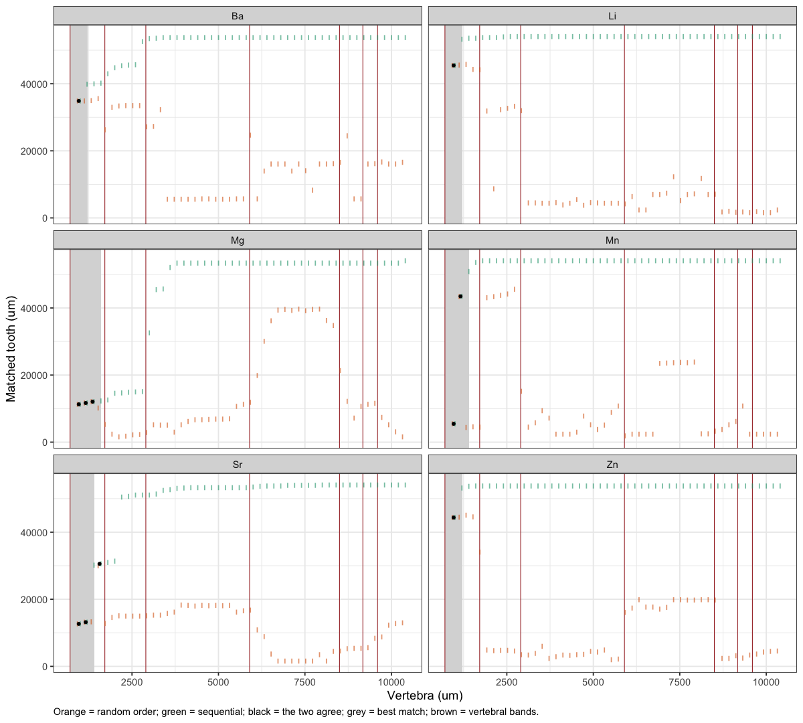
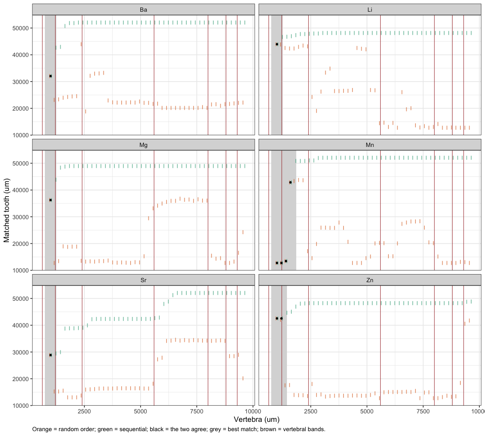
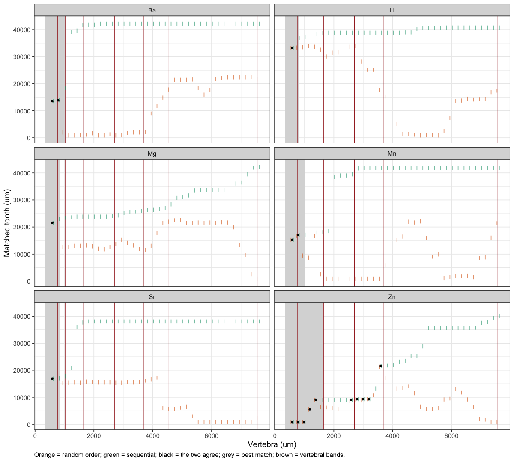

06d · DTW warp up
================
Nikki Biskis
Rendered 26 Oct 2026 20:28

- [Figures](#figures)
  - [SMA001 (water)](#sma001-water)
  - [SMA001 (bleach)](#sma001-bleach)
  - [SMA002 (water)](#sma002-water)

- **Paper:** The potential of elemental analysis in determining origin
  of sawfish rostra
- **DOI:** tbd
- **Written:** 28 Aug 2026 (rerun for all sets and elements Oct 2026)
- **Content:** dynamic time warping III: build the match up along the
  vertebra, window by window

The original exploration is in `original/06c_dtw_warpup.R`. This runs
the same two searches for every set and every element, using
`match_window()`:

- **Random order**: each 500 µm vertebra window (every 200 µm) on its
  own, free to match anywhere on the tooth.
- **Sequential**: the same windows from the start of the vertebra, each
  forced to match later on the tooth than the last.

Where the two agree (their matched tooth pieces overlap by at least half
of the shorter one), the match doesn’t depend on the order it was found
in.

- **Best match** of an element: its longest run of consecutive agreeing
  windows.
- **Warp-up mix**: elements that agree in at least half of the windows
  (if fewer than two, the two that agree most often).

Vertebra spans are the ones used for each set in 06c. Starts from 06a
and 06c (`data/output/dtw_cache/06a.RData`, `06c.RData`); saves
`06d.RData` for 06e and 06f.

``` r
source('helpers/microHelp.R')
source('helpers/functions/fxn_mavs.R')
source('helpers/functions/fxn_dtw.R')
source('helpers/functions/fxn_warps.R')
library(furrr)
load('data/output/dtw_cache/06a.RData') # objects from 06a
load('data/output/dtw_cache/06c.RData') # sets, gap_um, down (spans) from 06c
```

``` r
up_settings <- list(elements = mavs2, win = 500, step = 200, ratio_range = c(3, 16), overlap = 0.5)

# one set, one element: random order and sequential windows along the vertebra
warp_up <- function(name, el){
  set   <- sets[[name]]
  spanV <- down[[name]]$spanV
  prep  <- prep_records(set$tooth, set$vert, el, spanV, Inf, gap_um = gap_um)
  vr    <- range(set$vert$true_dist)
  v     <- seq(vr[1], vr[2] - up_settings$win, by = up_settings$step)
  mw <- function(vf, search) match_window(set$tooth, set$vert, el, v_from = vf, win = up_settings$win,
                                          spanV = spanV, ratio_range = up_settings$ratio_range,
                                          tooth_search = search, prep = prep, gap_um = gap_um)
  rand <- do.call(rbind, lapply(v, mw, search = c(-Inf, Inf)))
  sq <- list(); search <- c(-Inf, Inf)
  for(vf in v){
    r <- mw(vf, search); sq[[length(sq) + 1]] <- r
    if(!is.na(r$tooth_start)) search <- c(r$tooth_start, Inf)
  }
  sq <- do.call(rbind, sq)
  overlap <- pmax(0, pmin(rand$tooth_end, sq$tooth_end) - pmax(rand$tooth_start, sq$tooth_start)) /
             pmin(rand$tooth_end - rand$tooth_start, sq$tooth_end - sq$tooth_start)
  data.frame(set = name, element = el, v_from = v, v_to = v + up_settings$win,
             rand_start = rand$tooth_start, rand_end = rand$tooth_end,
             seq_start = sq$tooth_start, seq_end = sq$tooth_end,
             agree = !is.na(overlap) & overlap >= up_settings$overlap)
}
```

``` r
jobs <- expand.grid(set = names(sets), element = up_settings$elements, stringsAsFactors = FALSE)
plan(multisession, workers = future::availableCores() - 1)
up_windows <- future_map2_dfr(jobs$set, jobs$element, warp_up,
                              .options = furrr_options(packages = c("dtw", "ggplot2")))
plan(sequential)
```

``` r
# each element's best match: longest run of consecutive agreeing windows
up_best <- do.call(rbind, lapply(split(up_windows, list(up_windows$set, up_windows$element), drop = TRUE), function(d){
  d  <- d[order(d$v_from), ]
  rl <- rle(d$agree); ends <- cumsum(rl$lengths); starts <- ends - rl$lengths + 1
  k  <- which(rl$values)
  out <- data.frame(set = d$set[1], element = sub("_Ca.*$", "", d$element[1]),
                    agree_pct = round(100 * mean(d$agree)), windows = NA,
                    tooth_from = NA, tooth_to = NA, vert_from = NA, vert_to = NA, R = NA)
  if(length(k)){
    k <- k[which.max(rl$lengths[k])]
    w <- d[starts[k]:ends[k], ]
    out$windows <- nrow(w)
    out$tooth_from <- round(min(w$seq_start)); out$tooth_to <- round(max(w$seq_end))
    out$vert_from  <- round(min(w$v_from));    out$vert_to  <- round(max(w$v_to))
    out$R <- round((out$tooth_to - out$tooth_from) / (out$vert_to - out$vert_from), 1)
  }
  out
}))
up_best <- up_best[order(up_best$set, -up_best$agree_pct), ]
rownames(up_best) <- NULL

up_mix <- lapply(split(up_best, up_best$set), function(d){
  mix <- d$element[d$agree_pct >= 50]
  if(length(mix) < 2) mix <- head(d$element, 2)     # already ordered by agreement
  paste0(mix, "_Ca_mav")
})

knitr::kable(up_best, row.names = FALSE)
```

| set     | element | agree_pct | windows | tooth_from | tooth_to | vert_from | vert_to |    R |
|:--------|:--------|----------:|--------:|-----------:|---------:|----------:|--------:|-----:|
| SMA001B | Mn      |         9 |       4 |      12002 |    43602 |       746 |    1846 | 28.7 |
| SMA001B | Zn      |         5 |       2 |      41802 |    43302 |       746 |    1446 |  2.1 |
| SMA001B | Ba      |         2 |       1 |      31302 |    32802 |       746 |    1246 |  3.0 |
| SMA001B | Li      |         2 |       1 |      43202 |    44702 |       746 |    1246 |  3.0 |
| SMA001B | Mg      |         2 |       1 |      35502 |    37002 |       746 |    1246 |  3.0 |
| SMA001B | Sr      |         2 |       1 |      28102 |    29602 |       746 |    1246 |  3.0 |
| SMA001W | Mg      |         6 |       3 |      10521 |    12821 |       711 |    1611 |  2.6 |
| SMA001W | Sr      |         6 |       2 |      11921 |    13921 |       711 |    1411 |  2.9 |
| SMA001W | Mn      |         4 |       2 |       4721 |    44221 |       711 |    1411 | 56.4 |
| SMA001W | Ba      |         2 |       1 |      34121 |    35621 |       711 |    1211 |  3.0 |
| SMA001W | Li      |         2 |       1 |      44721 |    46221 |       711 |    1211 |  3.0 |
| SMA001W | Zn      |         2 |       1 |      43621 |    45121 |       711 |    1211 |  3.0 |
| SMA002W | Zn      |        28 |       5 |        112 |     9812 |       334 |    1634 |  7.5 |
| SMA002W | Ba      |         6 |       2 |      12812 |    14612 |       334 |    1034 |  2.6 |
| SMA002W | Mn      |         6 |       2 |      14512 |    17812 |       334 |    1034 |  4.7 |
| SMA002W | Li      |         3 |       1 |      32512 |    34012 |       334 |     834 |  3.0 |
| SMA002W | Mg      |         3 |       1 |      20812 |    22312 |       334 |     834 |  3.0 |
| SMA002W | Sr      |         3 |       1 |      16112 |    17612 |       334 |     834 |  3.0 |

``` r
data.frame(set = names(up_mix), mix = sapply(up_mix, function(m) paste(sub("_Ca.*$", "", m), collapse = "+")),
           row.names = NULL)
```

    #>       set   mix
    #> 1 SMA001B Mn+Zn
    #> 2 SMA001W Mg+Sr
    #> 3 SMA002W Zn+Ba

- **agree_pct**: share of vertebra windows where the random-order and
  sequential matches overlap by at least half.
- **windows**: windows in the element’s longest run of agreement (its
  best match).
- **tooth_from, tooth_to, vert_from, vert_to**: the best match on the
  tooth and vertebra (µm), from the sequential matches in that run.
- **R**: growth ratio over the best match, µm of tooth per µm of
  vertebra.

## Figures

Each panel is one element. x = vertebra window centre; y = matched tooth
piece (bars) from the random-order search (orange) and the sequential
search (green). Black points = windows where the two overlap by at least
half; the shaded band is the element’s best match (longest run of
those).

``` r
plot_up <- function(name){
  d <- up_windows[up_windows$set == name, ]
  d$element <- sub("_Ca.*$", "", d$element); d$v_mid <- (d$v_from + d$v_to) / 2
  b <- up_best[up_best$set == name & !is.na(up_best$vert_from), ]
  ggplot(d, aes(v_mid)) +
    geom_rect(data = b, aes(xmin = vert_from, xmax = vert_to, ymin = -Inf, ymax = Inf),
              inherit.aes = FALSE, fill = "grey85") +
    geom_vline(xintercept = sets[[name]]$bands, colour = "brown", linewidth = 0.3) +
    geom_linerange(aes(ymin = rand_start, ymax = rand_end), colour = "#d95f02", alpha = 0.6,
                   position = position_nudge(x = -40)) +
    geom_linerange(aes(ymin = seq_start, ymax = seq_end), colour = "#1b9e77", alpha = 0.6,
                   position = position_nudge(x = 40)) +
    geom_point(data = d[d$agree, ], aes(y = (seq_start + seq_end) / 2), size = 1) +
    facet_wrap(~ element, ncol = 2) +
    theme_bw() +
    theme(plot.caption = element_text(hjust = 0)) +
    labs(x = "Vertebra (um)", y = "Matched tooth (um)",
         caption = "Orange = random order; green = sequential; black = the two agree; grey = best match; brown = vertebral bands.")
}
```

### SMA001 (water)

``` r
plot_up("SMA001W")
```

<!-- -->

### SMA001 (bleach)

``` r
plot_up("SMA001B")
```

<!-- -->

### SMA002 (water)

``` r
plot_up("SMA002W")
```

<!-- -->

``` r
save(up_windows, up_best, up_mix, up_settings, file = 'data/output/dtw_cache/06d.RData')
```
