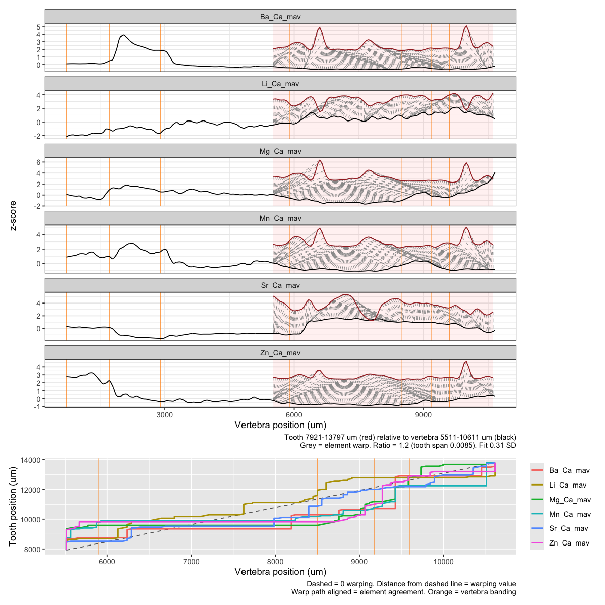
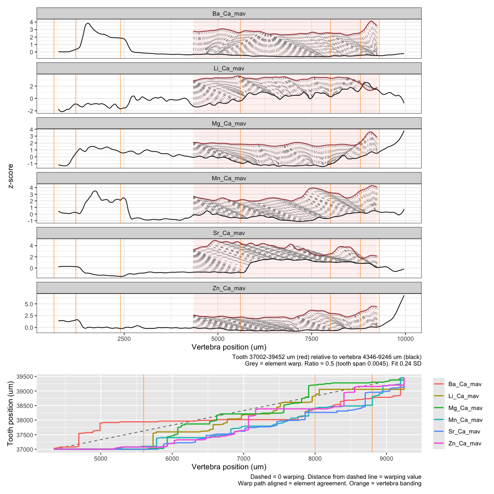
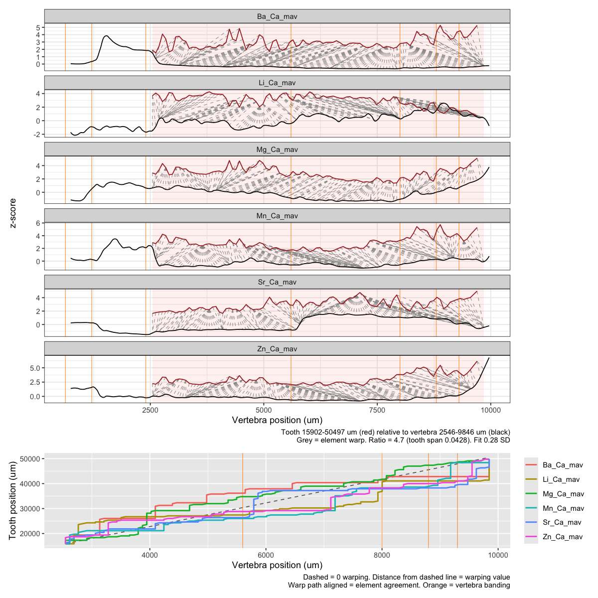
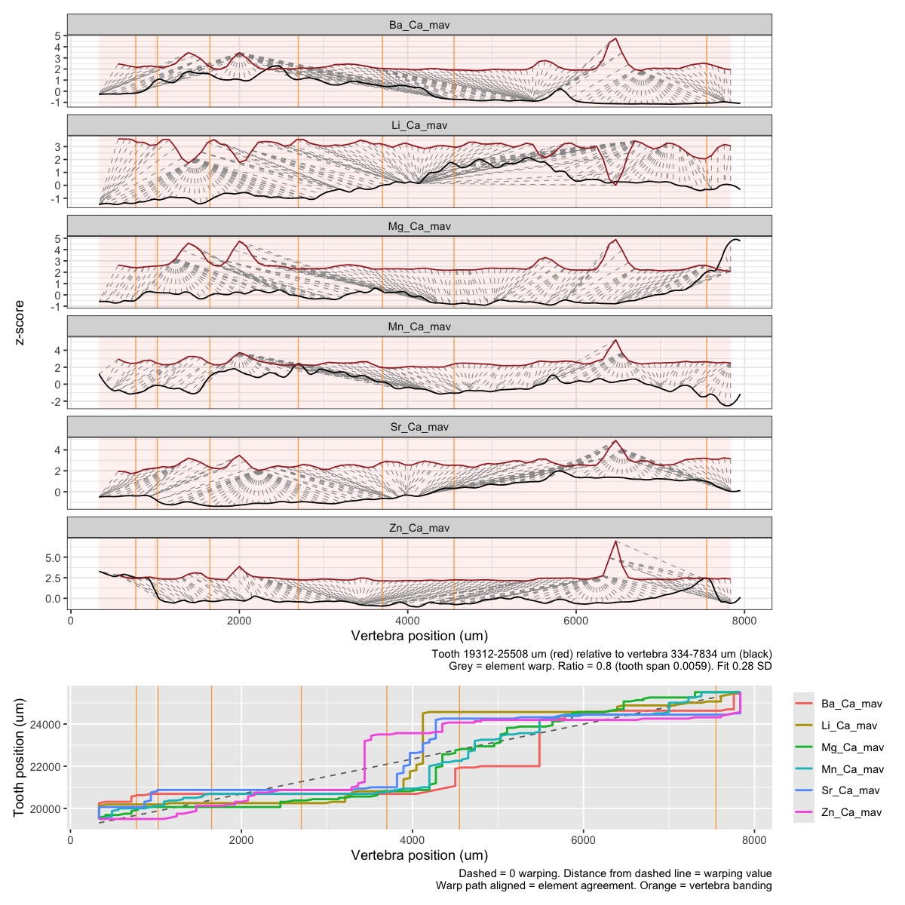
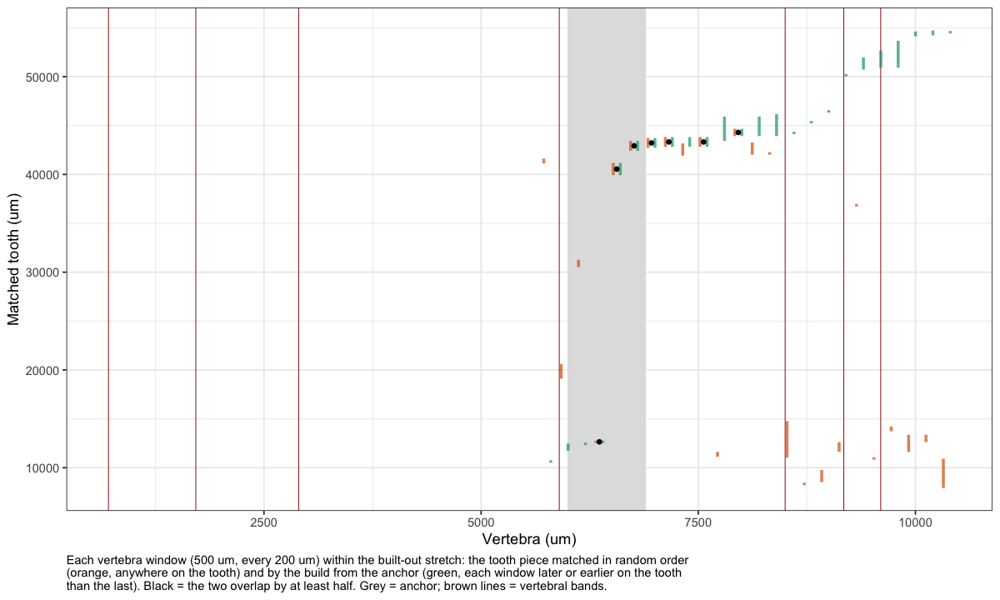
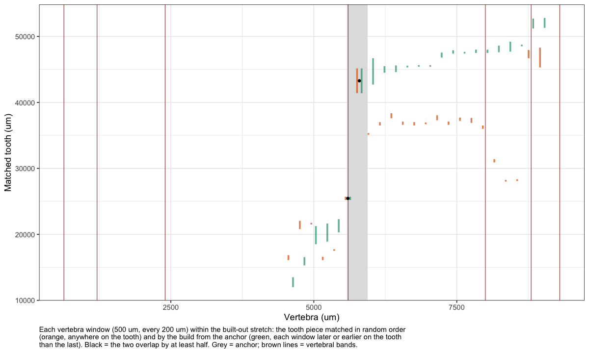
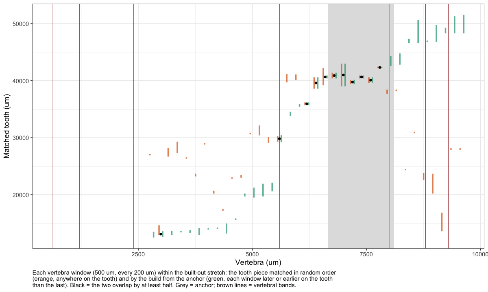
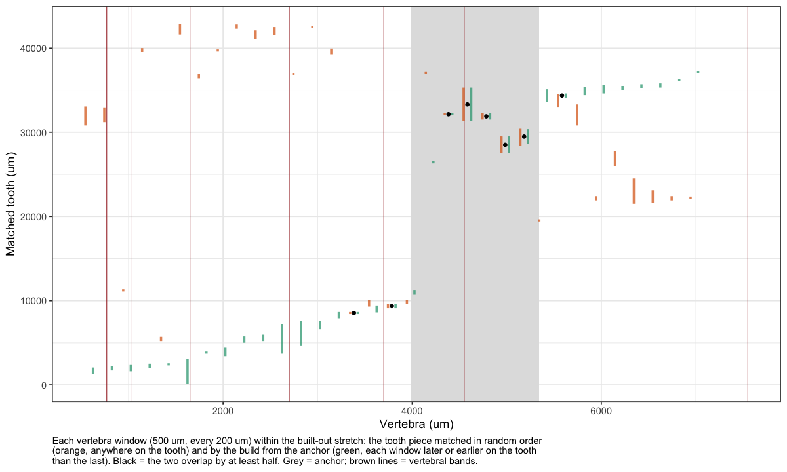
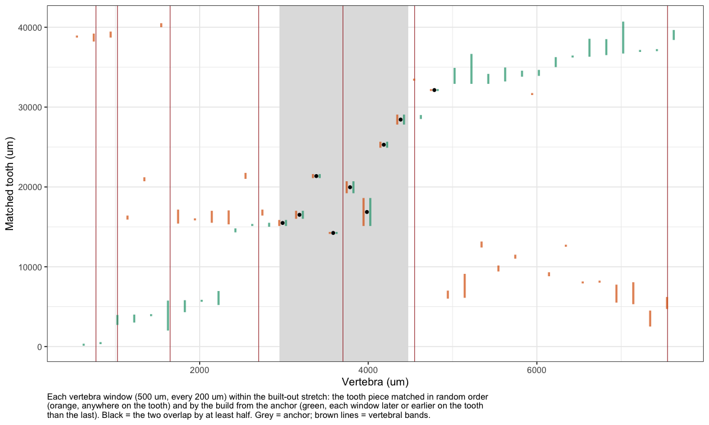

06d · DTW warp up
================
Nikki Biskis
Rendered 27 Oct 2026 11:15

- [Settings](#settings)
- [1. Build from the anchor](#1-build-from-the-anchor)
- [2. All six elements over the built-out
  stretch](#2-all-six-elements-over-the-built-out-stretch)
  - [SMA001W1](#sma001w1)
  - [SMA001B1](#sma001b1)
  - [SMA001B2](#sma001b2)
  - [SMA002W1](#sma002w1)
  - [SMA002W2](#sma002w2)
- [3. Random order, within the built-out
  stretch](#3-random-order-within-the-built-out-stretch)
- [4. Build vs random](#4-build-vs-random)
  - [SMA001W1](#sma001w1-1)
  - [SMA001B1](#sma001b1-1)
  - [SMA001B2](#sma001b2-1)
  - [SMA002W1](#sma002w1-1)
  - [SMA002W2](#sma002w2-1)

- **Paper:** The potential of elemental analysis in determining origin
  of sawfish rostra
- **DOI:** tbd
- **Written:** 28 Aug 2026 (all three sets, all six elements, Oct 2026)
- **Content:** dynamic time warping III: build the match up along the
  vertebra, window by window

The original version is in `original/06c_dtw_warpup.R`. For each version
(06c), with 500 µm vertebra windows every 200 µm, each allowed to match
0.5–8 µm of tooth per µm of vertebra (16 steps):

1.  **Build from the anchor**: the windows inside the anchor (the
    vertebra range where the version’s anchor elements map the same
    tooth to the same place, 06c) are matched freely, then built out one
    window at a time: forward, each window forced later on the tooth
    than the last, and backward, each forced earlier. Uses the anchor
    elements. Each direction stops when there’s no tooth left to match,
    or when the tooth stops moving while the vertebra moves on (a flat
    path: nothing happening, not an alignment).
2.  **All six elements over the built-out stretch**: one
    `match_window()` over the whole stretch the build reached, with its
    figure.
3.  **Random order, within that stretch**: the same windows, each free
    to match anywhere on the tooth, with the anchor elements. Windows
    outside the built-out stretch are skipped.
4.  **Build vs random**: where the two put each window’s tooth piece.
    Where they overlap by at least half (of the shorter piece), the
    match doesn’t depend on being built in order.

Versions without an anchor, or whose build fails, are skipped and
listed, so the rest still run. Starts from 06a and 06c
(`data/output/dtw_cache/06a.RData`, `06c.RData`); saves `06d.RData` for
06f and 06g. Spans are each version’s spans in 06c.

``` r
source('helpers/microHelp.R')
source('helpers/functions/fxn_mavs.R')
source('helpers/functions/fxn_dtw.R')
source('helpers/functions/fxn_warps.R')
library(furrr)
load('data/output/dtw_cache/06a.RData') # objects from 06a
load('data/output/dtw_cache/06c.RData') # sets, gap_um, down (spans), anchor_pairs, anchors from 06c
```

## Settings

``` r
up_settings <- list(win = 500, step = 200, ratio_range = c(0.5, 8), n_ratios = 16,
                    overlap = 0.5,           # build and random agree if their tooth pieces overlap by this share
                    final_elements = mavs2,  # step 2 uses all six
                    stall_windows = 3)       # stop building once the tooth stops moving for this many windows
# the tooth has to move at least this much per window step (the slowest growth ratio allowed)
up_settings$min_advance <- up_settings$step * up_settings$ratio_range[1]

# to set an anchor by hand, e.g.: anchors$SMA002W1 <- c(5000, 6000)
ok <- sapply(names(sets), function(n) length(anchors[[n]]) == 2)
skipped <- data.frame(version = names(sets)[!ok], reason = rep("no anchor from 06c", sum(!ok)))
sets <- sets[ok]

# one window of one version, with its anchor elements (each record smoothed once, then reused)
preps <- lapply(setNames(names(sets), names(sets)), function(n)
  prep_records(sets[[n]]$tooth, sets[[n]]$vert, anchor_pairs[[n]], down[[n]]$spanV, Inf, gap_um = gap_um))
mw <- function(n, v, search)
  cbind(set = n, match_window(sets[[n]]$tooth, sets[[n]]$vert, anchor_pairs[[n]], v_from = v, win = up_settings$win,
                              spanV = down[[n]]$spanV, ratio_range = up_settings$ratio_range,
                              n_ratios = up_settings$n_ratios, tooth_search = search, gap_um = gap_um,
                              prep = preps[[n]]))
starts <- function(n) seq(min(sets[[n]]$vert$true_dist), max(sets[[n]]$vert$true_dist) - up_settings$win,
                          by = up_settings$step)
```

## 1. Build from the anchor

``` r
build <- function(n){
  v_all <- starts(n); a_rng <- anchors[[n]]
  seeds <- v_all[v_all >= a_rng[1] & v_all + up_settings$win <= a_rng[2]]
  if(!length(seeds)) seeds <- v_all[which.min(abs(v_all + up_settings$win / 2 - mean(a_rng)))]  # anchor narrower than a window
  a <- do.call(rbind, lapply(seeds, mw, n = n, search = c(-Inf, Inf)))   # anchor windows: anywhere on the tooth
  a <- a[!is.na(a$tooth_start), ]
  if(!nrow(a)) stop("no match inside the anchor")
  a1 <- a[1, ]; aN <- a[nrow(a), ]
  # build one way from the anchor, one window at a time; stop when no tooth is left to match,
  # or when the tooth stops moving (less than min_advance per window, stall_windows in a row):
  # the vertebra moving on with no tooth is nothing happening, not an alignment
  build_dir <- function(vs, edge, forward){
    out <- list(); stall <- 0; why <- "end of vertebra"
    for(v in vs){
      r <- mw(n, v, if(forward) c(edge, Inf) else c(-Inf, edge))
      if(is.na(r$tooth_start)){ why <- "no tooth left"; break }
      moved <- if(forward) r$tooth_start - edge else edge - r$tooth_end
      stall <- if(moved < up_settings$min_advance) stall + 1 else 0
      out[[length(out) + 1]] <- r
      if(stall >= up_settings$stall_windows){ out <- head(out, -stall); why <- "tooth stopped moving"; break }
      edge <- if(forward) r$tooth_start else r$tooth_end
    }
    list(rows = do.call(rbind, out), why = why)
  }
  f <- build_dir(v_all[v_all > aN$v_from], aN$tooth_start, TRUE)          # later vert, later tooth
  k <- build_dir(rev(v_all[v_all < a1$v_from]), a1$tooth_end, FALSE)      # earlier vert, earlier tooth
  b <- rbind(if(!is.null(k$rows)) cbind(k$rows, stage = "backward"), cbind(a, stage = "anchor"),
             if(!is.null(f$rows)) cbind(f$rows, stage = "forward"))
  b <- b[order(b$v_from), ]
  attr(b, "stopped") <- c(forward = f$why, backward = k$why)
  b
}
plan(multisession, workers = min(length(sets), future::availableCores() - 1))
up <- future_map(setNames(names(sets), names(sets)), function(n) tryCatch(build(n), error = function(e) conditionMessage(e)),
                 .options = furrr_options(packages = c("dtw", "ggplot2")))
plan(sequential)
failed <- names(up)[sapply(up, is.character)]
stopped <- lapply(up[!names(up) %in% failed], attr, "stopped")
if(length(failed)) skipped <- rbind(skipped, data.frame(version = failed, reason = paste("build failed:", unlist(up[failed]))))
up <- up[!names(up) %in% failed]

# per-element results kept apart, since versions use different elements
split_els <- function(b){
  el_cols <- grep("^(cost|warp)_", names(b), value = TRUE)
  long <- do.call(rbind, lapply(unique(sub("^(cost|warp)_", "", el_cols)), function(el)
    data.frame(set = b$set, v_from = b$v_from, element = sub("_Ca.*$", "", el),
               cost = b[[paste0("cost_", el)]], warp = b[[paste0("warp_", el)]])))
  list(core = b[setdiff(names(b), el_cols)], elements = long)
}
built    <- do.call(rbind, lapply(up, function(b) split_els(b)$core))
built_el <- do.call(rbind, lapply(up, function(b) split_els(b)$elements))
built    <- built[!is.na(built$tooth_start), ]
rownames(built) <- NULL
```

``` r
if(nrow(skipped)) knitr::kable(skipped, row.names = FALSE) else cat("No versions skipped.")
```

    #> No versions skipped.

``` r
knitr::kable(do.call(rbind, lapply(split(built, built$set), function(b) data.frame(
  version = b$set[1], elements = paste(sub("_Ca.*$", "", anchor_pairs[[b$set[1]]]), collapse = " + "),
  anchor = sprintf("%.0f-%.0f", anchors[[b$set[1]]][1], anchors[[b$set[1]]][2]),
  windows = nrow(b), vert = sprintf("%.0f-%.0f", min(b$v_from), max(b$v_to)),
  tooth = sprintf("%.0f-%.0f", min(b$tooth_start), max(b$tooth_end)),
  backward_stopped = stopped[[b$set[1]]][["backward"]], forward_stopped = stopped[[b$set[1]]][["forward"]]))),
  row.names = FALSE)
```

| version | elements | anchor | windows | vert | tooth | backward_stopped | forward_stopped |
|:---|:---|:---|---:|:---|:---|:---|:---|
| SMA001B1 | Mg + Sr | 5582-5937 | 23 | 4346-9246 | 12002-52802 | tooth stopped moving | tooth stopped moving |
| SMA001B2 | Mg + Ba | 6652-8110 | 35 | 2546-9846 | 12502-51552 | tooth stopped moving | end of vertebra |
| SMA001W1 | Mg + Sr | 5993-6894 | 24 | 5511-10611 | 10521-54721 | tooth stopped moving | end of vertebra |
| SMA002W1 | Mg + Ba | 3989-5342 | 33 | 334-7234 | 112-37262 | end of vertebra | tooth stopped moving |
| SMA002W2 | Zn + Sr | 2949-4477 | 36 | 334-7834 | 112-40712 | end of vertebra | end of vertebra |

- **elements**: the anchor elements used to build; **anchor**: the
  anchor (vertebra µm).
- **windows, vert, tooth**: matched windows, and the stretch of vertebra
  and tooth the build reached (µm).
- **backward_stopped, forward_stopped**: why the build stopped in each
  direction: the end of the vertebra; no tooth left to match; or the
  tooth stopped moving (it moved less than `min_advance` µm per window,
  the slowest growth ratio allowed × the window step, for
  `stall_windows` windows in a row; those windows are dropped).

## 2. All six elements over the built-out stretch

``` r
final <- list()
for(n in names(up)){
  b <- built[built$set == n, ]
  cat("\n\n###", n, "\n\n")
  final[[n]] <- cbind(set = n, match_window(sets[[n]]$tooth, sets[[n]]$vert, up_settings$final_elements,
                                            v_from = min(b$v_from), win = max(b$v_to) - min(b$v_from),
                                            spanV = down[[n]]$spanV, ratio_range = up_settings$ratio_range,
                                            n_ratios = 24, gap_um = gap_um, plot = TRUE, bands = sets[[n]]$bands))
}
```

### SMA001W1

<!-- -->

### SMA001B1

<!-- -->

### SMA001B2

<!-- -->

### SMA002W1

<!-- -->

### SMA002W2

<!-- -->

``` r
final <- do.call(rbind, lapply(final, function(f) f[c("set", "v_from", "v_to", "tooth_start", "tooth_end", "ratio",
                                                      "cost", "disagree_pct")]))
```

## 3. Random order, within the built-out stretch

``` r
jobs <- do.call(rbind, lapply(names(up), function(n){
  b <- built[built$set == n, ]; v <- starts(n)
  data.frame(set = n, v = v[v >= min(b$v_from) & v <= max(b$v_from)])
}))
plan(multisession, workers = future::availableCores() - 1)
rand <- future_map2_dfr(jobs$set, jobs$v, function(n, v) mw(n, v, c(-Inf, Inf)),
                        .options = furrr_options(packages = c("dtw", "ggplot2")))
plan(sequential)
rand <- rand[!grepl("^(cost|warp)_", names(rand))]
```

## 4. Build vs random

``` r
cmp <- do.call(rbind, lapply(names(up), function(n){
  b <- built[built$set == n, ]; r <- rand[rand$set == n, ]
  m <- merge(b[c("v_from", "v_to", "tooth_start", "tooth_end", "stage")], r[c("v_from", "tooth_start", "tooth_end")],
             by = "v_from", suffixes = c("_build", "_rand"))
  ov <- pmax(0, pmin(m$tooth_end_build, m$tooth_end_rand) - pmax(m$tooth_start_build, m$tooth_start_rand)) /
        pmin(m$tooth_end_build - m$tooth_start_build, m$tooth_end_rand - m$tooth_start_rand)
  cbind(set = n, m, overlap = ov, agree = !is.na(ov) & ov >= up_settings$overlap,
        offset_um = abs((m$tooth_start_build + m$tooth_end_build) - (m$tooth_start_rand + m$tooth_end_rand)) / 2)
}))

# the anchor windows were matched freely too, so they agree by definition: left out of the shares
agree_tab <- do.call(rbind, lapply(split(cmp, cmp$set), function(d){
  d <- d[order(d$v_from), ]; o <- d[d$stage != "anchor", ]
  rl <- rle(d$agree); e <- cumsum(rl$lengths); st <- e - rl$lengths + 1
  k <- which(rl$values); k <- if(length(k)) k[which.max(rl$lengths[k])] else NA
  data.frame(version = d$set[1], windows = nrow(o),
             agree_pct = round(100 * mean(o$agree)),
             forward_pct = round(100 * mean(o$agree[o$stage == "forward"])),
             backward_pct = round(100 * mean(o$agree[o$stage == "backward"])),
             median_offset_um = round(median(o$offset_um)),
             longest_vert = if(is.na(k)) "-" else sprintf("%.0f-%.0f", d$v_from[st[k]], d$v_to[e[k]]),
             longest_tooth = if(is.na(k)) "-" else sprintf("%.0f-%.0f", min(d$tooth_start_build[st[k]:e[k]]), max(d$tooth_end_build[st[k]:e[k]])))
}))
knitr::kable(agree_tab, row.names = FALSE)
```

| version | windows | agree_pct | forward_pct | backward_pct | median_offset_um | longest_vert | longest_tooth |
|:---|---:|---:|---:|---:|---:|:---|:---|
| SMA001B1 | 22 | 5 | 0 | 17 | 8638 | 5346-6046 | 25202-45152 |
| SMA001B2 | 30 | 20 | 0 | 29 | 9088 | 5946-8046 | 35702-43002 |
| SMA001W1 | 22 | 23 | 26 | 0 | 24588 | 6111-7411 | 12521-43821 |
| SMA002W1 | 29 | 14 | 20 | 11 | 14075 | 4134-5434 | 27512-35312 |
| SMA002W2 | 31 | 13 | 12 | 14 | 22925 | 2734-4634 | 14112-29062 |

- **windows**: built windows compared (not counting the anchor).
- **agree_pct**: share whose tooth piece overlaps the random-order match
  by at least half; **forward_pct, backward_pct**: the same for each
  direction from the anchor.
- **median_offset_um**: median distance between the centres of the built
  and random tooth pieces (µm of tooth).
- **longest_vert, longest_tooth**: the longest run of consecutive
  agreeing windows (anchor included), on the vertebra and on the tooth
  (µm).

``` r
plot_cmp <- function(n){
  d <- cmp[cmp$set == n, ]; d$v_mid <- (d$v_from + d$v_to) / 2
  ggplot(d, aes(v_mid)) +
    ggplot2::annotate("rect", xmin = anchors[[n]][1], xmax = anchors[[n]][2], ymin = -Inf, ymax = Inf, fill = "grey88") +
    geom_vline(xintercept = sets[[n]]$bands, colour = "brown", linewidth = 0.3) +
    geom_linerange(aes(ymin = tooth_start_rand, ymax = tooth_end_rand), colour = "#d95f02", alpha = 0.7,
                   linewidth = 1, position = position_nudge(x = -40)) +
    geom_linerange(aes(ymin = tooth_start_build, ymax = tooth_end_build), colour = "#1b9e77", alpha = 0.7,
                   linewidth = 1, position = position_nudge(x = 40)) +
    geom_point(data = d[d$agree, ], aes(y = (tooth_start_build + tooth_end_build) / 2), size = 1.2) +
    theme_bw() +
    theme(plot.caption = element_text(hjust = 0)) +
    labs(x = "Vertebra (um)", y = "Matched tooth (um)",
         caption = paste(strwrap(paste(
           "Each vertebra window (500 um, every 200 um) within the built-out stretch: the tooth piece matched in",
           "random order (orange, anywhere on the tooth) and by the build from the anchor (green, each window later",
           "or earlier on the tooth than the last). Black = the two overlap by at least half. Grey = anchor; brown",
           "lines = vertebral bands."), 115), collapse = "\n"))
}
for(n in names(up)){
  cat("\n\n###", n, "\n\n")
  print(plot_cmp(n))
}
```

### SMA001W1

<!-- -->

### SMA001B1

<!-- -->

### SMA001B2

<!-- -->

### SMA002W1

<!-- -->

### SMA002W2

<!-- -->

``` r
save(up_settings, anchors, anchor_pairs, up, built, built_el, final, rand, cmp, agree_tab, skipped,
     file = 'data/output/dtw_cache/06d.RData')
```
