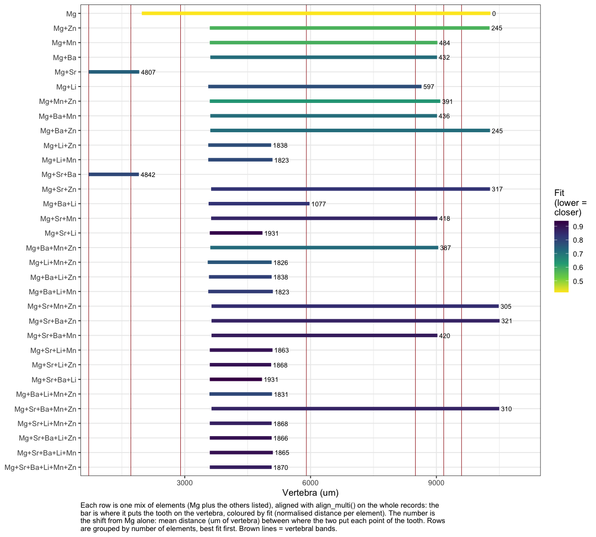
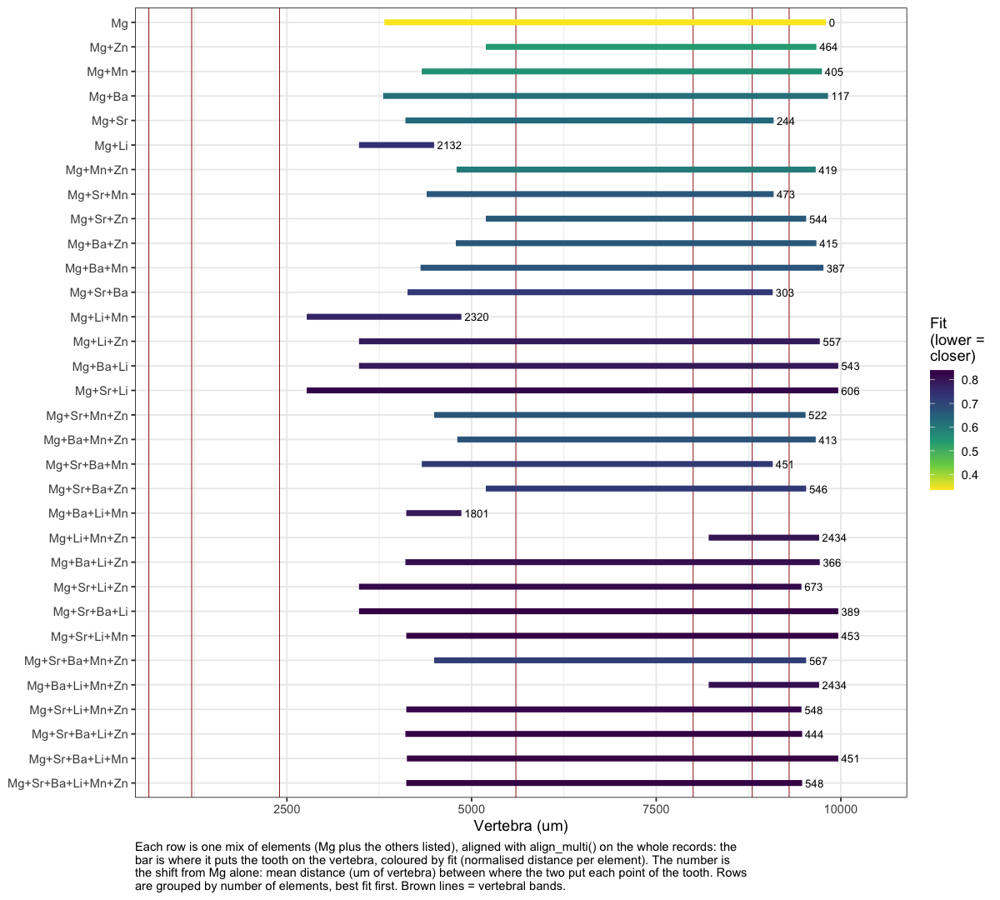
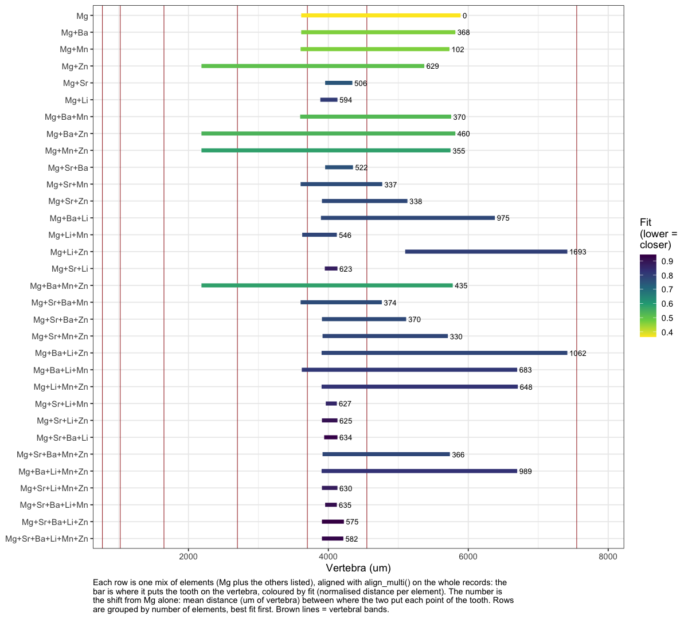

06e · DTW element combinations
================
Nikki Biskis
Rendered 27 Oct 2026 11:46

- [Tables](#tables)
  - [SMA001W](#sma001w)
  - [SMA001B](#sma001b)
  - [SMA002W](#sma002w)
- [Figures](#figures)
  - [SMA001W](#sma001w-1)
  - [SMA001B](#sma001b-1)
  - [SMA002W](#sma002w-1)

- **Paper:** The potential of elemental analysis in determining origin
  of sawfish rostra
- **DOI:** tbd
- **Written:** Oct 2026
- **Content:** dynamic time warping V: how the alignment changes as
  elements are added to Mg

For each fish, `align_multi()` is run on the whole tooth and vertebra
(open start and end) with Mg alone, then with Mg plus every combination
of the other five elements (32 runs). The order elements are added in
doesn’t change an `align_multi()` result, so each combination runs once.
For each:

- **vert_from, vert_to, R**: where the tooth lands on the vertebra, and
  the growth ratio (µm of tooth per µm of vertebra).
- **fit**: DTW normalised distance divided by √(number of elements), so
  mixes of different sizes can be compared (z-score units; lower =
  closer match).
- **shift_um**: how far the combination’s path is from Mg’s own: the
  mean distance (µm of vertebra) between where the two put each point of
  the tooth. 0 = adding the elements changes nothing.

Starts from 06a (`data/output/dtw_cache/06a.RData`).

``` r
source('helpers/microHelp.R')
source('helpers/functions/fxn_mavs.R')
source('helpers/functions/fxn_dtw.R')
load('data/output/dtw_cache/06a.RData') # objects from 06a
```

``` r
spanT  <- 0.02   # loess span on the tooth (share of its points)
spanV  <- 0.04   # loess span on the vertebra
gap_um <- 350    # tooth holes wider than this (um), as in 06a
sets <- list(
  SMA001W = list(tooth = SMA001T_filt,  vert = SMA001V_filt,  bands = c(710, 1715, 2900, 5900, 8500, 9175, 9600)),
  SMA001B = list(tooth = SMA001TB_filt, vert = SMA001VB_filt, bands = c(630, 1210, 2400, 5600, 8000, 8800, 9300)),
  SMA002W = list(tooth = SMA002T_filt,  vert = SMA002V_filt,  bands = c(770, 1025, 1650, 2700, 3700, 4550, 7550)))
fish <- names(sets)
others <- setdiff(mavs2, "Mg_Ca_mav")
combos <- c(list("Mg_Ca_mav"), unlist(lapply(1:length(others), function(k)
  lapply(combn(others, k, simplify = FALSE), function(x) c("Mg_Ca_mav", x))), recursive = FALSE))

# align_multi() with one mix; the vertebra position it gives each of the k tooth points
path_of <- function(n, els, k = 1000){
  set <- sets[[n]]
  invisible(capture.output(al <- align_multi(set$tooth, set$vert, els, n = k, spanT = spanT, spanV = spanV,
                                             open_begin = TRUE, open_end = TRUE, gap_um = gap_um)))
  tt <- sort(set$tooth$true_dist)[round(seq(1, nrow(set$tooth), length.out = k))]
  vv <- sort(set$vert$true_dist)[round(seq(1, nrow(set$vert), length.out = k))]
  v  <- tapply(vv[al$index2], al$index1, mean)
  list(tooth = tt[as.integer(names(v))], vert = as.numeric(v), fit = al$normalizedDistance / sqrt(length(els)))
}

combo_tab <- do.call(rbind, lapply(fish, function(n){
  mg <- path_of(n, "Mg_Ca_mav")
  do.call(rbind, lapply(combos, function(els){
    p <- if(length(els) == 1) mg else path_of(n, els)
    data.frame(set = n, elements = paste(sub("_Ca.*$", "", els), collapse = "+"), n_elements = length(els),
               vert_from = round(min(p$vert)), vert_to = round(max(p$vert)),
               R = round(diff(range(p$tooth)) / diff(range(p$vert)), 1),
               fit = round(p$fit, 3), shift_um = round(mean(abs(p$vert - mg$vert))))
  }))
}))
```

## Tables

``` r
for(n in fish){
  cat("\n\n###", n, "\n\n")
  d <- combo_tab[combo_tab$set == n, ]
  print(knitr::kable(d[order(d$n_elements, d$fit), -1], row.names = FALSE))
}
```

### SMA001W

| elements          | n_elements | vert_from | vert_to |    R |   fit | shift_um |
|:------------------|-----------:|----------:|--------:|-----:|------:|---------:|
| Mg                |          1 |      1976 |   10288 |  6.5 | 0.416 |        0 |
| Mg+Zn             |          2 |      3597 |   10268 |  8.1 | 0.574 |      245 |
| Mg+Mn             |          2 |      3597 |    9024 | 10.0 | 0.580 |      484 |
| Mg+Ba             |          2 |      3609 |    9015 | 10.0 | 0.715 |      432 |
| Mg+Sr             |          2 |       711 |    1915 | 44.9 | 0.743 |     4807 |
| Mg+Li             |          2 |      3560 |    8646 | 10.6 | 0.777 |      597 |
| Mg+Mn+Zn          |          3 |      3597 |    9093 |  9.8 | 0.635 |      391 |
| Mg+Ba+Mn          |          3 |      3609 |    9015 | 10.0 | 0.712 |      436 |
| Mg+Ba+Zn          |          3 |      3609 |   10279 |  8.1 | 0.716 |      245 |
| Mg+Li+Zn          |          3 |      3560 |    5060 | 36.0 | 0.776 |     1838 |
| Mg+Li+Mn          |          3 |      3560 |    5092 | 35.3 | 0.787 |     1823 |
| Mg+Sr+Ba          |          3 |       711 |    1907 | 45.2 | 0.788 |     4842 |
| Mg+Sr+Zn          |          3 |      3629 |   10279 |  8.1 | 0.830 |      317 |
| Mg+Ba+Li          |          3 |      3569 |    5976 | 22.4 | 0.831 |     1077 |
| Mg+Sr+Mn          |          3 |      3629 |    9024 | 10.0 | 0.862 |      418 |
| Mg+Sr+Li          |          3 |      3597 |    4853 | 43.0 | 0.922 |     1931 |
| Mg+Ba+Mn+Zn       |          4 |      3609 |    9044 |  9.9 | 0.721 |      387 |
| Mg+Li+Mn+Zn       |          4 |      3548 |    5072 | 35.5 | 0.761 |     1826 |
| Mg+Ba+Li+Zn       |          4 |      3577 |    5072 | 36.2 | 0.805 |     1838 |
| Mg+Ba+Li+Mn       |          4 |      3560 |    5101 | 35.1 | 0.815 |     1823 |
| Mg+Sr+Mn+Zn       |          4 |      3638 |   10487 |  7.9 | 0.845 |      305 |
| Mg+Sr+Ba+Zn       |          4 |      3638 |   10507 |  7.9 | 0.868 |      321 |
| Mg+Sr+Ba+Mn       |          4 |      3638 |    9024 | 10.0 | 0.884 |      420 |
| Mg+Sr+Li+Mn       |          4 |      3597 |    5092 | 36.2 | 0.902 |     1863 |
| Mg+Sr+Li+Zn       |          4 |      3597 |    5060 | 36.9 | 0.902 |     1868 |
| Mg+Sr+Ba+Li       |          4 |      3597 |    4842 | 43.4 | 0.939 |     1931 |
| Mg+Ba+Li+Mn+Zn    |          5 |      3589 |    5081 | 36.2 | 0.788 |     1831 |
| Mg+Sr+Ba+Mn+Zn    |          5 |      3638 |   10498 |  7.9 | 0.867 |      310 |
| Mg+Sr+Li+Mn+Zn    |          5 |      3597 |    5072 | 36.7 | 0.874 |     1868 |
| Mg+Sr+Ba+Li+Zn    |          5 |      3597 |    5072 | 36.7 | 0.905 |     1866 |
| Mg+Sr+Ba+Li+Mn    |          5 |      3597 |    5101 | 36.0 | 0.906 |     1865 |
| Mg+Sr+Ba+Li+Mn+Zn |          6 |      3597 |    5072 | 36.7 | 0.879 |     1870 |

### SMA001B

| elements          | n_elements | vert_from | vert_to |    R |   fit | shift_um |
|:------------------|-----------:|----------:|--------:|-----:|------:|---------:|
| Mg                |          1 |      3819 |    9798 |  6.8 | 0.335 |        0 |
| Mg+Zn             |          2 |      5193 |    9669 |  9.1 | 0.540 |      464 |
| Mg+Mn             |          2 |      4326 |    9744 |  7.5 | 0.557 |      405 |
| Mg+Ba             |          2 |      3802 |    9827 |  6.8 | 0.618 |      117 |
| Mg+Sr             |          2 |      4104 |    9090 |  8.2 | 0.631 |      244 |
| Mg+Li             |          2 |      3476 |    4493 | 40.2 | 0.743 |     2132 |
| Mg+Mn+Zn          |          3 |      4798 |    9660 |  8.4 | 0.595 |      419 |
| Mg+Sr+Mn          |          3 |      4392 |    9090 |  8.7 | 0.661 |      473 |
| Mg+Sr+Zn          |          3 |      5193 |    9530 |  9.4 | 0.662 |      544 |
| Mg+Ba+Zn          |          3 |      4787 |    9669 |  8.4 | 0.664 |      415 |
| Mg+Ba+Mn          |          3 |      4309 |    9764 |  7.5 | 0.670 |      387 |
| Mg+Sr+Ba          |          3 |      4133 |    9078 |  8.3 | 0.725 |      303 |
| Mg+Li+Mn          |          3 |      2768 |    4862 | 19.5 | 0.767 |     2320 |
| Mg+Li+Zn          |          3 |      3476 |    9715 |  6.6 | 0.787 |      557 |
| Mg+Ba+Li          |          3 |      3476 |    9965 |  6.3 | 0.789 |      543 |
| Mg+Sr+Li          |          3 |      2768 |    9965 |  5.7 | 0.824 |      606 |
| Mg+Sr+Mn+Zn       |          4 |      4493 |    9522 |  8.1 | 0.668 |      522 |
| Mg+Ba+Mn+Zn       |          4 |      4807 |    9660 |  8.4 | 0.671 |      413 |
| Mg+Sr+Ba+Mn       |          4 |      4326 |    9078 |  8.6 | 0.723 |      451 |
| Mg+Sr+Ba+Zn       |          4 |      5193 |    9530 |  9.4 | 0.724 |      546 |
| Mg+Ba+Li+Mn       |          4 |      4116 |    4862 | 54.8 | 0.791 |     1801 |
| Mg+Li+Mn+Zn       |          4 |      8211 |    9706 | 27.3 | 0.801 |     2434 |
| Mg+Ba+Li+Zn       |          4 |      4104 |    9715 |  7.3 | 0.808 |      366 |
| Mg+Sr+Li+Zn       |          4 |      3476 |    9467 |  6.8 | 0.820 |      673 |
| Mg+Sr+Ba+Li       |          4 |      3476 |    9965 |  6.3 | 0.838 |      389 |
| Mg+Sr+Li+Mn       |          4 |      4116 |    9965 |  7.0 | 0.838 |      453 |
| Mg+Sr+Ba+Mn+Zn    |          5 |      4493 |    9530 |  8.1 | 0.715 |      567 |
| Mg+Ba+Li+Mn+Zn    |          5 |      8211 |    9706 | 27.3 | 0.810 |     2434 |
| Mg+Sr+Li+Mn+Zn    |          5 |      4116 |    9467 |  7.6 | 0.823 |      548 |
| Mg+Sr+Ba+Li+Zn    |          5 |      4104 |    9476 |  7.6 | 0.835 |      444 |
| Mg+Sr+Ba+Li+Mn    |          5 |      4124 |    9965 |  7.0 | 0.840 |      451 |
| Mg+Sr+Ba+Li+Mn+Zn |          6 |      4116 |    9476 |  7.6 | 0.831 |      548 |

### SMA002W

| elements          | n_elements | vert_from | vert_to |     R |   fit | shift_um |
|:------------------|-----------:|----------:|--------:|------:|------:|---------:|
| Mg                |          1 |      3612 |    5890 |  18.8 | 0.364 |        0 |
| Mg+Ba             |          2 |      3612 |    5815 |  19.5 | 0.464 |      368 |
| Mg+Mn             |          2 |      3603 |    5731 |  20.2 | 0.466 |      102 |
| Mg+Zn             |          2 |      2186 |    5371 |  13.5 | 0.506 |      629 |
| Mg+Sr             |          2 |      3954 |    4343 | 110.3 | 0.747 |      506 |
| Mg+Li             |          2 |      3885 |    4130 | 175.2 | 0.809 |      594 |
| Mg+Ba+Mn          |          3 |      3597 |    5755 |  19.9 | 0.524 |      370 |
| Mg+Ba+Zn          |          3 |      2186 |    5815 |  11.8 | 0.538 |      460 |
| Mg+Mn+Zn          |          3 |      2186 |    5746 |  12.1 | 0.580 |      355 |
| Mg+Sr+Ba          |          3 |      3954 |    4352 | 107.9 | 0.756 |      522 |
| Mg+Sr+Mn          |          3 |      3603 |    4770 |  36.8 | 0.768 |      337 |
| Mg+Sr+Zn          |          3 |      3908 |    5130 |  35.1 | 0.777 |      338 |
| Mg+Ba+Li          |          3 |      3894 |    6380 |  17.3 | 0.778 |      975 |
| Mg+Li+Mn          |          3 |      3626 |    4121 |  86.6 | 0.782 |      546 |
| Mg+Li+Zn          |          3 |      5098 |    7416 |  18.5 | 0.797 |     1693 |
| Mg+Sr+Li          |          3 |      3949 |    4130 | 236.4 | 0.874 |      623 |
| Mg+Ba+Mn+Zn       |          4 |      2186 |    5778 |  11.9 | 0.580 |      435 |
| Mg+Sr+Ba+Mn       |          4 |      3603 |    4764 |  37.0 | 0.768 |      374 |
| Mg+Sr+Ba+Zn       |          4 |      3908 |    5112 |  35.6 | 0.775 |      370 |
| Mg+Sr+Mn+Zn       |          4 |      3917 |    5708 |  23.9 | 0.782 |      330 |
| Mg+Ba+Li+Zn       |          4 |      3903 |    7416 |  12.2 | 0.783 |     1062 |
| Mg+Ba+Li+Mn       |          4 |      3620 |    6699 |  13.9 | 0.816 |      683 |
| Mg+Li+Mn+Zn       |          4 |      3903 |    6708 |  15.3 | 0.826 |      648 |
| Mg+Sr+Li+Mn       |          4 |      3963 |    4121 | 270.8 | 0.855 |      627 |
| Mg+Sr+Li+Zn       |          4 |      3908 |    4130 | 193.4 | 0.905 |      625 |
| Mg+Sr+Ba+Li       |          4 |      3940 |    4130 | 225.7 | 0.932 |      634 |
| Mg+Sr+Ba+Mn+Zn    |          5 |      3917 |    5737 |  23.6 | 0.779 |      366 |
| Mg+Ba+Li+Mn+Zn    |          5 |      3903 |    6699 |  15.3 | 0.827 |      989 |
| Mg+Sr+Li+Mn+Zn    |          5 |      3908 |    4130 | 193.4 | 0.881 |      630 |
| Mg+Sr+Ba+Li+Mn    |          5 |      3954 |    4121 | 256.8 | 0.913 |      635 |
| Mg+Sr+Ba+Li+Zn    |          5 |      3908 |    4222 | 136.7 | 0.944 |      575 |
| Mg+Sr+Ba+Li+Mn+Zn |          6 |      3908 |    4214 | 140.5 | 0.924 |      582 |

## Figures

``` r
plot_combos <- function(n){
  d <- combo_tab[combo_tab$set == n, ]
  d$elements <- factor(d$elements, levels = rev(d$elements[order(d$n_elements, d$fit)]))
  ggplot(d, aes(y = elements)) +
    geom_vline(xintercept = sets[[n]]$bands, colour = "brown", linewidth = 0.3) +
    geom_segment(aes(x = vert_from, xend = vert_to, yend = elements, colour = fit), linewidth = 2) +
    geom_text(aes(x = vert_to, label = paste0(" ", shift_um)), hjust = 0, size = 2.8) +
    scale_colour_viridis_c(direction = -1, name = "Fit\n(lower =\ncloser)") +
    scale_x_continuous(expand = expansion(mult = c(0.02, 0.1))) +
    theme_bw() +
    theme(plot.caption = element_text(hjust = 0)) +
    labs(x = "Vertebra (um)", y = NULL,
         caption = paste(strwrap(paste(
           "Each row is one mix of elements (Mg plus the others listed), aligned with align_multi() on the whole",
           "records: the bar is where it puts the tooth on the vertebra, coloured by fit (normalised distance per",
           "element). The number is the shift from Mg alone: mean distance (um of vertebra) between where the two",
           "put each point of the tooth. Rows are grouped by number of elements, best fit first. Brown lines =",
           "vertebral bands."), 115), collapse = "\n"))
}
for(n in fish){
  cat("\n\n###", n, "\n\n")
  print(plot_combos(n))
}
```

### SMA001W

<!-- -->

### SMA001B

<!-- -->

### SMA002W

<!-- -->

``` r
dir.create('data/output/dtw_final', showWarnings = FALSE)
write.csv(combo_tab, 'data/output/dtw_final/element_combos.csv', row.names = FALSE)
```
