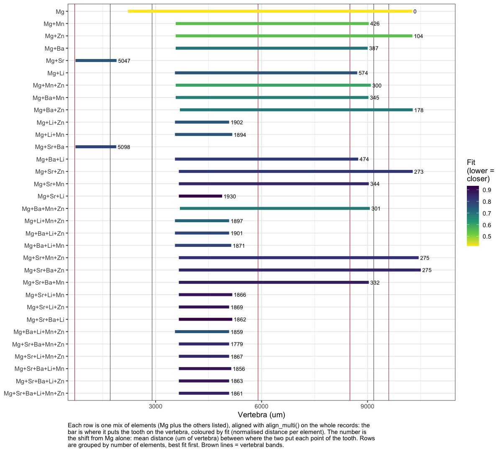
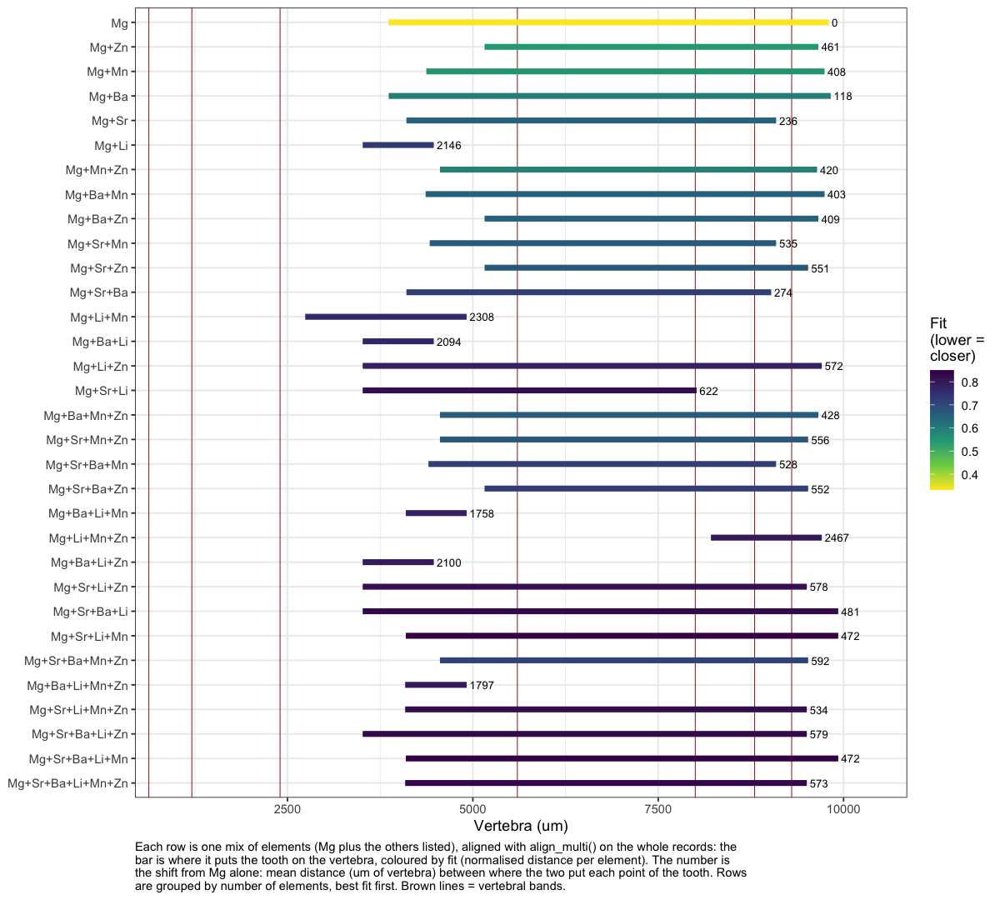
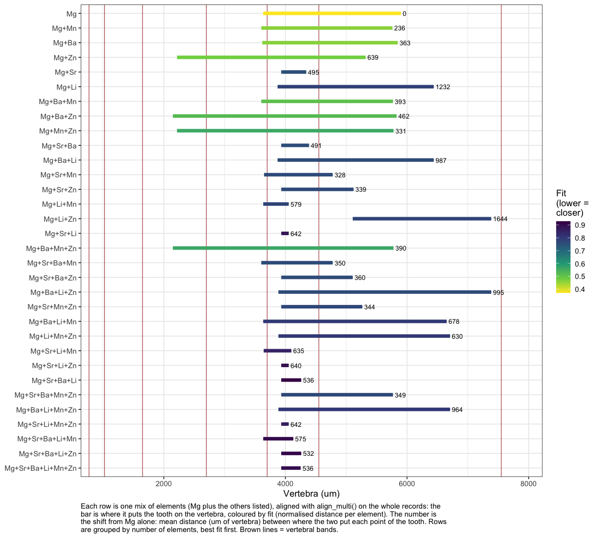

06e · DTW element combinations
================
Nikki Biskis
Rendered 27 Oct 2026 21:49

- [Tables](#tables)
  - [SMA001W](#sma001w)
  - [SMA001B](#sma001b)
  - [SMA002W](#sma002w)
- [Figures](#figures)
  - [SMA001W](#sma001w-1)
  - [SMA001B](#sma001b-1)
  - [SMA002W](#sma002w-1)

- **Paper:** The potential of elemental analysis in determining origin
  of sawfish rostra
- **DOI:** tbd
- **Written:** Oct 2026
- **Content:** dynamic time warping V: how the alignment changes as
  elements are added to Mg

For each fish, `align_multi()` is run on the whole tooth and vertebra
(open start and end) with Mg alone, then with Mg plus every combination
of the other five elements (32 runs). The order elements are added in
doesn’t change an `align_multi()` result, so each combination runs once.
For each:

- **vert_from, vert_to, R**: where the tooth lands on the vertebra, and
  the growth ratio (µm of tooth per µm of vertebra).
- **fit**: DTW normalised distance divided by √(number of elements), so
  mixes of different sizes can be compared (z-score units; lower =
  closer match).
- **shift_um**: how far the combination’s path is from Mg’s own: the
  mean distance (µm of vertebra) between where the two put each point of
  the tooth. 0 = adding the elements changes nothing.

Starts from 06a (`data/output/dtw_cache/06a.RData`).

``` r
source('helpers/microHelp.R')
source('helpers/functions/fxn_mavs.R')
source('helpers/functions/fxn_dtw.R')
load('data/output/dtw_cache/06a.RData') # objects from 06a
```

``` r
gap_um <- 350    # tooth holes wider than this (um), as in 06a
sets <- list(
  SMA001W = list(tooth = SMA001T_filt,  vert = SMA001V_filt,  bands = c(710, 1715, 2900, 5900, 8500, 9175, 9600)),
  SMA001B = list(tooth = SMA001TB_filt, vert = SMA001VB_filt, bands = c(630, 1210, 2400, 5600, 8000, 8800, 9300)),
  SMA002W = list(tooth = SMA002T_filt,  vert = SMA002V_filt,  bands = c(770, 1025, 1650, 2700, 3700, 4550, 7550)))
fish <- names(sets)
others <- setdiff(mavs2, "Mg_Ca_mav")
combos <- c(list("Mg_Ca_mav"), unlist(lapply(1:length(others), function(k)
  lapply(combn(others, k, simplify = FALSE), function(x) c("Mg_Ca_mav", x))), recursive = FALSE))

# align_multi() with one mix; the vertebra position it gives each of the k tooth points
path_of <- function(n, els, k = 1000){
  set <- sets[[n]]
  invisible(capture.output(al <- align_multi(set$tooth, set$vert, els, n = k,
                                             open_begin = TRUE, open_end = TRUE, gap_um = gap_um, plot = FALSE)))
  tt <- sort(set$tooth$true_dist)[round(seq(1, nrow(set$tooth), length.out = k))]
  vv <- sort(set$vert$true_dist)[round(seq(1, nrow(set$vert), length.out = k))]
  v  <- tapply(vv[al$index2], al$index1, mean)
  list(tooth = tt[as.integer(names(v))], vert = as.numeric(v), fit = al$normalizedDistance / sqrt(length(els)))
}

combo_tab <- do.call(rbind, lapply(fish, function(n){
  mg <- path_of(n, "Mg_Ca_mav")
  do.call(rbind, lapply(combos, function(els){
    p <- if(length(els) == 1) mg else path_of(n, els)
    data.frame(set = n, elements = paste(sub("_Ca.*$", "", els), collapse = "+"), n_elements = length(els),
               vert_from = round(min(p$vert)), vert_to = round(max(p$vert)),
               R = round(diff(range(p$tooth)) / diff(range(p$vert)), 1),
               fit = round(p$fit, 3), shift_um = round(mean(abs(p$vert - mg$vert))))
  }))
}))
```

## Tables

``` r
for(n in fish){
  cat("\n\n###", n, "\n\n")
  d <- combo_tab[combo_tab$set == n, ]
  print(knitr::kable(d[order(d$n_elements, d$fit), -1], row.names = FALSE))
}
```

### SMA001W

| elements          | n_elements | vert_from | vert_to |    R |   fit | shift_um |
|:------------------|-----------:|----------:|--------:|-----:|------:|---------:|
| Mg                |          1 |      2215 |   10259 |  6.7 | 0.417 |        0 |
| Mg+Mn             |          2 |      3569 |    9035 |  9.9 | 0.546 |      426 |
| Mg+Zn             |          2 |      3569 |   10268 |  8.1 | 0.547 |      104 |
| Mg+Ba             |          2 |      3569 |    9003 |  9.9 | 0.699 |      387 |
| Mg+Sr             |          2 |       732 |    1895 | 46.4 | 0.756 |     5047 |
| Mg+Li             |          2 |      3548 |    8707 | 10.5 | 0.763 |      574 |
| Mg+Mn+Zn          |          3 |      3569 |    9093 |  9.8 | 0.598 |      300 |
| Mg+Ba+Mn          |          3 |      3569 |    9024 |  9.9 | 0.681 |      345 |
| Mg+Ba+Zn          |          3 |      3687 |   10279 |  8.2 | 0.688 |      178 |
| Mg+Li+Zn          |          3 |      3548 |    5081 | 35.2 | 0.757 |     1902 |
| Mg+Li+Mn          |          3 |      3548 |    5170 | 33.3 | 0.762 |     1894 |
| Mg+Sr+Ba          |          3 |       732 |    1886 | 46.7 | 0.793 |     5098 |
| Mg+Ba+Li          |          3 |      3548 |    8735 | 10.4 | 0.813 |      474 |
| Mg+Sr+Zn          |          3 |      3658 |   10279 |  8.2 | 0.821 |      273 |
| Mg+Sr+Mn          |          3 |      3658 |    9035 | 10.0 | 0.854 |      344 |
| Mg+Sr+Li          |          3 |      3658 |    4882 | 44.1 | 0.924 |     1930 |
| Mg+Ba+Mn+Zn       |          4 |      3687 |    9064 | 10.0 | 0.688 |      301 |
| Mg+Li+Mn+Zn       |          4 |      3548 |    5081 | 35.2 | 0.733 |     1897 |
| Mg+Ba+Li+Zn       |          4 |      3548 |    5081 | 35.2 | 0.786 |     1901 |
| Mg+Ba+Li+Mn       |          4 |      3548 |    5141 | 33.9 | 0.792 |     1871 |
| Mg+Sr+Mn+Zn       |          4 |      3658 |   10446 |  7.9 | 0.830 |      275 |
| Mg+Sr+Ba+Zn       |          4 |      3658 |   10507 |  7.9 | 0.858 |      275 |
| Mg+Sr+Ba+Mn       |          4 |      3658 |    9035 | 10.0 | 0.873 |      332 |
| Mg+Sr+Li+Mn       |          4 |      3658 |    5170 | 35.7 | 0.885 |     1866 |
| Mg+Sr+Li+Zn       |          4 |      3658 |    5081 | 37.9 | 0.890 |     1869 |
| Mg+Sr+Ba+Li       |          4 |      3658 |    5170 | 35.7 | 0.932 |     1862 |
| Mg+Ba+Li+Mn+Zn    |          5 |      3548 |    5081 | 35.2 | 0.761 |     1859 |
| Mg+Sr+Ba+Mn+Zn    |          5 |      3658 |    5081 | 37.9 | 0.848 |     1779 |
| Mg+Sr+Li+Mn+Zn    |          5 |      3658 |    5081 | 37.9 | 0.854 |     1867 |
| Mg+Sr+Ba+Li+Mn    |          5 |      3658 |    5141 | 36.4 | 0.891 |     1856 |
| Mg+Sr+Ba+Li+Zn    |          5 |      3658 |    5081 | 37.9 | 0.891 |     1863 |
| Mg+Sr+Ba+Li+Mn+Zn |          6 |      3658 |    5081 | 37.9 | 0.859 |     1861 |

### SMA001B

| elements          | n_elements | vert_from | vert_to |    R |   fit | shift_um |
|:------------------|-----------:|----------:|--------:|-----:|------:|---------:|
| Mg                |          1 |      3865 |    9798 |  6.9 | 0.332 |        0 |
| Mg+Zn             |          2 |      5158 |    9660 |  9.1 | 0.542 |      461 |
| Mg+Mn             |          2 |      4372 |    9744 |  7.6 | 0.549 |      408 |
| Mg+Ba             |          2 |      3865 |    9827 |  6.8 | 0.595 |      118 |
| Mg+Sr             |          2 |      4104 |    9090 |  8.2 | 0.645 |      236 |
| Mg+Li             |          2 |      3514 |    4473 | 42.6 | 0.730 |     2146 |
| Mg+Mn+Zn          |          3 |      4556 |    9643 |  8.0 | 0.591 |      420 |
| Mg+Ba+Mn          |          3 |      4363 |    9744 |  7.6 | 0.651 |      403 |
| Mg+Ba+Zn          |          3 |      5158 |    9660 |  9.1 | 0.651 |      409 |
| Mg+Sr+Mn          |          3 |      4418 |    9090 |  8.7 | 0.663 |      535 |
| Mg+Sr+Zn          |          3 |      5158 |    9522 |  9.4 | 0.668 |      551 |
| Mg+Sr+Ba          |          3 |      4104 |    9024 |  8.3 | 0.720 |      274 |
| Mg+Li+Mn          |          3 |      2739 |    4916 | 18.8 | 0.763 |     2308 |
| Mg+Ba+Li          |          3 |      3514 |    4473 | 42.6 | 0.773 |     2094 |
| Mg+Li+Zn          |          3 |      3514 |    9706 |  6.6 | 0.784 |      572 |
| Mg+Sr+Li          |          3 |      3514 |    8018 |  9.1 | 0.821 |      622 |
| Mg+Ba+Mn+Zn       |          4 |      4556 |    9660 |  8.0 | 0.659 |      428 |
| Mg+Sr+Mn+Zn       |          4 |      4556 |    9522 |  8.2 | 0.668 |      556 |
| Mg+Sr+Ba+Mn       |          4 |      4401 |    9090 |  8.7 | 0.715 |      528 |
| Mg+Sr+Ba+Zn       |          4 |      5158 |    9522 |  9.4 | 0.721 |      552 |
| Mg+Ba+Li+Mn       |          4 |      4096 |    4916 | 49.7 | 0.782 |     1758 |
| Mg+Li+Mn+Zn       |          4 |      8211 |    9706 | 27.3 | 0.796 |     2467 |
| Mg+Ba+Li+Zn       |          4 |      3514 |    4473 | 42.6 | 0.797 |     2100 |
| Mg+Sr+Li+Zn       |          4 |      3514 |    9504 |  6.8 | 0.820 |      578 |
| Mg+Sr+Ba+Li       |          4 |      3514 |    9928 |  6.4 | 0.829 |      481 |
| Mg+Sr+Li+Mn       |          4 |      4096 |    9928 |  7.0 | 0.850 |      472 |
| Mg+Sr+Ba+Mn+Zn    |          5 |      4556 |    9522 |  8.2 | 0.710 |      592 |
| Mg+Ba+Li+Mn+Zn    |          5 |      4087 |    4916 | 49.2 | 0.800 |     1797 |
| Mg+Sr+Li+Mn+Zn    |          5 |      4087 |    9504 |  7.5 | 0.827 |      534 |
| Mg+Sr+Ba+Li+Zn    |          5 |      3514 |    9504 |  6.8 | 0.829 |      579 |
| Mg+Sr+Ba+Li+Mn    |          5 |      4096 |    9928 |  7.0 | 0.845 |      472 |
| Mg+Sr+Ba+Li+Mn+Zn |          6 |      4087 |    9504 |  7.5 | 0.831 |      573 |

### SMA002W

| elements          | n_elements | vert_from | vert_to |     R |   fit | shift_um |
|:------------------|-----------:|----------:|--------:|------:|------:|---------:|
| Mg                |          1 |      3635 |    5899 |  18.9 | 0.370 |        0 |
| Mg+Mn             |          2 |      3603 |    5760 |  19.8 | 0.458 |      236 |
| Mg+Ba             |          2 |      3620 |    5847 |  19.2 | 0.461 |      363 |
| Mg+Zn             |          2 |      2218 |    5320 |  13.8 | 0.477 |      639 |
| Mg+Sr             |          2 |      3931 |    4343 | 104.0 | 0.750 |      495 |
| Mg+Li             |          2 |      3871 |    6440 |  16.7 | 0.784 |     1232 |
| Mg+Ba+Mn          |          3 |      3603 |    5769 |  19.8 | 0.507 |      393 |
| Mg+Ba+Zn          |          3 |      2149 |    5829 |  11.6 | 0.521 |      462 |
| Mg+Mn+Zn          |          3 |      2218 |    5778 |  12.0 | 0.560 |      331 |
| Mg+Sr+Ba          |          3 |      3931 |    4389 |  93.5 | 0.755 |      491 |
| Mg+Ba+Li          |          3 |      3871 |    6440 |  16.7 | 0.760 |      987 |
| Mg+Sr+Mn          |          3 |      3649 |    4778 |  37.9 | 0.761 |      328 |
| Mg+Sr+Zn          |          3 |      3931 |    5121 |  36.0 | 0.764 |      339 |
| Mg+Li+Mn          |          3 |      3635 |    4055 | 101.8 | 0.776 |      579 |
| Mg+Li+Zn          |          3 |      5107 |    7385 |  18.8 | 0.776 |     1644 |
| Mg+Sr+Li          |          3 |      3931 |    4055 | 345.7 | 0.879 |      642 |
| Mg+Ba+Mn+Zn       |          4 |      2149 |    5778 |  11.8 | 0.563 |      390 |
| Mg+Sr+Ba+Mn       |          4 |      3603 |    4778 |  36.4 | 0.760 |      350 |
| Mg+Sr+Ba+Zn       |          4 |      3931 |    5107 |  36.4 | 0.763 |      360 |
| Mg+Ba+Li+Zn       |          4 |      3885 |    7385 |  12.2 | 0.763 |      995 |
| Mg+Sr+Mn+Zn       |          4 |      3931 |    5265 |  32.1 | 0.770 |      344 |
| Mg+Ba+Li+Mn       |          4 |      3635 |    6653 |  14.2 | 0.798 |      678 |
| Mg+Li+Mn+Zn       |          4 |      3885 |    6708 |  15.2 | 0.803 |      630 |
| Mg+Sr+Li+Mn       |          4 |      3643 |    4098 |  94.1 | 0.850 |      635 |
| Mg+Sr+Li+Zn       |          4 |      3931 |    4055 | 345.7 | 0.897 |      640 |
| Mg+Sr+Ba+Li       |          4 |      3931 |    4260 | 130.4 | 0.929 |      536 |
| Mg+Sr+Ba+Mn+Zn    |          5 |      3931 |    5769 |  23.3 | 0.769 |      349 |
| Mg+Ba+Li+Mn+Zn    |          5 |      3885 |    6708 |  15.2 | 0.807 |      964 |
| Mg+Sr+Li+Mn+Zn    |          5 |      3931 |    4055 | 345.7 | 0.868 |      642 |
| Mg+Sr+Ba+Li+Mn    |          5 |      3635 |    4130 |  86.4 | 0.908 |      575 |
| Mg+Sr+Ba+Li+Zn    |          5 |      3931 |    4260 | 130.4 | 0.912 |      532 |
| Mg+Sr+Ba+Li+Mn+Zn |          6 |      3931 |    4251 | 133.9 | 0.897 |      536 |

## Figures

``` r
plot_combos <- function(n){
  d <- combo_tab[combo_tab$set == n, ]
  d$elements <- factor(d$elements, levels = rev(d$elements[order(d$n_elements, d$fit)]))
  ggplot(d, aes(y = elements)) +
    geom_vline(xintercept = sets[[n]]$bands, colour = "brown", linewidth = 0.3) +
    geom_segment(aes(x = vert_from, xend = vert_to, yend = elements, colour = fit), linewidth = 2) +
    geom_text(aes(x = vert_to, label = paste0(" ", shift_um)), hjust = 0, size = 2.8) +
    scale_colour_viridis_c(direction = -1, name = "Fit\n(lower =\ncloser)") +
    scale_x_continuous(expand = expansion(mult = c(0.02, 0.1))) +
    theme_bw() +
    theme(plot.caption = element_text(hjust = 0)) +
    labs(x = "Vertebra (um)", y = NULL,
         caption = paste(strwrap(paste(
           "Each row is one mix of elements (Mg plus the others listed), aligned with align_multi() on the whole",
           "records: the bar is where it puts the tooth on the vertebra, coloured by fit (normalised distance per",
           "element). The number is the shift from Mg alone: mean distance (um of vertebra) between where the two",
           "put each point of the tooth. Rows are grouped by number of elements, best fit first. Brown lines =",
           "vertebral bands."), 115), collapse = "\n"))
}
figs <- lapply(setNames(fish, fish), plot_combos)
```

### SMA001W

``` r
figs$SMA001W
```

<!-- -->

### SMA001B

``` r
figs$SMA001B
```

<!-- -->

### SMA002W

``` r
figs$SMA002W
```

<!-- -->

``` r
dir.create('data/output/dtw_final', showWarnings = FALSE)
dir.create('figures/dtw', showWarnings = FALSE)
write.csv(combo_tab, 'data/output/dtw_final/element_combos.csv', row.names = FALSE)
for(n in fish) ggsave(paste0('figures/dtw/element_combos_', n, '.png'), figs[[n]], width = 10, height = 9, dpi = 300)
save(combo_tab, file = 'data/output/dtw_cache/06e.RData')   # for 06f
```
