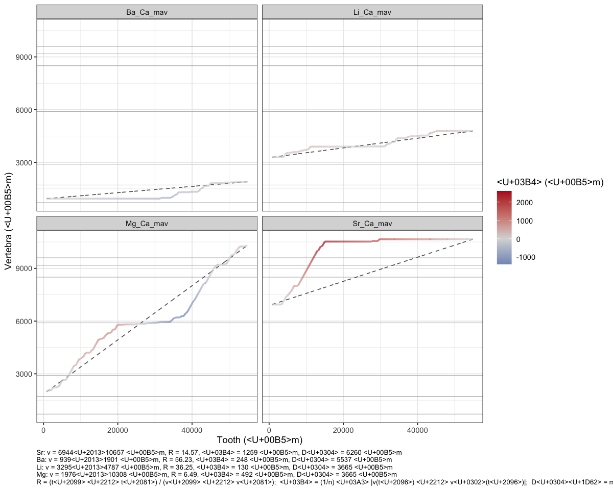
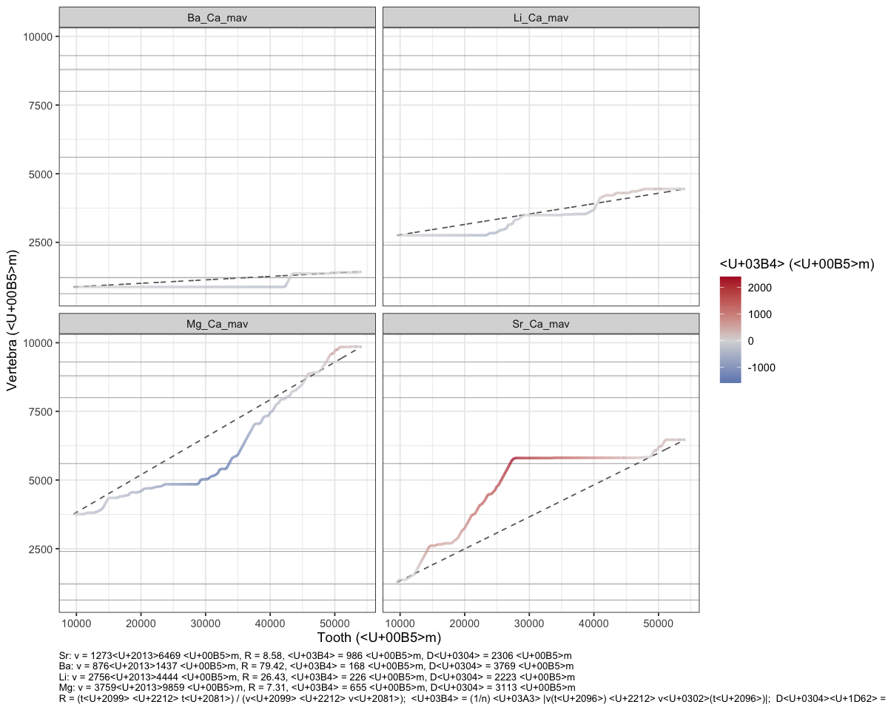
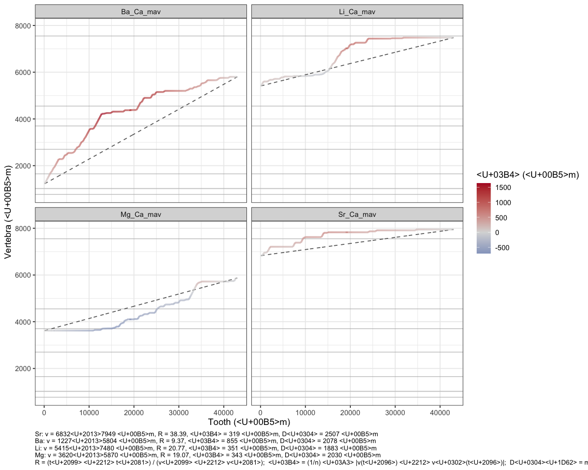

06e · DTW warp rates
================
Nikki Biskis
Rendered 24 Oct 2026 19:12

- [SMA001 (water)](#sma001-water)
- [SMA001 (bleach)](#sma001-bleach)
- [SMA002](#sma002)

- **Paper:** The potential of elemental analysis in determining origin
  of sawfish rostra
- **DOI:** tbd
- **Written:** 30 Aug 2026
- **Content:** dynamic time warping III: let’s check out that warp rate

R markdown version of `06e_dtw_rates.R`. It starts from the objects 06a
saved (`data/output/dtw_cache/06a.RData`).

``` r
source('helpers/functions/fxn_dtw.R')
source('helpers/functions/fxn_mavs.R')
source('helpers/microHelp.R')
load('data/output/dtw_cache/06a.RData') # objects from 06a
```

3 plots in the function, depending on the question:

- first one is the grouped warp rate
- second is warp rate per element if they are not force-aligned
- 3rd is now the warp rate but looking at elements that are forced to
  the same area along a tooth

``` r
library(dtw)
library(ggplot2)
library(patchwork)
library(tidyr)
```

<details>
<summary>
Show the function
</summary>

``` r
compare_warps <- function(datT, datV, elements,
                          spanT = 0.04, spanV = 0.01,
                          n = 2000, pattern = asymmetric,
                          bands = NULL){           # optional: vert positions (um) of dark bands
  
  datT <- datT[order(datT$true_dist), ]
  datV <- datV[order(datV$true_dist), ]
  if(length(spanT) == 1) spanT <- setNames(rep(spanT, length(elements)), elements)
  if(length(spanV) == 1) spanV <- setNames(rep(spanV, length(elements)), elements)
  
  tooth_idx  <- round(seq(1, nrow(datT), length.out = n))
  vert_idx   <- round(seq(1, nrow(datV), length.out = n))
  tooth_dist <- datT$true_dist[tooth_idx]
  
  prep <- function(dat, el, sp){
    sm <- predict(loess(dat[[el]] ~ dat$true_dist, span = sp))
    x  <- approx(seq_along(sm), sm, n = n)$y
    (x - mean(x)) / sd(x)
  }
  
  # matched vert position for every tooth point, one column per element
  vpos <- matrix(NA_real_, n, length(elements), dimnames = list(NULL, elements))
  for(el in elements){
    a <- dtw(prep(datT, el, spanT[[el]]), prep(datV, el, spanV[[el]]),
             step.pattern = pattern, open.begin = TRUE, open.end = TRUE)
    v <- tapply(datV$true_dist[vert_idx[a$index2]], a$index1, mean)
    vpos[as.integer(names(v)), el] <- v
  }
  
  # deviation from each element's own constant-rate line
  vhat <- sapply(elements, function(el){
    v <- vpos[, el]
    v[1] + (v[n] - v[1]) * (tooth_dist - tooth_dist[1]) / (tooth_dist[n] - tooth_dist[1])
  })
  dev <- vpos - vhat
  
  # pairwise separation
  D <- outer(elements, elements, Vectorize(function(i, j) mean(abs(vpos[, i] - vpos[, j]))))
  dimnames(D) <- list(elements, elements)
  
  summ <- data.frame(
    element    = elements,
    v_start    = vpos[1, ],
    v_end      = vpos[n, ],
    R          = (tooth_dist[n] - tooth_dist[1]) / (vpos[n, ] - vpos[1, ]),
    delta_um   = colMeans(abs(dev)),
    Dbar_um    = if(length(elements) > 1) (rowSums(D)) / (length(elements) - 1) else NA
  )
  rownames(summ) <- NULL
  
  # caption: reported values + definitions
  vals <- with(summ, sprintf("%s: v = %.0f–%.0f µm, R = %.2f, δ = %.0f µm, D̄ = %.0f µm",
                             sub("_Ca_mav$", "", element), v_start, v_end, R, delta_um, Dbar_um))
  defs <- paste0("R = (tₙ − t₁) / (vₙ − v₁);  ",
                 "δ = (1/n) Σ |v(tₖ) − v̂(tₖ)|;  ",
                 "D̄ᵢ = meanⱼ≠ᵢ (1/n) Σ |vᵢ(tₖ) − vⱼ(tₖ)|")
  caption <- paste(c(vals, defs), collapse = "\n")
  
  df <- data.frame(element    = rep(elements, each = n),
                   tooth_dist = rep(tooth_dist, length(elements)),
                   vert_dist  = as.vector(vpos),
                   vhat       = as.vector(vhat),
                   dev        = as.vector(dev))
  
  p <- ggplot(df, aes(tooth_dist, vert_dist)) +
    { if(!is.null(bands)) geom_hline(yintercept = bands, colour = "grey70", linewidth = 0.3) } +
    geom_line(aes(y = vhat), linetype = "dashed", colour = "grey40") +
    geom_line(aes(colour = dev), linewidth = 1) +
    scale_colour_gradient2(low = "#2166ac", mid = "grey85", high = "#b2182b", midpoint = 0,
                           name = "δ (µm)") +
    facet_wrap(~ element, ncol = 2) +
    theme_bw() +
    theme(plot.caption = element_text(hjust = 0, size = 8)) +
    labs(x = "Tooth (µm)", y = "Vertebra (µm)", caption = caption)
  
  print(p)
  print(summ, digits = 3, row.names = FALSE)
  print(round(D))
  
  invisible(list(summary = summ, pairwise = D, vert_positions = vpos, plot = p))
}
```

</details>

## SMA001 (water)

``` r
compare_warps(SMA001T_filt, SMA001V_filt,
              elements = mavs1,
              spanT = 0.04, spanV = 0.01, 
              bands = c(710, # birth
              1715, 2900, 5900,
              8500, 9175, 9600))                   
```

<!-- -->

    #>    element v_start v_end     R delta_um Dbar_um
    #>  Sr_Ca_mav    6944 10657 14.57     1259    6260
    #>  Ba_Ca_mav     939  1901 56.23      248    5537
    #>  Li_Ca_mav    3295  4787 36.25      130    3665
    #>  Mg_Ca_mav    1976 10308  6.49      492    3665
    #>           Sr_Ca_mav Ba_Ca_mav Li_Ca_mav Mg_Ca_mav
    #> Sr_Ca_mav         0      8848      5916      4016
    #> Ba_Ca_mav      8848         0      2932      4832
    #> Li_Ca_mav      5916      2932         0      2146
    #> Mg_Ca_mav      4016      4832      2146         0

``` r
# ooh! the area between the 3k and 6k band are not warped... like at all.
```

## SMA001 (bleach)

``` r
compare_warps(SMA001TB_filt, SMA001VB_filt,
              elements = mavs1,
              spanT = 0.04, spanV = 0.01, 
              bands = c(630, # birth
                        1210, 2400, 5600, 
                        8000, 8800, 9300))
```

<!-- -->

    #>    element v_start v_end     R delta_um Dbar_um
    #>  Sr_Ca_mav    1273  6469  8.58      986    2306
    #>  Ba_Ca_mav     876  1437 79.42      168    3769
    #>  Li_Ca_mav    2756  4444 26.43      226    2223
    #>  Mg_Ca_mav    3759  9859  7.31      655    3113
    #>           Sr_Ca_mav Ba_Ca_mav Li_Ca_mav Mg_Ca_mav
    #> Sr_Ca_mav         0      3758      1569      1590
    #> Ba_Ca_mav      3758         0      2450      5100
    #> Li_Ca_mav      1569      2450         0      2650
    #> Mg_Ca_mav      1590      5100      2650         0

## SMA002

``` r
compare_warps(SMA002T_filt, SMA002V_filt,
              elements = mavs1,
              spanT = 0.04, spanV = 0.01, 
              bands = c(770, 1025, # birth and/or 1yr
                        1650, 2700, 3700,
                        4550, 7550))
```

<!-- -->

    #>    element v_start v_end     R delta_um Dbar_um
    #>  Sr_Ca_mav    6832  7949 38.39      319    2507
    #>  Ba_Ca_mav    1227  5804  9.37      855    2078
    #>  Li_Ca_mav    5415  7480 20.77      351    1883
    #>  Mg_Ca_mav    3620  5870 19.07      343    2030
    #>           Sr_Ca_mav Ba_Ca_mav Li_Ca_mav Mg_Ca_mav
    #> Sr_Ca_mav         0      3329       937      3256
    #> Ba_Ca_mav      3329         0      2392       514
    #> Li_Ca_mav       937      2392         0      2320
    #> Mg_Ca_mav      3256       514      2320         0

``` r
# watching that magnesium is interesting!
```
