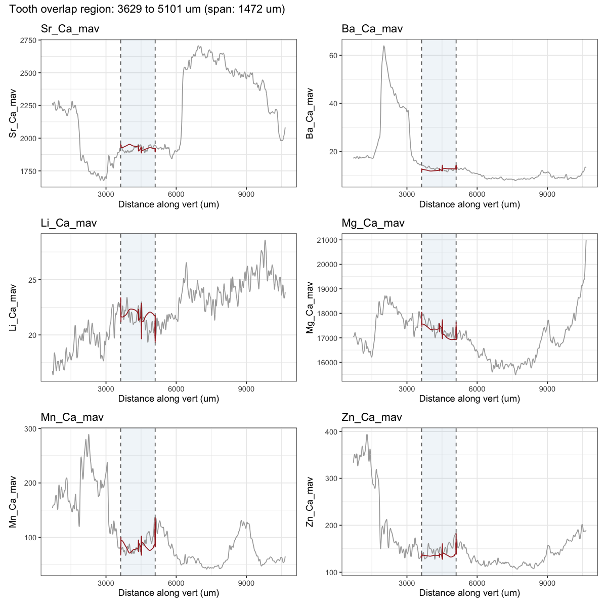
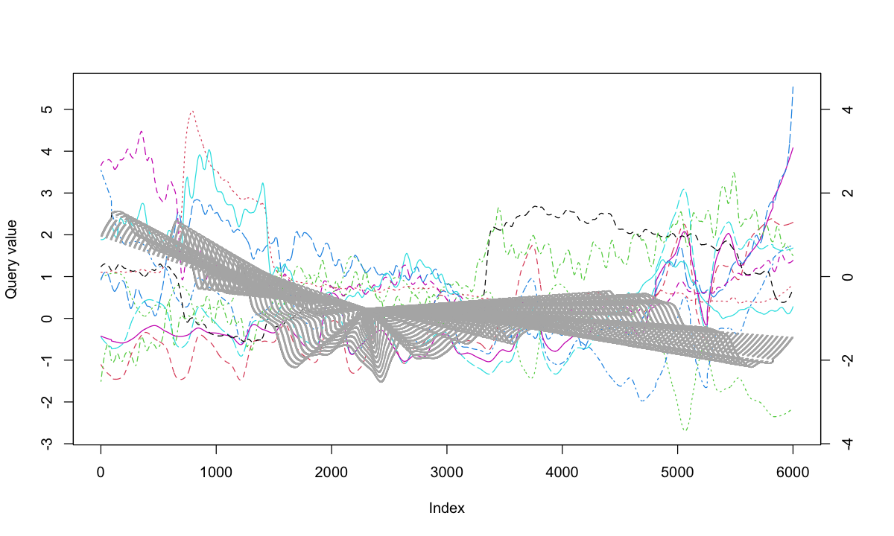

06f · DTW plots
================
Nikki Biskis
Rendered 24 Oct 2026 19:16

- [SMA001 water: all six elements (`mult1h6` from
  06b)](#sma001-water-all-six-elements-mult1h6-from-06b)

- **Paper:** The potential of elemental analysis in determining origin
  of sawfish rostra
- **DOI:** tbd
- **Written:** 30 Aug 2026
- **Content:** dynamic time warping IV: output plots

R markdown version of `06f_dtw_plots.R`. It starts from the objects 06b
saved (`data/output/dtw_cache/06b.RData`).

``` r
source('helpers/functions/fxn_dtw.R')
source('helpers/functions/fxn_mavs.R')
source('helpers/microHelp.R')
load('data/output/dtw_cache/06b.RData') # objects from 06b (mult1h6, SMA001T_filt, SMA001V_filt, mavs2)
```

<details>
<summary>
Show the function
</summary>

``` r
plot_overlap <- function(alignment, datT, datV, elements, spanT, spanV, n = 2000){
  
  datT <- datT[order(datT$true_dist), ]
  datV <- datV[order(datV$true_dist), ]
  
  if(length(spanT) == 1) spanT <- setNames(rep(spanT, length(elements)), elements)
  if(length(spanV) == 1) spanV <- setNames(rep(spanV, length(elements)), elements)
  
  for(element in elements) {
    smooth_col <- paste0(element, "_smooth")
    datT[[smooth_col]] <- predict(loess(datT[[element]] ~ datT$true_dist, span = spanT[[element]]))
    datV[[smooth_col]] <- predict(loess(datV[[element]] ~ datV$true_dist, span = spanV[[element]]))
  }
  
  tooth_idx <- round(seq(1, nrow(datT), length.out = n))
  vert_idx  <- round(seq(1, nrow(datV), length.out = n))
  
  vert_start <- datV$true_dist[vert_idx[alignment$index2[1]]]
  vert_end   <- datV$true_dist[vert_idx[alignment$index2[length(alignment$index2)]]]
  
  plots <- list()
  for(element in elements){
    smooth_col <- paste0(element, "_smooth")
    
    df_vert <- data.frame(distance = datV$true_dist, value = datV[[smooth_col]])
    df_tooth <- data.frame(
      distance = datV$true_dist[vert_idx[alignment$index2]],
      value = datT[[smooth_col]][tooth_idx[alignment$index1]]
    )
    
    vert_region <- df_vert[df_vert$distance >= vert_start & df_vert$distance <= vert_end, ]
    y_scale <- diff(range(vert_region$value, na.rm = TRUE)) / diff(range(df_tooth$value, na.rm = TRUE))
    y_offset <- min(vert_region$value, na.rm = TRUE) - min(df_tooth$value, na.rm = TRUE) * y_scale
    df_tooth$value <- df_tooth$value * y_scale + y_offset
    
    cat(element, "y_scale:", y_scale, "y_offset:", y_offset,
        "| vert_region range:", range(vert_region$value, na.rm = TRUE),
        "| df_tooth range (post-scale):", range(df_tooth$value, na.rm = TRUE), "\n")
    
    plots[[element]] <- ggplot() +
      ggplot2::annotate("rect", xmin = vert_start, xmax = vert_end, ymin = -Inf, ymax = Inf,
               fill = "steelblue", alpha = 0.08) +
      geom_vline(xintercept = c(vert_start, vert_end), linetype = "dashed", color = "grey40") +
      geom_line(data = df_vert, aes(distance, value), color = "darkgrey") +
      geom_line(data = df_tooth, aes(distance, value), color = "brown") +
      theme_bw() +
      labs(x = "Distance along vert (um)", y = element, title = element)
  }
  
  wrap_plots(plots, ncol = 2) +
    plot_annotation(
      title = sprintf("Tooth overlap region: %.0f to %.0f um (span: %.0f um)",
                      vert_start, vert_end, vert_end - vert_start)
    )
}
```

</details>

## SMA001 water: all six elements (`mult1h6` from 06b)

``` r
plot_overlap(mult1h6, SMA001T_filt, SMA001V_filt, 
             mavs2, spanT = 0.04, spanV = 0.01, n = 6000)
```

    #> Sr_Ca_mav y_scale: 0.1413836 y_offset: 1613.699 | vert_region range: 1886.728 1952.906 | df_tooth range (post-scale): 1886.728 1952.906 
    #> Ba_Ca_mav y_scale: 0.3044996 y_offset: 10.45039 | vert_region range: 11.49068 14.26743 | df_tooth range (post-scale): 11.49068 14.26743 
    #> Li_Ca_mav y_scale: 0.09311985 y_offset: 16.75754 | vert_region range: 19.33602 23.39483 | df_tooth range (post-scale): 19.33602 23.39483 
    #> Mg_Ca_mav y_scale: 0.05739403 y_offset: 16372.74 | vert_region range: 16921.93 18042.75 | df_tooth range (post-scale): 16921.93 18042.75 
    #> Mn_Ca_mav y_scale: 0.7898019 y_offset: 55.98027 | vert_region range: 66.91383 136.236 | df_tooth range (post-scale): 66.91383 136.236 
    #> Zn_Ca_mav y_scale: 0.06356265 y_offset: 122.6798 | vert_region range: 127.6683 182.8826 | df_tooth range (post-scale): 127.6683 182.8826

<!-- -->

``` r
plot(mult1h6, type = "twoway", offset = 1)
```

<!-- -->
