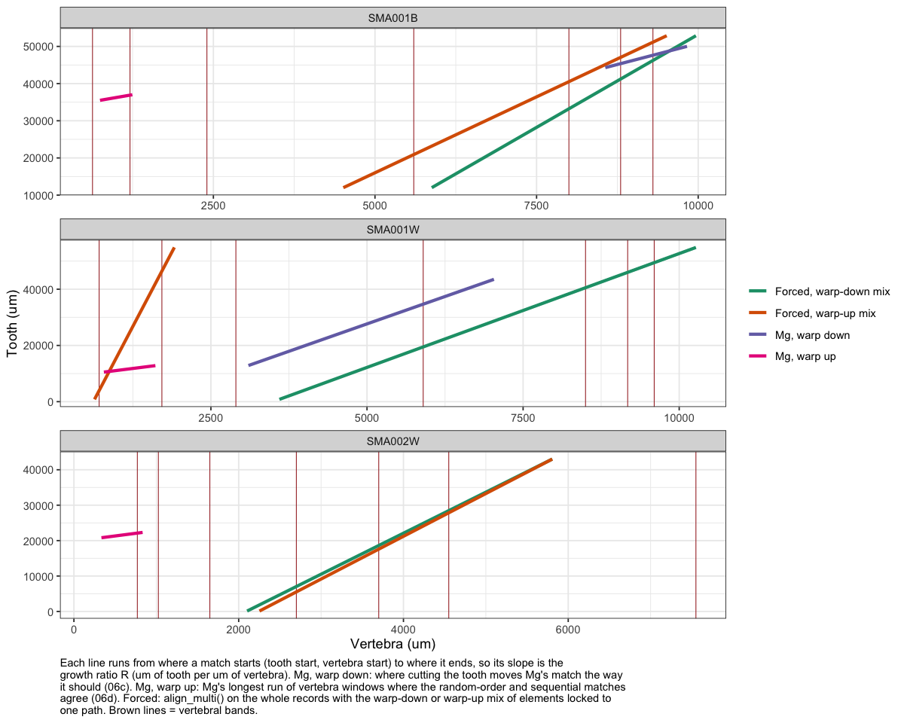
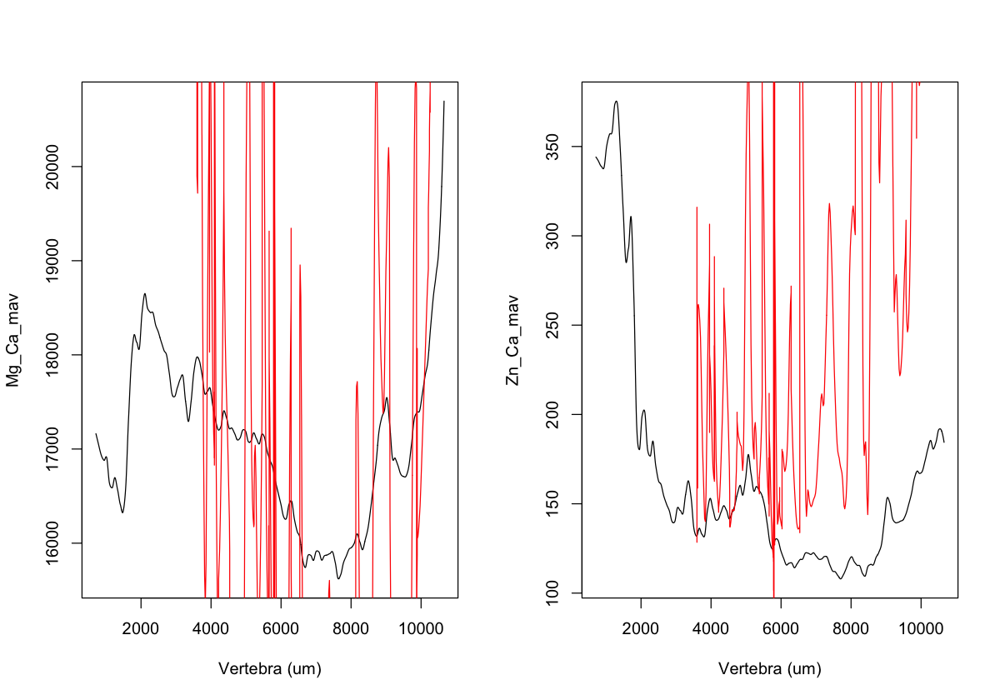
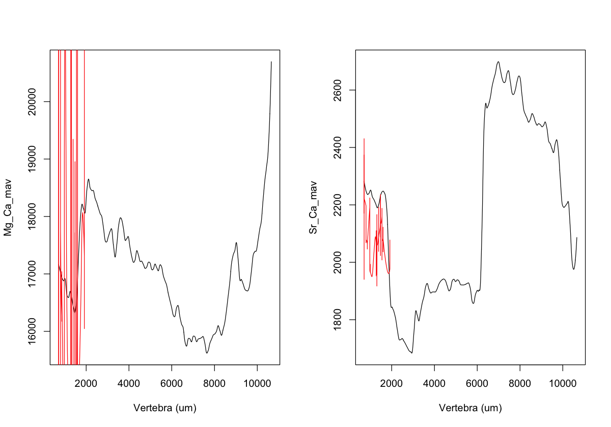
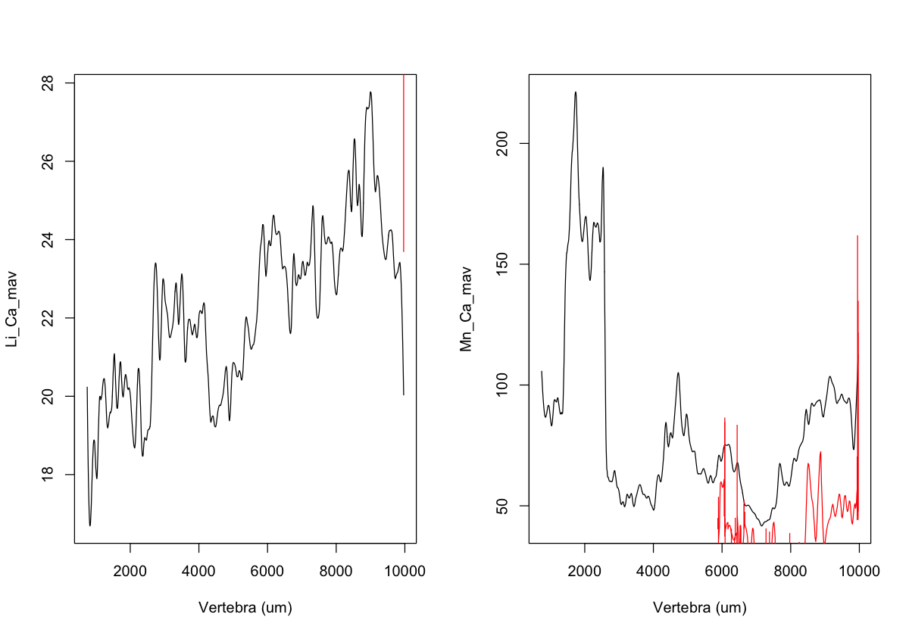
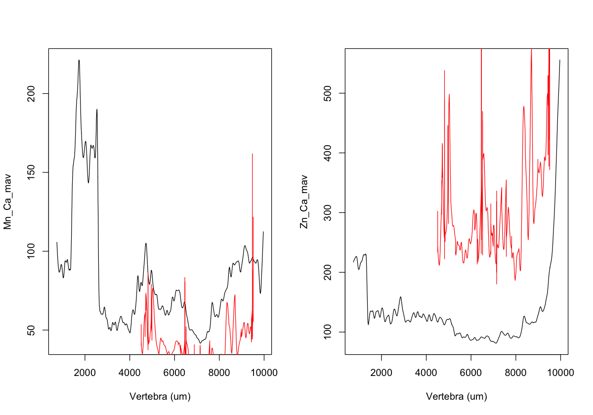
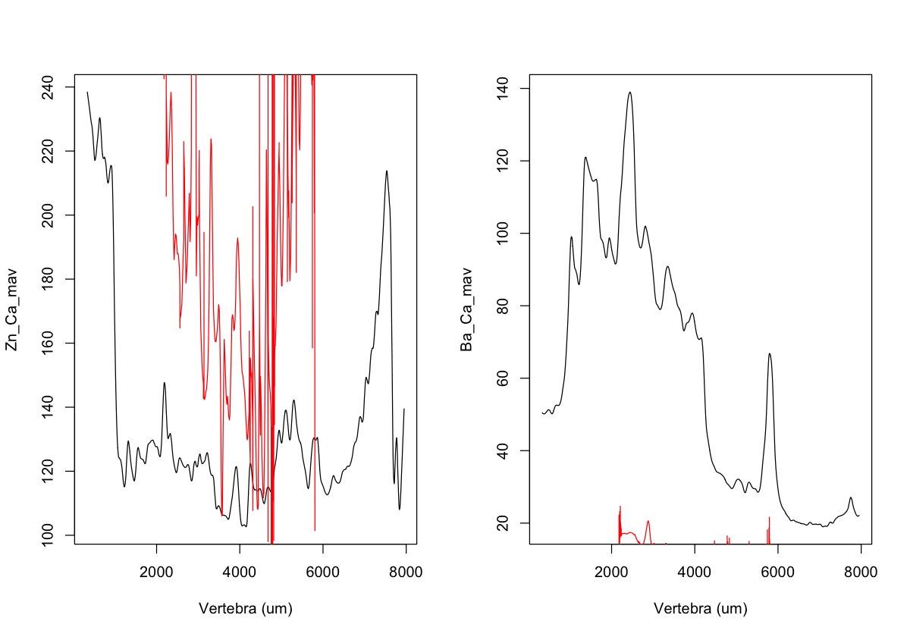

06f · DTW final figures
================
Nikki Biskis
Rendered 26 Oct 2026 20:43

- [The four matches](#the-four-matches)
- [Forced alignments](#forced-alignments)
  - [SMA001 (water)](#sma001-water)
  - [SMA001 (bleach)](#sma001-bleach)
  - [SMA002 (water)](#sma002-water)

- **Paper:** The potential of elemental analysis in determining origin
  of sawfish rostra
- **DOI:** tbd
- **Written:** 30 Aug 2026 (final figures Oct 2026)
- **Content:** dynamic time warping VI: figures for the four matches in
  06e

Starts from 06a, 06c, 06d and 06e (`data/output/dtw_cache/`). The
earlier version is in `original/06f_dtw_plots.R`.

``` r
source('helpers/microHelp.R')
source('helpers/functions/fxn_mavs.R')
source('helpers/functions/fxn_dtw.R')
load('data/output/dtw_cache/06a.RData') # objects from 06a
load('data/output/dtw_cache/06c.RData') # sets, gap_um, down, down_mix from 06c
load('data/output/dtw_cache/06d.RData') # up_mix from 06d
load('data/output/dtw_cache/06e.RData') # final_tab, force_align from 06e
```

## The four matches

``` r
p <- ggplot(final_tab[!is.na(final_tab$vert_from), ],
            aes(x = vert_from, xend = vert_to, y = tooth_from, yend = tooth_to, colour = match)) +
  geom_vline(data = do.call(rbind, lapply(names(sets), function(n) data.frame(set = n, band = sets[[n]]$bands))),
             aes(xintercept = band), colour = "brown", linewidth = 0.3) +
  geom_segment(linewidth = 1.2, position = position_dodge2(width = 300)) +
  facet_wrap(~ set, ncol = 1, scales = "free") +
  scale_colour_manual(values = c("Mg, warp down" = "#7570b3", "Mg, warp up" = "#e7298a",
                                 "Forced, warp-down mix" = "#1b9e77", "Forced, warp-up mix" = "#d95f02")) +
  theme_bw() +
  theme(plot.caption = element_text(hjust = 0)) +
  labs(x = "Vertebra (um)", y = "Tooth (um)", colour = NULL,
       caption = paste(strwrap(paste(
         "Each line runs from where a match starts (tooth start, vertebra start) to where it ends, so its",
         "slope is the growth ratio R (um of tooth per um of vertebra). Mg, warp down: where cutting the tooth",
         "moves Mg's match the way it should (06c). Mg, warp up: Mg's longest run of vertebra windows where the",
         "random-order and sequential matches agree (06d). Forced: align_multi() on the whole records with the",
         "warp-down or warp-up mix of elements locked to one path. Brown lines = vertebral bands."), 115),
         collapse = "\n"))
dir.create('figures/dtw', showWarnings = FALSE)
ggsave('figures/dtw/final_matches.png', p, width = 10, height = 8, dpi = 300)
p
```

<!-- -->

## Forced alignments

Each set aligned with `align_multi()` on the whole tooth and vertebra,
first with the warp-down mix, then with the warp-up mix. In each figure,
every panel is one element: the smoothed vertebra (black) with the
smoothed tooth (red) laid along it by the shared path.

### SMA001 (water)

``` r
invisible(capture.output(force_align("SMA001W", down_mix$SMA001W)))
```

<!-- -->

``` r
invisible(capture.output(force_align("SMA001W", up_mix$SMA001W)))
```

<!-- -->

### SMA001 (bleach)

``` r
invisible(capture.output(force_align("SMA001B", down_mix$SMA001B)))
```

<!-- -->

``` r
invisible(capture.output(force_align("SMA001B", up_mix$SMA001B)))
```

<!-- -->

### SMA002 (water)

``` r
invisible(capture.output(force_align("SMA002W", down_mix$SMA002W)))
```

<!-- -->

``` r
invisible(capture.output(force_align("SMA002W", up_mix$SMA002W)))
```

<!-- -->
